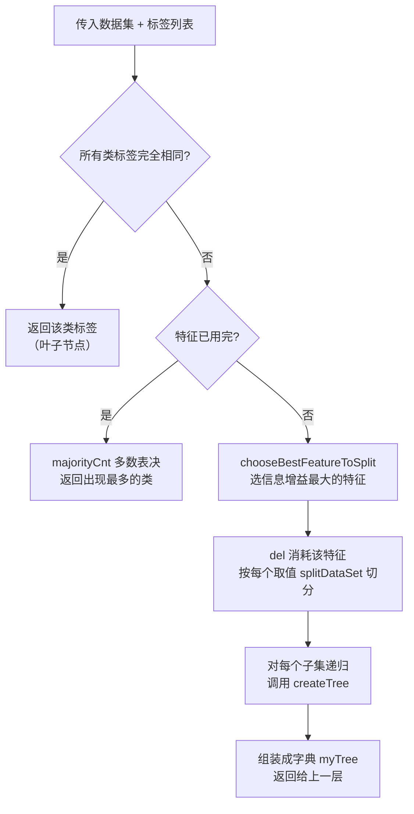

# 第 3 章 决策树

> **本章解决**：分类问题里"k-近邻给不出数据内在含义"的痛点——决策树（Decision Tree）从带标签数据中学出一棵类似"二十个问题"游戏的判定树，新样本从根节点走到叶子就得到类别，规则一目了然。本章用信息增益（ID3 算法）递归构造决策树，用 Matplotlib 注解画出树形图，用 pickle 把树存进硬盘，最后在隐形眼镜处方数据上完整实战。

你是否玩过**二十个问题**的游戏：一方在脑海里想某个事物，其他人提问，只允许提 20 个问题、答案只能是对或错，提问者通过推断分解逐步缩小范围。决策树的工作原理与此类似：用户输入一系列数据，程序沿着树判定，最后给出答案。

决策树经常用于处理分类问题，调查表明它也是**最经常使用的数据挖掘算法**之一（Giovanni Seni and John Elder, *Ensemble Methods in Data Mining*, Morgan and Claypool, 2010, p.28）。流行的原因：**不需要了解机器学习知识，就能搞明白决策树是如何工作的**——数据形式非常容易理解，这正是 k-近邻算法（第 2 章）最大的短板。专家系统中经常使用决策树，它给出的结果往往可以匹敌在当前领域有几十年工作经验的人类专家。

图 3-1 的流程图就是一个决策树：**长方形代表判断模块（decision block）**，**椭圆形代表终止模块（terminating block）**，表示已经得出结论、可以终止运行；从判断模块引出的左右箭头称作**分支（branch）**，可到达另一个判断模块或终止模块。图中是一个假想的邮件分类系统：先检测发件域名，`myEmployer.com` 直接归入"无聊时需要阅读的邮件"；否则检查内容里是否包含单词"曲棍球"——包含则归入"需要及时处理的朋友邮件"，不包含则归入"无需阅读的垃圾邮件"。

<figure>
  
  <figcaption>图 3-1 流程图形式的决策树（截自原书）</figcaption>
</figure>

本章构造的决策树算法能读取数据集合、构建类似图 3-1 的树：先讨论如何构造、如何写 Python 代码；再给出度量算法成功率的方法；然后用递归建立分类器并用 Matplotlib 绘制树形图；最后输入隐形眼镜的处方数据，由分类器预测需要的镜片类型。

## 3.0 本章导图

<div class="brtree">
  <div class="brrow">
    <span class="brlabel root">决策树（ID3）</span>
    <span class="brace"></span>
    <div class="brkids">
      <div class="brrow">
        <span class="brlabel">是什么</span>
        <span class="brace"></span>
        <div class="brkids">
          <span class="brleaf">二十个问题游戏：逐问缩小范围</span>
          <span class="brleaf">判断模块 / 终止模块 / 分支</span>
          <span class="brleaf">最常用的数据挖掘算法，结果易理解</span>
        </div>
      </div>
      <div class="brrow">
        <span class="brlabel">构造思路（3.1）</span>
        <span class="brace"></span>
        <div class="brkids">
          <span class="brleaf">选"决定性"特征划分数据集</span>
          <span class="brleaf">香农熵度量无序度（公式见 3.1.1）</span>
          <span class="brleaf">信息增益最大 = 最好的划分</span>
          <span class="brleaf">递归直到纯类 / 属性用尽（多数表决兜底）</span>
        </div>
      </div>
      <div class="brrow">
        <span class="brlabel">绘制树形图（3.2）</span>
        <span class="brace"></span>
        <div class="brkids">
          <span class="brleaf">Matplotlib annotations 注解 + 箭头</span>
          <span class="brleaf">getNumLeafs / getTreeDepth 定尺寸</span>
          <span class="brleaf">retrieveTree 预存树方便测试</span>
          <span class="brleaf">plotTree：按叶子数均分 x 轴</span>
        </div>
      </div>
      <div class="brrow">
        <span class="brlabel">分类与存储（3.3）</span>
        <span class="brace"></span>
        <div class="brkids">
          <span class="brleaf">classify：递归比较走到叶子</span>
          <span class="brleaf">featLabels.index 找特征位置</span>
          <span class="brleaf">pickle 序列化，免重复建树</span>
        </div>
      </div>
      <div class="brrow">
        <span class="brlabel">隐形眼镜实战（3.4）</span>
        <span class="brace"></span>
        <div class="brkids">
          <span class="brleaf">UCI lenses 数据：24 条 × 4 特征</span>
          <span class="brleaf">tearRate 作根，最多问 4 个问题</span>
          <span class="brleaf">过拟合 → 裁剪（第 9 章）</span>
        </div>
      </div>
      <div class="brrow">
        <span class="brlabel">算法谱系</span>
        <span class="brace"></span>
        <div class="brkids">
          <span class="brleaf">ID3：信息增益、多分支、只吃标称型</span>
          <span class="brleaf">C4.5 / CART：第 9 章再会</span>
        </div>
      </div>
    </div>
  </div>
</div>

## 3.1 决策树的构造

| 决策树 | 说明 |
| --- | --- |
| 优点 | 计算复杂度不高，输出结果易于理解，对中间值的缺失不敏感，可以处理不相关特征数据 |
| 缺点 | 可能会产生过度匹配（overfitting）问题 |
| 适用数据类型 | 数值型和标称型 |

!!! note "拓展：'适用数值型'要打个折"
    优缺点框里写适用"数值型和标称型"，但 3.1 节紧接着就会说明：**树构造算法只适用于标称型数据，数值型数据必须离散化**才能用。ID3 并不直接吃连续数值，所谓"适用数值型"指的是先量化离散化之后的情形。这也是 ID3 的主要局限之一（3.4 节会再提）。

本节先讨论数学上如何用信息论划分数据集，然后写代码把理论应用到具体数据集上，最后编写代码构建决策树。构造决策树要解决的第一个问题：**当前数据集上哪个特征在划分数据分类时起决定性作用**。为了找到决定性特征、划分出最好的结果，必须评估每个特征；完成测试之后，原始数据集就被划分为几个数据子集，分布在第一个决策点的所有分支上。如果某个分支下的数据属于同一类型，则已正确划分、无需继续分割；若不属于同一类型，则重复划分子集的过程——划分子集的方法与划分原始数据集相同，直到所有具有相同类型的数据均在一个子集内。

创建分支的伪代码函数 createBranch() 如下（注意倒数第二行它直接调用了自己，是**递归函数**）：

```text
检测数据集中的每个子项是否属于同一分类：
If so return 类标签
Else
    寻找划分数据集的最好特征
    划分数据集
    创建分支节点
        for 每个划分的子集
            调用函数 createBranch 并增加返回结果到分支节点中
    return 分支节点
```

**决策树的一般流程**：

1. 收集数据：可以使用任何方法。
2. 准备数据：树构造算法只适用于标称型数据，因此数值型数据必须离散化。
3. 分析数据：可以使用任何方法，构造树完成之后，应检查图形是否符合预期。
4. 训练算法：构造树的数据结构。
5. 测试算法：使用经验树计算错误率。
6. 使用算法：此步骤可适用于任何监督学习算法，而使用决策树可以更好地理解数据的内在含义。

一些决策树算法采用**二分法**划分数据，本书不采用：若依据某个属性划分会产生 4 个可能的值，就把数据划分成四块、创建四个分支。本书使用 **ID3 算法**划分数据集，它处理"如何划分数据集"与"何时停止划分"两个问题；每次划分只选取一个特征属性。

那么如果训练集中有 20 个特征，第一次选哪个特征作为划分的参考属性？表 3-1 的数据包含 5 个海洋动物，特征为"不浮出水面是否可以生存"与"是否有脚蹼"，要把动物分成鱼类和非鱼类两类——先凭肉眼判断该依据第一个还是第二个特征划分，下一小节给出量化方法。

| 样本 | 不浮出水面是否可以生存 | 是否有脚蹼 | 属于鱼类 |
| :---: | :---: | :---: | :---: |
| 1 | 是 | 是 | 是 |
| 2 | 是 | 是 | 是 |
| 3 | 是 | 否 | 否 |
| 4 | 否 | 是 | 否 |
| 5 | 否 | 是 | 否 |

### 3.1.1 信息增益

划分数据集的大原则：**将无序的数据变得更加有序**。可以采用多种方法划分数据集，各有优缺点。组织杂乱无章数据的一种方法就是用**信息论**度量信息——信息论（information theory）是量化处理信息的分支科学，可以在划分数据之前或之后量化度量信息的内容。

在划分数据集之前之后信息发生的变化称为**信息增益（information gain）**，知道如何计算信息增益，就能计算每个特征值划分数据集获得的信息增益，**获得信息增益最高的特征就是最好的选择**。

集合信息的度量方式称为**香农熵**或者简称为**熵（entropy）**，这个名字来源于信息论之父克劳德·香农（Claude Shannon）。

!!! note "侧栏：克劳德·香农"
    香农被公认为二十世纪最聪明的人之一。威廉·庞德斯通在 2005 年出版的《财富公式》一书中写道："贝尔实验室和 MIT 有很多人将香农和爱因斯坦相提并论，而其他人则认为这种对比是不公平的——对香农是不公平的。"

如果看不明白信息增益和熵，不要着急——它们自诞生之日起就注定令世人费解。香农写完信息论之后，约翰·冯·诺依曼建议使用"熵"这个术语，理由是**"大家都不知道它是什么意思"**。

熵定义为**信息的期望值**，在明晰这个概念之前必须先知道信息的定义。如果待分类的事物可能划分在多个分类之中，则符号 \(x_i\) 的信息定义为

\[
l(x_i) = -\log_2 p(x_i)
\]

其中 \(p(x_i)\) 是选择该分类的概率。为了计算熵，需要计算所有类别所有可能值包含的信息期望值，通过下面的公式得到：

\[
H = -\sum_{i=1}^{n} p(x_i)\log_2 p(x_i)
\]

其中 \(n\) 是分类的数目。

!!! note "拓展：熵到底在量什么"
    \(-\log_2 p\) 叫**自信息**：一件事概率越小，发生它所携带的信息量越大（概率 1/2 的事件信息 1 比特，概率 1/16 的事件信息 4 比特）。把每个类别按概率加权平均，就得到熵——它等于"猜对一个样本所需的是/否问题的最少个数"（单位：比特）。**数据越混杂、类别分布越均匀，熵越大；全体同类，熵为 0**。所以"让数据更有序"就是"让熵降下来"，这就是划分的大原则。

!!! note "拓展：信息增益就是'不确定性下降量'"
    信息增益 = 划分前的熵 − 按特征 A 划分后的条件熵（加权平均各分片的熵）。它衡量"知道特征 A 的取值之后，类别的不确定性减少了多少"。决策树里它也叫互信息；sklearn 文档里的 information gain 与这里是同一个概念。

下面用 Python 计算信息熵。创建名为 trees.py 的文件，录入程序清单 3-1，其功能是计算给定数据集的香农熵：

```python
# ===== 书 3.1.1 程序清单 3-1 =====
from math import log

def calcShannonEnt(dataSet):
    # 计算给定数据集的香农熵
    numEntries = len(dataSet)          # 数据集中实例总数:显式保存,后面多次用到,提高效率
    labelCounts = {}                   # 字典:键 = 类别标签,值 = 该类别出现次数
    for featVec in dataSet:
        currentLabel = featVec[-1]     # 取每个实例的最后一列(类别标签)
        if currentLabel not in labelCounts.keys():
            labelCounts[currentLabel] = 0   # 键不存在则扩展字典并加入
        labelCounts[currentLabel] += 1      # 该类别计数 +1
    shannonEnt = 0.0
    for key in labelCounts:
        prob = float(labelCounts[key]) / numEntries   # 该类别出现的频率,即概率
        shannonEnt -= prob * log(prob, 2)             # 以 2 为底求对数,累加期望信息
    return shannonEnt
```

!!! note "Python 2 → 3"
    `prob = float(labelCounts[key])/numEntries` 里的 `float()` 在 Python 2 是必需的（整数除法会截断），Python 3 中 `/` 本身就是真除法，写 `labelCounts[key]/numEntries` 也可以。保留写法是为了与原书一致。

利用 createDataSet() 函数得到表 3-1 的简单鱼鉴定数据集：

```python
# ===== 书 3.1.1 建立数据集 =====
def createDataSet():
    dataSet = [[1, 1, 'yes'],      # 1 号:能不浮出水面生存,有脚蹼 → 鱼类
               [1, 1, 'yes'],      # 2 号
               [1, 0, 'no'],       # 3 号:能不浮出水面生存,无脚蹼 → 非鱼类
               [0, 1, 'no'],       # 4 号:不能不浮出水面生存,有脚蹼 → 非鱼类
               [0, 1, 'no']]       # 5 号
    labels = ['no surfacing', 'flippers']   # 两个特征的含义
    return dataSet, labels
```

在 Python 命令提示符下测试：

```python
# ===== 书 3.1.1 测试:熵随分类混杂度变化 =====
import trees
myDat, labels = trees.createDataSet()
print(trees.calcShannonEnt(myDat))   # 0.9709505944546686(与书 0.9709505944546675 仅末位浮点误差)

myDat[0][-1] = 'maybe'               # 换入第 3 个分类,增加数据的混杂度
print(trees.calcShannonEnt(myDat))   # 1.3709505944546687
```

<figure>
  
  <figcaption>图 3-2 程序清单 3-1/3-3 的交互输出：熵与最优特征（代码实跑）</figcaption>
</figure>

熵越高，混合的数据也越多。往数据集里添加更多分类，熵就升高：5 条数据 2 鱼 3 非鱼时熵约 0.971；换入 `maybe`（1 鱼 1 非 1 maybe + 2 非）后分类变多、混杂度增大，熵升到约 1.371。

!!! note "拓展：基尼不纯度（Gini impurity）"
    另一个度量集合无序程度的方法是基尼不纯度：从一个数据集中随机选取子项，度量其被错误分类到其他分组里的概率。本书不采用基尼不纯度，不再展开（想深入了解可参考 Pan-Ning Tan, Vipin Kumar and Michael Steinbach, *Introduction to Data Mining*, Pearson Education, 2005, p.158）。第 9 章的 CART 算法用的正是它。

得到熵之后，就可以按获取最大信息增益的方法划分数据集。下一小节学习如何划分数据集以及如何度量信息增益。

### 3.1.2 划分数据集

上节学了度量数据集的无序程度，分类算法除了测量信息熵，还需要**划分数据集、度量划分后数据集的熵**，以便判断当前是否正确地划分了数据集：对每个特征划分数据集的结果计算一次信息熵，判断按哪个特征划分是最好的划分方式。想象二维空间的数据散点图，要在数据之间划条线分成两部分——按 x 轴还是 y 轴划线？答案就是本节内容。

打开文本编辑器，在 trees.py 中输入程序清单 3-2：

```python
# ===== 书 3.1.2 程序清单 3-2 =====
def splitDataSet(dataSet, axis, value):
    # 按照给定特征划分数据集
    # 三个输入参数:待划分的数据集、划分数据集的特征(轴)、需要返回的特征的值
    retDataSet = []                    # 新建列表对象:见下方说明
    for featVec in dataSet:
        if featVec[axis] == value:     # 发现符合要求的值
            reducedFeatVec = featVec[:axis]        # 抽取:该特征之前的所有元素
            reducedFeatVec.extend(featVec[axis+1:])  # 再拼上该特征之后的所有元素
            retDataSet.append(reducedFeatVec)      # 把去掉该特征的实例加入返回列表
    return retDataSet
```

!!! warning "Python 传参是列表引用"
    Python 在函数中传递的是**列表的引用**，在函数内部对列表对象的修改会影响该列表对象的整个生存周期。splitDataSet() 会在同一数据集上被调用多次，为了不修改原始数据集，函数开头必须声明一个**新列表对象** retDataSet。这个坑在 createTree 里还会再出现一次（见"坑与陷阱"）。

代码使用了列表类型自带的 `extend()` 和 `append()` 方法。两个方法功能类似，但处理多个列表时结果完全不同：假定存在两个列表 a 和 b：

```python
# ===== 书 3.1.2 侧例:append 与 extend 的区别 =====
a = [1, 2, 3]
b = [4, 5, 'x']
a.append(b)   # a = [1, 2, 3, [4, 5, 'x']]  得到第 4 个元素,且它本身也是一个列表
c = [1, 2, 3]
c.extend(b)   # c = [1, 2, 3, 4, 5, 'x']    得到包含 a 和 b 所有元素的一个列表
```

!!! note "拓展：append 与 extend 的成本"
    `append` 把整个对象当一个元素压入，平均 O(1)；`extend` 逐个迭代并追加，总代价与 b 的长度成正比。混淆二者最典型的后果就是把"平铺合并"写成了"嵌套列表"，后续按索引取特征时会错位。

接下来遍历整个数据集，循环计算香农熵和 splitDataSet()，找到最好的特征划分方式——熵计算会告诉我们如何划分数据集是最好的数据组织方式。输入程序清单 3-3：

```python
# ===== 书 3.1.2 程序清单 3-3 =====
def chooseBestFeatureToSplit(dataSet):
    # 选择最好的数据集划分方式
    numFeatures = len(dataSet[0]) - 1          # 特征数 = 每实例长度 - 1(最后一列是标签)
    baseEntropy = calcShannonEnt(dataSet)      # 原始香农熵:保存最初的无序度量值
    bestInfoGain = 0.0
    bestFeature = -1
    for i in range(numFeatures):               # 遍历所有特征
        featList = [example[i] for example in dataSet]  # 列表推导:取所有第 i 个特征值
        uniqueVals = set(featList)             # set 去重:得到该特征的所有唯一属性值
        newEntropy = 0.0
        for value in uniqueVals:               # 对每个唯一属性值划分一次数据集
            subDataSet = splitDataSet(dataSet, i, value)
            prob = len(subDataSet) / float(len(dataSet))  # 该分片占比
            newEntropy += prob * calcShannonEnt(subDataSet)  # 累加各分片加权熵
        infoGain = baseEntropy - newEntropy    # 信息增益 = 熵的减少(数据无序度的减少)
        if infoGain > bestInfoGain:            # 比较所有特征的信息增益
            bestInfoGain = infoGain
            bestFeature = i
    return bestFeature                         # 返回最好特征划分的索引值
```

!!! warning "原书笔误:numEntries 未定义"
    程序清单 3-3 原书代码中写的是 `prob = len(subDataSet)/float(numEntries)`，但该函数里**从未定义过 numEntries**，直接照抄会抛 `NameError`。官方勘误改为 `len(dataSet)`，上文代码已按勘误修正。

chooseBestFeatureToSplit() 对调用的数据有两个要求：**第一**，数据必须是由列表元素组成的列表，且所有列表元素都要具有相同的数据长度；**第二**，数据的最后一列（每个实例的最后一个元素）是当前实例的类别标签。满足要求后，函数第一行算出特征数；list 里既可以是数字也可以是字符串，不影响计算。从列表创建集合（set）是 Python 得到列表中唯一元素值的最快方法——集合类型与列表相似，唯一区别是每个值互不相同。

!!! note "拓展：set 为什么快"
    set 底层是哈希表，`set(list)` 一次 O(n) 扫描完成去重，之后成员判断、遍历都是常数级。用"先排序再去重"或手写 if-not-in 判断都是 O(n²) 起——书中这句"最快方法"在算法意义上是成立的。

测试实际输出：

```python
# ===== 书 3.1.2 测试:选择最优特征 =====
import trees
myDat, labels = trees.createDataSet()
print(trees.chooseBestFeatureToSplit(myDat))   # 0
```

代码运行结果告诉我们，**第 0 个特征是最好的用于划分数据集的特征**。实跑补上每个特征的增益，看得更清楚：特征 0 的信息增益为 0.4199731，特征 1 只有 0.1709506（见图 3-2）。这个结果是否有实际意义？回头再看表 3-1 的数据：

!!! warning "原书笔误:表 1-1"
    原书正文此处写"让我们回头再看一下表 1-1"，应为**表 3-1**（本章海洋生物数据表），原书排印错误。

- 按**第 0 个特征**（是否不浮出水面可生存）划分：取值 1 的分组（样本 1、2、3）有两类鱼、一类非鱼；取值 0 的分组（样本 4、5）全部是非鱼——后者已经完全同类；
- 按**第 1 个特征**（是否有脚蹼）划分：取值 1 的分组（样本 1、2、4、5）有两条鱼、两条非鱼；取值 0 的分组（样本 3）只有一个非鱼——第一种划分更好地处理了相关数据。

不相信目测结果的话，可以用 calcShannonEnt() 函数测试不同特征分组的输出结果。

### 3.1.3 递归构建决策树

前面已经得到构造决策树所需的子功能模块，工作原理：得到原始数据集，基于最好的属性值划分数据集；由于特征值可能多于两个，可能存在大于两个分支的划分。第一次划分之后，数据向下传递到树分支的下一个节点，在这个节点上再次划分——因此采用**递归**的原则处理数据集。

**递归结束的条件**：程序遍历完所有划分数据集的属性，或者每个分支下的所有实例都具有相同的分类。若所有实例具有相同的分类，则得到一个**叶子节点**（或终止块）；任何到达叶子节点的数据必然属于叶子节点的分类，参见图 3-3。

<figure>
  
  <figcaption>图 3-3 划分数据集时的数据路径（原书图 3-2，截自原书）</figcaption>
</figure>

第一个结束条件使算法可以终止，甚至可以设置算法划分的最大分组数目。后续章节还会介绍其他决策树算法（如 C4.5 和 CART），它们在运行时**并不总是在每次划分分组时都消耗特征**；由于特征数目并不是每次划分都减少，这些算法在实际使用时可能引起一定的问题。目前只需在算法开始运行前计算列的数目，查看算法是否使用了所有属性即可。如果数据集已经处理了所有属性，但类标签依然不是唯一的，需要决定如何定义该叶子节点——此时通常采用**多数表决**的方法决定该叶子节点的分类。

递归建树的完整判定流程：



先在 trees.py 文件顶部增加一行 `import operator`，然后添加多数表决函数：

```python
# ===== 书 3.1.3 多数表决 =====
import operator

def majorityCnt(classList):
    # 使用分类名称的列表,返回出现次数最多的分类名称
    classCount = {}                        # 键 = 类标签,值 = 出现频率
    for vote in classList:
        if vote not in classCount.keys():
            classCount[vote] = 0
        classCount[vote] += 1
    sortedClassCount = sorted(classCount.items(),
                              key=operator.itemgetter(1), reverse=True)
    return sortedClassCount[0][0]          # 出现次数最多的类标签
```

!!! warning "Python 2 → 3:iteritems()"
    原书代码是 `classCount.iteritems()`，Python 3 中字典已移除该方法，须改为 `classCount.items()`（上文已改）。这段投票表决代码与第 2 章 classify0 部分的投票逻辑非常类似：统计频率，用 operator 按值排序，取第一名。

输入程序清单 3-4，创建树的函数：

```python
# ===== 书 3.1.3 程序清单 3-4 =====
def createTree(dataSet, labels):
    # 创建树:输入 = 数据集 + 标签列表(标签只为数据含义明确,算法本身不需要它)
    classList = [example[-1] for example in dataSet]   # 数据集的所有类标签
    # 停止条件 1:所有类标签完全相同 → 直接返回该类标签(叶子节点)
    if classList.count(classList[0]) == len(classList):
        return classList[0]
    # 停止条件 2:用完了所有特征仍不能划分成唯一类别 → 多数表决
    if len(dataSet[0]) == 1:
        return majorityCnt(classList)
    bestFeat = chooseBestFeatureToSplit(dataSet)       # 当前最好的划分特征
    bestFeatLabel = labels[bestFeat]
    myTree = {bestFeatLabel: {}}                       # 字典存储树的所有信息
    del(labels[bestFeat])                              # 划分后消耗掉该特征
    featValues = [example[bestFeat] for example in dataSet]
    uniqueVals = set(featValues)                       # 该特征的所有属性值
    for value in uniqueVals:                           # 遍历每个属性值,递归建子树
        subLabels = labels[:]                          # 复制类标签!防止原列表被修改
        myTree[bestFeatLabel][value] = createTree(
            splitDataSet(dataSet, bestFeat, value), subLabels)
    return myTree
```

!!! danger "已知问题:del(labels[bestFeat]) 是就地变异"
    createTree 里 `del(labels[bestFeat])` 直接**修改了调用方传入的 labels 列表**。函数返回后，外层的 labels 已经少了被消耗的特征。实测：执行完 `myTree = createTree(myDat, labels)` 后再调用 `classify(myTree, labels, [1,0])` 会抛 `ValueError: 'no surfacing' is not in list`，因为根特征已从 labels 里被删掉。书上的示例能"看起来正常"，只是因为示例紧接着重新取了数据。防御方法：调用前自己复制一份 `labels2 = labels[:]` 传给 createTree（3.3.1 与 3.4 节的演示都这么做）。书中在循环里 `subLabels = labels[:]` 只保护了**递归调用**不受污染，管不住这一行对当前层的删除。

!!! note "拓展：为什么用字典存树"
    树完全可以声明特殊的数据类型（如节点类）来存储，但 Python 内嵌字典现成、可序列化、`{'特征': {取值: 子树}}` 的嵌套格式天然表达了"判断节点—分支"结构，绘制树形图也靠它。代价是可读性随深度下降（3.4 节的 lenses 树打印出来是一大行嵌套字典），且没做任何"这条边对应哪个取值"的显式建模——值都藏在键里。工业实现（如 sklearn）用数组存节点，效率高得多；学习阶段用字典最直观。

测试实际输出：

```python
# ===== 书 3.1.3 测试:建树 =====
import trees
myDat, labels = trees.createDataSet()
myTree = trees.createTree(myDat, labels)
print(myTree)
# {'no surfacing': {0: 'no', 1: {'flippers': {0: 'no', 1: 'yes'}}}}
```

变量 myTree 包含很多代表树结构信息的**嵌套字典**：从左边开始，第一个关键字 `no surfacing` 是第一个划分数据集的特征名称，其值是另一个字典；第二个关键字是 no surfacing 特征划分的数据集，这些关键字的值是 no surfacing 节点的子节点。值可能是**类标签**——则该子节点是叶子节点；也可能是**另一个数据字典**——则子节点是一个判断节点，这种格式不断重复就构成整棵树。本例这棵树包含 3 个叶子节点和 2 个判断节点。

## 3.2 在 Python 中使用 Matplotlib 注解绘制树形图

上节从数据集创建了树，但字典的表示形式非常不易于理解，直接绘制图形也比较困难。决策树的主要优点就是**直观易于理解**，如果不能将其直观地显示出来，就无法发挥其优势。Python 并没有提供绘制树的工具，必须自己绘制。本节要画出如图 3-4（原书图 3-3）所示的决策树。

<figure>
  
  <figcaption>图 3-4 决策树的范例（原书图 3-3，截自原书）</figcaption>
</figure>

### 3.2.1 Matplotlib 注解

Matplotlib 提供了一个注解工具 **annotations**，非常有用：它可以在数据图形上添加文本注释。注解通常用于解释数据的内容；由于数据上面直接压文本描述非常丑陋，该工具内嵌支持**带箭头的划线工具**，可以在其他恰当位置画箭头指向数据、并在那里添加描述信息。如图 3-5（原书图 3-4）：在坐标 (0.2, 0.1) 处有一个点，把对该点的描述放在 (0.35, 0.3) 处，并用箭头指向数据点 (0.2, 0.1)。

<figure>
  
  <figcaption>图 3-5 Matplotlib 注解示例（原书图 3-4，截自原书）</figcaption>
</figure>

!!! note "侧栏：绘制还是图形化"
    为什么用"绘制（plot）"而不说"图形化（graph）"？英语单词 graph 在某些学科中有特定含义：应用数学中，一系列由边连接在一起的对象或节点称为图，节点的任意联系都可以通过边连接；计算机科学中，图是一种数据结构，用于表示数学上的概念。汉语不存在这些混淆，本书统一使用"绘制树形图"。

本书将使用 Matplotlib 的注解功能绘制树形图：它可以对文字着色并提供多种形状供选择，而且可以反转箭头，让它指向文本框而不是数据点。创建名为 treePlotter.py 的新文件，输入程序清单 3-5：

```python
# ===== 书 3.2.1 程序清单 3-5 =====
import matplotlib.pyplot as plt

decisionNode = dict(boxstyle="sawtooth", fc="0.8")   # 判断节点:锯齿框,灰度 0.8
leafNode = dict(boxstyle="round4", fc="0.8")         # 叶节点:圆角框,灰度 0.8
arrow_args = dict(arrowstyle="<-")                   # 箭头样式

def plotNode(nodeTxt, centerPt, parentPt, nodeType):
    # 绘制带箭头的注解:parentPt 指向 centerPt
    createPlot.ax1.annotate(nodeTxt,
                            xy=parentPt, xycoords='axes fraction',
                            xytext=centerPt, textcoords='axes fraction',
                            va="center", ha="center",
                            bbox=nodeType, arrowprops=arrow_args)

def createPlot():
    # 第一个版本的 createPlot:先画两个不同类型的树节点示例
    fig = plt.figure(1, facecolor='white')
    fig.clf()
    createPlot.ax1 = plt.subplot(111, frameon=False)   # 无坐标轴的绘图区
    plotNode('a decision node', (0.5, 0.1), (0.5, 0.8), decisionNode)
    plotNode('a leaf node', (0.8, 0.1), (0.3, 0.8), leafNode)
    plt.show()
```

!!! note "拓展：createPlot.ax1 这个'全局变量'是什么"
    plotNode 里用到了 createPlot.ax1，但 ax1 并不是 plotNode 的参数——它被挂在**函数对象 createPlot 的属性**上（Python 的函数也是对象，可以任意挂属性），相当于手工实现的"模块级全局变量"。原书说"Python 语言中所有的变量默认都是全局有效的"，这句话并不严谨：真正的规则是**函数内部可以读全局名字**，而这里靠的正是把绘图区存到 `createPlot.ax1` 这个函数属性上，plotNode 才能在任何地方访问它。想复用这段代码时，记住 createPlot 必须先执行一次给 ax1 赋值，否则 plotNode 会抛 AttributeError。

测试：在 Python 命令提示符下导入 treePlotter 模块并执行：

```python
# ===== 书 3.2.1 测试 =====
import treePlotter
treePlotter.createPlot()   # 输出如图 3-6;可改动 plotNode 的 x、y 位置观察变化
```

<figure>
  
  <figcaption>图 3-6 函数 plotNode 的例子（原书图 3-5，截自原书）</figcaption>
</figure>

### 3.2.2 构造注解树

绘制一棵完整的树需要一些技巧：虽然有 x、y 坐标，但如何放置所有树节点是个问题。必须知道**有多少个叶节点**（以便正确确定 x 轴的长度），还需要知道**树有多少层**（以便正确确定 y 轴的高度）。这里定义两个新函数 getNumLeafs() 和 getTreeDepth()，参见程序清单 3-6，添加到 treePlotter.py 中：

```python
# ===== 书 3.2.2 程序清单 3-6 =====
def getNumLeafs(myTree):
    # 获取叶节点的数目
    numLeafs = 0
    firstStr = list(myTree.keys())[0]   # Python 2→3:myTree.keys()[0] 须先转 list
    secondDict = myTree[firstStr]       # 第一个关键字的值 = 子节点字典
    for key in secondDict.keys():       # 从第一个关键字出发遍历所有子节点
        if type(secondDict[key]).__name__ == 'dict':   # 测试节点数据类型是否为字典
            numLeafs += getNumLeafs(secondDict[key])   # 判断节点:递归累计
        else:
            numLeafs += 1                              # 类标签:叶节点 +1
    return numLeafs

def getTreeDepth(myTree):
    # 计算树的层数(遍历过程中遇到判断节点的个数)
    maxDepth = 0
    firstStr = list(myTree.keys())[0]
    secondDict = myTree[firstStr]
    for key in secondDict.keys():
        if type(secondDict[key]).__name__ == 'dict':
            thisDepth = 1 + getTreeDepth(secondDict[key])
        else:
            thisDepth = 1
        if thisDepth > maxDepth:
            maxDepth = thisDepth
    return maxDepth

def retrieveTree(i):
    # 输出预先存储的树信息:避免每次测试都要从数据中建树的麻烦
    listOfTrees = [{'no surfacing': {0: 'no',
                                     1: {'flippers': {0: 'no', 1: 'yes'}}}},   # 树 0
                   {'no surfacing': {0: 'no',
                                     1: {'flippers': {0: {'head': {0: 'no', 1: 'yes'}},
                                                      1: 'no'}}}}]             # 树 1
    return listOfTrees[i]
```

!!! note "Python 2 → 3:dict_keys 不可下标"
    原书 `firstStr = myTree.keys()[0]` 在 Python 2 可行（keys() 返回列表），Python 3 的 keys() 返回视图对象、不能 `[0]`，须写 `list(myTree.keys())[0]`。用 `type(...).__name__ == 'dict'` 判断节点类型是书的原写法；用 isinstance(secondDict[key], dict) 更 Pythonic，效果相同。

!!! note "retrieveTree 的两棵预存树"
    listOfTrees 里存了两棵树：树 0（2 层，3 叶）与树 1（3 层，4 叶，多出 head 判断节点，画出来即图 3-4 的范例树）。测试：`getNumLeafs(retrieveTree(0))` 返回 3（等于树 0 的叶子节点数），`getTreeDepth(retrieveTree(0))` 也能正确返回树的层数 2；对树 1 则分别为 4 与 3。

保存 treePlotter.py，在 Python 命令提示符下输入：

```python
# ===== 书 3.2.2 测试:取预存树并量尺寸 =====
import treePlotter
myTree = treePlotter.retrieveTree(0)
print(treePlotter.getNumLeafs(myTree))    # 3
print(treePlotter.getTreeDepth(myTree))   # 2
treePlotter.createPlot(myTree)            # 更新后的 createPlot 见程序清单 3-7
```

<figure>
  
  <figcaption>图 3-7 用 retrieveTree(0) 绘制的树形图，与图 3-8 一致（代码实跑）</figcaption>
</figure>

<figure>
  
  <figcaption>图 3-8 简单数据集绘制的树形图（原书图 3-6，截自原书，标注了示意坐标）</figcaption>
</figure>

现在把前面的方法组合起来绘制完整的树。输入程序清单 3-7（注意：前文已在文件中定义了函数 createPlot()，此处需要**更新**这部分代码）：

```python
# ===== 书 3.2.2 程序清单 3-7 =====
def plotMidText(cntrPt, parentPt, txtString):
    # 在父子节点间填充文本信息(分支取值)
    xMid = (parentPt[0] - cntrPt[0]) / 2.0 + cntrPt[0]   # 父子中点 x
    yMid = (parentPt[1] - cntrPt[1]) / 2.0 + cntrPt[1]   # 父子中点 y
    createPlot.ax1.text(xMid, yMid, txtString,
                        va="center", ha="center", rotation=30)

def plotTree(myTree, parentPt, nodeTxt):
    # 递归绘制树:先算宽高,再按叶子均分 x 轴放置节点
    numLeafs = getNumLeafs(myTree)          # 当前树的叶子数 → 决定占用宽度
    depth = getTreeDepth(myTree)            # 当前树的深度
    firstStr = list(myTree.keys())[0]
    # 判断节点位置:x 轴按其所有叶子节点居中(不是只按自己的子节点居中)
    cntrPt = (plotTree.xOff + (1.0 + float(numLeafs)) / 2.0 / plotTree.totalW,
              plotTree.yOff)
    plotMidText(cntrPt, parentPt, nodeTxt)          # 先画父子之间的分支取值文本
    plotNode(firstStr, cntrPt, parentPt, decisionNode)  # 画判断节点
    secondDict = myTree[firstStr]
    plotTree.yOff = plotTree.yOff - 1.0 / plotTree.totalD   # 自顶向下,按深度递减 y
    for key in secondDict.keys():
        if type(secondDict[key]).__name__ == 'dict':
            plotTree(secondDict[key], cntrPt, str(key))     # 判断节点:递归
        else:
            plotTree.xOff = plotTree.xOff + 1.0 / plotTree.totalW   # 叶子:右移一格
            plotNode(secondDict[key], (plotTree.xOff, plotTree.yOff),
                     cntrPt, leafNode)                      # 画叶节点
            plotMidText((plotTree.xOff, plotTree.yOff), cntrPt, str(key))
    plotTree.yOff = plotTree.yOff + 1.0 / plotTree.totalD   # 画完本层,恢复 y 偏移

def createPlot(inTree):
    # 最终版 createPlot:创建绘图区,计算全局尺寸,调用递归 plotTree
    fig = plt.figure(1, facecolor='white')
    fig.clf()
    axprops = dict(xticks=[], yticks=[])            # 隐藏 x、y 轴刻度
    createPlot.ax1 = plt.subplot(111, frameon=False, **axprops)
    plotTree.totalW = float(getNumLeafs(inTree))    # 树的总宽度 = 叶子数
    plotTree.totalD = float(getTreeDepth(inTree))   # 树的总深度 = 层数
    plotTree.xOff = -0.5 / plotTree.totalW
    plotTree.yOff = 1.0
    plotTree(inTree, (0.5, 1.0), '')
    plt.show()
```

createPlot() 是主函数，调用 plotTree()；plotTree 又依次调用 getNumLeafs/getTreeDepth 和 plotMidText。绘制树形图的很多工作都在 plotTree() 中完成：全局变量 plotTree.totalW 存储树的宽度、plotTree.totalD 存储树的深度，用这两个变量计算节点摆放位置，将树绘制在水平、垂直方向的中心位置。plotTree 也是递归函数。**树的宽度用于计算放置判断节点的位置，主要原则是将其放在所有叶子节点的中间，而不仅仅是它子节点的中间**；同时用两个全局变量 plotTree.xOff、plotTree.yOff 追踪已绘制的节点位置以及放置下一个节点的恰当位置。绘制图形的 x 轴有效范围是 0.0 到 1.0，y 轴有效范围也是 0.0～1.0——按叶子节点的数目将 x 轴划分为若干部分，从而得到当前节点的中心位置。**按图形比例绘制树形图的最大好处是无需关心实际输出图形的大小**：图形大小一旦变化，函数会自动按新尺寸重绘；若以像素为单位绘制，缩放图形就不是一件简单的工作。因为是**自顶向下**绘制图形，需要依次递减 y 坐标值（而不是递增）；绘制了所有子节点之后，再增加全局变量 y 的偏移。

变更字典再重绘，就能画出超过两个分支的树（图 3-9）：

```python
# ===== 书 3.2.2 测试:随手改树,观察重绘 =====
myTree['no surfacing'][3] = 'maybe'   # 给根节点加第 3 个分支
treePlotter.createPlot(myTree)        # 有点像一个无头的简笔画
```

<figure>
  
  <figcaption>图 3-9 超过两个分支的树形图（原书图 3-7，截自原书）</figcaption>
</figure>

也可以在树字典中随意添加一些数据，重新绘制树形图观察输出结果的变化。至此已学了构造决策树与绘制树形图的方法，下节实际使用这些方法，从数据和算法中得到新知识。

## 3.3 测试和存储分类器

到目前为止，本章的主要内容是如何从原始数据集中创建决策树并用 Matplotlib 绘制树形图，方便了解数据的真实含义。下面把重点转移到如何**利用决策树执行数据分类**，以及实际应用中如何**存储分类器**。下一节将在真实数据上使用决策树分类算法，验证它能否正确预测出患者应该使用的隐形眼镜类型。

### 3.3.1 测试算法：使用决策树执行分类

依靠训练数据构造了决策树之后，可以将它用于实际数据的分类。执行数据分类时，需要**决策树**以及**用于构造树的标签向量**。程序比较测试数据与决策树上的数值，递归执行该过程直到进入叶子节点，最后将测试数据定义为叶子节点所属的类型。将程序清单 3-8 的代码添加到 trees.py 中：

```python
# ===== 书 3.3.1 程序清单 3-8 =====
def classify(inputTree, featLabels, testVec):
    # 使用决策树的分类函数:递归比较,直到走到叶子
    firstStr = list(inputTree.keys())[0]        # 根节点特征名(Python 2→3:先转 list)
    secondDict = inputTree[firstStr]            # 根节点下的子树
    featIndex = featLabels.index(firstStr)      # 把标签字符串转换为索引:定位特征在数据中的位置
    for key in secondDict.keys():               # 遍历该特征的所有分支取值
        if testVec[featIndex] == key:           # 测试向量在 featIndex 上的值命中该分支
            if type(secondDict[key]).__name__ == 'dict':
                classLabel = classify(secondDict[key], featLabels, testVec)  # 判断节点:递归下探
            else:
                classLabel = secondDict[key]    # 叶子节点:得到分类标签
    return classLabel
```

classify 也是递归函数。存储带有特征的数据会面临一个问题：程序无法确定特征在数据集中的位置——例如前例第一个用于划分数据集的特征是 no surfacing 属性，但它在实际数据集中存储在哪个位置？是第一个属性还是第二个属性？**特征标签列表**帮助程序处理这个问题：使用 index 方法查找当前列表中第一个匹配 firstStr 变量的元素（上面的 featIndex 一行）。然后递归遍历整棵树，比较 testVec 变量中的值与树节点的值，若到达叶子节点，则返回当前节点的分类标签。

测试（注意：createTree 会就地删掉传入的 labels 里的特征，所以给 classify 用的标签要重新取一份，见"坑与陷阱"第 4 条）：

```python
# ===== 书 3.3.1 测试 =====
import trees
myDat, labels = trees.createDataSet()
myTree = trees.createTree(myDat, labels)       # labels 在此被变异
_, labels = trees.createDataSet()              # 重新取一份干净标签给 classify 用
print(trees.classify(myTree, labels, [1, 0]))  # no
print(trees.classify(myTree, labels, [1, 1]))  # yes
```

与图 3-8 比较上述输出结果：第一节点名为 no surfacing，它有两个子节点——名为 0 的叶子节点（类标签 no）和名为 flippers 的判断节点（此处进入递归调用，flippers 节点也有两个子节点）。以前绘制的树形图和此处代表树的数据结构完全相同。实跑验证：`classify(myTree, labels, [1,0])` 返回 `no`，`classify(myTree, labels, [1,1])` 返回 `yes`。

### 3.3.2 使用算法：决策树的存储

构造决策树是很耗时的任务，即使处理很小的数据集（如前面的样本数据）也要花费几秒，数据集很大时将耗费更多计算时间；然而用创建好的决策树解决分类问题，则可以很快完成。因此为节省计算时间，最好每次执行分类时调用**已经构造好的决策树**，而不是重新建树。解决这个问题需要使用 Python 模块 **pickle** 序列化对象，参见程序清单 3-9。序列化对象可以在磁盘上保存对象，并在需要的时候读取出来——**任何对象都可以执行序列化操作，字典对象也不例外**。

```python
# ===== 书 3.3.2 程序清单 3-9 =====
def storeTree(inputTree, filename):
    # 使用 pickle 模块存储决策树
    import pickle
    fw = open(filename, 'wb')     # Python 2→3:必须用 'wb' 二进制写
    pickle.dump(inputTree, fw)    # 序列化:把树字典写进磁盘
    fw.close()

def grabTree(filename):
    import pickle
    fr = open(filename, 'rb')     # Python 2→3:必须用 'rb' 二进制读
    return pickle.load(fr)        # 反序列化:直接还原树字典
```

!!! warning "Python 2 → 3:pickle 文件模式"
    原书代码用 `open(filename, 'w')` / `open(filename, 'r')`，Python 2 的 pickle 默认输出 ASCII 文本所以能跑；**Python 3 的 pickle 输出字节流**，文本模式打开会在 dump 时抛 `TypeError: write() argument must be str, not bytes`，load 时同样报错。必须改成 `'wb'` / `'rb'`（上文已改）。

在 Python 命令提示符中验证：

```python
# ===== 书 3.3.2 测试:存取分类器 =====
import trees
trees.storeTree(myTree, 'classifierStorage.txt')    # 存到硬盘
print(trees.grabTree('classifierStorage.txt'))      # 读回,无需重新建树
# {'no surfacing': {0: 'no', 1: {'flippers': {0: 'no', 1: 'yes'}}}}(实跑一致)
```

实跑确认：存入再读回的树与原树完全一致。这样就可以把分类器存储在硬盘上，不必每次对数据分类时重新学习一遍——这是决策树的优点之一，第 2 章的 k-近邻算法就无法持久化分类器。可以**预先提炼并存储数据集中包含的知识信息**，在需要对事物进行分类时再使用这些知识。

!!! note "拓展：pickle 与 JSON 怎么选"
    pickle 是 Python 专用的二进制序列化协议，能存几乎任意 Python 对象（字典、类实例、numpy 数组都可以），还原时无需再解析结构；JSON 是跨语言文本格式，只支持基础类型。两者共同的坑：**只 load 自己信任的文件**——反序列化恶意构造的数据可能执行任意代码。工程上更常用 joblib / ONNX 之类做模型持久化，思想与这里一样：训练一次，反复使用。

## 3.4 示例：使用决策树预测隐形眼镜类型

本节通过一个例子讲解决策树如何预测患者需要佩戴的隐形眼镜类型。使用小数据集就能利用决策树学到很多知识：眼科医生是如何判断患者需要佩戴的镜片类型；一旦理解决策树的工作原理，我们甚至也可以帮助人们判断需要佩戴的镜片类型。

**示例：使用决策树预测隐形眼镜类型**

1. 收集数据：提供的文本文件。
2. 准备数据：解析 tab 键分隔的数据行。
3. 分析数据：快速检查数据，确保正确地解析数据内容，使用 createPlot() 函数绘制最终的树形图。
4. 训练算法：使用 3.1 节的 createTree() 函数。
5. 测试算法：编写测试函数验证决策树可以正确分类给定的数据实例。
6. 使用算法：存储树的数据结构，以便下次使用时无需重新构造树。

隐形眼镜数据集是非常著名的数据集，包含很多患者眼部状况的观察条件以及医生推荐的隐形眼镜类型。隐形眼镜类型包括**硬材质（hard）、软材质（soft）以及不适合佩戴（no lenses）**。数据来源于 UCI 数据库，为更容易显示，本书对数据做了简单更改，存储在源代码下载路径的文本文件 lenses.txt 中（tab 分隔，24 行 × 5 列：age、prescript、astigmatic、tearRate 四个特征 + 类别）。

!!! note "运行环境"
    下面的代码读数据用的是相对文件名 `'lenses.txt'`，**运行时工作目录必须在该数据文件所在目录**，否则 open 直接 FileNotFoundError。拿不准先 `print(os.getcwd())`。lenses.txt 可从本书官方代码仓库 `pbharrin/machinelearninginaction` 的 Ch03 目录下载。

```python
# ===== 书 3.4 节:加载并建树 =====
import trees
import treePlotter

fr = open('lenses.txt')
lenses = [inst.strip().split('\t') for inst in fr.readlines()]   # 按 tab 切分每行
lensesLabels = ['age', 'prescript', 'astigmatic', 'tearRate']    # 4 个特征的含义
lensesTree = trees.createTree(lenses, lensesLabels)              # 训练:建树(会变异 lensesLabels)
print(lensesTree)     # 深层嵌套的一大行,几乎读不懂 —— 画图!
treePlotter.createPlot(lensesTree)                               # 绘制最终的树形图
```

!!! warning "深层嵌套打印"
    print(lensesTree) 会把整棵树压成一行嵌套字典，人眼几乎没法对齐配对（这正是 3.2 节"字典表示形式不易于理解"的放大版）。想从文本看结构，可以用 `pprint.pprint(lensesTree, width=40)` 或 `json.dumps(lensesTree, indent=2)` 分层缩进；最直观的还是 createPlot 画图。

<figure>
  
  <figcaption>图 3-10 由 ID3 算法产生的决策树（原书图 3-8，截自原书）</figcaption>
</figure>

采用文本方式很难分辨出决策树的模样，调用 createPlot() 函数绘制出如图 3-10 的树形图（实跑结果见图 3-11）。沿着决策树的不同分支，可以得到不同患者需要佩戴的隐形眼镜类型。从图上可以发现：**医生最多需要问四个问题就能确定患者需要佩戴哪种类型的隐形眼镜**。

<figure>
  
  <figcaption>图 3-11 隐形眼镜数据集训练出的完整决策树（代码实跑，与图 3-10 同构）</figcaption>
</figure>

用测试向量验证分类结果（实跑值）：

```python
# ===== 书 3.4 节:分类验证(实跑) =====
import trees
labels = ['age', 'prescript', 'astigmatic', 'tearRate']   # createTree 会吃特征,现取现用
print(trees.classify(lensesTree, labels, ['young', 'hyper', 'yes', 'normal']))
# hard     :年轻 + 远视 + 散光 + 泪液正常 → 硬材质
print(trees.classify(lensesTree, labels, ['presbyopic', 'hyper', 'no', 'normal']))
# soft     :老年 + 远视 + 不散光 + 泪液正常 → 软材质
print(trees.classify(lensesTree, labels, ['pre', 'myope', 'no', 'reduced']))
# no lenses:Pre 老花 + 近视 + 不散光 + 泪液减少 → 不适合佩戴
```

图 3-10 所示的决策树非常好地匹配了实验数据，然而这些**匹配选项可能太多了**——这种问题称为**过度匹配（overfitting）**。为减少过度匹配，可以**裁剪决策树，去掉一些不必要的叶子节点**：如果叶子节点只能增加少许信息，则可以删除该节点，将它并入到其他叶子节点中。第 9 章将进一步讨论这个问题。

第 9 章将学习另一个决策树构造算法 CART，本章使用的算法称为 ID3，它是一个好的算法但并不完美：ID3 算法**无法直接处理数值型数据**，尽管可以通过量化的方法将数值型数据转化为标称型数值，但如果存在太多的特征划分，ID3 算法仍然会面临其他问题。

!!! note "拓展：ID3 / C4.5 / CART 一览"
    | 算法 | 划分准则 | 分支方式 | 连续值 |
    | --- | --- | --- | --- |
    | ID3 | 信息增益 | 多叉（一个特征几个取值就几个分支） | 不支持 |
    | C4.5 | 增益率（校正"取值多天然增益大"的偏置） | 多叉为主 | 支持连续值 |
    | CART | 基尼不纯度（分类）/ 平方误差（回归） | 严格二叉 | 支持 |

    ID3 是贪心算法：每层选当前增益最大的特征，**从不回溯**——某一步选错，下面只能将错就错。这也是决策树容易过拟合、需要剪枝的根源之一。

## 3.5 本章小结

决策树分类器就像带有终止块的流程图，终止块表示分类结果。开始处理数据集时，首先需要测量集合中数据的不一致性（熵），然后寻找最优方案划分数据集，直到数据集中的所有数据属于同一分类。ID3 算法可以用于划分标称型数据集。构建决策树通常采用递归的方法将数据集转化为决策树；一般并不构造新的数据结构，而是使用 Python 内嵌的字典存储树节点信息。使用 Matplotlib 的注解功能，可以将存储的树结构转化为容易理解的图形；pickle 模块可用于存储决策树的结构。隐形眼镜的例子表明决策树可能会产生过多的数据集划分，从而产生过度匹配数据集的问题——通过裁剪决策树（合并相邻的无法产生大量信息增益的叶节点）可以消除过度匹配。

还有其他决策树构造算法，最流行的是 C4.5 和 CART，第 9 章讨论回归问题时将介绍 CART 算法。第 2 章、第 3 章讨论的都是结果确定的分类算法，数据实例最终会被明确划分到某个分类中；下一章讨论的分类算法将不能完全确定数据实例应该划分到某个分类，或者只能给出数据实例属于给定分类的概率。

## 坑与陷阱

!!! danger "8 个容易踩的坑"
    1. **chooseBestFeatureToSplit 的 numEntries 未定义（原书笔误）**：程序清单 3-3 原文写 `prob = len(subDataSet)/float(numEntries)`，照抄必抛 NameError，官方勘误为 `len(dataSet)`。
    2. **Python 2 老代码直接跑不通**：`iteritems()`（Python 3 改 `items()`）、`myTree.keys()[0]`（Python 3 的 dict_keys 不可下标，改 `list(myTree.keys())[0]`）、pickle 文件模式 `'w'/'r'`（Python 3 必须 `'wb'/'rb'`），三处都是本章代码从 Python 2 迁移必炸的点。
    3. **splitDataSet 忘记新建列表**：Python 函数传列表是传引用，函数内修改会波及调用方。splitDataSet 每次都要 `retDataSet = []` 开新列表，否则同一数据集被反复划分时原始数据会被污染。
    4. **createTree 的 del(labels[bestFeat]) 是就地变异**：建完树后外层 labels 少了用掉的特征，随后 `classify(myTree, labels, ...)` 会抛 ValueError（实测：'no surfacing' is not in list）。调用前自己复制一份：`labels2 = labels[:]`。
    5. **append 与 extend 用混**：`a.append(b)` 得到嵌套列表，`a.extend(b)` 才是拼接。在 splitDataSet 里用错 append 会让"去掉一个特征"变成"多出一层嵌套"，特征索引全部错位。
    6. **plotNode 之前必须先建绘图区**：plotNode 内部引用 `createPlot.ax1`，若没先执行 createPlot 给这个函数属性赋值就直接调用 plotNode，会 AttributeError: 'function' object has no attribute 'ax1'。
    7. **ID3 只吃标称型数据**：数值型必须先离散化；且特征取值越多越容易被选中（增益天然偏高），高基数特征很容易导致过拟合——lenses 数据"匹配选项太多"就是这么来的。
    8. **树的嵌套字典不要指望 print 看懂**：深度一大（lenses 树）print 就是一行天书；直接 createPlot 画图，或用 `pprint` / `json.dumps(indent=2)` 分层看。

## 速览

1. 决策树 = 带判断模块/终止模块的流程图；最常用的数据挖掘算法之一，结果易于理解，弥补 k-近邻"给不出数据内在含义"的短板。
2. 优点：复杂度不高、易理解、对中间值缺失不敏感、可处理不相关特征；缺点：可能过度匹配；数据需标称型（数值型先离散化）。
3. ID3：每次选一个特征划分，有几个取值分几个分支，不用二分法。
4. 熵 \(H = -\sum_{i=1}^{n} p(x_i)\log_2 p(x_i)\) 度量数据无序度：类别越混杂熵越高（鱼数据 0.971 → 加 maybe 1.371）；信息增益 = 划分前后熵的下降，增益最大的特征就是最优划分特征。
5. 四个积木函数：calcShannonEnt（算熵）→ splitDataSet（按特征取值切分并去掉该列）→ chooseBestFeatureToSplit（遍历特征挑最大增益）→ createTree（递归建树，字典存储）。
6. 递归停止条件：分支内类别全同 → 返回类标签；特征用完仍不纯 → majorityCnt 多数表决。
7. Python 字典存树：值为字典是判断节点，值为标签是叶子；树 0 含 3 叶 2 判断节点。
8. Matplotlib 注解绘树：annotations + 锯齿框（判断节点）/ 圆角框（叶节点）；getNumLeafs 定 x 轴、getTreeDepth 定 y 轴；plotTree 按叶子数把 x 轴 0～1 均分、自顶向下递减 y；比例绘制自动适应图形大小。
9. classify 用 featLabels.index(特征名) 定位特征在测试向量中的位置，递归下探到叶子返回类别；storeTree/grabTree 用 pickle（Python 3 必须二进制模式）把树存硬盘，免重复训练。
10. lenses 实战：24 条 × 4 特征（age/prescript/astigmatic/tearRate），根节点是 tearRate，最多问 4 个问题定镜片类型；树太贴合训练数据就是过度匹配，裁剪不必要的叶子可缓解；C4.5/CART 见第 9 章。

## 术语速查

| 英文 | 中文 | 一句话 |
| --- | --- | --- |
| decision tree | 决策树 | 带判断模块/终止模块的流程图式分类器 |
| decision block | 判断模块 | 流程图中的长方形：做一次判定并分支 |
| terminating block | 终止模块 | 椭圆：得出结论、停止运行（叶子节点） |
| branch | 分支 | 从判断模块引出的箭头，通向下一个模块 |
| ID3 algorithm | ID3 算法 | 用信息增益选特征、多叉划分、递归建树的算法 |
| information gain | 信息增益 | 划分数据集前后信息（熵）发生的变化，越大越好 |
| entropy / Shannon entropy | 熵 / 香农熵 | 信息的期望值，度量数据无序度（公式见 3.1.1） |
| Gini impurity | 基尼不纯度 | 随机子项被错分到其他分组的概率，本书未采用（CART 用） |
| self-information | 自信息 | \(l(x_i)=-\log_2 p(x_i)\)：概率越小，信息量越大 |
| leaf node | 叶节点 | 树的终止块，存放最终类标签 |
| majority voting | 多数表决 | 特征用完仍不纯时，取出现最多的类当叶子 |
| recursive construction | 递归构建 | 划分 → 子集再划分，直到纯类或属性耗尽 |
| feature label list | 特征标签列表 | 存特征名，classify 靠 index 把特征名换算成数据列位置 |
| overfitting | 过度匹配（过拟合） | 树太贴合训练数据，泛化变差 |
| pruning | 裁剪（剪枝） | 删掉只增加少许信息的叶子并合并，缓解过拟合 |
| annotations | 注解工具 | Matplotlib 的 annotate：文本 + 箭头，绘树的核心 |
| retrieveTree | 预存测试树 | 返回现成树字典，免去每次建树来测试绘图代码 |
| pickle | 序列化模块 | 把树字典存成磁盘文件（'wb'/'rb'），用时直接读回 |
| nominal data | 标称型数据 | 名字式取值（age、yes/no），ID3 只能直接处理它 |
| numerical data | 数值型数据 | 连续数值，必须先离散化才能进 ID3 |
| C4.5 / CART | 进阶决策树算法 | C4.5 用增益率；CART 基尼不纯度 + 严格二叉，第 9 章介绍 |
| lenses dataset | 隐形眼镜数据集 | UCI 修改版，24 条 × 4 特征，源自 Cendrowska PRISM（1987） |


