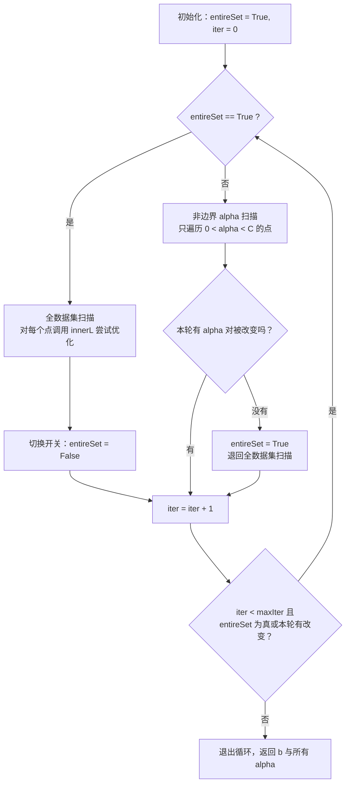

# 第 6 章 支持向量机

> **本章解决**：怎么让分类器的"分界线"尽可能宽——支持向量机（SVM）把分类看作一个最大化间隔的优化问题：找到离两类都尽量远的分隔超平面，离边界越远的预测越可信。
> 训练它靠 SMO 算法高效求解；遇到线性不可分的数据，用核函数把数据映射到高维空间再切一刀；最后用手写数字识别检验：只保留少量支持向量就能达到与 kNN 相当的效果。

"由于理解支持向量机需要掌握一些理论知识，而这对于读者来说有一定难度，于是建议读者直接下载 LIBSVM 使用。"——作者发现，介绍 SVM 的书大多采用这种模式，本书偏不。作者认为，如果不了解 SVM 的理论就去读产品级的 C++ 代码，难度很大；但如果把产品级代码和速度提升部分剥离出去，代码就变得可控、可以读懂了。这正是本章的做法。

有些人的看法是：**SVM 是最好的现成（off-the-shelf）分类器**——"现成"指的是分类器不加修改即可直接使用，在数据上应用基本形式的 SVM 就能得到低错误率的结果，并且能对训练集之外的数据点做出很好的分类决策。

本章主线：先讲 SVM 的基本概念与关键术语（6.1–6.2），然后只关注最流行的一种实现——序列最小优化（SMO）算法（6.3–6.4），再用核函数把 SVM 扩展到更多数据集上（6.5），最后回顾第 1 章的手写识别例子，看 SVM 能否提高识别效果（6.6）。

## 6.0 本章导图

<div class="brtree">
  <div class="brrow">
    <span class="brlabel root">支持向量机</span>
    <span class="brace"></span>
    <div class="brkids">
      <div class="brrow">
        <span class="brlabel">基本概念</span>
        <span class="brace"></span>
        <div class="brkids">
          <span class="brleaf">线性可分与分隔超平面</span>
          <span class="brleaf">超平面＝高维数据的决策边界</span>
          <span class="brleaf">间隔 margin：越大越健壮</span>
          <span class="brleaf">支持向量＝离分隔面最近的点</span>
        </div>
      </div>
      <div class="brrow">
        <span class="brlabel">优化问题</span>
        <span class="brace"></span>
        <div class="brkids">
          <span class="brleaf">类别标签取 -1 和 +1 的好处</span>
          <span class="brleaf">固定因子求最大间隔</span>
          <span class="brleaf">拉格朗日乘子 alpha</span>
          <span class="brleaf">松弛变量与常数 C 的权衡</span>
        </div>
      </div>
      <div class="brrow">
        <span class="brlabel">简化版 SMO</span>
        <span class="brace"></span>
        <div class="brkids">
          <span class="brleaf">辅助函数三件套</span>
          <span class="brleaf">必须同时改变两个 alpha</span>
          <span class="brleaf">L、H 边界与 clipAlpha</span>
          <span class="brleaf">eta 与退出条件</span>
        </div>
      </div>
      <div class="brrow">
        <span class="brlabel">完整 Platt SMO</span>
        <span class="brace"></span>
        <div class="brkids">
          <span class="brleaf">optStruct 把数据打包成对象</span>
          <span class="brleaf">误差缓存 eCache 提速</span>
          <span class="brleaf">外循环两种扫描交替</span>
          <span class="brleaf">14.5 秒提速到 0.78 秒</span>
        </div>
      </div>
      <div class="brrow">
        <span class="brlabel">核函数</span>
        <span class="brace"></span>
        <div class="brkids">
          <span class="brleaf">低维非线性映射到高维线性</span>
          <span class="brleaf">内积替换＝核技巧</span>
          <span class="brleaf">径向基核（高斯版）与参数 k1</span>
          <span class="brleaf">核矩阵 K 只需计算一次</span>
        </div>
      </div>
      <div class="brrow">
        <span class="brlabel">实战回顾</span>
        <span class="brace"></span>
        <div class="brkids">
          <span class="brleaf">手写数字 1 对 9 二类识别</span>
          <span class="brleaf">支持向量数目存在最优值</span>
          <span class="brleaf">对比 kNN：省内存、效果相当</span>
        </div>
      </div>
    </div>
  </div>
</div>

## 6.1 基于最大间隔分隔数据

| 支持向量机 | |
| --- | --- |
| 优点 | 泛化错误率低，计算开销不大，结果易解释 |
| 缺点 | 对参数调节和核函数的选择敏感，原始分类器不加修改仅适用于处理二类问题 |
| 适用数据类型 | 数值型和标称型数据 |

先解释几个概念。考虑图 6-1 中 A–D 共 4 个方框中的数据点分布，一个问题就是：能否画出一条直线将圆形点和方形点分开呢？

<figure>
  
  <figcaption>图 6-1 4 个线性不可分的数据集（截自原书）</figcaption>
</figure>

再看图 6-2 方框 A 中的两组数据：它们之间已经分隔得足够开，很容易画出一条直线将两组数据点分开。在这种情况下，这组数据被称为**线性可分（linearly separable）**数据。读者先不必担心这个假设是否过于完美——稍后当直线不能将数据点分开时，我们会对假设做一些修改（引入松弛变量，见 6.2.1）。

<figure>
  
  <figcaption>图 6-2 A 框中给出了一个线性可分的数据集，B、C、D 框中各自给出了一条可以将两类数据分开的直线（截自原书）</figcaption>
</figure>

把数据集分隔开来的直线称为**分隔超平面（separating hyperplane）**。上面例子中数据点都在二维平面上，所以分隔超平面就只是一条直线；如果数据集是三维的，用来分隔数据的就是一个平面；更高维的情况依此类推——如果数据集是 1024 维的，那么就需要一个 1023 维的"某某对象"来对数据进行分隔。这个 1023 维的对象到底该叫什么？它被称为**超平面（hyperplane）**，也就是分类的**决策边界**。分布在超平面一侧的所有数据都属于某个类别，另一侧的则属于另一个类别。

我们希望构建的分类器有这样的性质：**数据点离决策边界越远，最后的预测结果就越可信**。图 6-2 框 B 到框 D 中的三条直线都能将数据分隔开，但哪一条最好？是否应该最小化数据点到分隔超平面的平均距离来求最佳直线？如果是那样，框 B 和框 C 中的直线是否真的比框 D 中的好？这听起来有点像寻找最佳拟合直线（第 8 章的回归），但那样做并非最佳方案。正确的思路是：**找到离分隔超平面最近的那些点，确保它们离分隔面的距离尽可能远**。点**到分隔面的距离被称为间隔**。我们希望间隔尽可能地大——因为如果犯了错或者只在有限数据上训练分类器，我们希望分类器尽可能健壮。

!!! note "拓展：两个"间隔"概念（译者注）"
    本书中"间隔"其实有两个概念：一个是**点到分隔面的距离**，称为点相对于分隔面的间隔；另一个是**数据集中所有点到分隔面的最小间隔的 2 倍**，称为分类器或数据集的间隔。一般论文书籍中所说的"间隔"多指后者，SVM 分类器要找的是最大的数据集间隔。书中没有特意区分这两个概念，请根据上下文理解。

**支持向量（support vector）**就是离分隔超平面**最近的那些点**。接下来要做的，就是最大化支持向量到分隔面的距离——这需要找到此问题的优化求解方法。

## 6.2 寻找最大间隔

如何求解数据集的最佳分隔直线？看图 6-3。分隔超平面的形式可以写成 \(w^T x + b\)。要计算点 A 到分隔超平面的距离，就必须给出点到分隔面的法线或垂线的长度，该值为：

\[
\frac{|w^T A + b|}{\|w\|}
\]

这里的常数 \(b\) 类似于 Logistic 回归（第 5 章）中的截距 \(w_0\)。向量 \(w\) 和常数 \(b\) 一起描述了所给数据的分隔线或超平面。

<figure>
  
  <figcaption>图 6-3 点 A 到分隔平面的距离就是该点到分隔面的法线长度（截自原书）</figcaption>
</figure>

### 6.2.1 分类器求解的优化问题

前面已经提到了分类器，但还没有介绍它的工作原理。理解其工作原理将有助于理解基于优化问题的分类器求解过程。

输入数据给分类器会输出一个类别标签，这相当于一个类似于 Sigmoid 的函数在作用。这里使用类似**海维赛德阶跃函数（Heaviside step function，即单位阶跃函数）**的函数对 \(w^T x + b\) 作用得到 \(f(w^T x + b)\)：当 \(u < 0\) 时 \(f(u)\) 输出 -1，反之输出 +1。这和第 5 章的 Logistic 回归不同——那里的类别标签是 0 或 1。

**为什么类别标签采用 -1 和 +1，而不是 0 和 1？** 由于 -1 和 +1 仅仅相差一个符号，方便数学上的处理：我们可以用一个统一公式表示间隔或数据点到分隔超平面的距离，而不必担心数据到底属于 -1 还是 +1 类。计算数据点到分隔面的距离并确定分隔面的放置位置时，间隔通过 \(label \cdot (w^T x + b)\) 来计算——这时就能体现出 -1 和 +1 类的好处了：

- 如果数据点处于正方向（+1 类）且离分隔超平面很远的位置，\(w^T x + b\) 会是一个很大的正数，\(label \cdot (w^T x + b)\) 也是一个很大的正数；
- 如果数据点处于负方向（-1 类）且离分隔超平面很远的位置，由于类别标签为 -1，\(label \cdot (w^T x + b)\) 仍然是一个很大的正数。

!!! note "拓展：函数间隔与几何间隔（译者注）"
    \(label \cdot (w^T x + b)\) 被称为点到分隔面的**函数间隔（functional margin）**；而 \(label \cdot (w^T x + b)/\|w\|\) 被称为**几何间隔（geometric margin）**——即前面图 6-3 里那真实存在的几何距离。优化时固定函数间隔为 1 再最大化 \(1/\|w\|\)，等价于最大化几何间隔。

现在的目标就是找出分类器定义中的 \(w\) 和 \(b\)。为此必须找到具有最小间隔的数据点（也就是支持向量），然后对该间隔最大化。这可以写作：

\[
\underset{\{w, b\}}{\arg\max} \ \left\{ \min_n \left[ label^{(n)} (w^T x^{(n)} + b) \right] \right\} \cdot \frac{1}{\|w\|}
\]

直接求解相当困难，所以将它转换成更容易求解的形式。先考察上式大括号内的部分：对乘积进行优化很讨厌，因此要**固定其中一个因子而最大化其他因子**。如果令所有支持向量的 \(label \cdot (w^T x + b)\) 都为 1，那么就可以通过求 \(\|w\|^{-1}\) 的最大值来得到最终解。但要注意，并非所有数据点的 \(label \cdot (w^T x + b)\) 都等于 1——只有那些离分隔超平面最近的点得到的值才为 1，离超平面越远的数据点其值也就越大。

于是优化问题变成：在约束条件 \(label \cdot (w^T x + b) \ge 1.0\) 下，最大化 \(\|w\|^{-1}\)。这是**带约束条件的优化问题**，而这类问题有一个非常著名的求解方法——**拉格朗日乘子法**。通过引入拉格朗日乘子，可以基于约束条件来表述原来的问题。由于约束条件都是基于数据点的，超平面就可以写成数据点的形式。优化目标函数最后可以写成：

\[
\max_{\alpha} \left[ \sum_{i=1}^{m} \alpha_i - \frac{1}{2} \sum_{i, j=1}^{m} label^{(i)} \cdot label^{(j)} \cdot \langle x^{(i)}, x^{(j)} \rangle \cdot \alpha_i \alpha_j \right]
\]

其约束条件为：

\[
\alpha_i \ge 0, \quad \text{和} \quad \sum_{i=1}^{m} label^{(i)} \cdot \alpha_i = 0
\]

其中尖括号 \(\langle x^{(i)}, x^{(j)} \rangle\) 表示两个向量的内积（译者注）。

!!! note "拓展：为什么优化目标里全是"数据点两两内积"？"
    这是整个 SVM 最精妙的一步伏笔。用拉格朗日乘子法把问题转换到对偶形式后，数据点只以两两内积 \(\langle x^{(i)}, x^{(j)} \rangle\) 的形式出现，\(w\) 本身消失了。这意味着：第一，训练结束后超平面完全由 alpha 和数据点表达，SVM 的主要工作就是求解这些 alpha；第二，将来只要能算出"高维空间中的内积"，我们甚至不需要知道高维空间长什么样——这正是 6.5 节核函数的入口。

至此一切都很完美，但这里有个假设：**数据必须 100% 线性可分**。几乎所有数据都不那么"干净"。这时引入**松弛变量（slack variable）**，允许有些数据点可以处于分隔面的错误一侧。优化目标保持不变，但新的约束条件变为：

\[
C \ge \alpha_i \ge 0, \quad \text{和} \quad \sum_{i=1}^{m} label^{(i)} \cdot \alpha_i = 0
\]

常数 \(C\) 用于控制"最大化间隔"和"保证大部分点的函数间隔不小于 1.0"这两个目标的权重。在优化算法的实现代码中，C 是一个参数，可以通过调节它得到不同的结果。一旦求出了所有的 alpha，分隔超平面就可以通过这些 alpha 来表达——SVM 中的主要工作就是求解这些 alpha。

要理解这些公式还需要大量的知识，有兴趣可以查阅相关教材（Christopher M. Bishop《Pattern Recognition and Machine Learning》；Bernhard Schölkopf 和 Alexander J. Smola《Learning with Kernels: Support Vector Machines, Regularization, Optimization, and Beyond》）获得推导细节。

### 6.2.2 SVM 应用的一般框架

在第 1 章中，我们定义了构建机器学习应用的一般步骤，这些步骤会随任务或算法的不同而有所改变，因此有必要探讨如何在本章中实现它们。

| SVM 的一般流程 | |
| --- | --- |
| (1) 收集数据 | 可以使用任意方法 |
| (2) 准备数据 | 需要数值型数据 |
| (3) 分析数据 | 有助于可视化分隔超平面 |
| (4) 训练算法 | SVM 的大部分时间都源自训练，该过程主要实现两个参数的调优 |
| (5) 测试算法 | 十分简单的计算过程就可以实现 |
| (6) 使用算法 | 几乎所有分类问题都可以使用 SVM；注意 SVM 本身是一个二类分类器，对多类问题应用 SVM 需要对代码做一些修改 |

到目前为止已经了解了一些理论知识，接下来通过编程在数据集上将理论付诸实践。下一节介绍一个简单但很强大的实现算法。

## 6.3 SMO 高效优化算法

接下来根据 6.2.1 节中的最后两个式子进行优化：一个是最小化的目标函数，一个是优化过程中必须遵循的约束条件。不久之前，人们还在使用**二次规划求解工具（quadratic solver）**来求解上述最优化问题——这是一种用于在线性约束下优化具有多个变量的二次目标函数的软件。二次规划求解工具需要强大的计算能力支撑，实现上也十分复杂。而所有需要做的围绕优化的事情就是训练分类器：一旦得到 alpha 的最优值，就得到了分隔超平面（二维平面中就是直线），并能够将它用于数据分类。

下面先讨论 SMO 算法并给出一个简化版本，以便正确理解它的工作流程；再给出 SMO 算法的完整版，它比简化版快很多。

### 6.3.1 Platt 的 SMO 算法

1996 年，John Platt 发布了一个称为 **SMO（Sequential Minimal Optimization，序列最小优化）**的强大算法，用于训练 SVM。Platt 的 SMO 算法（1999 年正式发表的论文为 "Using Analytic QP and Sparseness to Speed Training of Support Vector Machines"）将**大优化问题分解为多个小优化问题**来求解。这些小优化问题往往很容易求解，并且对它们进行顺序求解的结果与将它们作为整体来求解的结果是完全一致的——结果完全相同的同时，SMO 算法的求解时间短很多。

SMO 算法的目标是**求出一系列 alpha 和 b**。一旦求出了这些 alpha，就很容易计算出权重向量 \(w\)，从而得到分隔超平面。

SMO 算法的工作原理：**每次循环中选择两个 alpha 进行优化处理**。一旦找到一对合适的 alpha，就增大其中一个同时减小另一个。这里所谓的"合适"是指两个 alpha 必须符合一定的条件：

- 条件之一：这两个 alpha 必须在**间隔边界之外**；
- 第二个条件：这两个 alpha **还没有进行过区间化处理或者不在边界上**。

### 6.3.2 应用简化版 SMO 算法处理小规模数据集

Platt SMO 算法的完整实现需要大量代码。第一个例子对算法做简化处理，以便了解算法的基本工作思路，之后再基于简化版给出完整版。简化版代码量少但执行速度慢。

Platt SMO 算法中的外循环确定要优化的最佳 alpha 对；简化版却跳过这一部分：**首先在数据集上遍历每一个 alpha，然后在剩下的 alpha 集合中随机选择另一个 alpha，从而构建 alpha 对**。这里有一点相当重要：必须**同时改变两个 alpha**。原因是有一个约束条件 \(\sum_i label^{(i)} \cdot \alpha_i = 0\)——只改变一个 alpha 可能导致该约束条件失效，因此总是同时改变两个 alpha（一个增大多少，另一个就减小多少）。

!!! note "运行环境"
    本节起代码要从数据文件读数据，文件名一律写相对路径（如 `'testSet.txt'`）。**运行时工作目录需在数据文件所在目录**（本站配套数据位于 `_ml_data\Ch06\`，内含 testSet.txt、testSetRBF.txt、testSetRBF2.txt；6.6 节手写数字复用 `_ml_data\Ch02\` 下的 trainingDigits\ 与 testDigits\）。拿不准时先 `import os; print(os.getcwd())` 检查。

!!! warning "NumPy 2.x 适配（Python 2 原书代码可直接运行的前提）"
    原书代码基于 Python 2 + NumPy 1.x。本笔记代码已改为 Python 3 可直接运行，除了 `print` 加括号之外，还有两处 NumPy 2.x 的适配（每个代码文件加一次即可）：

    ```python
    from numpy import *
    mat = asmatrix              # NumPy 2.x 移除了 mat 别名，asmatrix 是全称（行为一致）
    import builtins as _b
    max, min = _b.max, _b.min   # NumPy 2.x 的 * 导入会覆盖内置 max/min，恢复之
    ```

    第二行不是画蛇添足：`max(0, alphas[j] - alphas[i])` 用的正是**内置** max——若被 numpy 的 max 覆盖，第二个参数会被当成 axis 参数而报错（原书写代码时 NumPy 1.x 的星号导入并不会覆盖它们）。

先构建两个辅助函数（程序清单 6-1），把代码加入 svmMLiA.py 文件中：

```python
# ===== 书 6.3.2 节 程序清单 6-1：SMO 算法中的辅助函数 =====
def loadDataSet(fileName):
    """打开文件并逐行解析：得到每行的类标签与整个数据矩阵。"""
    dataMat = []; labelMat = []
    fr = open(fileName)
    for line in fr.readlines():
        lineArr = line.strip().split('\t')
        dataMat.append([float(lineArr[0]), float(lineArr[1])])
        labelMat.append(float(lineArr[2]))
    return dataMat, labelMat

def selectJrand(i, m):
    """在 0 到 m 之间随机选一个整数，只要不等于 i 就行（选第二个 alpha 用）。"""
    j = i
    while (j == i):
        j = int(random.uniform(0, m))
    return j

def clipAlpha(aj, H, L):
    """用于调整大于 H 或小于 L 的 alpha 值：把 alpha 限制在 L 与 H 之间。"""
    if aj > H:
        aj = H
    if L > aj:
        aj = L
    return aj
```

在 testSet.txt 文件中保存了图 6-3 所给出的数据。接下来就在这个文件上应用 SMO 算法。第一个函数 loadDataSet() 是老朋友了：打开文件并逐行解析，得到每行的类标签和整个数据矩阵。

第二个函数 selectJrand() 有两个参数：i 是第一个 alpha 的下标，m 是所有 alpha 的数目。只要函数值不等于输入值 i，函数就会随机选择。

最后一个辅助函数 clipAlpha() 用于调整大于 H 或小于 L 的 alpha 值。这三个辅助函数本身做的事不多，但在分类器中很有用处。

输入并保存上面的代码之后，运行如下命令：

```text
>>> dataArr, labelArr = loadDataSet('testSet.txt')
>>> labelArr[0]
-1.0
>>> labelArr[7]
-1.0
>>> labelArr[50]
1.0
```

可以看得出来，这里采用的类别标签是 -1 和 1，而不是 0 和 1。

上述工作完成之后，就可以使用 SMO 算法的第一个版本了。该 SMO 函数的伪代码大致如下：

```text
创建一个 alpha 向量并将其初始化为 0 向量
当迭代次数小于最大迭代次数时（外循环）
    对数据集中的每个数据向量（内循环）：
        如果该数据向量可以被优化：
            随机选择另外一个数据向量
            同时优化这两个向量
            如果两个向量都不能被优化，退出内循环
    如果所有向量都没被优化，增加迭代数目，继续下一次循环
```

程序清单 6-2 的代码是 SMO 算法的一个有效版本。Python 中如果某行以 `\` 符号结束，就意味着该语句没有结束并会在下一行延续——下面的代码中有很多很长的语句必须分成多行写：

```python
# ===== 书 6.3.2 节 程序清单 6-2：简化版 SMO 算法 =====
def smoSimple(dataMatIn, classLabels, C, toler, maxIter):
    """简化版 SMO：遍历每个 alpha + 随机选第二个 alpha 构建优化对。
    输入：数据集、类别标签、常数 C、容错率、退出前最大的循环次数。"""
    dataMatrix = mat(dataMatIn); labelMat = mat(classLabels).transpose()
    b = 0; m, n = shape(dataMatrix)
    alphas = mat(zeros((m, 1)))
    iter = 0                                # 在没有任何 alpha 改变的情况下遍历数据集的次数
    while (iter < maxIter):
        alphaPairsChanged = 0               # 记录本轮是否优化过 alpha
        for i in range(m):
            # fXi：当前预测的类别 f(x) = sum(alpha_i*label_i*<x_i,x>) + b
            fXi = float(multiply(alphas, labelMat).T * (dataMatrix * dataMatrix[i, :].T)) + b
            Ei = fXi - float(labelMat[i])   # 误差 Ei = 预测值 - 真实标签
            # 误差很大（正间隔或负间隔都测）且 alpha 不在边界 0/C 上，才值得优化
            if ((labelMat[i] * Ei < -toler) and (alphas[i] < C)) or \
               ((labelMat[i] * Ei > toler) and (alphas[i] > 0)):
                j = selectJrand(i, m)                       # 随机选择第二个 alpha
                fXj = float(multiply(alphas, labelMat).T * (dataMatrix * dataMatrix[j, :].T)) + b
                Ej = fXj - float(labelMat[j])
                alphaIold = alphas[i].copy(); alphaJold = alphas[j].copy()
                # L、H 用于把 alpha[j] 调整到 0 到 C 之间，且不破坏约束 sum(label_i*alpha_i)=0
                if (labelMat[i] != labelMat[j]):
                    L = max(0, alphas[j] - alphas[i])
                    H = min(C, C + alphas[j] - alphas[i])
                else:
                    L = max(0, alphas[j] + alphas[i] - C)
                    H = min(C, alphas[j] + alphas[i])
                if L == H: print("L==H"); continue          # 区间为空，本次无法优化
                # eta：alpha[j] 的最优修改量
                eta = 2.0 * dataMatrix[i, :] * dataMatrix[j, :].T - \
                    dataMatrix[i, :] * dataMatrix[i, :].T - \
                    dataMatrix[j, :] * dataMatrix[j, :].T
                if eta >= 0: print("eta>=0"); continue      # 简化处理：直接跳过
                alphas[j] -= labelMat[j] * (Ei - Ej) / eta  # 计算新的 alpha[j]
                alphas[j] = clipAlpha(alphas[j], H, L)      # 保证 alpha 在 0 与 C 之间
                if (abs(alphas[j] - alphaJold) < 0.00001):
                    print("j not moving enough"); continue  # 改动太小则放弃本次
                # 对 i 进行修改，修改量与 j 相同，但方向相反
                alphas[i] += labelMat[j] * labelMat[i] * (alphaJold - alphas[j])
                # 给这两个 alpha 设置常数项 b
                b1 = b - Ei - labelMat[i] * (alphas[i] - alphaIold) * dataMatrix[i, :] * dataMatrix[i, :].T \
                    - labelMat[j] * (alphas[j] - alphaJold) * dataMatrix[i, :] * dataMatrix[j, :].T
                b2 = b - Ej - labelMat[i] * (alphas[i] - alphaIold) * dataMatrix[i, :] * dataMatrix[j, :].T \
                    - labelMat[j] * (alphas[j] - alphaJold) * dataMatrix[j, :] * dataMatrix[j, :].T
                if (0 < alphas[i]) and (C > alphas[i]): b = b1
                elif (0 < alphas[j]) and (C > alphas[j]): b = b2
                else: b = (b1 + b2) / 2.0
                alphaPairsChanged += 1
                print("iter: %d i:%d, pairs changed %d" % (iter, i, alphaPairsChanged))
        if (alphaPairsChanged == 0): iter += 1
        else: iter = 0
        print("iteration number: %d" % iter)
    return b, alphas
```

这个函数比较大，或许是全书最大的一个函数。逐块拆解：

**输入与数据结构**。函数有 5 个输入参数：数据集、类别标签、常数 C、容错率（tolerance）和退出前最大的循环次数。本书构建函数时采用通用接口，可以对算法和数据源进行组合或配对处理。函数将多个列表和输入参数转换成 NumPy 矩阵，简化数学处理操作；类别标签做了转置，得到列向量而不是列表——这样类别标签向量的每行元素都和数据矩阵中的行一一对应。通过 dataMatIn 的 shape 属性得到常数 m 和 n。最后构建一个元素全为 0 的 alpha 列矩阵，并建立 iter 变量——它存储的是**在没有任何 alpha 改变的情况下遍历数据集的次数**，当该变量达到输入值 maxIter 时函数结束运行并退出。

**内循环的优化条件**。每次循环将 alphaPairsChanged 设为 0，然后对整个数据集顺序遍历。fXi 就是预测的类别；基于预测结果和真实结果的比对得到误差 Ei。如果误差很大，就可以对该数据实例对应的 alpha 值进行优化。if 语句中不管是正间隔还是负间隔都会被测试，同时检查 alpha 值以保证它不等于 0 或 C——由于后面 alpha 小于 0 或大于 C 时将被调整为 0 或 C，一旦它们等于这两个值就说明已经在"边界"上了，不能再减小或增大，不值得再优化。

**选择第二个 alpha 与 L、H**。利用程序清单 6-1 的 selectJrand() 随机选择第二个 alpha（alpha[j]），并用同样的方法计算它的误差 Ej。alphaIold 和 alphaJold 通过 copy() 保存，稍后将新 alpha 值与老的进行比较。**这里必须明确 copy()**：Python 会通过引用的方式传递所有列表，如果不分配新内存，新旧值就是同一个对象，比较时看不到变化。L 和 H 用于将 alpha[j] 调整到 0 到 C 之间；如果 L 和 H 相等，就不做任何改变，直接执行 continue 进入下一次 for 循环。

**eta 与更新**。eta 是 alpha[j] 的最优修改量（在那行很长的计算代码中得到）。如果 eta 为 0，计算新的 alpha[j] 就比较麻烦——这里做了**简化处理**：直接退出 for 循环的当前迭代。想深究的读者可以阅读 Platt 的原文；现实中这种情况并不常发生，忽略通常也无伤大雅。于是计算出新 alpha[j] 后，利用 clipAlpha() 以及 L 与 H 值对其进行调整。然后检查 alpha[j] 是否有轻微改变（小于 0.00001 则"j not moving enough"，退出本次循环）。接着对 alpha[i] 进行改变：改变的大小一样，**方向正好相反**（一个增加，另一个就减少）。优化完两个 alpha 后，给它们设置常数项 b（b1、b2 分别只在对应 alpha 非边界时有效，都处于边界时取均值）。

**退出条件**。如果程序执行到 for 循环的最后一行都没有执行 continue，说明成功改变了一对 alpha，alphaPairsChanged 加 1。for 循环之外检查 alpha 值是否更新过：有更新则把 iter 设为 0 后继续运行。**只有在所有数据集上遍历 maxIter 次且不再发生任何 alpha 修改之后**，程序才会停止并退出 while 循环。

!!! note "拓展：innerL/smoSimple 的 L、H 与标准 SMO 公式的对照"
    程序里的 L、H 正是 Platt 论文中 alpha[j] 的可行区间：

    - 若 \(y_i \ne y_j\)：\(L = \max(0, \alpha_j - \alpha_i)\)，\(H = \min(C, C + \alpha_j - \alpha_i)\)；
    - 若 \(y_i = y_j\)：\(L = \max(0, \alpha_j + \alpha_i - C)\)，\(H = \min(C, \alpha_j + \alpha_i)\)。

    eta 对应论文中的二阶导数项（符号相反）：书里 eta \(= 2K_{ij} - K_{ii} - K_{jj} = -\|x_i - x_j\|^2 \le 0\)，eta ≥ 0 时目标函数在直线上无曲率（退化），直接放弃这对优化。另外，更新公式 \(\alpha_j \leftarrow \alpha_j - y_j (E_i - E_j)/\eta\) 与 \(\alpha_i\) 的反方向等量更新，保证了 \(\sum_i y_i \alpha_i\) 始终不变——这就是"必须同时改变两个 alpha"的数学根源。

为了解实际效果，运行如下命令（书 6.3.2 的输出 a1、a2、b，本站实跑）：

```text
>>> b, alphas = smoSimple(dataArr, labelArr, 0.6, 0.001, 40)
iter: 0 i:53, pairs changed 1
iter: 0 i:83, pairs changed 2
iter: 0 i:91, pairs changed 3
iter: 0 i:94, pairs changed 4
j not moving enough
L==H
iteration number: 1
...(中间几十行省略)
iteration number: 40
>>> b
matrix([[-3.82495849]])
```

上述运行过程需要几分钟才会收敛（原书在一台性能较差的笔记本上需要 14.5 秒；本站实跑 1.71 秒）。一旦运行结束，可以对结果进行观察：

```text
>>> alphas[alphas>0]
matrix([[ 0.12203458,  0.24299828,  0.36503286]])
```

原书印刷的输出是 b = matrix([[-3.84064413]])、alphas[alphas>0] = matrix([[ 0.12735413,  0.24154794,  0.36890208]])——同样是 3 个非零 alpha，具体数值与本站不同（随机性所致，见下方红框）。

可以直接观察 alpha 矩阵本身，但其中零元素太多。为了观察大于 0 的元素的数量，用**数组过滤（array filtering）**：

```text
>>> shape(alphas[alphas>0])
(1, 3)
```

!!! note "数组过滤 alphas[alphas>0]"
    `alphas[alphas>0]` 是数组过滤的一个实例，只对 NumPy 类型有用，不适用于 Python 的正则列表（regular list）。`alphas>0` 会得到一个布尔数组，不等式成立的位置为 True；将这个布尔数组应用到原始矩阵上，就得到一个仅包含大于 0 的值的矩阵。本站实跑得到 3 个大于 0 的 alpha：0.12203、0.24300、0.36503。

为了得到支持向量的个数：

```text
>>> shape(alphas[alphas>0])
(1, 3)
```

为了解哪些数据点是支持向量：

```text
>>> dataMat[nonzero(alphas.A>0)[0]]
matrix([[ 4.6582  ,  3.5074  ],
        [ 3.4571  , -0.0822  ],
        [ 6.0806  ,  0.4189  ]])
```

!!! danger "SMO 的随机性：你的运行结果不会和书（以及本站）完全一样"
    简化版 SMO 用 selectJrand 随机挑第二个 alpha，**不同次运行得到的 b、alpha 值和支持向量个数都会不同**（书里明确说"由于 SMO 算法的随机性，读者运行后所得到的结果可能会与上述结果不同"）。本站第一次实跑得到 3 个支持向量，另一次实跑得到 7 个（其中几个 alpha 是 1e-17 量级的浮点残渣，见"坑与陷阱"）。这是算法性质，不是你写错了。

在原始数据集上对这些支持向量画圈之后的结果如图 6-4 所示。

<figure>
  
  <figcaption>图 6-4 示例数据集上运行简化版 SMO 算法后得到的结果，包括画圈的支持向量与分隔超平面（截自原书）</figcaption>
</figure>

本站按书参数（C=0.6、toler=0.001、maxIter=40）实跑同样得到 3 个支持向量，收敛前后对比如下——收敛前 alpha 全为 0、b 为 0，模型对每个点的预测值都是 0；收敛后支持向量圈出、分隔超平面落位：

<figure>
  
  <figcaption>简化版 SMO 在 testSet.txt 上的收敛前后：左为初始状态，右为 3 个支持向量（灰圈）与分隔超平面（代码实跑）</figcaption>
</figure>

利用书中的设置，原书作者运行了 10 次程序并取平均时间，在一台性能较差的笔记本上需要 14.5 秒。结果看起来不算太差，但别忘了这只是一个仅有 100 个点的小规模数据集；在更大的数据集上收敛时间会变得更长。下一节构建完整 SMO 算法来加快运行速度。

## 6.4 利用完整 Platt SMO 算法加速优化

在几百个点组成的小规模数据集上，简化版 SMO 算法的运行没有什么问题，但在更大的数据集上运行速度就会变慢。下面讨论完整版的 Platt SMO 算法。**两个版本中，实现 alpha 的更改和代数运算的优化环节一模一样，唯一的不同是选择 alpha 的方式**——完整版应用了一些能够提速的启发方法。

**外循环**：Platt SMO 算法通过一个外循环来选择第一个 alpha 值，其选择过程在两种方式之间交替：

- 一种方式是在**所有数据集**上进行单遍扫描；
- 另一种方式是在**非边界 alpha** 中实现单遍扫描。

所谓**非边界 alpha**，指的就是那些不等于边界 0 或 C 的 alpha 值。对整个数据集的扫描相当容易；而对非边界 alpha 值的扫描，首先需要建立这些 alpha 值的列表，然后对这个表进行遍历，同时跳过那些已知的不会改变的 alpha 值。

**内循环**：选择第一个 alpha 值后，算法通过内循环选择第二个 alpha 值。优化过程中通过**最大化步长**的方式来获得第二个 alpha 值。简化版 SMO 在选择 j 之后才计算误差 Ej；完整版则建立一个**全局的缓存**用于保存误差值，并从中选择使得步长（即 \(E_i - E_j\)）最大的 alpha 值。

完整算法的流程（外循环在两种扫描方式之间切换，直到没有 alpha 可以被优化）：



在讲述改进后的代码之前，必须先对上节的代码进行清理。下面的程序清单包含 1 个用于清理代码的数据结构和 3 个用于对 E 进行缓存的辅助函数（程序清单 6-3）：

```python
# ===== 书 6.4 节 程序清单 6-3：完整版 Platt SMO 的支持函数（无核版本） =====
class optStruct:
    """仅含 __init__ 的类，当作数据结构用：把所有重要值打包传递。"""
    def __init__(self, dataMatIn, classLabels, C, toler):  # 引入核函数后的版本见程序清单 6-6
        self.X = dataMatIn
        self.labelMat = classLabels
        self.C = C
        self.tol = toler
        self.m = shape(dataMatIn)[0]
        self.alphas = mat(zeros((self.m, 1)))
        self.b = 0
        self.eCache = mat(zeros((self.m, 2)))  # 误差缓存：第 1 列有效标志位，第 2 列实际 E 值

def calcEk(oS, k):
    """计算 E 值并返回（6.5 节引入核函数后改为核矩阵版本）。"""
    fXk = float(multiply(oS.alphas, oS.labelMat).T * (oS.X * oS.X[k, :].T)) + oS.b
    Ek = fXk - float(oS.labelMat[k])
    return Ek

def selectJ(i, oS, Ei):
    """内循环选第二个 alpha：在误差缓存中选使步长 |Ei - Ej| 最大的 j。"""
    maxK = -1; maxDeltaE = 0; Ej = 0
    oS.eCache[i] = [1, Ei]                     # 先把 Ei 存入缓存（标记为有效）
    validEcacheList = nonzero(oS.eCache[:, 0].A)[0]   # 有效标志位非 0 的行下标
    if (len(validEcacheList)) > 1:             # 缓存里已有多个 E 值：挑改变最大的
        for k in validEcacheList:
            if k == i: continue
            Ek = calcEk(oS, k)
            deltaE = abs(Ei - Ek)
            if (deltaE > maxDeltaE):
                maxK = k; maxDeltaE = deltaE; Ej = Ek
        return maxK, Ej
    else:                                      # 第一次循环：随机选
        j = selectJrand(i, oS.m)
        Ej = calcEk(oS, j)
    return j, Ej

def updateEk(oS, k):
    """计算误差值并存入缓存（对 alpha 值进行优化之后会用到）。"""
    Ek = calcEk(oS, k)
    oS.eCache[k] = [1, Ek]
```

首要的事情是建立一个数据结构来保存所有的重要值——通过一个**对象**来完成。这里使用对象的目的并不是为了面向对象编程，而只是把它当作数据结构：把所有数据移到一个结构里，数据就可以通过一个对象来传递，省掉手工输入的麻烦。实际上完成实现时也可以用 Python 的字典来做，但访问对象成员变量时字典需要更多手工输入——对比一下 `myObject.X` 和 `myObject['X']` 就知道。为此构建一个仅包含 \_\_init\_\_ 方法的 optStruct 类，该方法实现成员变量的填充。除了增加了一个 m×2 的矩阵成员变量 **eCache** 之外，这些做法和简化版 SMO 一模一样。eCache 的第一列给出的是**有效标志位**（是否已计算好），第二列给出的是**实际的 E 值**。

对于给定的 alpha 值，第一个辅助函数 calcEk() 能够计算 E 值并返回。以前该过程是采用内嵌方式完成的，但在完整版的 SMO 算法中出现频繁，必须单独拎出来。

下一个函数 selectJ() 用于选择第二个 alpha（内循环的 alpha），目标是选择合适的第二个 alpha 以保证**每次优化中采用最大步长**。该函数与第一个 alpha 的误差值 Ei 和下标 i 有关：首先将输入值 Ei 在缓存中设置为有效（"有效"意味着它已经计算好了）；代码 `nonzero(oS.eCache[:,0].A)[0]` 构建出非零表——NumPy 函数 nonzero() 返回包含输入列表中非零值下标的列表，所以该语句返回的是**非零有效标志位所对应的 alpha 下标**，而不是 E 值本身。程序在所有有效值上循环，选择使改变最大的那个值。如果是第一次循环（缓存中没有可用的 E 值），就随机选择一个 alpha 值。当然存在更复杂的处理方式，但上述做法就能满足目的。

最后一个辅助函数 updateEk() 会计算误差值并存入缓存，在 alpha 值优化之后会用到它。

!!! note "拓展：nonzero(alphas.A>0) 里的 .A 是什么"
    oS.eCache、alphas 这些变量是 numpy 的 matrix（矩阵）类型。`.A` 把 matrix 转换成 ndarray（数组）——因为 nonzero()、布尔比较这类操作对 matrix 的返回形状常常多出一维，先转数组再取下标更直观。书中 6.4 的 `nonzero((oS.alphas.A > 0) * (oS.alphas.A < C))[0]` 同理：先转数组，做两个布尔条件相与，再取非零行下标，得到"非边界 alpha"的列表。

程序清单 6-3 中的代码本身作用并不大，但当和优化例程及外循环组合在一起时，就能组成强大的 SMO 算法。接下来是用于寻找决策边界的优化例程（程序清单 6-4）——读者已经见过它的另外一种形式：

```python
# ===== 书 6.4 节 程序清单 6-4：完整 Platt SMO 算法中的优化例程 =====
def innerL(i, oS):
    """与 smoSimple 的内层几乎一样：数据结构换成 oS、selectJ 换启发式、更新 Ecache。"""
    Ei = calcEk(oS, i)
    if ((oS.labelMat[i] * Ei < -oS.tol) and (oS.alphas[i] < oS.C)) or \
       ((oS.labelMat[i] * Ei > oS.tol) and (oS.alphas[i] > 0)):
        j, Ej = selectJ(i, oS, Ei)             # 内循环中的启发式方法：选最大步长的 j
        alphaIold = oS.alphas[i].copy(); alphaJold = oS.alphas[j].copy()
        if (oS.labelMat[i] != oS.labelMat[j]):
            L = max(0, oS.alphas[j] - oS.alphas[i])
            H = min(oS.C, oS.C + oS.alphas[j] - oS.alphas[i])
        else:
            L = max(0, oS.alphas[j] + oS.alphas[i] - oS.C)
            H = min(oS.C, oS.alphas[j] + oS.alphas[i])
        if L == H: print("L==H"); return 0
        eta = 2.0 * oS.X[i, :] * oS.X[j, :].T - \
            oS.X[i, :] * oS.X[i, :].T - oS.X[j, :] * oS.X[j, :].T
        if eta >= 0: print("eta>=0"); return 0
        oS.alphas[j] -= oS.labelMat[j] * (Ei - Ej) / eta
        oS.alphas[j] = clipAlpha(oS.alphas[j], H, L)
        updateEk(oS, j)                        # 更新误差缓存
        if (abs(oS.alphas[j] - alphaJold) < 0.00001):
            print("j not moving enough"); return 0
        oS.alphas[i] += oS.labelMat[j] * oS.labelMat[i] * (alphaJold - oS.alphas[j])
        updateEk(oS, i)                        # 更新误差缓存
        b1 = oS.b - Ei - oS.labelMat[i] * (oS.alphas[i] - alphaIold) * oS.X[i, :] * oS.X[i, :].T \
            - oS.labelMat[j] * (oS.alphas[j] - alphaJold) * oS.X[i, :] * oS.X[j, :].T
        b2 = oS.b - Ej - oS.labelMat[i] * (oS.alphas[i] - alphaIold) * oS.X[i, :] * oS.X[j, :].T \
            - oS.labelMat[j] * (oS.alphas[j] - alphaJold) * oS.X[j, :] * oS.X[j, :].T
        if (0 < oS.alphas[i]) and (oS.C > oS.alphas[i]): oS.b = b1
        elif (0 < oS.alphas[j]) and (oS.C > oS.alphas[j]): oS.b = b2
        else: oS.b = (b1 + b2) / 2.0
        return 1
    else:
        return 0
```

程序清单 6-4 中的代码几乎和程序清单 6-2 的 smoSimple() 函数一模一样，但有三个重要修改：

1. 代码使用了自己的数据结构，该结构在参数 oS 中传递；
2. 使用程序清单 6-3 的 selectJ()（而不是 selectJrand()）来选择第二个 alpha——第二个 alpha 选择中的启发式方法；
3. 在 alpha 值改变时更新 Ecache。

程序清单 6-5 将把上述过程打包在一起——这就是选择第一个 alpha 值的外循环：

```python
# ===== 书 6.4 节 程序清单 6-5：完整版 Platt SMO 的外循环代码 =====
def smoP(dataMatIn, classLabels, C, toler, maxIter, kTup=('lin', 0)):
    """完整 Platt SMO：外循环在"全数据集扫描"与"非边界 alpha 扫描"之间交替。"""
    oS = optStruct(mat(dataMatIn), mat(classLabels).transpose(), C, toler, kTup)
    iter = 0
    entireSet = True; alphaPairsChanged = 0
    while (iter < maxIter) and ((entireSet == True) or (alphaPairsChanged > 0)):
        alphaPairsChanged = 0
        if entireSet:                                       # 遍历所有的值
            for i in range(oS.m):
                alphaPairsChanged += innerL(i, oS)
                print("fullSet, iter: %d i:%d, pairs changed %d" % (iter, i, alphaPairsChanged))
            iter += 1
        else:                                               # 遍历非边界值
            nonBoundIs = nonzero((oS.alphas.A > 0) * (oS.alphas.A < C))[0]
            for i in nonBoundIs:
                alphaPairsChanged += innerL(i, oS)
                print("non-bound, iter: %d i:%d, pairs changed %d" % (iter, i, alphaPairsChanged))
            iter += 1
        if entireSet: entireSet = False                     # 切换到非边界扫描
        elif (alphaPairsChanged == 0): entireSet = True     # 非边界无改变：退回全扫描
        print("iteration number: %d" % iter)
    return oS.b, oS.alphas
```

完整版 Platt SMO 的输入和 smoSimple() 完全一样。函数一开始构建一个数据结构容纳所有数据，然后对控制函数退出的一些变量进行初始化。代码主体是 while 循环，与 smoSimple() 类似但**退出条件更多**：当迭代次数超过指定最大值，**或者**遍历整个集合都未对任意 alpha 对进行修改时，就退出循环。

这里的 maxIter 变量和 smoSimple() 中的作用有一点不同：smoSimple() 在没有任何 alpha 改变时才把整个集合的一次遍历计成一次迭代；而这里**一次迭代定义为一次循环过程，不管该循环具体做了什么**。此时如果在优化过程中存在波动就会停止，因此这里的做法优于 smoSimple() 的计数方法。

while 循环内部：第一个 for 循环在数据集上遍历任意可能的 alpha（调用 innerL() 选择第二个 alpha 并在可能时优化，任意一对 alpha 值发生改变就返回 1）；第二个 for 循环遍历所有非边界 alpha 值（不在边界 0 或 C 上的值）。接下来对 for 循环在非边界循环和完整遍历之间进行切换，并打印迭代次数。最后程序返回常数 b 和 alpha 值。

为观察执行效果，在 Python 提示符下输入书中命令——注意书里这一步用的参数是 0.6、0.001、40（与简化版相同），原书印刷的输出类似如下：

```text
>>> dataArr,labelArr = svmMLiA.loadDataSet('testSet.txt')
>>> b,alphas = svmMLiA.smoP(dataArr, labelArr, 0.6, 0.001, 40)
non-bound, iter: 2 i:54, pairs changed 0
non-bound, iter: 2 i:55, pairs changed 0
iteration number: 3
fullSet, iter: 3 i:0, pairs changed 0
fullSet, iter: 3 i:1, pairs changed 0
fullSet, iter: 3 i:2, pairs changed 0
```

书这组宽松参数下算法停得较早，结果随机波动：本站实跑 3 次分别得到 6、10、10 个支持向量，w 在 [0.64, -0.26] 到 [0.75, -0.16] 之间。把参数收紧为与 6.5 节 testRbf 一致的 (C=200, toler=0.0001, maxIter=10000) 后，smoP 稳定收敛（本站实跑）：

```text
>>> b, alphas = smoP(dataArr, labelArr, 200, 0.0001, 10000)
fullSet, iter: 0 i:0, pairs changed 1
fullSet, iter: 0 i:1, pairs changed 2
...(第一次全扫描改动很多，行数较多)
non-bound, iter: 1 i:3, pairs changed 1
...(非边界扫描，行数较少)
iteration number: 3
>>> b
matrix([[-2.89901748]])
>>> shape(alphas[alphas>0])
(1, 9)
```

!!! note "拓展：为什么收紧参数后能和原书的打印值逐位一致"
    SMO 求解的是一个**凸二次规划**，最优解唯一。testSet.txt 线性可分，最优解处所有 alpha 都远小于 C（实跑最大 alpha 仅 0.06），松弛约束不起作用，解就是"硬间隔"最优超平面——它由数据本身决定，**与 C 的具体取值无关**。所以只要算法真正收敛到最优，w 就落在同一个点上：本站紧参数实跑与原书本节末尾打印的 ws = [0.65307162, -0.17196128] 逐位一致。而简化版 SMO（随机选对、`eta>=0` 就跳过）不保证收敛到全局最优，所以书里它的输出只能"类似"而无法复现。

相对简化版 SMO，上述方法是否更快？基于同样的设置，原书作者在自己的笔记本上运行 10 次取平均，结果是 **0.78 秒**；同样的数据集上 smoSimple() 平均需要 **14.5 秒**（本站实跑：smoP 0.03 秒，smoSimple 1.71 秒——完整版提速约 18 倍，在更大规模数据集上差距更大）。

!!! note "拓展：常数 C 取大取小会怎样"
    6.2.1 节说过，常数 C 给出的是不同优化目标的权重：一方面要保障所有样例的间隔不小于 1.0（正确分类），另一方面要使间隔尽可能大。**如果 C 很大**，分类器将力图通过分隔超平面对所有样例都正确分类——这时画圈的支持向量会更多（对比图 6-5 与图 6-4）。注意图 6-4 其实来自简化版算法，它通过随机的方式选择 alpha 对，也能工作，但效果不如覆盖了整个数据集的完整版本。**如果数据集非线性可分，会发现支持向量在超平面附近聚集成团**。

<figure>
  
  <figcaption>图 6-5 在数据集上运行完整版 SMO 算法之后得到的支持向量，其结果与图 6-4 稍有不同（截自原书）</figcaption>
</figure>

本站实跑完整版 SMO（C=200、toler=0.0001）得到 9 个支持向量，画出分隔超平面：

<figure>
  
  <figcaption>完整 Platt SMO 实跑结果：9 个支持向量（灰圈）+ 分隔超平面，训练集 100% 正确分类（代码实跑）</figcaption>
</figure>

花了大量时间计算出的 alpha 值，如何利用它们进行分类呢？首先必须基于 alpha 值得到超平面，这包括了 \(w\) 的计算。下面的小函数可以实现上述任务：

```python
# ===== 书 6.4 节 calcWs：由 alpha 计算 w =====
def calcWs(alphas, dataArr, classLabels):
    """w = sum(alpha_i * label_i * x_i)：大部分 alpha 为 0，实际只有支持向量起作用。"""
    X = mat(dataArr); labelMat = mat(classLabels).transpose()
    m, n = shape(X)
    w = zeros((n, 1))
    for i in range(m):
        w += multiply(alphas[i] * labelMat[i], X[i, :].T)
    return w
```

代码中最重要的部分是 for 循环——虽然其中实现的仅仅是多个数的乘积。看一下前面计算出的任何一个 alpha：大部分 alpha 值为 0，**非零 alpha 所对应的就是支持向量**。虽然 for 循环遍历了数据集中的所有数据，但最终起作用的只有支持向量；对 w 的计算毫无作用的其他数据点可以很容易地舍弃。

为了使用该函数，输入如下命令，并对数据点分类（比如对第一个数据点分类）：

```text
>>> ws = calcWs(alphas, dataArr, labelArr)
>>> ws
array([[ 0.65307162],
       [-0.17196128]])
>>> dataMat = mat(dataArr)
>>> dataMat[0] * mat(ws) + b
matrix([[-0.925557]])      # 小于 0 → 属于 -1 类
>>> dataMat[1] * mat(ws) + b
matrix([[-1.367067]])
>>> dataMat[2] * mat(ws) + b
matrix([[ 2.304363]])      # 大于 0 → 属于 +1 类
>>> labelArr[0]
-1.0
```

如果该值大于 0，那么属于 1 类；小于 0 则属于 -1 类。对于数据点 0，应该得到的类别标签是 -1，`labelArr[0]` 确认分类结果正确。本站实跑的 w = [0.65307162, -0.17196128] 与分类值 -0.925557，和原书印刷值（ws 同为 [0.65307162, -0.17196128]，datMat[0]*mat(ws)+b = -0.92555695）**逐位一致**——完整版 SMO 收敛到了与书相同的解。继续检查其他数据分类结果的正确性，可将该结果与图 6-5 进行比较以确认其有效性。

现在可以成功训练出分类器了。但这里两个类中的数据点分布在一条直线的两边——看图 6-1 大概就能得到两类的分隔线形状。倘若两类数据点分别分布在一个圆的内部和外部，会得到什么样的分类面呢？下一节介绍一种方法，解决类别区域形状不同情况下的数据集分隔问题。

## 6.5 在复杂数据上应用核函数

考虑图 6-6 给出的数据，有点像图 6-1 的方框 C 中的数据——前面我们用这类数据描述非线性可分的情况。显而易见，数据中存在某种可以识别的模式。我们能否像线性情况一样，利用强大的工具来捕捉数据中的这种模式？答案是肯定的。接下来使用一种称为**核函数（kernel）**的工具将数据转换成易于分类器理解的形式。本节先解释核函数的概念并介绍它们在 SVM 中的使用方法，然后介绍最流行的一种核函数——**径向基函数（radial basis function）**，最后将该核函数应用于前面得到的分类器。

<figure>
  
  <figcaption>图 6-6 这个数据在二维平面中很难用一条直线分隔，不过很明显，这里存在分隔方形点和圆形点的模式（截自原书）</figcaption>
</figure>

### 6.5.1 利用核函数将数据映射到高维空间

图 6-6 中数据点处于一个圆中，人类的大脑能意识到这一点；然而对于分类器而言，它只能识别分类器的结果是大于 0 还是小于 0。如果只在 x 和 y 轴构成的坐标系中插入直线进行分类，不会得到理想的结果。我们或许可以对圆中的数据进行某种形式的转换，从而得到某些新的变量来表示数据——在这种表示下，就容易得到大于 0 或者小于 0 的测试结果。这个例子中，我们把数据**从一个特征空间转换到另一个特征空间**。在新空间下，可以很容易利用已有的工具对数据进行处理。数学家们喜欢将这个过程称为从一个特征空间到另一个特征空间的**映射**；通常情况下，这种映射会将低维特征空间映射到**高维空间**。

这种映射是通过**核函数**来实现的。可以把核函数想象成一个**包装器（wrapper）或者接口（interface）**，它能把数据从某个很难处理的形式转换成另一个较容易处理的形式。如果"特征空间映射"的说法让人迷糊，也可以把它想象成**另外一种距离计算的方法**：距离计算的方法有很多种，核函数也一样具有多种类型。经过空间转换之后，我们可以在高维空间中解决线性问题，这也就**等价于在低维空间中解决非线性问题**。

SVM 优化中一个特别好的地方是：所有的运算都可以写成**内积（inner product，也称点积）**的形式。向量的内积指的是两个向量相乘之后得到单个标量（数值）。我们可以把内积运算替换成核函数，而不必做简化处理。将内积替换成核函数的方式被称为**核技巧（kernel trick）**。

!!! warning "原书笔误"
    原书把核技巧的英文印作 kernel substation（中译按误拼直译成核"变电"），规范写法应为 kernel substitution（核替换）。

!!! note "拓展：核函数不止用于 SVM"
    核函数并非 SVM 专属。任何能写成"样本两两内积"形式的算法都可以套核技巧——例如 k 均值、PCA、感知机等都有对应的核化版本。学界把这一族方法统称为核方法（kernel methods）。6.2.1 节那句"优化目标函数里全是数据点两两内积"正是伏笔：因为只有内积出现，才能"偷梁换柱"。

### 6.5.2 径向基核函数

**径向基函数（radial basis function）**是 SVM 中常用的一个核函数。径向基函数是一个采用向量作为自变量的函数，能够基于**向量距离**运算输出一个标量。这个距离可以是从 <0,0> 向量或者其他向量开始计算的距离。接下来使用径向基函数的**高斯版本**，其具体公式为：

\[
k(x, y) = \exp\left( -\frac{\|x - y\|^2}{2\sigma^2} \right)
\]

其中 \(\sigma\) 是用户定义的用于确定**到达率（reach）**或者说函数值跌落到 0 的速度的参数。

!!! warning "原书笔误"
    原书正文多处将径向基函数的英文写作 radial **bias** function，应为 radial **basis** function（径向**基**函数）。"bias"（偏置）与"basis"（基）一词之差，中文书译名是对的。

上述高斯核函数将数据从其特征空间映射到更高维的空间，具体来说这里是映射到一个**无穷维**的空间。关于无穷维空间，读者目前不需要太担心：高斯核函数只是一个常用的核函数，使用者并不需要确切地理解数据到底是如何表现的，而且使用高斯核函数还会得到一个理想的结果。在上面的例子中，数据点基本上都在一个圆内，可以直接检查原始数据并意识到只要度量数据点到圆心的距离即可；然而如果碰到一个不是这种形式的新数据集，就会陷入困境。在该数据集上使用高斯核函数可以得到很好的结果，当然它也可以用于许多其他数据集并得到低错误率的结果。

!!! note "拓展：高斯核为什么"等价于"无穷维空间"
    把高斯核的指数展开成泰勒级数可以看到，\(k(x, y)\) 是 \(\exp(-\|x\|^2/2\sigma^2)\exp(\langle x, y\rangle/\sigma^2)\exp(-\|y\|^2/2\sigma^2)\) 的乘积形式，而中间那个 \(\exp(\langle x, y\rangle/\sigma^2)\) 展开后是"所有阶数的多项式特征的内积之和"——多项式特征的阶数没有上限，所以对应的特征空间是无穷维的。这也是它拟合能力强的原因，同时也解释了 6.5.3 节"k1 太小支持向量暴增"的过拟合现象。

如果在 svmMLiA.py 文件中添加一个函数并稍做修改，就能够在已有代码中使用核函数。首先输入函数 kernelTrans()，然后对 optStruct 类进行修改，得到程序清单 6-6 的代码：

```python
# ===== 书 6.5.2 节 程序清单 6-6：核转换函数 + optStruct 新版本 =====
def kernelTrans(X, A, kTup):
    """核转换函数：把数据从低维映射到高维（等价于直接计算高维空间中的内积）。
    kTup 是包含核函数信息的元组：第 1 个参数是核类型的字符串，其余是可选参数。"""
    m, n = shape(X)
    K = mat(zeros((m, 1)))
    if kTup[0] == 'lin': K = X * A.T                        # 线性核：就是普通内积
    elif kTup[0] == 'rbf':                                  # 径向基核（高斯版本）
        for j in range(m):
            deltaRow = X[j, :] - A
            K[j] = deltaRow * deltaRow.T                    # 先算 ||x_j - A||^2
        K = exp(K / (-1 * kTup[1] ** 2))                    # 元素间除法，再逐元素 exp
    else:
        raise NameError('Houston We Have a Problem -- That Kernel is not recognized')
    return K

class optStruct:
    """程序清单 6-6 的新版本：引入 kTup 与预计算的核矩阵 K。"""
    def __init__(self, dataMatIn, classLabels, C, toler, kTup):
        self.X = dataMatIn
        self.labelMat = classLabels
        self.C = C
        self.tol = toler
        self.m = shape(dataMatIn)[0]
        self.alphas = mat(zeros((self.m, 1)))
        self.b = 0
        self.eCache = mat(zeros((self.m, 2)))
        self.K = mat(zeros((self.m, self.m)))
        for i in range(self.m):
            self.K[:, i] = kernelTrans(self.X, self.X[i, :], kTup)
```

建议看一下 optStruct 类的新版本：除了引入一个新变量 **kTup** 之外，该版本和原来的 optStruct 一模一样。kTup 是一个**包含核函数信息的元组**：元组的第一个参数是描述所用核函数类型的一个字符串，其余参数是核函数可能需要的可选参数。在初始化方法结束时，矩阵 K 先被构建，然后再通过调用函数 kernelTrans() 进行填充。**全局的 K 值只需计算一次**，之后想使用核函数时直接调用即可——这省去了很多冗余的计算开销。

当计算矩阵 K 时，该过程多次调用了 kernelTrans()。该函数有 3 个输入参数：2 个数值型变量和 1 个元组。函数首先构建一个列向量，然后检查元组以确定核函数的类型。这里只给出 2 种选择（lin 与 rbf），依然可以很容易地通过添加 elif 语句扩展到更多选项。

- **线性核**：内积计算在"所有数据集"和"数据集中的一行"这两个输入之间展开；
- **径向基核**：在 for 循环中对矩阵的每个元素计算高斯函数的值（先算平方距离），for 循环结束后将计算过程应用到整个向量上。值得一提的是，在 NumPy 矩阵中，**除法符号意味着对矩阵元素展开计算**，而不像在 MATLAB 中一样计算矩阵的逆（侧栏：元素间的除法）。

最后，如果遇到一个无法识别的元组，程序就会抛出异常——在这种情况下不希望程序再继续运行，这一点相当重要。

!!! note "拓展：核矩阵 K 的内存开销"
    optStruct 把所有两两核值预计算进 K（m×m 矩阵），以空间换时间：100 个点只有 100×100，而 6.6 节手写数字训练集有 1934 个样本，K 就是 1934×1934 个 float64，约 30 MB——还能接受；但样本数再涨一个数量级，m² 的内存和时间就会扛不住。产品级的 LIBSVM 等库会按需计算、缓存有限的核值列来规避这个问题。

为了使用核函数，先期的两个函数 innerL() 和 calcEk() 的代码需要做些修改（程序清单 6-7）。重新列出这两个函数的所有代码需要超过 90 行，因此下面只列出修改的代码片段：

```python
# ===== 书 6.5.2 节 程序清单 6-7：使用核函数时对 innerL() 及 calcEk() 的修改 =====
# calcEk 中：把内积 oS.X * oS.X[k,:].T 换成预计算好的核矩阵的一列
def calcEk(oS, k):
    fXk = float(multiply(oS.alphas, oS.labelMat).T * oS.K[:, k] + oS.b)
    Ek = fXk - float(oS.labelMat[k])
    return Ek

# innerL 中：eta 与 b1、b2 里的内积全部换成核矩阵的元素
#   eta = 2.0 * oS.K[i, j] - oS.K[i, i] - oS.K[j, j]
#   b1 = oS.b - Ei - oS.labelMat[i]*(oS.alphas[i]-alphaIold)*oS.K[i,i]
#        - oS.labelMat[j]*(oS.alphas[j]-alphaJold)*oS.K[i,j]
#   b2 = oS.b - Ej - oS.labelMat[i]*(oS.alphas[i]-alphaIold)*oS.K[i,j]
#        - oS.labelMat[j]*(oS.alphas[j]-alphaJold)*oS.K[j,j]
```

改写后的完整函数如下（替换文件中的旧定义即可）：

```python
# ===== 书 6.5.2 节 程序清单 6-7（改写后的完整 innerL） =====
def innerL(i, oS):
    Ei = calcEk(oS, i)
    if ((oS.labelMat[i] * Ei < -oS.tol) and (oS.alphas[i] < oS.C)) or \
       ((oS.labelMat[i] * Ei > oS.tol) and (oS.alphas[i] > 0)):
        j, Ej = selectJ(i, oS, Ei)
        alphaIold = oS.alphas[i].copy(); alphaJold = oS.alphas[j].copy()
        if (oS.labelMat[i] != oS.labelMat[j]):
            L = max(0, oS.alphas[j] - oS.alphas[i])
            H = min(oS.C, oS.C + oS.alphas[j] - oS.alphas[i])
        else:
            L = max(0, oS.alphas[j] + oS.alphas[i] - oS.C)
            H = min(oS.C, oS.alphas[j] + oS.alphas[i])
        if L == H: print("L==H"); return 0
        eta = 2.0 * oS.K[i, j] - oS.K[i, i] - oS.K[j, j]      # 已改用核矩阵
        if eta >= 0: print("eta>=0"); return 0
        oS.alphas[j] -= oS.labelMat[j] * (Ei - Ej) / eta
        oS.alphas[j] = clipAlpha(oS.alphas[j], H, L)
        updateEk(oS, j)
        if (abs(oS.alphas[j] - alphaJold) < 0.00001):
            print("j not moving enough"); return 0
        oS.alphas[i] += oS.labelMat[j] * oS.labelMat[i] * (alphaJold - oS.alphas[j])
        updateEk(oS, i)
        b1 = oS.b - Ei - oS.labelMat[i] * (oS.alphas[i] - alphaIold) * oS.K[i, i] \
            - oS.labelMat[j] * (oS.alphas[j] - alphaJold) * oS.K[i, j]
        b2 = oS.b - Ej - oS.labelMat[i] * (oS.alphas[i] - alphaIold) * oS.K[i, j] \
            - oS.labelMat[j] * (oS.alphas[j] - alphaJold) * oS.K[j, j]
        if (0 < oS.alphas[i]) and (oS.C > oS.alphas[i]): oS.b = b1
        elif (0 < oS.alphas[j]) and (oS.C > oS.alphas[j]): oS.b = b2
        else: oS.b = (b1 + b2) / 2.0
        return 1
    else:
        return 0
```

已经了解了如何在训练过程中使用核函数，接下来了解如何在测试过程中使用核函数。

### 6.5.3 在测试中使用核函数

接下来构建一个对图 6-6 中的数据点进行有效分类的分类器，该分类器使用了径向基核函数。前面提到的径向基函数有一个用户定义的输入 \(\sigma\)。首先需要确定它的大小，然后利用该核函数构建分类器。整个测试函数如程序清单 6-8 所示（加入函数 testRbf()）：

```python
# ===== 书 6.5.3 节 程序清单 6-8：利用核函数进行分类的径向基测试函数 =====
def testRbf(k1=1.3):
    dataArr, labelArr = loadDataSet('testSetRBF.txt')
    b, alphas = smoP(dataArr, labelArr, 200, 0.0001, 10000, ('rbf', k1))   # C=200 重要
    datMat = mat(dataArr); labelMat = mat(labelArr).transpose()
    svInd = nonzero(alphas.A > 0)[0]                    # 非 0 alpha 的下标
    sVs = datMat[svInd]                                 # 构建支持向量矩阵
    labelSV = labelMat[svInd]
    print("there are %d Support Vectors" % shape(sVs)[0])
    m, n = shape(datMat)
    errorCount = 0
    for i in range(m):
        kernelEval = kernelTrans(sVs, datMat[i, :], ('rbf', k1))
        predict = kernelEval.T * multiply(labelSV, alphas[svInd]) + b
        if sign(predict) != sign(labelArr[i]): errorCount += 1
    print("the training error rate is: %f" % (float(errorCount) / m))
    # 原书风格：直接复用变量名读入测试集（sVs、labelSV、alphas 已提前保存，不受影响）
    dataArr, labelArr = loadDataSet('testSetRBF2.txt')
    errorCount = 0
    datMat = mat(dataArr); labelMat = mat(labelArr).transpose()
    m, n = shape(datMat)
    for i in range(m):
        kernelEval = kernelTrans(sVs, datMat[i, :], ('rbf', k1))
        predict = kernelEval.T * multiply(labelSV, alphas[svInd]) + b
        if sign(predict) != sign(labelArr[i]): errorCount += 1
    print("the test error rate is: %f" % (float(errorCount) / m))
```

上述代码只有一个可选的输入参数——高斯径向基函数中的用户定义变量（书中记作 k1，即公式里的 \(\sigma\)）。整个代码主要由以前定义的函数集合构成：先从文件中读入数据集，然后在数据集上运行 Platt SMO 算法，其中核函数的类型为 'rbf'。

优化过程结束后，在后面的矩阵数学运算中建立了数据的矩阵副本，并找出那些非零的 alpha 值，从而得到所需要的支持向量，同时得到这些支持向量和 alpha 的类别标签值——这些值仅仅是我们需要分类的值。

整个代码中最重要的是 for 循环开始的那两行，它们给出了**如何利用核函数进行分类**：首先利用结构初始化方法中使用过的 kernelTrans() 函数得到转换后的数据，然后再用其与前面的 alpha 及类别标签值求积。其中需要特别注意：**这几行代码只需要支持向量数据就可以进行分类，除此之外的其他数据都可以直接舍弃**。

与第一个 for 循环相比，第二个 for 循环仅仅只有数据集不同——后者采用的是测试数据集。读者可以比较不同的设置在测试集和训练集上表现出的性能。

为测试程序清单 6-8 的代码，在 Python 提示符下先 `reload(svmMLiA)` 再运行 `svmMLiA.testRbf()`（默认 k1=1.3）。原书印刷的输出类似如下：

```text
iteration number: 12
there are 27 Support Vectors
the training error rate is: 0.030000
the test error rate is: 0.040000
```

本站按同样的书参数（C=200、toler=0.0001、maxIter=10000）实跑一次得到 26 个支持向量、训练错误率 0.090000、测试错误率 0.180000——SMO 随机选样导致单次结果波动（详见下方红框）。

可以尝试更换不同的 k1 参数，观察测试错误率、训练错误率、支持向量个数随 k1 的变化情况。图 6-7 给出了当 k1 非常小（=0.1）时的结果。

<figure>
  
  <figcaption>图 6-7 在用户自定义参数 k1=0.1 时的径向基函数。该参数减小了每个支持向量的影响半径，因此需要更多的支持向量（截自原书）</figcaption>
</figure>

图 6-7 中共有 100 个数据点，其中 **85 个为支持向量**。优化算法发现，必须使用这些支持向量才能对数据进行正确分类——这就给了我们"径向基函数到达率太小"的直觉。我们可以通过增加 \(\sigma\) 来观察错误率的变化情况。增加 \(\sigma\) 之后得到的另一个结果如图 6-8 所示。

<figure>
  
  <figcaption>图 6-8 在用户自定义参数 k1=1.3 时的径向基函数。这里的支持向量个数少于图 6-7，而这些支持向量在决策边界周围聚集（截自原书）</figcaption>
</figure>

同图 6-7 相比，图 6-8 中只有 **27 个支持向量**，数目少了很多。此时观察 testRbf() 的输出结果就会发现，测试错误率也在下降。该数据集在这个设置的某处存在着最优值。如果降低 \(\sigma\)，那么训练错误率就会降低，但是测试错误率却会上升。

本站实跑（书参数 C=200、toler=0.0001、maxIter=10000）与书图对照：

<figure>
  
  <figcaption>径向基核函数分类结果：左为 k1=0.1（实跑 88 个支持向量，书图 6-7 为 85 个），右为 k1=1.3（实跑 21 个支持向量，书图 6-8 为 27 个）（代码实跑）</figcaption>
</figure>

进一步把 k1 从 0.1 扫到 10，记录训练/测试错误率与支持向量个数（书正文只给了 k1=0.1 与 1.3 两个点，这张图是本站补充实验）：

<figure>
  
  <figcaption>k1 的作用实跑扫描：k1=0.1 时支持向量多达 88 个（过拟合倾向），k1 在 0.5–1.3 附近错误率与支持向量数都较低，k1 大到 5–10 时决策边界退化、错误率飙升（代码实跑）</figcaption>
</figure>

!!! danger "同一组参数多次运行，错误率会波动"
    SMO 每次都在随机选 alpha 对，不同次运行收敛到不同解。本站对 k1=1.3 重复运行 5 次：支持向量 22–26 个，训练错误率 0–9%，测试错误率 4–18%。上面的实跑数字是其中一次，请以"数量级和趋势"为准，不要抠个位数字。上图为重复 5 次取训练错误率最低的一次（避免随机早停干扰 σ 本身的作用）。

**支持向量的数目存在一个最优值**。SVM 的优点在于它能对数据进行高效分类：如果支持向量太少，就可能会得到一个很差的决策边界（下个例子会说明这一点）；如果支持向量太多，就相当于每次都利用整个数据集进行分类——这种分类方法正是 **k 近邻（第 2 章）**。

我们可以对 SMO 算法中的其他设置进行随意地修改或者建立新的核函数。接下来将在一个更大的数据集上应用支持向量机，并与以前介绍的一个分类器进行对比。

## 6.6 示例：手写识别问题回顾

考虑这样一个假想的场景。老板过来对你说："你写的那个手写体识别程序非常好，但是它占用的内存太大了。顾客不能通过无线的方式下载我们的应用（在写本书时，无线下载的限制容量为 10MB——可以肯定，这将来会成为笑料的）。我们必须在保持其性能不变的同时使用更少的内存。我告诉了 CEO，你会在一周内准备好，但你到底还得多长时间才能搞定这件事？"

如何回答不重要，重要的是：**要满足这种需求，可以考虑使用支持向量机**。第 2 章的 kNN 方法效果不错，但需要保留所有的训练样本；而支持向量机只需要保留少得多的样本（即只保留支持向量），却能获得可比的效果。

!!! warning "原书前后不一致"
    本章章首说"最后会回顾第 1 章中手写识别的例子"，但手写识别实际出自**第 2 章**的 kNN（本节正文也说"使用第 2 章中的一些代码"）。以第 2 章为准。

| 示例：基于 SVM 的数字识别 | |
| --- | --- |
| (1) 收集数据 | 提供的文本文件 |
| (2) 准备数据 | 基于二值图像构造向量 |
| (3) 分析数据 | 对图像向量进行目测 |
| (4) 训练算法 | 采用两种不同的核函数，并对径向基核函数采用不同的设置来运行 SMO 算法 |
| (5) 测试算法 | 编写一个函数来测试不同的核函数并计算错误率 |
| (6) 使用算法 | 一个图像识别的完整应用还需要一些图像处理的知识，这里不打算深入介绍 |

使用第 2 章的一些代码和 SMO 算法，可以构建一个系统在手写数字上测试分类器。把第 2 章 knn.py 中的 img2vector() 函数复制过来，然后加入程序清单 6-9 中的代码：

```python
# ===== 书 6.6 节 img2vector（复制自第 2 章 knn.py） =====
def img2vector(filename):
    """32x32 二值图摊平成 1x1024 向量。"""
    returnVect = zeros((1, 1024))
    fr = open(filename)
    for i in range(32):
        lineStr = fr.readline()
        for j in range(32):
            returnVect[0, 32 * i + j] = int(lineStr[j])
    return returnVect

# ===== 书 6.6 节 程序清单 6-9：基于 SVM 的手写数字识别 =====
def loadImages(dirName):
    """重构自 kNN 的 handwritingClassTest：读目录、逐文件解析标签。
    SVM 是二类分类器：数字 9 标为 -1，其余标为 +1。"""
    from os import listdir
    hwLabels = []
    trainingFileList = listdir(dirName)
    m = len(trainingFileList)
    trainingMat = zeros((m, 1024))
    for i in range(m):
        fileNameStr = trainingFileList[i]
        fileStr = fileNameStr.split('.')[0]                 # 去掉 .txt
        classNumStr = int(fileStr.split('_')[0])            # 文件名前缀即数字
        if classNumStr == 9: hwLabels.append(-1)
        else: hwLabels.append(1)
        trainingMat[i, :] = img2vector('%s/%s' % (dirName, fileNameStr))
    return trainingMat, hwLabels

def testDigits(kTup=('rbf', 10)):
    dataArr, labelArr = loadImages('trainingDigits')
    b, alphas = smoP(dataArr, labelArr, 200, 0.0001, 10000, kTup)
    datMat = mat(dataArr); labelMat = mat(labelArr).transpose()
    svInd = nonzero(alphas.A > 0)[0]
    sVs = datMat[svInd]
    labelSV = labelMat[svInd]
    print("there are %d Support Vectors" % shape(sVs)[0])
    m, n = shape(datMat)
    errorCount = 0
    for i in range(m):
        kernelEval = kernelTrans(sVs, datMat[i, :], kTup)
        predict = kernelEval.T * multiply(labelSV, alphas[svInd]) + b
        if sign(predict) != sign(labelArr[i]): errorCount += 1
    print("the training error rate is: %f" % (float(errorCount) / m))
    # 原书风格：变量复用读入测试集
    dataArr, labelArr = loadImages('testDigits')
    errorCount = 0
    datMat = mat(dataArr); labelMat = mat(labelArr).transpose()
    m, k = shape(datMat)
    for i in range(m):
        kernelEval = kernelTrans(sVs, datMat[i, :], kTup)
        predict = kernelEval.T * multiply(labelSV, alphas[svInd]) + b
        if sign(predict) != sign(labelArr[i]): errorCount += 1
    print("the test error rate is: %f" % (float(errorCount) / m))
```

函数 loadImages() 作为第 2 章 knn.py 中 handwritingClassTest() 的一部分出现过，这里重构为独立的函数。其中仅有的一个大区别在于：kNN 的代码直接应用类别标签，而与支持向量机一起使用时，类别标签为 -1 或者 +1——**一旦碰到数字 9，则输出类别标签 -1，否则输出 +1**。本质上，支持向量机是一个二类分类器，其分类结果不是 +1 就是 -1。

!!! warning "原书笔误：多类 SVM 论文的作者姓名"
    原书写作 "C. W. Huset 等人发表的论文 A Comparison of Methods for Multiclass Support Vector Machines"，作者应为 **C. W. Hsu（许闻廉）与 C. J. Lin（林智仁）**，发表于 IEEE Transactions on Neural Networks 13 卷 2 期（2002 年 3 月）415–425 页——两位正是 LIBSVM 的作者。中文版把 "Hsu" 排成了 "Huset"。

由于这里只做二类分类，除了 1 和 9 之外的数字都被去掉了。基于 SVM 构建多类分类器已有不少研究和对比，除了读上面这篇论文，实践中常见的做法是"一对一"或"一对余（one-vs-rest）"：训练多个二类分类器再投票，LIBSVM 内部就是这么做的。

<figure>
  
  <figcaption>手写数字二类数据示例：数字 9 标为 -1，数字 1 标为 +1；每张 32×32 二值图将被摊平成 1×1024 向量（代码实跑）</figcaption>
</figure>

下一个函数 testDigits() 并不是全新的函数——它和 testRbf() 的代码几乎一样，唯一的大区别是调用了 loadImages() 来获得类别标签和数据；另一个细小不同是这里的核元组 kTup 是输入参数（testRbf() 中默认使用 rbf 核函数）。如果不给 testDigits() 传入任何参数，那么 kTup 的默认值就是 ('rbf', 10)。

输入程序清单 6-9 中的代码并保存后，先看原书的演示命令——书里这里传的是 ('rbf', 20)，印刷的输出类似如下：

```text
>>> svmMLiA.testDigits(('rbf', 20))
L==H
fullSet, iter: 3 i:401, pairs changed 0
iteration number: 4
there are 43 Support Vectors
the training error rate is: 0.017413
the test error rate is: 0.032258
```

本站按默认参数实跑 `testDigits()`（即 ('rbf', 10)，对应表 6-1 的 RBF, 10 行；训练集 1934 个样本、测试集 946 个样本，训练耗时 365 秒，大头花在 1934×1934 核矩阵的预计算上）：

```text
>>> testDigits()
fullSet, iter: 0 i:0, pairs changed 1
...(第一次全扫描 1934 个点，省略上千行)
iteration number: 4
there are 299 Support Vectors
the training error rate is: 0.000000
the test error rate is: 0.006342
>>> b
matrix([[ 0.88556533]])
```

!!! note "实跑数字与书表 6-1 对得上吗"
    本站实跑：训练错误率 0%、测试错误率 0.63%，与表 6-1 中 RBF, 10 行（0% / 0.5%）几乎一致；支持向量 299 个比书的 99 个多——一是 SMO 的随机性（每次运行收敛到的解不同），二是 `alphas.A > 0` 会把 1e-17 量级的浮点残渣也数进去。结论不受影响：1934 个训练样本只需保留约一两百个支持向量。

作者尝试了不同的 \(\sigma\) 值和线性核函数，总结得到的结果如表 6-1 所示。

| 表 6-1 不同 \(\sigma\) 值的手写数字识别性能 | | | |
| --- | ---: | ---: | ---: |
| 内核，设置 | 训练错误率（%） | 测试错误率（%） | 支持向量数 |
| RBF, 0.1 | 0 | 52 | 402 |
| RBF, 5 | 0 | 3.2 | 402 |
| RBF, 10 | 0 | 0.5 | 99 |
| RBF, 50 | 0.2 | 2.2 | 41 |
| RBF, 100 | 4.5 | 4.3 | 26 |
| Linear | 2.7 | 2.2 | 38 |

表 6-1 的结果表明：**径向基核函数的参数 \(\sigma\) 取 10 左右时，可以得到最小的测试错误率**。该参数值比前面例子中的取值大得多（前面在 1.3 左右）。为什么差距如此之大？原因在于**数据的不同**：手写识别数据中有 1024 个特征，这些特征的值可能高达 1.0；而 6.5 节的例子中所有数据从 -1 到 1 变化，却只有 2 个特征。怎么才能知道该怎么设置？说老实话，作者写这个例子时也不知道——只是对不同的设置进行了多次尝试。C 的设置也会影响分类结果。当然还存在另外的 SVM 形式把 C 同时考虑到优化过程中，例如 **v-SVM**（较好的讨论可参考第 3 章介绍过的 Sergios Theodoridis 和 Konstantinos Koutroumbas 撰写的《Pattern Recognition》）。

你可能注意到了一个有趣的现象：**最小的训练错误率并不对应于最小的支持向量数目**。另一个值得注意之处：**线性核函数的效果并不是特别糟糕**——可以以牺牲线性核的错误率来换取分类速度的提高。这一点在实际中是否可以接受，取决于具体的应用。

!!! note "拓展：如何选核函数与调参（落到工程）"
    书里的方法论是"试"：扫参数、看训练/测试错误率和支持向量数。工程上沿用至今的默认顺序是：数据量大且特征多时先试线性核（快、不容易过拟合）；不够再试 RBF 并用交叉验证网格搜索 C 与 \(\sigma\)（常用 10 的幂次序列）；RBF, 0.1 行那 52% 的测试错误率就是教科书级的过拟合案例——训练错误率 0%、支持向量 402 个，几乎把整个训练集背了下来。

## 6.7 本章小结

支持向量机是一种分类器。之所以称为"机"，是因为它会产生一个**二值决策结果**，即它是一种决策"机"。支持向量机的**泛化错误率较低**——具有良好的学习能力，且学到的结果具有很好的推广性。这些优点使得支持向量机十分流行，有些人认为它是监督学习中最好的定式算法。

支持向量机试图通过求解一个**二次优化问题**来最大化分类间隔。在过去，训练 SVM 常采用非常复杂并且低效的二次规划求解方法。John Platt 引入了 **SMO 算法**，可以通过**每次只优化 2 个 alpha 值**来加快 SVM 的训练速度。本章先讨论了简化版的 SMO 优化过程，接着给出完整的 Platt SMO 算法——相对于简化版，完整版不仅大大提高了优化速度，还存在进一步提高运行速度的空间（这方面经常被引用的参考文献是 "Improvements to Platt's SMO Algorithm for SVM Classifier Design"）。

**核方法**（或者说核技巧）会将数据（有时是非线性数据）从一个低维空间映射到一个高维空间，把低维空间中的非线性问题转换成高维空间下的线性问题来求解。核方法不止在 SVM 中适用，还可以用于其他算法中。其中**径向基函数**是一个常用的、度量两个向量距离的核函数。

支持向量机是一个**二类分类器**，用它解决多类问题时需要额外的方法进行扩展。SVM 的效果对优化参数和所用核函数中的参数**敏感**。

下一章将通过介绍一个称为 **boosting** 的方法来结束有关分类的介绍。不久就会看到，boosting 和 SVM 之间存在着许多相似之处。

## 坑与陷阱

!!! danger "8 个容易踩的坑"
    1. **类别标签必须 -1/+1，不能照搬 0/1**：分类器内部按 \(label \cdot (w^T x + b)\) 统一计算间隔，标签改成 0/1 会把一半样本的"间隔"变成 0，整个优化失效。loadImages() 里要手动把数字 9 映射成 -1、其余映射成 +1。
    2. **b1/b2 的交叉修正项容易抄丢**：从各种二手资料抄 SMO 代码时，b 更新式里 \(-label^{(j)} \cdot \Delta\alpha_j \cdot K_{ij}\) 这一项经常被省略。本站初版照抄简版公式后，smoP 在 testSet 上 3 轮就"收敛"，训练正确率只有 47%；补回该项后立即 100%。复查依据：对照 Platt 论文的阈值更新公式或作者源码。
    3. **eta ≥ 0 直接跳过是简化处理**：eta \(= 2K_{ij} - K_{ii} - K_{jj}\)，理论上对半正定核恒 ≤ 0，但数值退化时会取到 0；标准 SMO 此时会换一种启发式选择 j，书中直接放弃这对 alpha。极端情况下算法会带着残余的 KKT 违反提前停机，表现为错误率偏高。
    4. **同一参数多次运行结果不同**：简化版全程随机选 j，完整版在误差缓存为空时也要随机选。实测 k1=1.3 五次运行，训练错误率 0–9%、测试错误率 4–18% 都出现过。报告实验结果时要多跑几次看分布，别拿一次运行下结论。
    5. **alphas > 0 里的浮点残渣**：优化后有些 alpha 停在 1e-17 量级而非精确的 0，`alphas[alphas>0]` 会把它们也数进支持向量。统计支持向量个数时用带阈值的判断（如 `alphas.A > 1e-5`）更稳。
    6. **核矩阵 K 是 O(m²) 内存**：optStruct 预计算所有两两核值，1934 个样本约 30 MB 尚可，几万个样本会爆内存；LIBSVM 等库采用按需计算 + 缓存策略。
    7. **exp 下溢使核矩阵失去区分度**：距离大而 \(\sigma\) 小时，\(\exp(-\|x-y\|^2/2\sigma^2)\) 整片下溢成 0，所有点在核空间里"看起来一样"。可以对指数做下限截断（如 `np.exp(np.maximum(expItem, -700))`）或用 `np.errstate(under='ignore')` 屏蔽警告后检查 K 是否全 0。
    8. **Python 引用传递，copy() 不能省**：alphaIold/alphaJold 必须用 copy() 复制（matrix 是引用语义），否则"新旧值对比"比的是同一个对象，`j not moving enough` 的判断永远为假，clip 逻辑全乱。

## 速览

1. SVM 是二类分类器：找把两类分开、且离最近点（支持向量）最远的分隔超平面（hyperplane）；间隔越大，预测越可信、分类器越健壮。
2. 类别标签取 -1/+1 使间隔可用统一公式 \(label \cdot (w^T x + b)\) 表达；令支持向量的该值为 1，最大化 \(\|w\|^{-1}\)，约束 \(label \cdot (w^T x + b) \ge 1.0\)。
3. 经拉格朗日乘子法转为对偶形式后，数据只以两两内积出现，解是 alpha（\(\alpha \ge 0\)，\(\sum label_i \alpha_i = 0\)）；引入松弛变量后约束变为 \(C \ge \alpha \ge 0\)，C 权衡"间隔大"与"分类对"。
4. SMO（Platt, 1996）把大优化拆成每次两个 alpha 的小优化，顺序求解与整体求解结果一致且更快；因为约束 \(\sum label_i \alpha_i = 0\)，两个 alpha 必须一增一减同步改。
5. 简化版 smoSimple：遍历每个 alpha + 随机选第二个；辅助函数 loadDataSet / selectJrand / clipAlpha；100 点数据原书耗时 14.5 秒（本站 1.71 秒）。
6. 完整版 smoP：外循环在"全数据集扫描"与"非边界 alpha 扫描"间交替；内循环用误差缓存 eCache 选使 \(|E_i - E_j|\) 最大的 j；原书 0.78 秒（本站 0.03 秒），提速约 18 倍。
7. 训练完用 calcWs 算 \(w = \sum \alpha_i y_i x_i\)——只有支持向量有贡献，分类只需支持向量 + alpha + b。
8. 核函数＝把低维数据映射到高维的"包装器/接口"；SVM 全程只依赖内积，把内积换成核函数就是核技巧。径向基（高斯）核 \(k(x,y)=\exp(-\|x-y\|^2/2\sigma^2)\)，\(\sigma\) 决定到达率（函数值跌落到 0 的速度），实际映射到无穷维空间。
9. k1（=σ）太小 → 支持向量暴增（书例 85/100 个，过拟合）；太大 → 决策边界变差、错误率上升；支持向量数目存在最优值——太少边界差，太多等于 kNN。
10. 手写数字 1 对 9：SVM 只存支持向量（书表 6-1 中 RBF,10 时 99 个 vs 训练集 1934 个样本；本站实跑 299 个含浮点残渣），内存远小于 kNN；测试错误率书 0.5%、本站实跑 0.63%，训练错误率 0%；\(\sigma\) 取 10 左右最优——参数敏感，换数据集就要重调。

## 术语速查

| 英文 | 中文 | 一句话 |
| --- | --- | --- |
| Support Vector Machines (SVM) | 支持向量机 | 最大化间隔的二类分类器，"机"指输出二值决策 |
| linearly separable | 线性可分 | 能用一条直线（超平面）完全分开的数据 |
| separating hyperplane | 分隔超平面 | 把两类数据分开的直线/平面/超平面 |
| hyperplane | 超平面 | 高维数据的分隔对象（1024 维数据对应 1023 维），即决策边界 |
| margin | 间隔 | 点到分隔面的距离；SVM 要让支持向量离分隔面尽量远 |
| support vector | 支持向量 | 离分隔超平面最近、alpha 非 0 的点；删掉其余点超平面不变 |
| functional margin | 函数间隔 | \(label \cdot (w^T x + b)\)，即 label 乘以预测值 |
| geometric margin | 几何间隔 | 函数间隔除以 \(\|w\|\)，即真实几何距离 |
| lagrange multiplier (alpha) | 拉格朗日乘子 | 优化问题的解；大部分为 0，非 0 者即支持向量 |
| slack variable | 松弛变量 | 允许部分点跑到分隔面错误一侧，配合约束 \(C \ge \alpha \ge 0\) |
| C | 常数（惩罚系数） | 权衡"最大化间隔"与"保证间隔不小于 1.0"，是可调参数 |
| toler | 容错率 | KKT 检查容忍的误差阈值（简化版例子里 0.001） |
| SMO (Sequential Minimal Optimization) | 序列最小优化 | Platt 1996 年提出的 SVM 训练算法，每次优化两个 alpha |
| quadratic solver | 二次规划求解工具 | 早期训练 SVM 的通用工具，复杂且需强大算力 |
| Ei | 误差 | 预测值 \(f(x_i)\) 与真实标签之差，用于判断 KKT 违反 |
| eCache | 误差缓存 | m×2 矩阵：第 1 列有效标志位，第 2 列 E 值 |
| non-bound alpha | 非边界 alpha | 不等于边界 0 或 C 的 alpha；完整版外循环的一种扫描范围 |
| kernel | 核函数 | 把数据从难处理的形式转换到易处理形式的"包装器/接口" |
| kernel trick (kernel substation) | 核技巧（核"变电"） | 把优化中出现的内积直接替换成核函数 |
| inner product | 内积（点积） | 两向量相乘得标量；SVM 的运算全部可写成内积形式 |
| Radial Basis Function (RBF) | 径向基函数 | 基于向量距离输出标量的核，高斯版映射到无穷维空间 |
| reach | 到达率 | 参数 σ 决定核函数值跌落到 0 的速度 |
| kTup | 核函数信息元组 | （'lin' 或 'rbf'，可选参数），如 ('rbf', 1.3) |
| linear kernel | 线性核 | 直接计算内积不做映射；手写数字上错误率 2.2%，不算糟 |
| v-SVM | v-支持向量机 | 把 C 纳入优化的另一类 SVM 形式 |
| LIBSVM | —— | 产品级 SVM 库（作者：先懂本章原理，再直接用它） |
