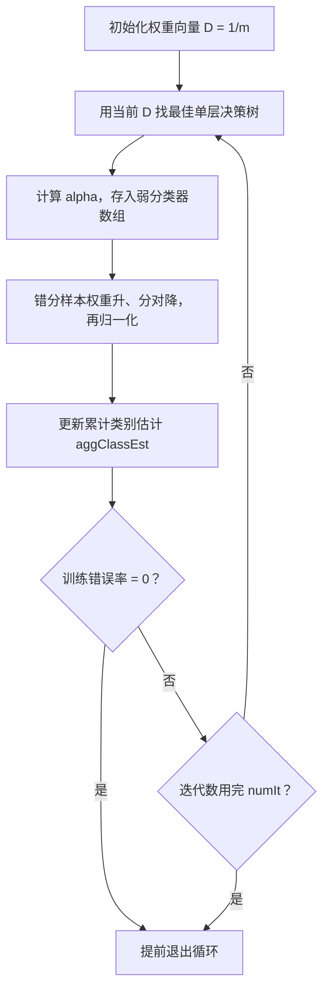

# 第 7 章 利用AdaBoost元算法提高分类性能

> **本章解决**：一个分类器不够强时，能不能把多个"弱"分类器组合成一个"强"分类器？集成方法（ensemble method）给出了肯定答案——bagging 靠随机重抽样加投票，boosting 靠串行训练加加权求和。本章主角 AdaBoost 是 boosting 的代表：用一批仅比瞎猜好一点点的单层决策树（decision stump），按各自错误率加权组装，得到错误率低得多的强分类器。
> 最后一节讨论所有分类器共有的难题——非均衡分类：正反例数量悬殊或错误代价不同时，改用正确率、召回率、ROC 曲线来评价，用代价函数和数据抽样来改进。

当做重要决定时，大家都会考虑吸取多个专家而不只是一个人的意见。机器学习处理问题时也是如此——这就是元算法（**meta-algorithm**）背后的思路：对其他算法进行组合的一种方式。有人认为 AdaBoost 是最好的监督学习方法之一，它是本章要集中关注的、最流行的元算法。

本章主线：先讨论分类器的集成方式（7.1）；然后讲 AdaBoost 的理论（7.2），建立单层决策树弱分类器（7.3），实现完整的 AdaBoost（7.4–7.5）；在一个难数据集上检验效果（7.6）；最后在结束分类话题之前，讨论所有分类器都会遇到的非均衡分类问题（7.7）。

## 7.0 本章导图

<div class="brtree">
  <div class="brrow">
    <span class="brlabel root">AdaBoost 元算法</span>
    <span class="brace"></span>
    <div class="brkids">
      <div class="brrow">
        <span class="brlabel">集成方法</span>
        <span class="brace"></span>
        <div class="brkids">
          <span class="brleaf">bagging：放回抽样 S 份 + 投票</span>
          <span class="brleaf">boosting：串行训练 + 关注错分样本</span>
          <span class="brleaf">随机森林（更先进的 bagging）</span>
        </div>
      </div>
      <div class="brrow">
        <span class="brlabel">AdaBoost 原理</span>
        <span class="brace"></span>
        <div class="brkids">
          <span class="brleaf">权重向量 D：初始 1/m，和为 1</span>
          <span class="brleaf">错误率 ε → 分类器权重 alpha</span>
          <span class="brleaf">错分样本加权，分对样本降权</span>
          <span class="brleaf">停止：错误率 0 或轮数用完</span>
        </div>
      </div>
      <div class="brrow">
        <span class="brlabel">弱学习器：单层决策树</span>
        <span class="brace"></span>
        <div class="brkids">
          <span class="brleaf">stumpClassify：阈值比较二分类</span>
          <span class="brleaf">buildStump：特征×阈值×不等号三层循环</span>
          <span class="brleaf">按权重 D 计算加权错误率</span>
        </div>
      </div>
      <div class="brrow">
        <span class="brlabel">训练完整算法</span>
        <span class="brace"></span>
        <div class="brkids">
          <span class="brleaf">adaBoostTrainDS：numIt 唯一用户参数</span>
          <span class="brleaf">aggClassEst：类别估计累计值</span>
          <span class="brleaf">错误率为 0 提前 break</span>
        </div>
      </div>
      <div class="brrow">
        <span class="brlabel">分类与实战</span>
        <span class="brace"></span>
        <div class="brkids">
          <span class="brleaf">adaClassify：加权求和取 sign</span>
          <span class="brleaf">马疝病难数据集：50 个 stump 见效</span>
          <span class="brleaf">错误率先降后升＝过拟合</span>
        </div>
      </div>
      <div class="brrow">
        <span class="brlabel">非均衡分类</span>
        <span class="brace"></span>
        <div class="brkids">
          <span class="brleaf">混淆矩阵：TP / FN / FP / TN</span>
          <span class="brleaf">正确率 Precision、召回率 Recall</span>
          <span class="brleaf">ROC 曲线与 AUC</span>
          <span class="brleaf">代价敏感学习</span>
          <span class="brleaf">过抽样 / 欠抽样</span>
        </div>
      </div>
    </div>
  </div>
</div>

## 7.1 基于数据集多重抽样的分类器

前面已经介绍了五种不同的分类算法，各有优缺点。我们自然可以把不同的分类器组合起来，组合结果称为集成方法（**ensemble method**）或者元算法（**meta-algorithm**）。使用集成方法时会有多种形式：

- 不同算法的集成；
- 同一算法在不同设置下的集成；
- 数据集不同部分分配给不同分类器之后的集成。

本章介绍基于**同一种分类器多个不同实例**的两种计算方法。在这些方法中，数据集会不断变化，而后应用于不同的实例分类器上。

| AdaBoost | |
| --- | --- |
| 优点 | 泛化错误率低，易编码，可以应用在大部分分类器上，无参数调整 |
| 缺点 | 对离群点敏感 |
| 适用数据类型 | 数值型和标称型数据 |

### 7.1.1 bagging：基于数据随机重抽样的分类器构建方法

自举汇聚法（**bootstrap aggregating**），也称为 bagging 方法，是从原始数据集选择 S 次后得到 S 个新数据集的一种技术。新数据集和原数据集**大小相等**。每个数据集都是通过在原始数据集中**随机选择一个样本来进行替换**而得到的——"替换"意味着可以多次选择同一样本，所以新数据集中可以有重复的值，而原始数据集的某些值在新集合中则不再出现。

!!! note "替换的准确含义（原书表述较绕，译者注已澄清）"
    原书正文说"随机选择一个样本，然后随机选择一个样本来代替这个样本"，读起来费解。译者注澄清：bagging 中的数据集通常认为是**放回取样**得到的——要得到大小为 n 的新数据集，其中每个样本都是在原始数据集中随机抽一次（抽完放回），独立重复 n 次的结果。

在 S 个数据集建好之后，将某个学习算法分别作用于每个数据集就得到了 S 个分类器。对新数据进行分类时，应用这 S 个分类器进行分类，**选择分类器投票结果中最多的类别**作为最后的分类结果。

还有一些更先进的 bagging 方法，比如随机森林（**random forest**）。

### 7.1.2 boosting

boosting 是一种与 bagging 很类似的技术。不论 boosting 还是 bagging，所使用的多个分类器的**类型都是一致的**。两点关键差别：

1. **串行训练**：boosting 中不同的分类器通过串行训练获得，每个新分类器都根据已训练出的分类器的性能来进行训练——boosting 通过**集中关注被已有分类器错分的那些数据**来获得新分类器；
2. **加权求和**：boosting 的分类结果基于所有分类器的加权求和。bagging 中的分类器权重相等；boosting 中的分类器权重并不相等，每个权重代表其对应分类器在上一轮迭代中的成功度。

boosting 方法拥有多个版本，本章只关注其中最流行的版本 AdaBoost。

!!! note "拓展：bagging 与 boosting 到底差在哪"
    | 维度 | bagging | boosting |
    | --- | --- | --- |
    | 训练方式 | 各分类器独立并行，互不影响 | 串行，后一个盯着前一个的错误 |
    | 数据来源 | 放回随机抽样，与错误无关 | 数据权重随上一轮错误调整 |
    | 组合方式 | 等权投票 | 按上轮成功度加权求和 |
    | 主要作用 | 降低方差（对数据扰动更稳） | 降低偏差（整体更准） |
    | 对离群点 | 不敏感 | 敏感（离群点权重会被越推越高） |

    顺着"降方差/降偏差"看：bagging 让模型对"换一批数据"这件事不敏感，是稳定模型的手段；boosting 让模型一轮轮修补自己的错误，是把弱模型变强的手段。AdaBoost 的"对离群点敏感"这个缺点，根源就在串行加权——错分的离群点权重指数上升，后面的分类器会被迫去拟合它。

## 7.2 训练算法：基于错误提升分类器的性能

能否使用弱分类器和多个实例来构建一个强分类器？这是一个非常有趣的理论问题。"弱"意味着分类器的性能**比随机猜测要略好**，但也不会好太多；"强"分类器的错误率则会低很多。AdaBoost 算法即脱胎于上述理论问题。

!!! warning "原书笔误"
    原书接下来一句写"在二分类情况下弱分类器的错误率会**高于** 50%"。这与前一句"比随机猜测要略好"矛盾——比随机（50% 错误率）略好，错误率应当**略低于 50%**。上下文逻辑与英文原版均支持"略低于"，按此理解。

AdaBoost 是 **adaptive boosting**（自适应 boosting）的缩写，其运行过程如下：

1. 训练数据中的每个样本都被赋予一个权重，这些权重构成向量 \(D\)。一开始这些权重都初始化成**相等值**；
2. 在训练数据上训练出一个弱分类器并计算该分类器的错误率，然后在同一数据集上**再次**训练弱分类器。第二次训练时会重新调整每个样本的权重：**第一次分对的样本权重降低，第一次分错的样本权重提高**；
3. 为了从所有弱分类器中得到最终的分类结果，AdaBoost 为每个分类器都分配一个权重值 alpha，alpha 基于每个弱分类器的错误率计算。

错误率 \(\varepsilon\) 的定义：**错分样本的权重之和**（\(D\) 均匀时就是错分样本数占总数的比例）：

\[
\varepsilon=\sum_{i:\ \text{样本 } i \text{ 被错分}} D_i
\]

alpha 的计算公式：

\[
\alpha=\frac{1}{2}\ln\frac{1-\varepsilon}{\varepsilon}
\]

!!! note "拓展：alpha 公式的直觉"
    把 \(\alpha=\frac{1}{2}\ln\frac{1-\varepsilon}{\varepsilon}\) 代几个值进去就看懂了：

    - \(\varepsilon=0.5\)（瞎猜）→ \(\alpha=0\)：这票等于没投，白给；
    - \(\varepsilon\to 0\)（几乎全对）→ \(\alpha\to+\infty\)：话语权极大；
    - \(\varepsilon>0.5\)（比瞎猜还差）→ \(\alpha<0\)：**负权**——把它的输出反过来用照样是"略好于瞎猜"，照样可用，这就是"自适应"。

AdaBoost 算法的流程如图 7-1 所示。

<figure>
  
  <figcaption>图 7.1 AdaBoost 算法示意图：左边数据集直方图的不同宽度表示每个样例的不同权重；加权的预测结果通过三角形中的 alpha 值加权，最后在圆形中求和得到最终输出（截自原书）</figcaption>
</figure>

计算出 alpha 之后，可以对权重向量 D 进行更新，使得正确分类的样本权重降低而错分样本权重升高。如果某个样本被**正确分类**，该样本的权重更改为：

\[
D_{t+1}^{(i)}=\frac{D_t^{(i)}\,\mathrm{e}^{-\alpha}}{\mathrm{Sum}(D)}
\]

如果某个样本被**错分**，该样本的权重更改为：

\[
D_{t+1}^{(i)}=\frac{D_t^{(i)}\,\mathrm{e}^{+\alpha}}{\mathrm{Sum}(D)}
\]

其中 \(\mathrm{Sum}(D)\) 是更新后权重向量的元素和，除以它是为了把 \(D\) 重新归一化成概率分布。在计算出 D 之后，AdaBoost 又进入下一轮迭代，不断重复训练和调整权重的过程，**直到训练错误率为 0 或者弱分类器的数目达到用户的指定值为止**。

## 7.3 基于单层决策树构建弱分类器

单层决策树（**decision stump**，也称决策树桩）是一种简单的决策树：仅基于**单个特征**做决策。由于这棵树只有一次分裂过程，它实际上就是一个树桩。

在构造 AdaBoost 的代码时，先用一个简单数据集确保算法实现一切就绪。建立一个叫 `adaboost.py` 的新文件并加入如下代码：

```python
# ===== 书 7.3 节：loadSimpData，造一个单层决策树切不开的简单数据集 =====
from numpy import *
from numpy import asmatrix as mat   # Python3/NumPy2 适配：mat 别名已从 numpy 移除，用 asmatrix 顶上
import builtins
_max = builtins.max                 # 适配：numpy 的 max 遮住了内置 max，后文 max(error,1e-16) 要用内置版

def loadSimpData():
    datMat = mat([[1.0, 2.1],
                  [2.0, 1.1],
                  [1.3, 1.0],
                  [1.0, 1.0],
                  [2.0, 1.0]])                 # 5 个样本，2 个特征
    classLabels = [1.0, 1.0, -1.0, -1.0, 1.0]  # 类别标签：+1 圆形点，-1 方形点
    return datMat, classLabels
```

图 7-2 给出了该数据集的示意图。如果想从某个坐标轴上选择一个值（即选择一条与坐标轴平行的直线）来把所有圆形点和方形点分开，这显然是不可能的。这是单层决策树难以处理的一个著名问题。而通过**多棵单层决策树**，就可以构建出一个能够对该数据集完全正确分类的分类器。

<figure>
  
  <figcaption>图 7.2 用于检测 AdaBoost 构建函数的简单数据——不可能仅通过在某个坐标轴上选择某个阈值将圆形点和方形点分开，AdaBoost 需要组合多个单层决策树才能正确分类（截自原书）</figcaption>
</figure>

<figure>
  
  <figcaption>图 7.3 loadSimpData 的 5 个数据点实跑散点：3 个圆形点（+1）、2 个方形点（-1），与图 7.2 对照（代码实跑）</figcaption>
</figure>

!!! warning "原书示意图与代码数据不完全一致"
    细看图 7.2 会发现它在 (1.4, 1.6) 附近画了一个圆点，而 `loadSimpData` 里并没有这个点；(2.0, 1.1) 与 (2.0, 1.0) 两个正例在图中几乎重叠成一个。这是原书配图的手绘误差，**数据以代码为准**（见图 7.3 的实跑散点）。

通过键入如下命令实现数据集和类标签的导入：

```python
# ===== 书 7.3 节：导入数据 =====
import adaboost
datMat, classLabels = adaboost.loadSimpData()
```

有了数据，接下来构建两个函数来建立单层决策树：第一个函数测试是否有某个值**小于或者大于**正在测试的阈值；第二个函数在加权数据集中循环，找到具有最低错误率的单层决策树。伪代码大致如下：

```text
将最小错误率 minError 设为 +∞
对数据集中的每一个特征（第一层循环）：
    对每个步长（第二层循环）：
        对每个不等号（第三层循环）：
            建立一棵单层决策树并利用加权数据集对它进行测试
            如果错误率低于 minError，则将当前单层决策树设为最佳单层决策树
返回最佳单层决策树
```

程序清单 7-1 的代码存入 `adaboost.py` 并保存（原书此处笔误写成 boost.py，与上文"建立叫 adaboost.py 的新文件"不一致，按 adaboost.py 理解）：

```python
# ===== 书 7.3 节 程序清单 7-1：单层决策树生成函数 =====
def stumpClassify(dataMatrix, dimen, threshVal, threshIneq):
    """按"特征 dimen 与阈值 threshVal 比较"分类：一边 -1，另一边 +1。"""
    retArray = ones((shape(dataMatrix)[0], 1))        # 先全部置 1
    if threshIneq == 'lt':                            # lt：小于等于阈值的置 -1
        retArray[dataMatrix[:, dimen] <= threshVal] = -1.0
    else:                                             # 否则 gt：大于阈值的置 -1
        retArray[dataMatrix[:, dimen] > threshVal] = -1.0
    return retArray

def buildStump(dataArr, classLabels, D):
    """遍历 stumpClassify 的所有输入组合，返回加权错误率最低的单层决策树。"""
    dataMatrix = mat(dataArr); labelMat = mat(classLabels).T   # 数据转矩阵、标签转列向量
    m, n = shape(dataMatrix)
    numSteps = 10.0                                    # 每个特征的步数
    bestStump = {}; bestClasEst = mat(zeros((m, 1)))   # 最佳 stump 字典 / 最佳类别估计
    minError = inf                                     # 最小加权错误率，初始 +∞
    for i in range(n):                                 # 第一层循环：所有特征
        rangeMin = dataMatrix[:, i].min(); rangeMax = dataMatrix[:, i].max()
        stepSize = (rangeMax - rangeMin) / numSteps    # 步长 = 取值范围 / 步数
        for j in range(-1, int(numSteps) + 1):         # 第二层循环：-1 与 10 越过取值端点
            for inequal in ['lt', 'gt']:               # 第三层循环：大于/小于之间切换
                threshVal = (rangeMin + float(j) * stepSize)
                predictedVals = stumpClassify(dataMatrix, i, threshVal, inequal)
                errArr = mat(ones((m, 1)))             # 错误向量：先默认全错
                errArr[predictedVals == labelMat] = 0  # 预测对的位置清 0
                weightedError = D.T * errArr           # 加权错误率 = 错分样本的权重之和
                # print("split: dim %d, thresh %.2f, thresh ineqal: %s, "
                #       "the weighted error is %.3f" % (i, threshVal, inequal,
                #                                       weightedError[0, 0]))
                if weightedError < minError:           # 更小则记录为当前最佳
                    minError = weightedError
                    bestClasEst = predictedVals.copy()
                    bestStump['dim'] = i
                    bestStump['thresh'] = threshVal
                    bestStump['ineq'] = inequal
    return bestStump, minError, bestClasEst
```

两个函数的分工：

- **stumpClassify()** 通过阈值比较对数据进行分类。所有在阈值一边的数据分到类别 -1，另一边分到类别 +1。实现用的是数组过滤：先把返回数组全部元素设置为 1，再把所有不满足不等式要求的元素设置为 -1。可以基于数据集中的任一元素比较，也可以把不等号在大于、小于之间切换；
- **buildStump()** 遍历 stumpClassify() 的所有可能输入值，找到数据集上最佳的单层决策树。这里的"最佳"是**基于数据的权重向量 D** 来定义的。函数先把 bestStump 建成空字典，用于存储给定权重向量 D 时得到的最佳单层决策树信息；numSteps 用于在特征的所有可能值上遍历；minError 一开始初始化为正无穷大，之后用于寻找可能的最小错误率。

三层嵌套的 for 循环是程序最主要的部分：第一层在数据集的所有特征上遍历；考虑到数值型特征，通过最小值和最大值确定步长；第二层在这些值上遍历——甚至**将阈值设置为整个取值范围之外也是可以的**，因此在取值范围之外还应该有两个额外的步骤；最后一个 for 循环在大于和小于之间切换不等式。

在嵌套的三层 for 循环之内，调用 stumpClassify() 得到分类预测结果；构建列向量 errArr，predictedVals 中不等于 labelMat 的位置为 1；将 errArr 和权重向量 D 的相应元素相乘再求和得到 weightedError。**这就是 AdaBoost 和分类器交互的地方**：基于权重向量 D 而不是其他错误计算指标来评价分类器。如果需要使用其他分类器作为弱分类器，就需要考虑 D 上最佳分类器所定义的计算过程。程序输出所有的值（这一行可以注释掉，但对理解函数的运行很有帮助）。最后将当前错误率与已有最小错误率对比，更小就把该单层决策树保存在字典 bestStump 中，并把字典、错误率和类别估计值返回给 AdaBoost 算法。

为了解实际运行过程，在 Python 提示符下输入（实跑输出）：

```text
>>> D = mat(ones((5,1))/5)
>>> adaboost.buildStump(datMat,classLabels,D)
split: dim 0, thresh 0.90, thresh ineqal: lt, the weighted error is 0.400
split: dim 0, thresh 0.90, thresh ineqal: gt, the weighted error is 0.600
split: dim 0, thresh 1.00, thresh ineqal: lt, the weighted error is 0.400
split: dim 0, thresh 1.00, thresh ineqal: gt, the weighted error is 0.600
.
.（共 2 特征 × 12 阈值 × 2 不等号 = 48 行，略）
.
split: dim 1, thresh 2.10, thresh ineqal: lt, the weighted error is 0.600
split: dim 1, thresh 2.10, thresh ineqal: gt, the weighted error is 0.400
({'dim': 0, 'ineq': 'lt', 'thresh': 1.3}, matrix([[0.2]]), matrix([[-1.],
     [ 1.],
     [-1.],
     [-1.],
     [ 1.]]))
```

<figure>
  
  <figcaption>图 7.4 单层决策树的 6 种试切（权重 D 均匀取 1/5）：绿色虚线是阈值，× 是被错分的点；特征 0、阈值 1.30、不等号 lt 时加权错误率最低（0.200）（代码实跑）</figcaption>
</figure>

<figure>
  
  <figcaption>图 7.5 buildStump 找到的最佳单层决策树：dim 0、thresh 1.3、lt——把 (1.0, 2.1) 这个正例切到了 -1 一侧，加权错误率 0.200（代码实跑）</figcaption>
</figure>

buildStump 在所有可能的值上遍历的同时输出结果，最后返回字典。可以思考一下：该字典是否对应了最小可能的加权错误率？是否存在其他的设置也能得到相同的错误率？——实跑验证：**存在并列**。例如 dim 0、thresh 1.90、lt（错分 (1.0, 2.1)）的加权错误率同样是 0.200；buildStump 用严格小于比较，并列时保留先遍历到的那个。

上述单层决策树的生成函数是决策树的一个简化版本，它就是所谓的**弱学习器**（weak learner），即弱分类算法。到这里，我们已经构建了单层决策树并生成程序，做好了过渡到完整 AdaBoost 算法的准备。

!!! note "拓展：为什么阈值要推到取值范围之外"
    `j` 取 -1 和 `numSteps`（10）这两个"额外步骤"，让阈值 \(\text{rangeMin}-\text{stepSize}\) 和 \(\text{rangeMax}+\text{stepSize}\) 越过了数据端点。这时"小于等于阈值"或"大于阈值"会对**所有样本**成立，等价于"全判 -1"或"全判 +1"的 stump。别小看它们：7.4 节的三轮迭代中，**第三轮正是靠一个"全判 +1"的 stump（dim 0、thresh 0.9、lt）收官**的——前两轮之后只剩下第 5 个点被错分且权重高达 0.5，此时"全体判正"加权错误率最低（0.143）。没有这两个额外步骤，这个 stump 根本进不了候选。

## 7.4 完整AdaBoost算法的实现

上一节构建了基于加权输入值进行决策的分类器。现在利用 7.3 节的单层决策树来实现 7.2 节给出提纲的算法。整个实现的伪代码如下：

```text
对每次迭代：
    利用 buildStump() 函数找到最佳的单层决策树
    将最佳单层决策树加入到单层决策树数组
    计算 alpha
    计算新的权重向量 D
    更新累计类别估计值
    如果错误率等于 0.0，则退出循环
```



打开 `adaboost.py` 文件并将程序清单 7-2 的代码加入其中：

```python
# ===== 书 7.4 节 程序清单 7-2：基于单层决策树的 AdaBoost 训练过程 =====
def adaBoostTrainDS(dataArr, classLabels, numIt=40):
    weakClassArr = []                              # 单层决策树数组（DS = decision stump）
    m = shape(dataArr)[0]                          # 数据点数目
    D = mat(ones((m, 1)) / m)                      # 权重向量 D：初始均等 1/m，是概率分布（和为 1.0）
    aggClassEst = mat(zeros((m, 1)))               # 每个数据点的类别估计累计值
    for i in range(numIt):                         # 核心：运行 numIt 次或直到训练错误率为 0
        bestStump, error, classEst = buildStump(dataArr, classLabels, D)
        print("D:", D.T)
        # alpha = 1/2 * ln((1-err)/err)；max(error,1e-16) 防止没有错误时除零溢出。
        # 书里写的是内置 max；因 from numpy import * 已遮蔽内置 max，故用 _max（见 7.3 顶部）。
        alpha = float((0.5 * log((1.0 - error) / _max(error, 1e-16))).item())
        bestStump['alpha'] = alpha                 # alpha 存入字典 → 字典加入列表
        weakClassArr.append(bestStump)             # 该字典包括分类所需的所有信息
        print("classEst: ", classEst.T)
        expon = multiply(-1 * alpha * mat(classLabels).T, classEst)  # 分对得 -alpha，分错得 +alpha
        D = multiply(D, exp(expon))                # 按 7.2 节公式更新 D
        D = D / D.sum()                            # 归一化：保证 D 的所有元素之和仍为 1.0
        aggClassEst += alpha * classEst            # 累计类别估计值（加权求和）
        print("aggClassEst: ", aggClassEst.T)
        aggErrors = multiply(sign(aggClassEst) != mat(classLabels).T, ones((m, 1)))
        errorRate = aggErrors.sum() / m            # 训练错误率 = 错分点数 / m
        print("total error: ", errorRate)
        if errorRate == 0.0: break                 # 总错误率为 0，提前中止
    return weakClassArr                            # 书 7.7.1：改 return weakClassArr, aggClassEst
```

!!! warning "Python 3 / NumPy 2 运行适配（照抄原书会报错）"
    原书是 Python 2 + 老版 numpy。在本笔记的 Python 3 + NumPy 2 环境实跑，需要动三处（都已写进上面代码）：

    1. **`mat` 别名没了**：NumPy 2.0 从顶层命名空间移除了 `mat`，用 `from numpy import asmatrix as mat` 顶上；
    2. **`max` 被遮蔽**：`from numpy import *` 会用 `numpy.max` 遮住内置 `max`，原书 `max(error,1e-16)` 会变成 `numpy.max(error, axis=1e-16)` 直接 `TypeError`——先 `import builtins; _max = builtins.max` 再用；
    3. **`float(1×1矩阵)` 已弃用**：老 numpy 里 `float(matrix([[0.2]]))` 能安静地取出标量，NumPy 1.25 起发 DeprecationWarning，用 `.item()` 替代。

AdaBoost 算法的输入参数包括数据集、类别标签以及迭代次数 numIt，其中 **numIt 是整个 AdaBoost 算法中唯一需要用户指定的参数**。假定迭代次数设为 9：如果算法在第三次迭代之后错误率为 0，就会退出迭代过程，此时就不需要执行所有的 9 次。每次迭代的中间结果都通过 print 语句输出，了解内部运行过程后可以把 print 语句注释掉。

函数名称尾部的 **DS 代表单层决策树（decision stump）**，它是 AdaBoost 中最流行的弱分类器，但并非唯一可用的弱分类器。上述函数建立在单层决策树之上，但很容易修改以引入其他基分类器——实际上任意分类器都可以作为基分类器，本书前面讲到的任何一个算法都行。算法输出一个单层决策树的数组，因此首先建立一个新表存储；然后得到数据点的数目 m，并建立列向量 D。

向量 D 非常重要，它包含了**每个数据点的权重**。一开始这些权重都赋予相等的值。在后续迭代中，AdaBoost 算法会在增加错分数据的权重的同时降低正确分类数据的权重。**D 是一个概率分布向量，其所有元素之和为 1.0**——为满足此要求，一开始的所有元素都初始化成 \(1/m\)。程序还建立另一个列向量 aggClassEst，记录每个数据点的类别估计累计值。

AdaBoost 算法的核心在于 for 循环。循环第一件事是利用 buildStump() 建立单层决策树：输入权重向量 D，返回利用 D 得到的具有最小错误率的单层决策树，同时返回最小错误率以及估计的类别向量。

接下来计算 alpha 值：它告诉总分类器本次单层决策树输出结果的权重。`max(error, 1e-16)` 用于确保在没有错误时不会发生除零溢出。alpha 加入 bestStump 字典，字典又添加到列表中——该字典包括了分类所需的全部信息（特征维、阈值、不等号方向、alpha）。

接下来的三行用于计算下一次迭代的新权重向量 D。在训练错误率为 0 时提前结束 for 循环：程序通过 aggClassEst 变量保持一个**运行时的类别估计值**来实现——该值只是一个浮点数，为了得到二值分类结果还需要调用 sign() 函数。如果总错误率为 0，则由 break 语句中止 for 循环。

观察中间的运行结果（实跑输出）。数据的类别标签为 \([1.0,\ 1.0,\ -1.0,\ -1.0,\ 1.0]\)：

```text
>>> classifierArray = adaboost.adaBoostTrainDS(datMat,classLabels,9)
D: [[0.2 0.2 0.2 0.2 0.2]]
classEst:  [[-1.  1. -1. -1.  1.]]
aggClassEst:  [[-0.69314718  0.69314718 -0.69314718 -0.69314718  0.69314718]]
total error:  0.2

D: [[0.5   0.125 0.125 0.125 0.125]]
classEst:  [[ 1.  1. -1. -1. -1.]]
aggClassEst:  [[ 0.27980789  1.66610226 -1.66610226 -1.66610226 -0.27980789]]
total error:  0.2

D: [[0.28571429 0.07142857 0.07142857 0.07142857 0.5       ]]
classEst:  [[1. 1. 1. 1. 1.]]
aggClassEst:  [[ 1.17568763  2.56198199 -0.77022252 -0.77022252  0.61607184]]
total error:  0.0
```

第一轮迭代中 D 的所有值相等（均为 0.2），只有**第一个数据点**被错分了。因此在第二轮迭代中，D 向量给第一个数据点 0.5 的权重（分错样本 \(\mathrm{e}^{+\alpha}\) 加权、分对样本 \(\mathrm{e}^{-\alpha}\) 降权再归一化的结果）。第二轮迭代之后，第一个数据点已经正确分类，但此时**最后一个数据点**却是错分了——D 向量的最后一个元素变成 0.5，而其他值都变得非常小。第三次迭代之后 aggClassEst 所有值的符号和真实类别标签完全吻合，训练错误率为 0，程序就此退出。

<figure>
  
  <figcaption>图 7.6 三轮迭代中权重向量 D 的变化：错分的样本权重升高（0.2 → 0.5），分对的被压低（0.2 → 0.125 → 0.071）（代码实跑）</figcaption>
</figure>

<figure>
  
  <figcaption>图 7.7 累计类别估计值 aggClassEst 逐轮叠加：样本 0 的估计值从 -0.69 翻正到 +0.28，样本 4 从 +0.69 翻负到 -0.28，第 3 个弱分类器叠加后所有符号与真实类别一致（代码实跑）</figcaption>
</figure>

<figure>
  
  <figcaption>图 7.8 单层决策树组合出非线性边界：一条直线切不开的数据，三个 stump（dim 0 thresh 1.3 lt → dim 1 thresh 1.0 lt → dim 0 thresh 0.9 lt）叠加就分对了——这正是"分段常数"式决策面（代码实跑）</figcaption>
</figure>

为了观察 classifierArray 的值，键入：

```text
>>> classifierArray
[{'dim': 0, 'ineq': 'lt', 'thresh': 1.3, 'alpha': 0.6931471805599453},
 {'dim': 1, 'ineq': 'lt', 'thresh': 1.0, 'alpha': 0.9729550745276565},
 {'dim': 0, 'ineq': 'lt', 'thresh': 0.9, 'alpha': 0.8958797346140273}]
```

该数组包含三部词典，其中包含分类所需要的所有信息。此时一个分类器已经构建成功，而且只要愿意，随时都可以将训练错误率降到 0。那么**测试错误率**会如何呢？为了观察测试错误率，需要编写分类的代码——下一节讨论分类。

!!! note "勘误核查：D 更新与 aggErrors 写法对照标准 AdaBoost"
    **权重更新**：代码 `expon = -α·label·classEst`。标签与估计值都取 ±1，两者同号（分对）乘积为 +1，指数为 \(-\alpha\)；异号（分错）乘积为 -1，指数为 \(+\alpha\)；再乘旧 \(D\)、除以 \(\mathrm{Sum}(D)\) 归一化——与 7.2 节的两条更新公式逐字一致，无错。

    **aggErrors 的写法**：`multiply(sign(aggClassEst) != mat(classLabels).T, ones((m,1)))` 先得到布尔矩阵，再与全 1 矩阵逐元素相乘变成 0/1 数值矩阵求和。写法绕但正确。一个边角：`sign()` 对 0 返回 0，与任何 ±1 标签都不等、会被算成"错分"——本书标签只有 ±1、aggClassEst 几乎不可能恰为 0，实际不受影响；但换标签体系（如 0/1）重用这段代码时要注意。

## 7.5 测试算法：基于AdaBoost的分类

一旦拥有了多个弱分类器以及其对应的 alpha 值，进行测试就相当容易了。adaBoostTrainDS() 中实际已经写完大部分代码，现在只需把弱分类器的训练过程抽出来，应用到某个具体的实例上：每个弱分类器的结果以其对应的 alpha 值作为权重，**所有弱分类器的结果加权求和就得到最后的结果**。将下列代码添加到 `adaboost.py` 中：

```python
# ===== 书 7.5 节 程序清单 7-3：AdaBoost 分类函数 =====
def adaClassify(datToClass, classifierArr):
    dataMatrix = mat(datToClass)                   # 待分类样例转矩阵（可以是一个或多个）
    m = shape(dataMatrix)[0]                       # 待分类样例个数
    aggClassEst = mat(zeros((m, 1)))               # 类别估计累计值，含义同训练函数
    for i in range(len(classifierArr)):            # 遍历所有弱分类器
        classEst = stumpClassify(dataMatrix, classifierArr[i]['dim'],\
                                 classifierArr[i]['thresh'],\
                                 classifierArr[i]['ineq'])   # 直接套用单层决策树
        aggClassEst += classifierArr[i]['alpha'] * classEst  # 估计值 × alpha 累加
        print(aggClassEst)                         # 观察每次迭代后的变化（可注释掉）
    return sign(aggClassEst)                       # 大于 0 返回 +1，小于 0 返回 -1
```

adaClassify() 利用训练出的多个弱分类器进行分类。输入是由一个或多个待分类样例 datToClass 以及多个弱分类器组成的数组 classifierArr。函数先把 datToClass 转换成 NumPy 矩阵并得到待分类样例的个数 m，然后构建 0 列向量 aggClassEst（与 adaBoostTrainDS() 中的含义一样）。

接下来遍历 classifierArr 中的所有弱分类器，基于 stumpClassify() 对每个分类器得到一个类别估计值。在构建单层决策树时，我们在所有可能的树桩值上迭代来得到具有最小加权错误率的单层决策树；而这里只是**简单地应用**单层决策树。输出的类别估计值乘上该单层决策树的 alpha 权重，累加到 aggClassEst 上。最后返回 aggClassEst 的符号：大于 0 则返回 +1，小于 0 则返回 -1。

看看实际运行效果（实跑输出）：

```text
>>> adaboost.adaClassify([0,0],classifierArray)
[[-0.69314718]]
[[-1.66610226]]
[[-2.56198199]]
matrix([[-1.]])
```

随着迭代的进行，数据点 [0,0] 的分类结果越来越强（-0.693 → -1.666 → -2.562，离 0 越来越远，置信度越来越高），最终符号为 -1。在其他点上分类：

```text
>>> adaboost.adaClassify([[5, 5],[0,0]],classifierArray)
[[ 0.69314718]
 [-0.69314718]]
[[ 1.66610226]
 [-1.66610226]]
[[ 2.56198199]
 [-2.56198199]]
matrix([[ 1.],
        [-1.]])
```

这两个点的分类结果也会随着迭代的进行而越来越强。下一节将该分类器应用到一个规模更大、难度也更大的真实数据集中。

## 7.6 示例：在一个难数据集上应用AdaBoost

本节在第 5 章给出的马疝病数据集上应用 AdaBoost 分类器。第 5 章曾利用 Logistic 回归预测患有疝病的马能否存活，本节想知道：利用多个单层决策树和 AdaBoost 能不能预测得更准。

!!! warning "原书笔误：章号写错"
    原书本节两处写"第 4 章给出的马疝病数据集 / 第 4 章利用 Logistic 回归"，而同节后文又写"在第 5 章中……采用 Logistic 回归"。Logistic 回归是本书第 5 章的内容，"第 4 章"系笔误。

示例：在一个难数据集上的 AdaBoost 应用

1. **收集数据**：提供的文本文件；
2. **准备数据**：确保类别标签是 +1 和 -1 而非 1 和 0；
3. **分析数据**：手工检查数据；
4. **训练算法**：在数据上，利用 adaBoostTrainDS() 函数训练出一系列的分类器；
5. **测试算法**：拥有两个数据集，在不采用随机抽样的方法下，对 AdaBoost 和 Logistic 回归的结果进行完全对等的比较；
6. **使用算法**：观察该例子上的错误率。也可以构建一个 Web 网站，让驯马师输入马的症状然后预测马是否会死去。

!!! note "运行环境"
    本章笔记代码复用第 5 章的数据文件 `horseColicTraining.txt` 与 `horseColicTest.txt`（存于 `E:\Desktop\深度学习\_ml_data\Ch05\`）。**运行时工作目录需在数据所在目录**（或把路径改成文件所在位置），否则 loadDataSet 读不到文件。原书用的是标签已转为 ±1 的 `horseColicTraining2.txt / horseColicTest2.txt`；第 5 章数据的标签是 1/0，加载后需把 0 映射成 -1（见下段代码第一行命令的注释）。

在使用程序清单中的代码之前，必须要有向文件中加载数据的方法。程序清单 7-4 给出常见 loadDataSet() 的写法：

```python
# ===== 书 7.6 节 程序清单 7-4：自适应数据加载函数 =====
def loadDataSet(fileName):
    numFeat = len(open(fileName).readline().split('\t'))   # 自动检测特征数目：数第一行的字段数
    dataMat = []; labelMat = []
    fr = open(fileName)
    for line in fr.readlines():
        lineArr = []
        curLine = line.strip().split('\t')                 # 按制表符切分
        for i in range(numFeat - 1):                       # 前 numFeat-1 列是特征
            lineArr.append(float(curLine[i]))
        dataMat.append(lineArr)
        labelMat.append(float(curLine[-1]))                # 假定最后一列是类别标签
    return dataMat, labelMat
```

之前可能多次见过 loadDataSet() 函数。这里与前面的稍有不同：**不必指定每个文件中的特征数目**，该函数能够自动检测出特征的数目；同时假定最后一个特征是类别标签。

将上述代码添加到 `adaboost.py` 后输入如下命令使用（实跑输出）：

```text
>>> datArr,labelArr = adaboost.loadDataSet('horseColicTraining.txt')   # 标签 0→-1
>>> classifierArray = adaboost.adaBoostTrainDS(datArr,labelArr,10)
total error: 0.284280936455
.
.（中间各轮输出略，逐轮下降）
.
total error: 0.230769230769
>>> testArr,testLabelArr = adaboost.loadDataSet('horseColicTest.txt')
>>> prediction10 = adaboost.adaClassify(testArr,classifierArray)
>>> errArr = mat(ones((67,1)))
>>> errArr[prediction10!=mat(testLabelArr).T].sum()
16.0
```

要得到错误率，只需将上述错分样例的个数除以 67 即可：\(16/67 \approx 0.2388\)。

将弱分类器的数目设定为 1 到 10 000 之间的几个不同数字并运行上述过程，得到的结果如表 7-1 所示。该数据集上得到的错误率相当低：第 5 章在同一数据集上采用 Logistic 回归得到的平均错误率为 0.35，而采用 AdaBoost 得到的错误率永远不会那么高。从表中可以看出，**仅仅使用 50 个弱分类器，就达到了较高的性能**。

| 分类器数目 | 训练错误率（书） | 测试错误率（书） | 训练错误率（实跑） | 测试错误率（实跑） |
| --- | --- | --- | --- | --- |
| 1 | 0.28 | 0.27 | 0.2843 | 0.2687 |
| 10 | 0.23 | 0.24 | 0.2308 | 0.2388 |
| 50 | 0.19 | 0.21 | 0.1873 | 0.2090 |
| 100 | 0.19 | 0.22 | 0.1906 | 0.2239 |
| 500 | 0.16 | 0.25 | 0.1572 | 0.2537 |
| 1000 | 0.14 | 0.31 | 0.1405 | 0.3134 |
| 10000 | 0.11 | 0.33 | （未实跑，太慢） | （未实跑，太慢） |

表 7-1 不同弱分类器数目情况下的 AdaBoost 训练和测试错误率（数值即错误率比例，0.28 = 28%；实跑列为本笔记在 Python 3 + NumPy 2 环境的复现结果，与书完全对得上；书表头写"错误率（%）"，数值按小数读）。

<figure>
  
  <figcaption>图 7.9 马疝病数据上训练/测试错误率随弱分类器数目的变化（1–1000，对数横轴）：训练错误率一路下降，测试错误率在 50 个弱分类器附近见底（约 0.21）后回升（代码实跑）</figcaption>
</figure>

观察表 7-1 中的测试错误率一栏：测试错误率在达到了一个最小值之后又开始上升了。这类现象称为**过拟合（overfitting，也称过学习）**。有文献声称，对于表现好的数据集，AdaBoost 的测试错误率会达到一个稳定值，并不会随分类器的增多而上升——或许本例的数据集称不上"表现好"。该数据集一开始有 30% 的缺失值，对于 Logistic 回归而言这些缺失值的假设是有效的，而对于决策树却可能并不合适。如果回到数据集，把所有的 0 值替换成其他值或者给定类别的平均值，能否得到更好的性能？

很多人都认为，AdaBoost 和 SVM 是监督机器学习中最强大的两种方法。实际上两者之间拥有不少相似之处：可以把弱分类器想象成 SVM 中的一个核函数，也可以按照最大化某个最小间隔的方式重写 AdaBoost 算法。两者不同在于所定义的**间隔计算方式**有所不同，导致的结果也不同——特别是在高维空间下，差异会更加明显。

!!! note "拓展：过拟合是怎么被 AdaBoost"养"出来的"
    表 7-1 里训练错误率降到 0.11、测试错误率却涨到 0.33——训练集上越来越完美，新数据上越来越差。机制：AdaBoost 每轮给错分样本加权，**噪声点和离群点也会被反复加权**，后期的弱分类器为了压低加权错误率，不得不去拟合这些"不该学"的样本。这正好呼应 7.1 节缺点栏里的"对离群点敏感"。表现干净的数据集上错分点多数是真难样本，加权是正向激励；噪声多的数据集上加权就成了"强制背题"，所以有文献说"表现好的数据集测试错误率会稳定"。

## 7.7 非均衡分类问题

在结束分类这个主题之前，还必须讨论一个问题。前面六章的所有分类介绍中，都假设**所有类别的分类代价是一样的**。例如第 5 章构建了用于检测患疝病的马匹是否存活的系统，但并没有对分类后的情形加以讨论：假如某人牵来一匹马，希望预测这匹马能否生存；如果预测"马会死"，他们可能会对马实施安乐死，而不是通过喂药来延缓其不可避免的死亡过程。如果预测错误，就错杀了一个昂贵的动物——更何况人对马还有情感上的依恋，而分类器只有 80% 的精确率（accuracy）。

如何过滤垃圾邮件？如果收件箱中会出现某些垃圾邮件，但**合法邮件永远不会被扔进垃圾邮件夹**，人们是否会满意？癌症检测呢？只要患病的人不会得不到治疗，那么再找一个医生来看看会不会更好（即情愿误判也不漏判）？

还可以举出很多这样的例子。坦白地说，大多数情况下**不同类别的分类代价并不相等**。本节考察一种新的分类器性能度量方法，并通过图像技术对非均衡问题下不同分类器的性能进行可视化，然后考察两种能把不同决策代价考虑在内的分类器变换算法。

### 7.7.1 其他分类性能度量指标：正确率、召回率及 ROC 曲线

到目前为止，本书都是基于错误率来衡量分类器任务的成功程度的：错误率指在所有测试样例中错分的样例比例。这样的度量**掩盖了样例如何被分错的事实**。在机器学习中，有一个普遍适用的工具——混淆矩阵（**confusion matrix**），帮助人们更好地了解分类中的错误。表 7-2 是"预测房子周围可能发现的动物类型"这个三类问题的混淆矩阵：

| 真实 ＼ 预测 | 狗 | 猫 | 鼠 |
| --- | --- | --- | --- |
| 狗 | 24 | 2 | 5 |
| 猫 | 2 | 27 | 0 |
| 鼠 | 4 | 2 | 30 |

利用混淆矩阵就可以更好地理解分类中的错误了：**如果矩阵中的非对角元素均为 0，就会得到一个完美的分类器**。

再考虑一个二类问题的混淆矩阵（表 7-3）。如果将一个正例判为正例，产生了一个真正例（**True Positive**，TP，也称真阳）；对一个反例正确地判为反例，产生了一个真反例（**True Negative**，TN，也称真阴）；相应地，另外两种情况分别称为伪反例（**False Negative**，FN，也称假阴）和伪正例（**False Positive**，FP，也称假阳）。

| 真实 ＼ 预测 | +1 | -1 |
| --- | --- | --- |
| +1 | 真正例（TP） | 伪反例（FN） |
| -1 | 伪正例（FP） | 真反例（TN） |

当某个类别的重要性高于其他类别时，就可以利用上述定义构造出比错误率更好的新指标。第一个指标是**正确率（Precision）**，第二个指标是**召回率（Recall）**：

\[
\text{正确率}=\frac{TP}{TP+FP} \qquad \text{召回率}=\frac{TP}{TP+FN}
\]

- 正确率给出的是**预测为正例的样本中真正正例的比例**；
- 召回率给出的是**预测为正例的真实正例占所有真实正例的比例**。在召回率很大的分类器中，真正判错的正例的数目并不多。

可以很容易构造一个高正确率**或**高召回率的分类器，但很难同时保证两者成立：如果将任何样本都判为正例，那么召回率达到百分之百而此时正确率很低。构建一个同时使正确率和召回率最大的分类器是具有挑战性的。

另一个用于度量分类中非均衡性的工具是 **ROC 曲线（ROC curve）**。ROC 代表**接收者操作特征（receiver operating characteristic）**，最早在二战期间由电气工程师构建雷达系统时使用。图 7-10 给出了一条 ROC 曲线的例子。

<figure>
  
  <figcaption>图 7.10 利用 10 个单层决策树的 AdaBoost 马疝病检测系统的 ROC 曲线：实线是分类器，虚线是随机猜测的结果曲线（截自原书）</figcaption>
</figure>

图 7-10 的 ROC 曲线中，横轴是**伪正例的比例**（假阳率 \(=FP/(FP+TN)\)），纵轴是**真正例的比例**（真阳率 \(=TP/(TP+FN)\)）。ROC 曲线给出的是**当阈值变化时假阳率和真阳率的变化情况**：左下角的点对应将所有样例判为反例的情况，右上角的点对应将所有样例判为正例的情况；虚线给出的是随机猜测的结果曲线。

ROC 曲线不但可以用于比较分类器，还可以基于**成本效益（cost-versus-benefit）分析**来做出决策。在不同阈值下，不同分类器的表现可能各不相同，因此以某种方式将它们组合起来或许更有意义——如果只是简单地观察分类器的错误率，就难以得到这种更深入的洞察效果。

理想情况下，最佳分类器应该尽可能处于**左上角**：在假阳率很低的同时获得很高的真阳率。例如在垃圾邮件过滤中，这相当于过滤了所有的垃圾邮件，但没有将任何合法邮件误识为垃圾邮件放入垃圾邮件文件夹。

对不同 ROC 曲线进行比较的一个指标是**曲线下的面积（Area Under the Curve，AUC）**。AUC 给出的是分类器的平均性能值，当然它并不能完全代替对整条曲线的观察。一个完美分类器的 AUC 为 1.0，而随机猜测的 AUC 则为 0.5。

!!! warning "原书笔误（两处）"
    1. 原书正文写"曲线下的面积（Area **Unser** the Curve，AUC）"——"Unser"应为"**Under**"。
    2. 原书解释排序游程时写"如果该样例属于反例，那么对**假阴率**进行修改"——游程在 x 轴方向倒退，修改的是**假阳率**（False Positive Rate），x 轴标签本身写的就是假阳率。

为了画出 ROC 曲线，分类器必须提供**每个样例被判为阳性或者阴性的可信程度值**。尽管大多数分类器都能做到这一点，但通常情况下，这些值会在最后输出离散分类标签之前被清除：朴素贝叶斯能够提供一个可能性；Logistic 回归中输入到 Sigmoid 函数中的是一个数值；AdaBoost 和 SVM 中都会计算出一个数值然后输入到 sign() 函数中。所有这些值都可以用于衡量给定分类器的**预测强度**。

创建 ROC 曲线的做法：首先将分类样例按照其预测强度**排序**。先从排名最低的样例开始，所有排名更低的样例都被判为反例，而所有排名更高的样例都被判为正例，该情况对应的点为 \<1.0, 1.0\>。然后移到排名次低的样例中去：如果该样例属于正例，对真阳率进行修改；如果该样例属于反例，对假阳率进行修改。

上述过程听起来容易让人混淆，但阅读程序清单 7-5 中的代码就一目了然了。打开 `adaboost.py` 加入如下代码：

```python
# ===== 书 7.7.1 节 程序清单 7-5：ROC 曲线的绘制及 AUC 计算函数 =====
def plotROC(predStrengths, classLabels):
    import matplotlib.pyplot as plt
    cur = (1.0, 1.0)                              # 绘制光标的位置，从右上角 (1,1) 出发
    ySum = 0.0                                    # 累加矩形高度，用于计算 AUC
    numPosClas = sum(array(classLabels) == 1.0)   # 正例数目（数组过滤）
    yStep = 1 / float(numPosClas)                 # y 轴步长：1 / 正例数
    xStep = 1 / float(len(classLabels) - numPosClas)  # x 轴步长：1 / 反例数
    sortedIndicies = predStrengths.argsort()      # 按预测强度升序排好序的索引
    fig = plt.figure()
    fig.clf()
    ax = plt.subplot(111)
    for index in sortedIndicies.tolist()[0]:      # 矩阵要转成表才能迭代
        if classLabels[index] == 1.0:             # 正例：沿 y 轴下降一个步长
            delX = 0; delY = yStep
        else:                                     # 反例：沿 x 轴倒退一个步长
            delX = xStep; delY = 0
            ySum += cur[1]                        # 累加横向游程处的曲线高度
        ax.plot([cur[0], cur[0] - delX], [cur[1], cur[1] - delY], c='b')
        cur = (cur[0] - delX, cur[1] - delY)      # 更新当前点
    ax.plot([0, 1], [0, 1], 'b--')                # 虚线：随机猜测的参照线
    plt.xlabel('False Positive Rate'); plt.ylabel('True Positive Rate')
    plt.title('ROC curve for AdaBoost Horse Colic Detection System')
    ax.axis([0, 1, 0, 1])
    plt.show()
    print("the Area Under the Curve is: ", ySum * xStep)   # 高度和 × 宽度 = AUC
```

函数有两个输入参数：第一个是 NumPy 数组或者由行向量组成的矩阵，代表**分类器的预测强度**——这些数值在分类器和训练函数把它们应用到 sign() 函数之前就已产生；第二个是先前使用过的 classLabels。程序首先导入 pyplot，然后构建一个浮点数二元组并初始化为 (1.0, 1.0)——这是绘制光标的位置；变量 ySum 用于计算 AUC。接着通过数组过滤计算正例数目 numPosClas：它确定了 y 坐标轴上的步进数目，在 x 轴和 y 轴的 0.0 到 1.0 区间上绘点，因此 y 轴步长是 \(1.0/\text{numPosClas}\)，类似可得 x 轴步长。

排序索引是按**最小到最大**的顺序排列的，因此要从点 \<1.0, 1.0\> 开始绘，一直到 \<0, 0\>。这些值在 NumPy 数组或矩阵中排序，Python 需要一个表来进行迭代循环，所以要调用 tolist() 方法。遍历时，每得到一个标签为 1.0 的类，沿 y 轴方向下降一个步长（不断降低真阳率）；对每个其他类别的标签，在 x 轴方向上倒退一个步长（假阳率方向）。上述代码只关注 1 这个类别标签，因此无所谓采用 1/0 标签还是 +1/-1 标签。

计算 AUC 的思路：对多个小矩形的面积累加，小矩形的宽度是 xStep，因此先对所有矩形的高度累加，最后乘以 xStep 得到总面积。所有高度的和（ySum）随 x 轴的每次移动渐次增加。决定了移动方向后，就在当前点和新点之间画出一条线段，然后更新当前点 cur。

为了解实际运行效果，需要将 adaBoostTrainDS() 的最后一行代码替换成：

```python
    return weakClassArr, aggClassEst              # 书 7.7.1 的要求：把累计估计值也返回
```

以得到 aggClassEst 的值。然后在 Python 提示符下键入（实跑输出）：

```text
>>> classifierArray,aggClassEst = adaboost.adaBoostTrainDS(datArr,labelArr,10)
>>> adaboost.plotROC(aggClassEst.T,labelArr)
the Area Under the Curve is:  0.8586684000371433
```

书上的运行结果为 0.858296943506，本笔记实跑为 0.8586684000——差别来自并列预测强度在 argsort 中的先后次序（见下方拓展），AUC 量级与结论完全一致。注意传给 plotROC 的是 `aggClassEst.T`：**行向量**（1×m）。

<figure>
  
  <figcaption>图 7.11 马疝病数据 10 个弱分类器的 ROC 曲线实跑：曲线明显压在随机猜测虚线的左上方（代码实跑）</figcaption>
</figure>

当初在 50 个弱分类器下得到了最优的分类性能，那么这种情况下的 ROC 曲线会如何？AUC 是不是更好？——是更好：

```text
>>> classifierArray,aggClassEst = adaboost.adaBoostTrainDS(datArr,labelArr,50)
>>> adaboost.plotROC(aggClassEst.T,labelArr)
the Area Under the Curve is:  0.8954870461509897
```

<figure>
  
  <figcaption>图 7.12 弱分类器数目 10 → 50：ROC 曲线整体向左上移动，AUC 从 0.8587 增大到 0.8955（代码实跑）</figcaption>
</figure>

!!! note "拓展：AUC 实跑值与书差 0.0004 的原因——并列强度的"切角""
    `predStrengths.argsort()` 对并列的预测强度给出任意先后序，而 plotROC 是一个样例一个样例地挪动光标。两个强度相同的样例如果一正一反，"先正后反"和"先反后正"画出的阶梯路径不同——后者会把阶梯"切"出一块凸角，使面积略有出入。严谨的做法是把**强度相同的样例作为一组同时移动**（沿对角线走）。这解释了书值 0.858296 与本机实跑 0.858668 的微小差异；哪个高一点取决于并列组的排列运气，不影响任何结论。

### 7.7.2 基于代价函数的分类器决策控制

除了调节分类器的阈值之外，还有其他可以用于处理非均衡分类代价的方法，其中一种称为**代价敏感的学习（cost-sensitive learning）**。考虑表 7-4 中的代价矩阵：第一张是目前为止分类器的代价矩阵（代价不是 0 就是 1），总代价为 \(TP\times0+FN\times1+FP\times1+TN\times0\)；第二张代价矩阵下分类代价的计算公式为 \(TP\times(-5)+FN\times1+FP\times50+TN\times0\)——两种分类错误的代价不一样，两种正确分类所得到的收益也不一样。如果在构建分类器时知道了这些代价值，就可以选择**付出最小代价**的分类器。

| 真实 ＼ 预测 | +1 | -1 |
| --- | --- | --- |
| +1 | 0 | 1 |
| -1 | 1 | 0 |

| 真实 ＼ 预测 | +1 | -1 |
| --- | --- | --- |
| +1 | -5 | 1 |
| -1 | 50 | 0 |

表 7-4 一个二类问题的代价矩阵：上为 0/1 代价，下为"错杀代价 50、漏检代价 1、正确判正奖励 5"的代价矩阵

在分类算法中引入代价信息的方法：

- **AdaBoost**：可以基于代价函数来调整错误权重向量 D；
- **朴素贝叶斯**：可以选择具有最小期望代价而不是最大概率的类别作为最后的结果；
- **SVM**：可以在代价函数中对不同的类别选择不同的参数 C。

上述做法都会**给较小类更多的权重**——即在训练时，小类当中只允许更少的错误。

### 7.7.3 处理非均衡问题的数据抽样方法

另一种针对非均衡问题调节分类器的方法，是对分类器的**训练数据进行改造**。这可以通过**欠抽样（undersampling）**或者**过抽样（oversampling）**来实现：过抽样意味着复制样例，欠抽样意味着删除样例。不管采用哪种方式，数据都会从原始形式改造为新形式，抽样过程可以通过随机方式或者某个预定方式来实现。

通常存在某个罕见的类别需要识别，比如信用卡欺诈当中的正例类别。希望对这种罕见类别尽可能保留更多的信息，因此应该**保留正例类别中的所有样例，而对反例类别进行欠抽样**（样例删除）。这种方法的缺点在于要确定哪些样例需要剔除——在选择剔除的样例中，可能携带了剩余样例并不包含的有价值信息。

一种解决办法：选择那些**离决策边界较远的样例**进行删除。假定有一个数据集，其中有 50 例信用卡欺诈交易和 5000 例合法交易。想对合法交易样例欠抽样、使两类数据比较均衡的话，需要去掉 4950 个样例，而这些样例中可能包含很多有价值的信息——这看上去有些极端。一种替代策略是使用**反例类别的欠抽样和正例类别的过抽样相混合**的方法。

要对正例类别进行过抽样，可以复制已有样例，或者加入与已有样例相似的点。一种方法是加入已有数据点的插值点，但这种做法可能会导致过拟合的问题。

!!! note "拓展：插值过抽样——SMOTE 的雏形"
    "加入已有数据点的插值点"正是后来著名的 SMOTE（Synthetic Minority Oversampling Technique，2002）的核心思想：对罕见类样本，在它与近邻的连线上按随机比例取点作为新样本。书里同时提醒了副作用——插值点会把决策边界向外"糊"，插多了容易过拟合。工程上通常配正则化或干脆只对边界附近的罕见类样本做插值。

## 7.8 本章小结

集成方法通过组合多个分类器的分类结果，获得了比简单的单分类器更好的分类结果。有一些利用不同分类器的集成方法，但本章只介绍了那些利用**同一类分类器**的集成方法。

多个分类器组合可能会进一步凸显出单分类器的不足，比如过拟合问题。如果分类器之间差别显著，那么多个分类器组合就可能会缓解这一问题。分类器之间的差别可以是算法本身，或者是应用于算法上的数据的不同。

本章介绍的两种集成方法是 **bagging** 和 **boosting**：bagging 通过随机抽样的替换方式得到与原始数据集规模一样的数据集；boosting 在 bagging 的思路上更进一步，在数据集上**顺序应用**多个不同的分类器。另一个成功的集成方法是随机森林，但由于随机森林不如 AdaBoost 流行，本书并没有对它进行介绍。

!!! note "拓展：二十年后的反转"
    书出版时（2012）说"随机森林不如 AdaBoost 流行"，如今工程界恰好相反：随机森林训练可并行、超参好调、对噪声不敏感，是表格数据的常青默认模型；而 AdaBoost 的思想被梯度提升树（GBDT / XGBoost / LightGBM）继承并发扬，成了 Kaggle 表格赛的主力。两者同根同源——都是"组合一堆弱模型"，只是组合的损失函数不同。

本章介绍的 boosting 方法中最流行的 AdaBoost 算法：以弱学习器作为基分类器，输入数据通过权重向量加权。第一次迭代中所有数据等权重，后续迭代中前次迭代分错的数据权重会增大——**这种针对错误的调节能力正是 AdaBoost 的长处**。本章以单层决策树作为弱学习器构建了 AdaBoost 分类器；实际上 AdaBoost 函数可以应用于任意分类器，只要该分类器能够处理加权数据即可。AdaBoost 算法十分强大，能够快速处理其他分类器很难处理的数据集。

非均衡分类问题指分类器训练时正例数目和反例数目不相等（相差很大），错分正例和反例的代价不同时该问题也存在。本章考察了一种不同的分类器评价方法——ROC 曲线，还介绍了正确率和召回率这两种在类别重要性不同时度量分类器性能的指标；介绍了通过过抽样和欠抽样方法调节数据集中的正例和反例数目；另一种可能更好的处理方法是在训练分类器时**将错误的代价考虑在内**。

到目前为止我们介绍了一系列强大的分类技术。本章是分类部分的最后一章，接下来进入另一类监督学习算法——**回归方法**：回归很像分类，但和分类输出标称型类别值不同，回归方法会预测出一个连续值。

## 坑与陷阱

!!! danger "8 个容易踩的坑"
    1. **权重更新后忘了归一化**：`D = multiply(D, exp(expon))` 之后必须 `D = D/D.sum()`。漏掉归一化，D 不再是概率分布，buildStump 的加权错误率会越算越离谱，alpha 跟着失真。
    2. **`max(error, 1e-16)` 不能省**：error 可能为 0（某轮 stump 恰好全对），不设下限 alpha 计算直接除零。另注意 `from numpy import *` 已遮蔽内置 max，Python 3/NumPy 2 下要 `import builtins` 取回内置版再比较。
    3. **照抄原书 Python 2 代码跑不起来**：NumPy 2 移除了 `mat` 别名（用 `asmatrix`）、`float(1×1矩阵)` 已弃用（用 `.item()`）、star 导入遮蔽内置 `max`——三处适配缺一不可，详见 7.4 节 warning。
    4. **标签必须是 ±1**：`expon = -α·label·classEst` 靠 label 与 est 同号/异号决定升降权。第 5 章的 0/1 标签直接喂进去会让 D 更新全乱——加载后把 0 映射成 -1。
    5. **plotROC 必须传行向量**：`plotROC(aggClassEst.T, labelArr)`。若把 m×1 的列向量传进去，`argsort().tolist()[0]` 只剩一个元素，ROC 曲线只画一条线就结束。
    6. **弱分类器不是越多越好**：马疝病数据上测试错误率在 50 个 stump 处见底（0.21），10000 个时涨到 0.33——过拟合。选模型看测试错误率，别被一路下降的训练错误率迷惑。
    7. **对离群点敏感**：离群点每轮都被加权，后期 stump 被迫拟合噪声。数据脏时先清噪声，或改用对离群点不敏感的 bagging 系（随机森林）。
    8. **换基分类器要能处理加权数据**：函数名里的 DS（decision stump）只是最流行的选择；换成其他分类器时，它的"最佳"必须按权重向量 D 来定义（把 D 融进其错误率计算），否则 AdaBoost 的交互接口就断了。

## 速览

1. 集成方法（元算法）= 组合多个分类器；形式有不同算法集成、同算法不同设置集成、数据集分块集成。AdaBoost：泛化错误率低、易编码、无参数调整；缺点是对离群点敏感；适用数值型和标称型数据。
2. bagging（自举汇聚法）：放回抽样造 S 份等大数据集 → S 个分类器投票；随机森林是更先进的 bagging。
3. boosting：串行训练，每个新分类器盯着已有分类器的错分样本；结果按各分类器"上轮成功度"加权求和（bagging 等权，boosting 不等权）。
4. AdaBoost 核心：错误率 \(\varepsilon\)（错分样本权重和）→ \(\alpha=\frac{1}{2}\ln\frac{1-\varepsilon}{\varepsilon}\)；分对样本权重 ×e^(-α)/Sum(D)、分错 ×e^(+α)/Sum(D)；直到训练错误率为 0 或达到指定轮数。
5. 弱学习器 = 单层决策树（decision stump）：单特征 + 阈值 + 大于/小于；buildStump 按 特征 × 12 阈值 × 2 不等号 三层循环找加权错误率最小者，阈值可越出取值范围（"全判 +1/-1"的 stump 也能参选）。
6. adaBoostTrainDS：唯一用户参数 numIt；D 初始 1/m 且和为 1；aggClassEst 累计加权估计，其符号即当前总分类；错误率 0 提前 break。简单数据集 3 轮收敛（alpha 依次 0.693 / 0.973 / 0.896）。
7. adaClassify：所有弱分类器输出 × alpha 累加，取 sign。迭代越多置信度越强（-0.693 → -1.666 → -2.562）。
8. 马疝病难数据集：16/67 ≈ 0.24 测试错误率（10 个 stump）；50 个 stump 达到最优（训练 0.19 / 测试 0.21），远好于 Logistic 回归的 0.35；此后测试错误率回升——过拟合。
9. 非均衡分类指标：混淆矩阵（非对角全 0 = 完美）；正确率 TP/(TP+FP)、召回率 TP/(TP+FN)（两者难兼得）；ROC 曲线（阈值变化下假阳率-真阳率），AUC 完美 1.0、随机 0.5，马疝病 10 stump 实跑 0.859、50 stump 0.895。
10. 处理非均衡：代价敏感学习（AdaBoost 调 D、朴素贝叶斯选最小期望代价、SVM 调 C，都给小类更多权重）；抽样改造——欠抽样删样例（删离边界远的）、过抽样复制样例（加插值点，可能过拟合）。

## 术语速查

| 英文 | 中文 | 一句话 |
| --- | --- | --- |
| meta-algorithm | 元算法 | 对其他算法进行组合的方式，"多专家会诊" |
| ensemble method | 集成方法 | 组合多个分类器的方法，元算法的别名 |
| bagging / bootstrap aggregating | 自举汇聚法 | 放回抽样造 S 份等大数据集，训练 S 个分类器投票 |
| random forest | 随机森林 | 更先进的 bagging 方法（本章未展开） |
| boosting | 提升 | 串行训练，新分类器关注已有分类器的错分样本 |
| AdaBoost (adaptive boosting) | 自适应提升 | 最流行的 boosting；分类器权重按错误率自适应 |
| weak learner | 弱学习器 | 只比随机猜测略好的分类算法（错误率略低于 50%） |
| decision stump | 单层决策树（决策树桩） | 只有一次分裂、仅基于单个特征的简化决策树 |
| weight vector D | 权重向量 D | 每个样本的权重，概率分布（和为 1），初始 1/m |
| error rate ε | 错误率 | 错分样本的权重之和，D 均匀时即错分比例 |
| alpha | 分类器权重 | \(\frac{1}{2}\ln\frac{1-\varepsilon}{\varepsilon}\)，错误越低话语权越大 |
| stumpClassify | —— | 按特征与阈值的大小比较输出 ±1 |
| buildStump | —— | 特征×阈值×不等号三层循环，找加权错误率最小的 stump |
| aggClassEst | 累计类别估计值 | 各轮 alpha×估计值的累加，符号即总分类结果 |
| numIt | 迭代次数 | AdaBoost 唯一需要用户指定的参数 |
| adaClassify | —— | 弱分类器结果加权求和再取 sign 的分类函数 |
| overfitting | 过拟合（过学习） | 测试错误率见底后随分类器增多而回升 |
| confusion matrix | 混淆矩阵 | 行真实、列预测的错误分布表；非对角全 0 即完美 |
| True/False Positive, Negative | 真正例/伪正例，真反例/伪反例 | TP（真阳）、FP（假阳）、TN（真阴）、FN（假阴） |
| Precision | 正确率 | TP/(TP+FP)：预测为正例中真正例的占比 |
| Recall | 召回率 | TP/(TP+FN)：真实正例中被找出来的占比 |
| ROC curve (receiver operating characteristic) | 接收者操作特征曲线 | 阈值变化下假阳率（x）与真阳率（y）的关系曲线 |
| AUC (Area Under the Curve) | 曲线下面积 | ROC 的平均性能值：完美 1.0，随机猜测 0.5 |
| cost-sensitive learning | 代价敏感学习 | 把不同决策的代价计入训练/决策，给小类更多权重 |
| undersampling / oversampling | 欠抽样 / 过抽样 | 删除样例 / 复制样例来调节两类数量比例 |
