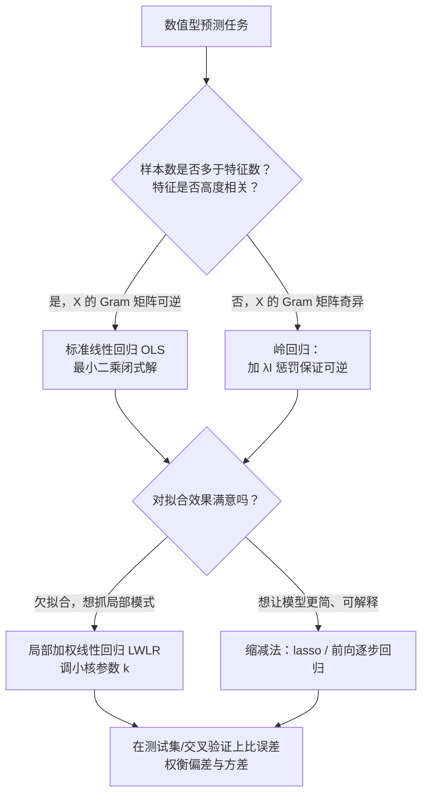

# 第 8 章 预测数值型数据：回归

> **本章解决**：目标变量是连续数值（价格、年龄、销量）时怎么预测——线性回归如何用最小二乘解出回归系数，欠拟合时怎么用局部加权回归"局部"拟合，特征比样本还多时怎么用岭回归、lasso、前向逐步回归把系数"缩减"下来，最后落到偏差-方差权衡这条主线上选模型。
> **承上启下**：前面章节的目标变量都是标称型（分类标签），本章换成连续型；本章"线性模型拟合不了"的遗憾由第 9 章的树回归接手。

---

## 8.0 本章导图

<div class="brtree">
  <div class="brrow">
    <span class="brlabel root">预测数值型数据：回归</span>
    <span class="brace"></span>
    <div class="brkids">
      <div class="brrow">
        <span class="brlabel">线性回归</span>
        <span class="brace"></span>
        <div class="brkids">
          <span class="brleaf">平方误差最小化求 w</span>
          <span class="brleaf">行列式判奇异</span>
          <span class="brleaf">相关系数评好坏</span>
        </div>
      </div>
      <div class="brrow">
        <span class="brlabel">局部加权线性回归</span>
        <span class="brace"></span>
        <div class="brkids">
          <span class="brleaf">高斯核给附近点加权</span>
          <span class="brleaf">k 小抓局部模式、过拟合</span>
          <span class="brleaf">每次预测都要整个数据集</span>
        </div>
      </div>
      <div class="brrow">
        <span class="brlabel">岭回归</span>
        <span class="brace"></span>
        <div class="brkids">
          <span class="brleaf">特征多于样本时用</span>
          <span class="brleaf">λI 惩罚、系数缩减</span>
          <span class="brleaf">λ 取对数间隔扫一遍</span>
        </div>
      </div>
      <div class="brrow">
        <span class="brlabel">lasso 与前向逐步回归</span>
        <span class="brace"></span>
        <div class="brkids">
          <span class="brleaf">lasso 约束用绝对值、难解</span>
          <span class="brleaf">逐步回归贪心近似 lasso</span>
          <span class="brleaf">能帮你找出不重要的特征</span>
        </div>
      </div>
      <div class="brrow">
        <span class="brlabel">偏差与方差</span>
        <span class="brace"></span>
        <div class="brkids">
          <span class="brleaf">训练误差与测试误差</span>
          <span class="brleaf">模型复杂度找平衡点</span>
          <span class="brleaf">缩减 = 增偏差换减方差</span>
        </div>
      </div>
      <div class="brrow">
        <span class="brlabel">两个实战案例</span>
        <span class="brace"></span>
        <div class="brkids">
          <span class="brleaf">鲍鱼年龄：选核大小</span>
          <span class="brleaf">乐高价格：交叉验证选 λ</span>
          <span class="brleaf">系数还原出可读公式</span>
        </div>
      </div>
    </div>
  </div>
</div>

拿到一个数值型预测任务，方法怎么选？本章技术就按下面这张决策图对号入座：



!!! note "运行环境"
    本章代码默认把所有函数保存进 `regression.py`，在 Python 提示符或脚本里导入使用。数据文件（`ex0.txt`、`abalone.txt`、`lego*.txt`）放在数据目录下，**代码里只用相对文件名，运行前把工作目录切到数据所在目录**，否则 `loadDataSet` 读不到文件。原书是 Python 2，本章全部改写为 Python 3 可直接运行：`print` 改函数、`urllib2` 改 `urllib.request`；另外新版 numpy（2.0 起）删掉了 `mat()`，代码开头用一行 `mat = asmatrix` 补回，行为完全一致。

## 8.1 用线性回归找到最佳拟合直线

| 线性回归 | |
| --- | --- |
| 优点 | 结果易于理解，计算上不复杂 |
| 缺点 | 对非线性的数据拟合不好 |
| 适用数据类型 | 数值型和标称型数据 |

回归（regression）的目的是预测数值型的目标值。最直接的办法是依据输入写出一个目标值的计算公式。比如想预测姐姐男友汽车的功率，可能会这么写：

```text
HorsePower = 0.0015*annualSalary - 0.99*hoursListeningToPublicRadio
```

这就是所谓的**回归方程**（**regression equation**），其中的 0.0015 和 −0.99 称作**回归系数**（**regression weights**），求这些回归系数的过程就是回归。有了回归系数，再做预测就非常容易：用回归系数乘以输入值，再把结果加在一起，就得到预测值（也就是说，这里做的是回归系数向量与输入向量的内积）。

说到回归，一般指的就是**线性回归**（**linear regression**），本章里"回归"和"线性回归"是同一个意思。线性回归意味着可以把输入项分别乘以一些常量，再将结果加起来得到输出。也存在另一种**非线性回归**（**nonlinear regression**），它不认同上面的做法，比如认为输出可能是输入的乘积——功率公式也可以写成 `HorsePower = 0.0015*annualSalary/hoursListeningToPublicRadio`，这就是一个非线性回归的例子，本章不做深入讨论。

**回归的一般方法**：

| 步骤 | 做法 |
| --- | --- |
| (1) 收集数据 | 采用任意方法收集数据 |
| (2) 准备数据 | 回归需要数值型数据，标称型数据将被转成二值型数据 |
| (3) 分析数据 | 绘出数据的可视化二维图有助于理解和分析；采用缩减法求得新回归系数后，可以把新拟合线绘在图上作对比 |
| (4) 训练算法 | 找到回归系数 |
| (5) 测试算法 | 使用 R² 或者预测值和数据的拟合度，来分析模型的效果 |
| (6) 使用算法 | 给定输入时预测出一个数值，这是对分类方法的提升——预测连续型数据而不仅仅是离散的类别标签 |

!!! note "拓展：'回归'一词的来历"
    今天我们所知道的回归由达尔文（Charles Darwin）的表兄弟 Francis Galton 发明。Galton 于 1877 年完成了第一次回归预测，目的是根据上一代豌豆种子（双亲）的尺寸来预测下一代豌豆种子（孩子）的尺寸。他在大量对象上应用回归分析，甚至包括人的身高，并注意到：如果双亲的高度比平均高度高，子女也倾向于比平均高度高，但尚不及双亲——孩子的高度向着平均高度回退（回归）。尽管这个英文单词跟数值预测没有任何关系，这种研究方法仍被称作回归。

应当怎样从一大堆数据里求出回归方程呢？假定输入数据存放在矩阵 \(X\) 中，回归系数存放在向量 \(w\) 中。对给定的数据 \(X_1\)，预测结果由 \(Y_1 = X_1^T w\) 给出。现在手里有一些 \(X\) 和对应的 \(y\)，怎么找 \(w\)？一个常用的方法就是找出使**误差**最小的 \(w\)。这里的误差指预测 \(y\) 值和真实 \(y\) 值之间的差值——直接用误差的简单累加会让正差值和负差值相互抵消，所以我们采用**平方误差**：

\[
\sum_{i=1}^{m} \left( y_i - x_i^T w \right)^2
\]

用矩阵表示还可以写做 \((y - Xw)^T (y - Xw)\)。对 \(w\) 求导得到 \(X^T (Y - Xw)\)，令其等于零，解出 \(w\) 如下：

\[
\hat{w} = (X^T X)^{-1} X^T y
\]

\(w\) 上方的小标记表示这是当前可以估计出的 \(w\) 的最优解。从现有数据上估计出的 \(w\) 可能并不是数据中的真实 \(w\) 值，所以用"帽"符号表示它仅是 \(w\) 的一个最佳估计。注意公式里包含 \((X^T X)^{-1}\)，也就是需要对矩阵求逆，因此这个方程只在逆矩阵存在的时候适用；矩阵的逆可能并不存在，必须在代码里对此作出判断。

!!! note "拓展：为什么是平方误差"
    对 \(w\) 求导令导数为零就能得到闭式解，这是平方误差最讨喜的地方。统计上还有一层解释：如果假设噪声服从高斯分布，最小化平方误差等价于极大似然估计，所以"最小二乘"不只是拍脑袋的选择。此外，上述最佳 \(w\) 的求解是统计学中的常见问题，除矩阵方法外还有很多其他解法——通过调用 NumPy 的矩阵方法，几行代码就能完成。这个方法也称作**普通最小二乘法**（**Ordinary Least Squares**, **OLS**）。

图 8-1 的散点图来自数据文件 ex0.txt，下面给出它的最佳拟合直线。

<figure>
  
  <figcaption>图 8.1 从 ex0.txt 得到的样例数据（截自原书）</figcaption>
</figure>

程序清单 8-1 完成数据导入与标准回归。

```python
# ===== 书 8.1 节 程序清单8-1：标准回归函数和数据导入函数 =====
from numpy import *
try:
    mat                                   # numpy 1.x 自带
except NameError:
    mat = asmatrix                        # numpy 2.0 起移除 mat，asmatrix 等价替换


def loadDataSet(fileName):                # 解析 tab 分隔的浮点文件
    numFeat = len(open(fileName).readline().split('\t')) - 1  # 由首行求特征数
    dataMat = []; labelMat = []
    fr = open(fileName)
    for line in fr.readlines():
        lineArr = []
        curLine = line.strip().split('\t')
        for i in range(numFeat):          # 每行前 numFeat 列是特征
            lineArr.append(float(curLine[i]))
        dataMat.append(lineArr)
        labelMat.append(float(curLine[-1]))   # 最后一个值是目标值
    return dataMat, labelMat


def standRegres(xArr, yArr):              # 标准线性回归：求最佳拟合直线的系数
    xMat = mat(xArr); yMat = mat(yArr).T  # xMat m×n，yMat 转成列向量 m×1
    xTx = xMat.T * xMat                   # 计算 X^T X
    if linalg.det(xTx) == 0.0:            # 行列式为 0 → 不可逆，直接返回
        print('This matrix is singular, cannot do inverse')
        return
    ws = xTx.I * (xMat.T * yMat)          # w = (X^T X)^(-1) X^T y
    return ws
```

`loadDataSet()` 打开一个用 tab 键分隔的文本文件，默认每行最后一个值是目标值。`standRegres()` 先读入 \(x\) 和 \(y\) 并保存为矩阵，然后计算 \(X^T X\)，并用 `linalg.det()` 判断它的行列式是否为零——如果为零，计算逆矩阵时会出错（NumPy 的线性代数库 linalg 提供这些方法）。如果行列式非零，就计算并返回 \(w\)。若不检查行列式就直接求逆，将会报错。

!!! warning "原书笔误"
    原书提到求 \(w\) 也可以用 NumPy 解方程组的函数，写法应为 `ws = linalg.solve(xTx, xMat.T*yMat)`（原书排印把第二个参数误作 `xMat.T*yMatT`，多了一个 T）。`solve` 不显式求逆，数值上更稳。

下面看实际效果：

```python
# ===== 书 8.1 节 实跑：求回归系数（Python 3）=====
import regression as rg
from regression import mat

xArr, yArr = rg.loadDataSet('ex0.txt')
xArr[0:2]
# [[1.0, 0.067732], [1.0, 0.42781]]
# 第一个值恒等于 1.0，即 X0（假定偏移量是常数）；第二个值 X1 是图中横坐标

ws = rg.standRegres(xArr, yArr)
ws
# matrix([[3.00774324],
#         [1.69532264]])      ← 与原书输出完全一致（代码实跑）
```

变量 `ws` 存放的就是回归系数。用内积预测 \(y\) 时，第一维乘以常数 \(X_0\)，第二维乘以输入变量 \(X_1\)；因为 \(X_0 = 1\)，最终得到 `yHat = ws[0] + ws[1]*X1`。预测出的 \(y\) 记作 `yHat`，与真实的 `y` 区分：

```python
# ===== 书 8.1 节 实跑：计算预测值并绘出最佳拟合直线 =====
xMat = mat(xArr); yMat = mat(yArr)
yHat = xMat * ws

import matplotlib.pyplot as plt
fig = plt.figure()
ax = fig.add_subplot(111)
ax.scatter(xMat[:, 1].flatten().A[0], yMat.T[:, 0].flatten().A[0])  # 原始数据
xCopy = xMat.copy()
xCopy.sort(0)                       # 直线上的点必须按升序排列，否则绘图会乱
yHat = xCopy * ws                   # 用排序后的 x 算 yHat
ax.plot(xCopy[:, 1], yHat)          # 画出最佳拟合直线
plt.show()
```

<figure>
  
  <figcaption>ex0.txt 数据集散点图（代码实跑）</figcaption>
</figure>

<figure>
  
  <figcaption>ex0.txt 数据集与它的最佳拟合直线（代码实跑）</figcaption>
</figure>

<figure>
  
  <figcaption>图 8.2 ex0.txt 的数据集与它的最佳拟合直线（截自原书）</figcaption>
</figure>

几乎任一数据集都可以用上述方法建立模型，那模型的好坏怎么判断？比较图 8-3 的两个子图：在两个数据集上分别作线性回归，会得到完全一样的模型（拟合直线）。显然两个数据不一样，模型在二者上的效果如何比较？有种方法可以计算预测值 `yHat` 序列和真实值 `y` 序列的匹配程度——计算这两个序列的**相关系数**（**correlation coefficient**）。

<figure>
  
  <figcaption>图 8.3 具有相同回归系数（0 和 2.0）的两组数据。上图的相关系数是 0.58，下图的相关系数是 0.99（截自原书）</figcaption>
</figure>

NumPy 提供相关系数的计算：`corrcoef(yEstimate, yActual)`。

```python
# ===== 书 8.1 节 实跑：相关系数 =====
yHat = xMat * ws
corrcoef(yHat.T, yMat)
# matrix([[1.        , 0.98647356],
#         [0.98647356, 1.        ]])   ← 代码实跑，与原书"0.98"一致
```

该矩阵包含所有两两组合的相关系数：对角线上是 1.0（`yMat` 和自己的匹配最完美），`yHat` 和 `yMat` 的相关系数为 0.98。最佳拟合直线把数据视为直线建模，表现不错；但图 8-2 的数据中似乎还有别的潜在模式。如何利用这些模式？可以根据数据来局部调整预测——这就是下一节的方法。

!!! note "拓展：相关系数与 R²"
    `corrcoef` 给出的是皮尔逊相关系数，度量"预测值和真实值的线性相关程度"，取值 −1 到 1。它对"整体斜率对不对"不敏感——把所有预测值放大 2 倍，相关系数仍是 1，但预测已经错了。所以书第 5 步还提到 R²（判定系数）：一元线性回归情形下 R² 就是相关系数的平方，它衡量模型解释了多少方差，比单纯看相关系数更严格。两个指标都算，才不会把"形似"当成"准"。

## 8.2 局部加权线性回归

线性回归的一个问题是有可能出现**欠拟合**（**underfitting**），因为它求的是具有最小均方误差的**无偏估计**（**unbiased estimate**）。模型欠拟合将不能取得最好的预测效果。所以有些方法允许在估计中引入一些偏差，从而降低预测的均方误差。

其中的一个方法是**局部加权线性回归**（**Locally Weighted Linear Regression**, **LWLR**）。在该算法中，我们给待预测点附近的每个点赋予一定的权重；然后与 8.1 节类似，在这个子集上基于最小均方差来进行普通的回归。与 kNN 一样，这种算法每次预测均需要事先选取出对应的数据子集。该算法解出回归系数 \(w\) 的形式如下：

\[
\hat{w} = (X^T W X)^{-1} X^T W y
\]

其中 \(W\) 是一个矩阵，用来给每个数据点赋予权重（读者要注意区分这里的权重 \(W\) 和回归系数 \(w\)：与 kNN 一样，该加权模型认为样本点距离越近，越可能符合同一个线性模型）。

LWLR 使用"**核**"（**kernel**，与支持向量机中的核类似）来对附近的点赋予更高的权重。核的类型可以自由选择，最常用的核就是**高斯核**（**Gaussian kernel**），高斯核对应的权重如下：

\[
w(i, i) = \exp \left( \frac{|x^{(i)} - x|^2}{-2k^2} \right)
\]

!!! warning "原书笔误"
    原书排印的高斯核公式分子是 \(|x^{(i)} - x|\)，漏了平方。对照程序清单 8-2 的代码 `exp(diffMat*diffMat.T/(-2.0*k**2))` 可知：`diffMat*diffMat.T` 正是距离的平方，正确公式应为 \(|x^{(i)} - x|^2\)。上式已修正。

这样就构建了一个只含对角元素的权重矩阵 \(W\)，并且点 \(x\) 与 \(x^{(i)}\) 越近，\(w(i,i)\) 将会越大。公式包含一个用户指定的参数 \(k\)，它决定了对附近的点赋予多大的权重，这是使用 LWLR 时唯一需要考虑的参数。图 8-4 展示了参数 \(k\) 与权重的关系。

<figure>
  
  <figcaption>图 8.4 每个点的权重图（假定我们正预测的点是 x = 0.5）：最上面的图是原始数据集；第二个图显示当 k = 0.5 时，大部分的数据都用于训练回归模型；最下面的图显示当 k = 0.01 时，仅有很少的局部点被用于训练回归模型（截自原书）</figcaption>
</figure>

<figure>
  
  <figcaption>待预测点 x = 0.5 时各样本点的权重：k = 0.5 时几乎全员参与，k = 0.1 收窄，k = 0.01 只剩尖峰附近的一小撮（代码实跑）</figcaption>
</figure>

程序清单 8-2 实现了 LWLR。

```python
# ===== 书 8.2 节 程序清单8-2：局部加权线性回归函数 =====
def lwlr(testPoint, xArr, yArr, k=1.0):
    xMat = mat(xArr); yMat = mat(yArr).T
    m = shape(xMat)[0]
    weights = mat(eye((m)))                       # ① 创建 m 阶对角权重矩阵
    for j in range(m):
        diffMat = testPoint - xMat[j, :]          # ② 权重随距离以指数级衰减
        weights[j, j] = exp(diffMat * diffMat.T / (-2.0 * k ** 2))
    xTx = xMat.T * (weights * xMat)
    if linalg.det(xTx) == 0.0:
        print('This matrix is singular, cannot do inverse')
        return
    ws = xTx.I * (xMat.T * (weights * yMat))      # 加权后的最小二乘解
    return testPoint * ws                         # 返回该点的预测值


def lwlrTest(testArr, xArr, yArr, k=1.0):         # 对每个点调用 lwlr，便于求解 k
    m = shape(testArr)[0]
    yHat = zeros(m)
    for i in range(m):
        yHat[i] = lwlr(testArr[i], xArr, yArr, k)
    return yHat
```

函数 `lwlr()` 的开头与程序清单 8-1 类似：读入数据并创建所需矩阵，之后创建对角权重矩阵 `weights`。权重矩阵是一个方阵，阶数等于样本点个数——即给每个样本点初始化了一个权重。接着算法遍历数据集，计算每个样本点对应的权重值：随着样本点与待预测点距离的递增，权重将以指数级衰减，输入参数 k 控制衰减的速度。权重矩阵计算完毕后，就能得到对回归系数 ws 的一个估计。另一个函数 `lwlrTest()` 用于为数据集中每个点调用 `lwlr()`。

下面看实际效果：

```python
# ===== 书 8.2 节 实跑：单点估计与全数据集估计 =====
import regression as rg
xArr, yArr = rg.loadDataSet('ex0.txt')

yArr[0]                          # 3.176513（真实值）
rg.lwlr(xArr[0], xArr, yArr, 1.0)     # matrix([[3.12204471]])  ← 与原书一致
rg.lwlr(xArr[0], xArr, yArr, 0.001)   # matrix([[3.20175729]])  ← 与原书一致

yHat = rg.lwlrTest(xArr, xArr, yArr, 0.003)   # 数据集里所有点的估计
```

绘出估计值和原始值，看 `yHat` 的拟合效果。所用的绘图函数需要将数据点按 x 升序排列（直线上点序混乱会画成折线）：

```python
# ===== 书 8.2 节 实跑：排序后绘图 =====
srtInd = xMat[:, 1].argsort(0)        # 对 xArr 排序，取下标
xSort = xMat[srtInd][:, 0, 1].flatten().A[0]
ax.plot(xSort, yHat[srtInd], c='gray')    # 再用 Matplotlib 绘图
```

<figure>
  
  <figcaption>图 8.5 使用 3 种不同平滑值绘出的局部加权线性回归结果：上图 k = 1.0，中图 k = 0.01，下图 k = 0.003。k = 1.0 时的模型效果与最小二乘法差不多；k = 0.01 时该模型可以挖出数据的潜在规律；k = 0.003 时考虑了太多的噪声，导致了过拟合现象（截自原书）</figcaption>
</figure>

<figure>
  
  <figcaption>同样三种 k 的实跑对照：k = 1.0 退化为一条直线（欠拟合），k = 0.01 抓住波浪形的潜在规律，k = 0.003 开始贴着噪声走（过拟合）（代码实跑）</figcaption>
</figure>

图 8-5 给出了 k 在三种不同取值下的结果：当 k = 1.0 时权重很大，如同将所有数据视为等权重，得出的最佳拟合直线与标准的回归一致；使用 k = 0.01 得到了非常好的效果，抓住了数据的潜在模式；下图使用 k = 0.003 纳入了太多的噪声点，拟合的直线与数据点过于贴近。所以最下图是**过拟合**（**overfitting**）的一个例子，而最上图则是欠拟合的一个例子。下一节将对过拟合和欠拟合进行量化分析。

!!! note "拓展：LWLR 的代价——一个'懒惰'的模型"
    局部加权线性回归也存在一个问题，即增加了计算量：它对每个点做预测时都必须使用整个数据集，而且每次都要重新构建一个 m 阶的权重矩阵、解一次方程——训练 m 个点要解 m 次，来了新数据又要重算。从图 8-5 可以看出 k = 0.01 时可以得到很好的估计，但同时看图 8-4 中 k = 0.01 的情况：大多数据点的权重都接近零。如果避免这些权重几乎为零的点的计算，可以减少程序运行时间，缓解计算量问题。这类"预测时才拿着全部训练数据现算"的模型被称为惰性学习（lazy learning），kNN 也是同类。

## 8.3 示例：预测鲍鱼的年龄

接下来把回归用于真实数据：一份来自 UCI 数据集合的数据，记录了鲍鱼（一种介壳类水生动物）的年龄。鲍鱼年龄可以从鲍鱼壳的层数推算得到。

先在 `regression.py` 中加入平方误差函数：

```python
# ===== 书 8.3 节：平方误差 =====
def rssError(yArr, yHatArr):     # yArr 与 yHatArr 都需为数组
    return ((yArr - yHatArr) ** 2).sum()
```

```python
# ===== 书 8.3 节 实跑：鲍鱼数据上的 LWLR =====
abX, abY = rg.loadDataSet('abalone.txt')

# 训练集上的误差（前 99 条同时做训练和预测）
yHat01 = rg.lwlrTest(abX[0:99], abX[0:99], abY[0:99], 0.1)
yHat1  = rg.lwlrTest(abX[0:99], abX[0:99], abY[0:99], 1)
yHat10 = rg.lwlrTest(abX[0:99], abX[0:99], abY[0:99], 10)
```

为了分析预测误差的大小，用 `rssError()` 计算这一指标（前三行是训练误差；后三行换用第 100～199 条作为新数据测试，训练仍然只用前 99 条；均为代码实跑）：

| 核大小 k | 训练误差 rssError | 新数据上的测试误差 |
| --- | --- | --- |
| 0.1 | 56.79 | 57913.52 |
| 1 | 429.89 | 573.53 |
| 10 | 549.12 | 517.57 |

!!! note "与原书数值的对照"
    原书印次的输出为：训练误差 56.84 / 429.89 / 549.12，测试误差 25619.93 / 573.53 / 517.57。实跑中 k = 1 和 k = 10 的四个数与原书逐位一致；k = 0.1 的两个数有差异（训练 56.79 vs 56.84，测试 57913.52 vs 25619.93）——k 很小时局部方程接近奇异，误差对浮点噪声极端敏感，这种"爆炸"本身正是小核过拟合的表现，量级没有可比性，结论不受影响。

可以看到，使用较小的核将得到较低的**训练**误差。那么为什么不在所有数据集上都使用最小的核？因为使用最小的核将造成过拟合，对新数据不一定能达到最好的预测效果——上表里 k = 0.1 的测试误差爆炸就是证明。三个参数中，核大小等于 10 时的测试误差最小，但它在训练集上的误差却是最大的。接下来再和简单的线性回归做个比较：

```python
# ===== 书 8.3 节 实跑：与标准线性回归对比 =====
ws = rg.standRegres(abX[0:99], abY[0:99])
yHat = mat(abX[100:199]) * ws
rg.rssError(abY[100:199], yHat.T.A)
# 518.6363153245542    ← 与原书 518.63631532450131 一致
```

简单线性回归达到了与局部加权线性回归类似的效果（518.64 vs 517.57）。这也表明一点：**必须在未知数据上比较效果才能选取到最佳模型**。那么最佳的核大小是 10 吗？或许是，但如果想得到更好的效果，应该用 10 个不同的样本集做 10 次测试来比较结果。

本例展示了如何使用局部加权线性回归来构建模型，可以得到比普通线性回归更好的效果。局部加权线性回归的问题在于，每次必须在整个数据集上运行——为了做出预测，必须保存所有的训练数据。下面介绍另一种提高预测精度的方法，并分析它的优势所在。

## 8.4 缩减系数来"理解"数据

如果数据的特征比样本点还多应该怎么办？还能否使用线性回归和之前的方法来做预测？答案是否定的——在计算 \((X^T X)^{-1}\) 的时候会出错。特征比样本点还多（\(n > m\)），意味着输入数据矩阵 \(X\) 不是**满秩**（**full rank**）矩阵，非满秩矩阵在求逆时会出现问题。

为了解决这个问题，统计学家引入了**岭回归**（**ridge regression**），这是本节介绍的第一种缩减方法。接着是 lasso 法，该方法效果很好但计算复杂。本节最后介绍第二种缩减方法——**前向逐步回归**（**forward stepwise regression**），可以得到与 lasso 差不多的效果，且更容易实现。

### 8.4.1 岭回归

简单说来，岭回归就是在矩阵 \(X^T X\) 上加一个 \(\lambda I\) 从而使得矩阵非奇异，进而能对 \(X^T X + \lambda I\) 求逆。其中矩阵 \(I\) 是单位矩阵，对角线上元素全为 1，其他元素全为 0；\(\lambda\) 是一个用户定义的数值。在这种情况下，回归系数的计算公式将变成：

\[
\hat{w} = (X^T X + \lambda I)^{-1} X^T y
\]

!!! warning "原书笔误"
    原书正文说"其中矩阵 I 是一个 m×m 的单位矩阵"。这里 \(X^T X\) 是 n×n（n 为特征数、m 为样本数），代码 `eye(shape(xMat)[1])` 加的也是 n 阶单位阵——I 应与 \(X^T X\) 同阶，即 n×n，原书的 m×m 是笔误。

岭回归最先用来处理特征数多于样本数的情况，现在也用于在估计中加入偏差，从而得到更好的估计。这里通过引入 \(\lambda\) 来限制了所有 \(w\) 之和，通过引入该惩罚项，能够减少不重要的参数，这个技术在统计学中也叫做**缩减**（**shrinkage**）。

!!! note "侧栏：岭回归中的'岭'是什么？"
    岭回归使用了单位矩阵乘以常量 \(\lambda\)。观察其中的单位矩阵 \(I\)：值 1 贯穿整个对角线，其余元素全是 0。形象地说，在 0 构成的平面上有一条 1 组成的"岭"，这就是岭回归中的"岭"的由来。

缩减方法可以去掉不重要的参数，因此能更好地理解数据。此外，与简单的线性回归相比，缩减法能取得更好的预测效果。与前几章训练其他参数所用的方法类似，这里通过预测误差最小化得到 \(\lambda\)：数据获取之后，首先抽一部分数据用于测试，剩余的作为训练集用于训练参数 \(w\)；训练完毕后在测试集上测试预测性能；通过选取不同的 \(\lambda\) 来重复上述测试过程，最终得到一个使预测误差最小的 \(\lambda\)。

```python
# ===== 书 8.4.1 节 程序清单8-3：岭回归 =====
def ridgeRegres(xMat, yMat, lam=0.2):     # lambda 是 Python 保留字，故用 lam
    xTx = xMat.T * xMat
    denom = xTx + eye(shape(xMat)[1]) * lam   # X^T X + λI（单位阵与特征数同阶）
    if linalg.det(denom) == 0.0:
        print('This matrix is singular, cannot do inverse')
        return
    ws = denom.I * (xMat.T * yMat)
    return ws


def ridgeTest(xArr, yArr):                # 在一组 λ 上测试岭回归
    xMat = mat(xArr); yMat = mat(yArr).T
    yMean = mean(yMat, 0)
    yMat = yMat - yMean                   # 减去 y 的均值，等价于消去常数项 X0
    # 特征标准化
    xMeans = mean(xMat, 0)                # 每列均值
    xVar = var(xMat, 0)                   # 每列方差
    xMat = (xMat - xMeans) / xVar         # 减均值、除以方差
    numTestPts = 30
    wMat = zeros((numTestPts, shape(xMat)[1]))
    for i in range(numTestPts):
        ws = ridgeRegres(xMat, yMat, exp(i - 10))   # λ 以指数级变化
        wMat[i, :] = ws.T
    return wMat
```

程序清单 8-3 包含两个函数：`ridgeRegres()` 用于计算回归系数，`ridgeTest()` 用于在一组 λ 上测试结果。`ridgeRegres()` 实现给定 lambda 下的岭回归求解，未指定 lambda 时默认为 0.2。该函数先构建矩阵 \(X^T X\)，然后用 lam 乘以单位矩阵（由 NumPy 的 `eye()` 生成）。普通回归可能出错时，岭回归仍可以正常工作——那么是不是就不再需要检查行列式了？不完全对：lambda 设定为 0 的时候同样可能产生错误，所以仍需要这个检查。

为了使用岭回归和缩减技术，首先需要对特征做标准化处理（第 2 章已经用过），使每维特征具有相同的重要性（不考虑特征代表什么）。`ridgeTest()` 就展示了数据标准化的过程：所有特征减去各自的均值并除以方差。处理完成后在 30 个不同的 lambda 下调用 `ridgeRegres()`。注意 lambda 应以指数级变化，这样可以看出 lambda 取非常小的值和非常大的值时分别对结果造成的影响。

!!! note "拓展：'除以方差'不是标准的 z-score"
    统计课上的标准化（z-score）是减均值后除以**标准差**，除完之后标准差为 1。而本书代码（以及 8.4.3 的 `regularize()`）除的是**方差**，除完之后标准差是 \(1/\sqrt{\text{方差}}\)，并非严格"均值为 0、方差为 1"。这个选择贯穿本章且自洽——预测结果不受影响，但系数的大小会被整体放大 \(1/\text{标准差}\) 倍，还原系数时也要按同样的口径除回（见 8.6.2 的 `unReg = bestWeights/varX`）。读别人的岭回归代码时，先看清它除的到底是方差还是标准差。

在鲍鱼数据集上运行（用全部 4177 条数据求得 30 组系数）：

```python
# ===== 书 8.4.1 节 实跑：岭回归系数随 λ 的变化 =====
import matplotlib.pyplot as plt
abX, abY = rg.loadDataSet('abalone.txt')
ridgeWeights = rg.ridgeTest(abX, abY)

fig = plt.figure()
ax = fig.add_subplot(111)
ax.plot(arange(30) - 10, ridgeWeights)    # 横轴即 log(lambda)
ax.set_xlabel('log(lambda)')
plt.show()
```

<figure>
  
  <figcaption>图 8.6 岭回归的回归系数变化图。λ 非常小时，系数与普通回归一样；λ 非常大时，所有回归系数缩减为 0。可以在中间某处找到使得预测的结果最好的 λ 值（截自原书）</figcaption>
</figure>

<figure>
  
  <figcaption>鲍鱼数据上 30 个 λ 对应的回归系数曲线（代码实跑）：最左端 λ 最小时系数等于普通回归的解（实跑首行 [0.043, −0.023, 0.132, 0.021, 2.224, −0.999, −0.117, 0.166]，与 8.4.3 节最小二乘的标准化结果一致），最右端所有系数缩为 0</figcaption>
</figure>

运行后得到回归系数与 log(λ) 的关系图：最左边 λ 最小时，可以得到所有系数的原始值（与线性回归一致）；而在右边，系数全部缩减成 0；中间部分的某值将可以取得最好的预测效果。为了定量地找到最佳参数值，还需要进行交叉验证。另外，要判断哪些变量对结果预测最具有影响力，在图 8-6 中观察它们对应的系数大小就可以。

还有一些其他缩减方法，如 lasso、LAR、PCA 回归以及子集选择等。与岭回归一样，这些方法不仅可以提高预测精确率，而且可以解释回归系数（参见 Trevor Hastie、Robert Tibshirani、Jerome Friedman 的 *The Elements of Statistical Learning: Data Mining, Inference, and Prediction* 一书）。

!!! note "拓展：岭回归就是 L2 正则化"
    用今天的说法，岭回归 = 线性回归 + L2 正则化：目标函数从"平方误差"变成"平方误差 + λ·系数平方和"。scikit-learn 里的 `Ridge(alpha=...)` 就是它，alpha 对应本书的 λ。除了"让矩阵可逆"，L2 惩罚还压缩系数、降低模型方差，对共线性特征尤其有效——这些现代视角都是对本书内容的直接推广。

### 8.4.2 lasso

不难证明，在增加如下约束时，普通的最小二乘法回归会得到与岭回归一样的公式：

\[
\sum_{k=1}^{n} w_k^2 \leq \lambda
\]

上式限定了所有回归系数的平方和不能大于 λ。使用普通的最小二乘法回归，当两个或更多的特征相关时，可能会得出一个很大的正系数和一个很大的负系数；正是因为上述限制条件的存在，使用岭回归可以避免这个问题。

与岭回归类似，另一个缩减方法 **lasso** 也对回归系数做了限定，对应的约束条件如下：

\[
\sum_{k=1}^{n} |w_k| \leq \lambda
\]

唯一的不同点在于，这个约束条件使用绝对值取代了平方和。虽然约束形式只是稍作变化，结果却大相径庭：在 λ 足够小的时候，一些系数会因此被迫缩减到 0，这个特性可以帮助我们更好地理解数据。这两个约束条件在公式上看起来相差无几，但细微的变化却极大地增加了计算复杂度——为了在这个新的约束条件下解出回归系数，需要使用二次规划算法。下面介绍一个更为简单的方法来得到结果，该方法叫做前向逐步回归。

| 缩减方法 | 约束条件 | 求解 | 效果 |
| --- | --- | --- | --- |
| 岭回归 | \(\sum w_k^2 \leq \lambda\)（平方和） | 矩阵运算，简单 | 系数变小，但难有恰好为 0 的 |
| lasso | \(\sum \lvert w_k \rvert \leq \lambda\)（绝对值和） | 需要二次规划算法，复杂 | λ 足够小时部分系数被迫缩成 0 |

!!! note "拓展：为什么绝对值约束能产生 0 系数"
    几何直观：在二维系数平面上，L2 约束是个圆盘（边界光滑），L1 约束是个菱形（四个角正好落在坐标轴上）。误差的等高线往外扩时，最先碰到菱形的地方大概率是一个角——那里某个系数恰好是 0。所以 L1 天然"挑特征"，这就是稀疏性的来源；lasso 也因此是现代特征选择（L1 正则化）的原型。

### 8.4.3 前向逐步回归

前向逐步回归算法可以得到与 lasso 差不多的效果，但更加简单。它属于一种**贪心算法**（**greedy algorithm**），即每一步都尽可能减少误差。一开始，所有的权重都设为 1（系数全为 0 的向量），然后每一步所做的决策是对某个权重增加或减少一个很小的值。该算法的伪代码如下所示：

```text
数据标准化，使其分布满足 0 均值和单位方差
在每轮迭代过程中：
    设置当前最小误差 lowestError 为正无穷
    对每个特征：
        增大或缩小：
            改变一个系数得到一个新的 W
            计算新 W 下的误差
            如果误差 Error 小于当前最小误差 lowestError：设置 Wbest 等于当前的 W
    将 W 设置为新的 Wbest
```

```python
# ===== 书 8.4.3 节 程序清单8-4：前向逐步线性回归 =====
def regularize(xMat):                    # 按列标准化（书正文未给定义，此为实现）
    inMat = xMat.copy()
    inMeans = mean(inMat, 0)             # 计算每列均值并减去
    inVar = var(inMat, 0)                # 除以每列方差
    return (inMat - inMeans) / inVar


def stageWise(xArr, yArr, eps=0.01, numIt=100):
    xMat = mat(xArr); yMat = mat(yArr).T
    yMean = mean(yMat, 0)
    yMat = yMat - yMean                  # y 也中心化（也可对 y 标准化，但会得到更小的系数）
    xMat = regularize(xMat)              # 特征标准化
    m, n = shape(xMat)
    returnMat = zeros((numIt, n))        # 记录每轮迭代的 w，供绘图
    ws = zeros((n, 1)); wsTest = ws.copy(); wsMax = ws.copy()   # wsMax 保存最优 w
    for i in range(numIt):
        print(ws.T)                      # 打印当前 w，观察执行过程与效果
        lowestError = inf
        for j in range(n):               # 对每个特征
            for sign in [-1, 1]:         # 增大或缩小
                wsTest = ws.copy()
                wsTest[j] += eps * sign  # 改变一个系数得到新 W
                yTest = xMat * wsTest    # 计算新 W 下的误差
                rssE = rssError(yMat.A, yTest.A)
                if rssE < lowestError:   # 误差更小则记为最优
                    lowestError = rssE
                    wsMax = wsTest
        ws = wsMax.copy()
        returnMat[i, :] = ws.T
    return returnMat
```

!!! warning "书中代码不完整"
    程序清单 8-4 直接调用了 `regularize()`，但全书没有给出这个函数的定义（正文与配套代码均缺），照书输入会直接 `NameError`。上面的第一个函数就是需要自行补上的实现：按列减均值、除以方差。另外，原书正文说图 8-7 使用"0.005 的 epsilon 值并经过 1000 次迭代"，而实际的命令与输出是 `stageWise(xArr, yArr, 0.001, 5000)`，以命令为准。

函数 `stageWise()` 的输入包括输入数据 `xArr` 和预测变量 `yArr`，另有两个参数：`eps` 表示每次迭代需要调整的步长，`numIt` 表示迭代次数。函数先把输入数据转成矩阵并对特征做标准化，然后创建向量 `ws` 保存 w 的值，并为贪心算法建立 `ws` 的两份副本（`wsTest` 试探用、`wsMax` 保存最优）。优化过程迭代 `numIt` 次，每次迭代都打印 w 向量用于分析。贪心算法在所有特征上运行两次 for 循环（对应 sign 的 −1 和 +1），分别计算增加或减少该特征对误差的影响；误差用平方误差 `rssError()` 度量，初始值设为正无穷，与所有误差比较后取最小的。整个过程循环迭代进行。

下面看实际效果：

```python
# ===== 书 8.4.3 节 实跑：stageWise 在鲍鱼数据上 =====
xArr, yArr = rg.loadDataSet('abalone.txt')
ret1 = rg.stageWise(xArr, yArr, 0.01, 200)
ret1[0]      # [0. 0. 0. 0.01 0. 0. 0. 0.]   第 1 次迭代
ret1[1]      # [0. 0. 0. 0.02 0. 0. 0. 0.]   第 2 次迭代
ret1[-1]     # [0.05 0. 0.09 0.03 0.31 -0.64 0. 0.36]   最后一次
```

上述结果中值得注意的是 `w1` 和 `w6` 都是 0（下标从 0 数起，即第 2、第 7 个系数），这表明它们不对目标值造成任何影响，这些特征很可能是不需要的。另外，在参数 eps 设置为 0.01 的情况下，一段时间后系数就已经饱和并在特定值之间来回震荡——步长太大的缘故。可以看到第一个权重在 0.04 和 0.05 之间来回震荡。下面试着用更小的步长和更多的步数：

```python
# ===== 书 8.4.3 节 实跑：更小步长，与最小二乘对比 =====
ret2 = rg.stageWise(xArr, yArr, 0.001, 5000)
ret2[-1]     # [0.043 -0.011 0.12 0.022 2.023 -0.963 -0.105 0.187]

# 与最小二乘法比较（同样做标准化、y 中心化）
xMat = mat(xArr); yMat = mat(yArr).T
xMat = rg.regularize(xMat)
yM = mean(yMat, 0)
yMat = yMat - yM
weights = rg.standRegres(xMat, yMat.T)
weights.T
# matrix([[ 0.0430442 , -0.02274163,  0.13214087,  0.02075182,
#           2.22403814, -0.99895312, -0.11725427,  0.16622915]])
#           ↑ 与原书输出逐位一致（代码实跑）
```

可以看到在 5000 次迭代以后，逐步线性回归算法与常规的最小二乘法效果类似（对比第 5 个系数：2.023 vs 2.224，其余各系数也相当接近）。使用 0.005 的步长并经过 1000 次迭代后的结果参见图 8-7。

<figure>
  
  <figcaption>图 8.7 鲍鱼数据集上执行逐步线性回归法得到的系数与迭代次数间的关系。逐步线性回归得到了与 lasso 相似的结果，但计算起来更加简便（截自原书）</figcaption>
</figure>

<figure>
  
  <figcaption>同一实验的实跑版（eps = 0.005，1000 次迭代）：第 5 个特征（鲍鱼肉重）系数一路上涨，第 6 个特征一路下跌到 −0.8 左右，其余大多被压平（代码实跑）</figcaption>
</figure>

逐步线性回归算法的实际好处并不在于能绘出图 8-7 这样漂亮的图，主要的优点在于它可以帮助人们理解现有的模型并做出改进。当构建了一个模型后，可以运行该算法找出重要的特征，这样就有可能及时停止对那些不重要特征的收集。最后，如果用于测试，该算法每 100 次迭代后就可以构建出一个模型，可以使用类似于 10 折交叉验证的方法比较这些模型，最终选择使误差最小的模型。

!!! note "拓展：逐步线性回归的前世今生"
    前向逐步回归是经典统计学里的老方法，它的"近亲"还有最小角回归（LAR）和坐标下降（coordinate descent）：都是"一次只动一个系数"的迭代思路。今天 sklearn 的 `Lasso` 内部用的坐标下降，本质上就是把书里"每个特征试 ±eps"换成"沿该特征的方向解析地走到底"。理解了 stageWise 的循环，再看那些库的文档就不会发怵。

当应用缩减方法（如逐步线性回归或岭回归）时，模型也就增加了**偏差**（**bias**），与此同时却减小了模型的**方差**（**variance**）。下一节将揭示这些概念之间的关系并分析它们对结果的影响。

## 8.5 权衡偏差与方差

任何时候，一旦发现模型和测量值之间存在差异，就说出现了误差。考虑模型中的"噪声"或误差时，必须考虑其来源：你可能会对复杂的过程进行简化，这将导致模型和测量值之间出现"噪声"；若无法理解数据的真实生成过程，也会导致差异；另外，测量过程本身也可能产生"噪声"。

举一个例子：8.1 节和 8.2 节处理过从文件导入的二维数据——实话来讲，这个数据是作者自己造出来的，生成公式如下：

\[
y = 3.0 + 1.7x + 0.1\sin(30x) + 0.06 N(0, 1)
\]

其中 \(N(0,1)\) 是均值为 0、方差为 1 的正态分布。在 8.1 节中，我们尝试仅用一条直线来拟合上述数据。不难想到，直线所能得到的最佳拟合应该是 \(3.0 + 1.7x\) 这一部分；误差部分就是 \(0.1\sin(30x) + 0.06N(0,1)\)。在 8.2 节和 8.3 节，我们使用局部加权线性回归来试图捕捉数据背后的结构，并测试了多组不同的局部权重来找到具有最小测试误差的解。

图 8-8 给出了训练误差和测试误差的曲线图：上面的曲线是测试误差，下面的曲线是训练误差。根据 8.3 节的实验：如果降低核的大小，那么训练误差将变小。从图 8-8 来看，从左到右就表示了核逐渐减小的过程。

<figure>
  
  <figcaption>图 8.8 偏差方差折中与测试误差及训练误差的关系。上面的曲线就是测试误差，在中间部分最低。为了做出最好的预测，我们应该调整模型复杂度来达到测试误差的最小值（截自原书）</figcaption>
</figure>

<figure>
  
  <figcaption>按书中生成公式造数（训练 200 条、测试 100 条，纵轴为均方误差）复现图 8-8：核 k 从 10 扫到 0.005，测试误差在 k ≈ 0.02 附近最低（0.00395），训练误差一路下降；k 再小时局部方程近奇异，预测输出 nan（代码实跑，噪声种子已固定）</figcaption>
</figure>

一般认为，上述两种误差由三个部分组成：偏差、测量误差和随机噪声。在 8.2 节和 8.3 节，我们通过引入三个越来越小的核来不断增大模型的方差。8.4 节介绍了缩减法，可以将一些系数缩减成很小的值或直接缩减为 0——这是一个增大模型偏差的例子。通过把一些特征的回归系数缩减到 0，同时也就减少了模型的复杂度。例子中有 8 个特征，消除其中两个后不仅使模型更易理解，同时还降低了预测误差。图 8-8 的左侧是参数缩减过于严厉的结果，而右侧是无缩减的效果。

| | 低复杂度（核大、缩减严厉） | 高复杂度（核小、无缩减） |
| --- | --- | --- |
| 特点 | 低方差、高偏差 | 高方差、低偏差 |
| 训练误差 | 高 | 低 |
| 测试误差 | 高 | 先降后升，中间最低 |

方差是可以度量的：如果从鲍鱼数据中取一个随机样本集（例如取其中 100 个数据）并用线性模型拟合，将会得到一组回归系数；再取出另一组随机样本集并拟合，将会得到另一组回归系数。这些系数间的差异大小也就是模型方差大小的反映（方差指的是模型之间的差异，而偏差指的是模型预测值和数据之间的差异，注意区分）。上述偏差与方差折中的概念在机器学习中十分流行并且反复出现。

!!! note "拓展：把'偏差-方差-噪声'写成一行公式"
    对同一个测试点，期望预测误差可以分解为：期望误差 = 偏差² + 方差 + 噪声。偏差是"平均预测值"偏离真值的程度（模型太简单）；方差是"换一份训练数据，预测值摆动多少"（模型太敏感）；噪声是不可约减的部分（数据本身），再好的模型也压不下去。本章所有操作都能对应到这三项：LWLR 调 k、缩减法调 λ，都是在偏差与方差之间拨天平；而噪声决定了那条测试误差曲线的下限。

下一节将介绍上述理论的应用：首先从拍卖站点抽取一些数据，再使用一些回归法进行实验来为数据找到最佳的岭回归模型，通过实际效果来看看偏差和方差间的折中。

## 8.6 示例：预测乐高玩具套装的价格

乐高（LEGO）公司生产拼装类玩具，由很多大小不同的塑料插块组成，不需要任何粘合剂就可以随意拼装。除了简单玩具之外，乐高玩具在一些成人中也很流行。插块一般成套出售，可以拼装成船、城堡、一些著名建筑等；每个套装包含的部件数目从 10 件到 5000 件不等。一种乐高套装基本上在几年后就会停产，但乐高的收藏者之间仍会在停产后彼此交易。Dangler 喜欢为乐高套装估价，下面用本章的回归技术帮助他建立一个预测模型。

**示例：用回归法预测乐高套装的价格**：

| 步骤 | 做法 |
| --- | --- |
| (1) 收集数据 | 用 Google Shopping 的 API 收集数据 |
| (2) 准备数据 | 从返回的 JSON 数据中抽取价格 |
| (3) 分析数据 | 可视化并观察数据 |
| (4) 训练算法 | 构建不同的模型，采用逐步线性回归和直接的线性回归模型 |
| (5) 测试算法 | 使用交叉验证来测试不同的模型，分析哪个效果最好 |
| (6) 使用算法 | 这次练习的目标就是生成数据模型 |

### 8.6.1 收集数据：使用 Google 购物的 API

Google 曾经提供了一套购物 API 来抓取价格：注册 Google 账号、在 API 控制台确保购物 API 可用之后，就可以发送 HTTP 请求，API 将以 JSON 格式返回所需的产品信息；Python 的 JSON 解析模块可以从返回的 JSON 里整理出所需数据。

!!! warning "时代局限：API 已停服"
    Google 购物 API（Google Shopping Search API）早已停止服务，书中的 URL、API key 均已失效。本节代码按原书忠实呈现（仅做 Python 3 改写），**不再实跑**；8.6.2 的建模实验改用配套仓库自带的乐高数据文件完成，数据收集的思路不受影响。

```python
# ===== 书 8.6.1 节 程序清单8-5：购物信息的获取函数（Python 3 改写，已不可实跑）=====
from time import sleep
import json
import urllib.request                    # 原书为 urllib2，Python 3 改名


def searchForSet(retX, retY, setNum, yr, numPce, origPrc):
    sleep(10)                            # 休眠 10 秒，防止短时间内过多 API 调用
    myAPIstr = 'get from code.google.com'          # 你自己的 API key
    searchURL = ('https://www.googleapis.com/shopping/search/v1/public/products?'
                 'key=%s&country=US&q=lego+%d&alt=json' % (myAPIstr, setNum))
    pg = urllib.request.urlopen(searchURL)
    retDict = json.loads(pg.read())
    for i in range(len(retDict['items'])):
        try:
            currItem = retDict['items'][i]
            if currItem['product']['condition'] == 'new':
                newFlag = 1              # 标记是否全新
            else:
                newFlag = 0
            listOfInv = currItem['product']['inventories']
            for item in listOfInv:
                sellingPrice = item['price']
                if sellingPrice > origPrc * 0.5:      # ① 过滤掉不完整的套装
                    print("%d\t%d\t%d\t%f\t%f" %
                          (yr, numPce, newFlag, origPrc, sellingPrice))
                    retX.append([yr, numPce, newFlag, origPrc])
                    retY.append(sellingPrice)
        except:
            print('problem with item %d' % i)


def setDataCollect(retX, retY):          # 多次调用 searchForSet，抓 6 个套装
    searchForSet(retX, retY, 8288,  2006,  800,  49.99)
    searchForSet(retX, retY, 10030, 2002,  3096, 269.99)
    searchForSet(retX, retY, 10179, 2007,  5195, 499.99)
    searchForSet(retX, retY, 10181, 2007,  3428, 199.99)
    searchForSet(retX, retY, 10189, 2008,  5922, 299.99)
    searchForSet(retX, retY, 10196, 2009,  3263, 249.99)
```

`searchForSet()` 调用 Google 购物 API 并保证数据抽取的正确性：开头休眠 10 秒是为了防止短时间内有过多的 API 调用；然后拼接查询的 URL 字符串（添加 API key 和待查询的套装信息），打开和解析通过 `json.loads()` 实现。部分返回结果是一个产品数组，循环迭代这些产品，判断该产品是否为新产品并抽取价格。乐高套装由很多小插件组成，有的二手套装很可能会缺失其中一两件——卖家只出售套装的若干部件（不完整），而搜索结果会返回这些信息，所以要把它们过滤掉（可以统计描述中的关键词，或者用贝叶斯方法判断）。这里仅使用一个简单的启发式方法：**如果一个套装的价格比原始价格低一半以上，则认为该套装不完整**（代码 ① 处）。解析成功后的套装显示在屏幕上并保存进 list 对象 `retX` 和 `retY`。

六个套装的元数据（来自 www.brickset.com）：

| 套装编号 | 发行年份 | 部件数 | 原始价格（美元） |
| --- | --- | --- | --- |
| 8288 | 2006 | 800 | 49.99 |
| 10030 | 2002 | 3096 | 269.99 |
| 10179 | 2007 | 5195 | 499.99 |
| 10181 | 2007 | 3428 | 199.99 |
| 10189 | 2008 | 5922 | 299.99 |
| 10196 | 2009 | 3263 | 249.99 |

原书的执行输出形如（每行依次是 年份、部件数、是否全新、原始价格、售价）：

```text
2006    800     1    49.990000    549.990000
2006    800     1    49.990000    759.050000
2006    800     1    49.990000    316.990000
2002    3096    1    269.990000   499.990000
2002    3096    1    269.990000   289.990000
...
2009    3263    1    249.990000   672.000000
2009    3263    1    249.990000   580.000000
```

检查 `lgX` 和 `lgY` 确认它们非空，下节用这些数据构建回归方程并预测乐高套装的售价。

### 8.6.2 训练算法：建立模型

现在为这些数据构建一个模型，对售价做出预测并帮助我们理解现有数据。首先需要添加对应常数项的特征 \(X_0\)（\(X_0=1\)），为此创建一个全 1 的矩阵；然后把原数据矩阵 `lgX` 复制到新数据矩阵 `lgX1` 的第 1 到第 5 列（第 0 列留作常数项）：

```python
# ===== 书 8.6.2 节 实跑：构建 X0 列并做标准回归 =====
shape(lgX)                 # (58, 4)：58 条数据、4 个特征 [年份, 部件数, 是否全新, 原价]
lgX1 = mat(ones((58, 5)))  # 全 1 矩阵，多一列常数项
lgX1[:, 1:5] = mat(lgX)    # 原数据复制到第 1~4 列

lgX[0]       # [2006.0, 800.0, 0.0, 49.99]
lgX1[0]      # matrix([[1.0, 2006.0, 800.0, 0.0, 49.99]])：仅第 0 列多了 1

ws = rg.standRegres(lgX1, lgY)
ws
# matrix([[ 5.53199701e+04],
#         [-2.75928219e+01],
#         [-2.68392234e-02],
#         [-1.12208481e+01],
#         [ 2.57604055e+00]])     ← 原书输出（58 条数据）；本次实跑数据 83 条，见下
```

检查一下结果，看看模型是否有效（原书数据）：

```text
>>> lgX1[0]*ws
matrix([[ 76.07418853]])
>>> lgX1[-1]*ws
matrix([[ 431.17797672]])
>>> lgX1[43]*ws
matrix([[ 516.20733105]])
```

可以看到模型有效。该模型认为套装的售价应该采用如下公式计算：

\[
Price = 55319.97 - 27.59 \times Year - 0.00268 \times NumPieces - 11.22 \times NewOrUsed + 2.57 \times OrigPrice
\]

这个模型的预测效果非常好，但模型本身并不能令人满意：它对数据拟合得很好，看上去却没有什么道理——从公式看，套装里零部件越多售价反而会越低，而且该公式对新套装（年份大）也有一定的惩罚。

下面使用缩减法中的岭回归再进行一次实验：前面讨论过如何对系数进行缩减，这次将看到如何用缩减法**确定最佳回归系数**。

```python
# ===== 书 8.6.2 节 程序清单8-6：交叉验证测试岭回归 =====
def crossValidation(xArr, yArr, numVal=10):
    m = len(yArr)
    indexList = list(range(m))          # 原书为 range(m)：Python 3 的 range 不可 shuffle
    errorMat = zeros((numVal, 30))      # numVal 行 × 30 列：每个 λ 每次划分的误差
    for i in range(numVal):
        trainX = []; trainY = []        # ① 创建训练集和测试集容器
        testX = []; testY = []
        random.shuffle(indexList)       # 混洗，实现随机选取
        for j in range(m):
            if j < m * 0.9:             # ② 90% 训练集，其余 10% 测试集
                trainX.append(xArr[indexList[j]])
                trainY.append(yArr[indexList[j]])
            else:
                testX.append(xArr[indexList[j]])
                testY.append(yArr[indexList[j]])
        wMat = ridgeTest(trainX, trainY)     # 得到 30 组回归系数
        for k in range(30):                  # 用 30 组系数逐一在测试集上试
            matTestX = mat(testX); matTrainX = mat(trainX)
            meanTrain = mean(matTrainX, 0); varTrain = var(matTrainX, 0)
            matTestX = (matTestX - meanTrain) / varTrain  # ③ 用训练集的参数标准化测试数据
            yEst = matTestX * mat(wMat[k, :]).T + mean(trainY)  # 预测并加回 y 均值
            errorMat[i, k] = rssError(yEst.T.A, array(testY))
    meanErrors = mean(errorMat, 0)      # 每个 λ 在 numVal 次划分下的平均误差
    minMean = float(min(meanErrors))
    bestWeights = wMat[nonzero(meanErrors == minMean)]   # 平均误差最低的那组系数
    # 还原系数：标准化时 Xreg = (x - meanX)/varX，故 w_原始 = w_标准化 / varX
    xMat = mat(xArr); yMat = mat(yArr).T
    meanX = mean(xMat, 0); varX = var(xMat, 0)
    unReg = bestWeights / varX                       # ④ 数据还原
    print('the best model from Ridge Regression is:\n', unReg)
    print('with constant term: ',
          -1 * sum(multiply(meanX, unReg)) + mean(yMat))   # 计算常数项
```

!!! warning "crossValidation 的循环逻辑缺陷"
    两个问题要心里有数。其一，`wMat = ridgeTest(...)` 写在 `for i in range(numVal)` 循环**内部**，循环结束后 `wMat` 只剩**最后一折**的 30 组系数，而 `meanErrors` 却是全部折的平均误差——"平均误差最优的 λ"和"系数"来自不同的划分，严格来说应当每一折各自选出最优系数再汇总。其二，`indexList = range(m)` 在 Python 3 下 `random.shuffle` 会直接报错（range 不可赋值），必须像上面那样改成 `list(range(m))`。

上述函数 `crossValidation()` 有三个参数：前两个参数存有数据集中 X 和 Y 值的 list 对象（默认二者长度相同），第三个参数 `numVal` 是交叉验证的次数（默认 10）。函数先计算数据点个数 m，创建训练集和测试集容器，再用 NumPy 的 `random.shuffle()` 对下标混洗，实现训练集/测试集数据点的随机选取；② 处将数据集的 90% 分割成训练集，其余 10% 为测试集。混洗之后建立矩阵 `wMat` 保存岭回归的所有回归系数（`ridgeTest()` 用 30 个不同的 λ 值创建 30 组系数），接下来在测试集上用 30 组系数循环测试回归效果。岭回归需要使用标准化后的数据，因此测试数据也需要用与**训练集**相同的参数来执行标准化（③ 处），并用 `rssError()` 计算误差存入 `errorMat`。所有交叉验证完成后，计算这些误差估计值的**均值**（10 折即每个 λ 对应 10 个误差，应选取使误差均值最低的回归系数）。注意：岭回归使用了数据标准化，而 `standRegres()` 则没有，因此为了将比较可视化，④ 处对数据做了还原。

!!! note "拓展：为什么测试集要用训练集的均值和方差"
    标准化本身是一种"从训练数据学到的变换"：均值、方差就是学到的参数。如果用测试集自己的统计量去标准化测试集，等于把测试集的信息提前泄漏给了模型，评估结果会偏乐观；工程实践中这条纪律叫"避免数据泄漏"（data leakage），sklearn 里对应"在训练折上 fit、在测试折上 transform"。书里 ③ 处的写法正是正确示范。

由于 API 已停服，实跑改用配套仓库自带的乐高数据（6 个套装的价格文件，每行格式为"年份、部件数、是否全新、原价、售价"，与 `setDataCollect` 收集到的数据同构）：

```python
# ===== 书 8.6.2 节 实跑：用仓库 lego 数据建模（工作目录：数据目录）=====
lgX = []; lgY = []
for f in ['lego8288', 'lego10030', 'lego10179',
          'lego10181', 'lego10189', 'lego10196']:
    for line in open(f + '.txt'):
        if line.strip():
            vals = [float(v) for v in line.strip().split('\t')]
            lgX.append(vals[:4])     # [年份, 部件数, 是否全新, 原价]
            lgY.append(vals[4])      # 售价

random.seed(0)                       # 交叉验证含随机划分，固定种子便于复现
shape(lgX)                           # (83, 4)：仓库数据比当年 API 抓的 58 条多
lgX1 = mat(ones((83, 5)))
lgX1[:, 1:5] = mat(lgX)
ws = rg.standRegres(lgX1, lgY)
ws
# matrix([[ 5.63219652e+04], [-2.81000122e+01], [-3.02444291e-02],
#         [ 4.93950935e+01], [ 2.56974106e+00]])    ← 代码实跑

rg.crossValidation(lgX, lgY, 10)
# the best model from Ridge Regression is:
#  [[-3.21106519e+01 -1.91200900e-03  2.75622982e+01  2.09398859e+00]]
# with constant term:  64413.20784021085     ← 代码实跑（seed=0）
```

!!! note "与原书数值的对照"
    原书（58 条 API 数据）的最小二乘公式为 \(Price = 55319.97 - 27.59 \times Year - 0.00268 \times NumPieces - 11.22 \times NewOrUsed + 2.57 \times OrigPrice\)；本次实跑（83 条仓库数据）为 \(Price = 56321.97 - 28.10 \times Year - 0.0302 \times NumPieces + 49.40 \times NewOrUsed + 2.57 \times OrigPrice\)，预测样例 57.61 / 462.16 美元（原书 76.07 / 431.18），预测与真实售价的相关系数 0.80。交叉验证最优岭模型原书为 \(-29.64 \times Year - 0.00134 \times NumPieces - 33.85 \times NewOrUsed + 2.44 \times OrigPrice\)（常数项 59389.21），实跑为 \(-32.11 \times Year - 0.00191 \times NumPieces + 27.56 \times NewOrUsed + 2.09 \times OrigPrice\)（常数项 64413.21）。数值不同源于数据不同，且交叉验证带随机性；"常数项巨大、零件数系数接近 0、原价系数 2~3"的怪模型形态两边一致。

为了便于与常规的最小二乘法进行比较，需要看一下在缩减过程中回归系数是如何变化的：

```python
# ===== 书 8.6.2 节 实跑：观察缩减过程中的系数 =====
ridgeWeights = rg.ridgeTest(lgX, lgY)
ridgeWeights[0]   # [-234.50291172 -11475.69538782    11.65693072  35174.24965294]
ridgeWeights[-1]  # [-2.42095206e-06  5.76791344e-08  4.96448135e-05  1.02750577e-06]
```

这些系数是经过不同程度的缩减得到的。看第 1 行：原书数据中第 4 项（原始价格）比第 2 项（部件数）的系数大 5 倍、比第 1 项（年份）大 57 倍——如果只能选择一个特征来做预测，应该选择第 4 个特征（原始价格）；如果可以选 2 个特征，应该选择第 4 个和第 2 个。本次实跑数据上同样如此：首行四个绝对值分别是 234.5、11475.7、11.7、35174.2，第 4 项比第 2 项大约 3 倍、比第 1 项大约 150 倍，"第 4 个特征最重要、其次是第 2 个"的结论与原书一致（数据不同，倍数不同）。

这种分析方法使得我们可以挖掘大量数据的内在规律。在仅有 4 个特征时，该方法的效果也许并不明显；但如果有 100 个以上的特征，该方法就会变得十分有效：它可以指出哪些特征是关键的，而哪些特征是不重要的。

## 8.7 本章小结

与分类一样，回归也是预测目标值的过程；不同点在于回归预测连续型变量，分类预测离散型变量。回归是统计学中最有力的工具之一：在回归方程里，求得特征对应最佳回归系数的方法是最小化误差的平方和。给定输入矩阵 \(X\)，如果 \(X^T X\) 的逆存在并可以求得，回归法就可以直接使用。数据集上计算出的回归方程并不一定意味着它是最佳的，可以使用预测值 `yHat` 和原始值 `y` 的相关性来度量回归方程的好坏。

当数据的样本数比特征数还少时，\(X^T X\) 的逆不能直接计算；即便样本数比特征数多，\(X^T X\) 的逆仍有可能无法计算（特征高度相关）。这时可以考虑使用岭回归——当 \(X^T X\) 的逆不能计算时，它仍保证能求得回归参数。岭回归是缩减法的一种，相当于对回归系数的大小施加了限制；另一种很好的缩减法是 lasso。lasso 难以求解，但可以使用计算简便的逐步线性回归方法来求得近似结果。缩减法还可以看做是对一个模型增加偏差的同时减少方差——偏差方差折中是重要的概念，可以帮助我们理解现有模型并做出改进，从而得到更好的模型。

本章的方法很有用，但有些时候数据间的关系会更复杂，如预测值与特征之间是非线性关系，线性模型就难以拟合。下一章将介绍几种使用树结构来预测数据的方法。

## 坑与陷阱

!!! danger "8 个容易踩的坑"
    1. **LWLR 的开销与失效**：每预测一个点都要构建 m 阶权重矩阵并解一次方程，开销随样本数平方增长；k 调得极小时，远处样本的权重下溢为 0，\(X^T W X\) 近奇异，预测会输出 nan 或离谱值——实测鲍鱼数据 k = 0.1 测试误差 57913（原书 25620，同为爆炸，量级不可比），k = 0.001 时干脆全 nan。核大小要在验证集上选。
    2. **`det() == 0` 只防"精确奇异"**：`standRegres`/`lwlr` 里的行列式检查挡不住"接近奇异"的矩阵——行列式不是 0 但逆的元素巨大，预测照样崩且不报错。别把这个检查当成安全带。
    3. **权重矩阵别写成 k·eye**：书里 `weights = mat(eye((m)))` 建的是单位阵、对角元再逐点赋高斯权重；有人讹传成 `k*eye((m))`（整体缩放 k 倍，加权方向完全错误）。对角元上放的是 exp(−距离²/2k²)，k 只出现在核函数里。
    4. **缩减前必须标准化特征**：岭回归、逐步回归都要求先按列标准化（书里是减均值除方差），否则量纲大的特征会独揽系数、惩罚失真。而且测试集必须用**训练集**的均值和方差来变换（见 crossValidation ③），拿测试集自己的统计量做变换是数据泄漏。
    5. **书的"标准化"除的是方差不是标准差**：系数大小整体被放大 1/标准差 倍，直接比较系数大小挑特征会失真；还原系数时同样要除以方差（`unReg = bestWeights/varX`），口径要一致。
    6. **eps 太大不收敛**：stageWise 在 eps = 0.01 时第一个系数在 0.04/0.05 间来回震荡，永远停不下来；把 eps 减小（如 0.001）并加大 numIt 才能逼近最小二乘的解。
    7. **lambda 是 Python 关键字**：书代码用 `lam` 做参数名，自己写时用 `lam`/`alpha` 都行，就是不能叫 lambda。
    8. **Google 购物 API 已停服**：8.6.1 的收集代码只能当历史流程读；复现用配套仓库的 `lego*.txt`（83 条 vs 原书 58 条），数值不可照抄，结论（第 4 特征最重要）可复现。

## 速览

1. 回归预测连续型目标值；线性回归假设 \(y = Xw\)，最小化平方误差得闭式解 \(\hat{w} = (X^T X)^{-1} X^T y\)，即普通最小二乘法（OLS）；求逆前必须检查 \(X^T X\) 行列式是否为 0。
2. 模型好坏用预测值 `yHat` 与真实值 `y` 的相关系数 `corrcoef` 度量（ex0 上为 0.98）。
3. 局部加权线性回归（LWLR）：给待预测点附近的点按高斯核 \(w(i,i)=\exp(-|x^{(i)}-x|^2/2k^2)\) 加权，再解 \((X^T W X)^{-1}X^T W y\)；唯一参数 k——1.0 等价 OLS（欠拟合），0.01 抓住潜在规律，0.003 过拟合。
4. LWLR 每次预测都要用整个数据集现算，属于惰性学习，计算量大；鲍鱼实验表明测试误差必须在未知数据上评估：k=10 测试误差最小（517.57），k=0.1 训练误差最小（56.79）但测试爆炸。
5. 特征数多于样本数时 \(X^T X\) 非满秩不可逆，需要缩减法：岭回归在 \(X^T X\) 上加 \(\lambda I\)，λ 通过交叉验证选取，30 个指数级 λ 扫一遍画系数轨迹。
6. lasso 把岭回归的平方和约束 \(\sum w_k^2 \leq \lambda\) 换成绝对值和 \(\sum |w_k| \leq \lambda\)，能把部分系数压成 0，但要求解二次规划；前向逐步回归用贪心（每个系数试 ±eps）近似 lasso，eps=0.001、5000 次迭代的结果接近最小二乘。
7. 逐步回归的真正用处是理解模型：系数停在 0 的特征（如 w1、w6）很可能不需要收集。
8. 误差由偏差、测量误差与随机噪声构成：减小核/去掉缩减 → 方差增大偏差减小；增大核/加强缩减 → 偏差增大方差减小；最优模型在测试误差曲线的谷底（实跑在 k≈0.02 处）。
9. 乐高预测：特征 [年份, 部件数, 是否全新, 原价]，最小二乘公式"零件越多越便宜"，不合理但拟合好；岭回归 + 10 折交叉验证选出最优 λ，再把标准化系数除回方差还原成可读公式，据此判断第 4 特征（原价）最重要、其次是第 2 特征（零件数）。
10. Python 3 迁移要点：`print` 函数化、`urllib2` → `urllib.request`、`range` 不能 shuffle 要 `list(range(m))`、numpy 2.x 无 `mat()` 用 `asmatrix` 顶替。

## 术语速查

| 英文 | 中文 | 一句话 |
| --- | --- | --- |
| regression equation | 回归方程 | 用回归系数乘输入再求和的预测公式 |
| regression weights | 回归系数 | 公式里的常量 w，"求回归"就是求它 |
| linear regression | 线性回归 | 输入乘常量后相加得到输出的模型 |
| nonlinear regression | 非线性回归 | 输出可能是输入乘积等非线性形式，本章不展开 |
| OLS (ordinary least squares) | 普通最小二乘法 | 最小化平方误差求 w 的经典方法 |
| unbiased estimate | 无偏估计 | 期望等于真值的估计；OLS 的产物，也是欠拟合的根源之一 |
| correlation coefficient | 相关系数 | corrcoef(yHat, y) 度量预测与真实的匹配程度 |
| locally weighted linear regression (LWLR) | 局部加权线性回归 | 待预测点附近加权后再做最小二乘 |
| kernel | 核 | 给附近点赋更高权重的函数，类型可选 |
| Gaussian kernel | 高斯核 | 权重随距离平方指数衰减（分母 2k²），最常用 |
| k (bandwidth) | 核参数/带宽 | 控制权重衰减速度，LWLR 唯一要调的参数 |
| RSS (residual sum of squares) | 平方误差和 | rssError()：\(\sum (y-\hat{y})^2\) |
| full rank | 满秩 | 样本多于特征且特征不共线才有可逆的 \(X^T X\) |
| singular matrix | 奇异矩阵 | 行列式为 0、不可逆的矩阵 |
| ridge regression | 岭回归 | \(X^T X + \lambda I\) 保证可逆并缩减系数 |
| shrinkage | 缩减 | 通过惩罚限制系数大小、去掉不重要参数的技术 |
| lasso | 套索回归 | 约束用绝对值和，λ 小时候把部分系数压成 0 |
| LAR (least angle regression) | 最小角回归 | 与 lasso 相关的另一种缩减方法（书中仅提名） |
| forward stepwise regression | 前向逐步回归 | 贪心地把每个系数 ±eps 试探，近似 lasso |
| eps | 步长 | stageWise 每次迭代调整系数的幅度 |
| bias | 偏差 | 模型预测值与数据之间差异的度量 |
| variance | 方差 | 模型之间（不同样本训练出的系数间）差异的度量 |
| cross validation | 交叉验证 | 把数据分成训练/测试多折，选 λ 等参数 |
| regularization | 正则化 | 岭回归/lasso 的现代名称（拓展名） |
