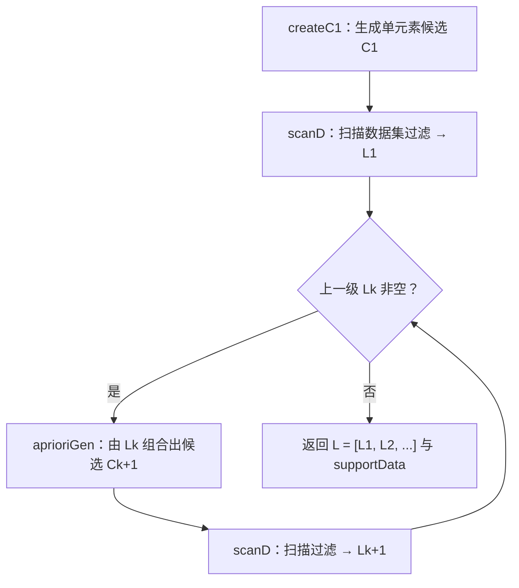

# 第 11 章 使用Apriori算法进行关联分析

> **本章解决**：如何从大规模数据集中找出物品间的隐含关系——这就是关联分析（association analysis），也叫关联规则学习（association rule learning）。量化"有趣关系"靠两个指标：频繁项集（frequent item sets）与关联规则（association rules），分别用支持度和可信度来度量。穷举所有物品组合的代价随物品数指数增长，Apriori 算法利用"非频繁项集的超集必然非频繁"这一原理剪掉绝大多数候选，让问题在合理时间内可解。

在杂货店的购物过程里藏着一堆机器学习的应用：物品的展示方式、购物之后的优惠券、用户忠诚度计划，等等。商店想知道哪些商品经常被一起购买——顾客用会员卡结账时，折扣换来了购买记录；不用会员卡，商店还能看信用卡记录；连现金付款的顾客，商店也可以查看"一起结账的商品"（Stephen Baker 在 *The Numerati* 一书里介绍了商店使用的更多技术）。这些从数据海洋中抽取的知识，可以直接用于商品定价、市场促销、存货管理。

## 11.0 本章导图

<div class="brtree">
  <div class="brrow">
    <span class="brlabel root">Apriori 关联分析</span>
    <span class="brace"></span>
    <div class="brkids">
      <div class="brrow">
        <span class="brlabel">两个量化目标</span>
        <span class="brace"></span>
        <div class="brkids">
          <span class="brleaf">频繁项集：经常一块出现的物品集合</span>
          <span class="brleaf">关联规则："买了 A 很可能买 B"的蕴含关系</span>
          <span class="brleaf">支持度：包含该项集的记录占比</span>
          <span class="brleaf">可信度：两个支持度相除，针对单条规则</span>
        </div>
      </div>
      <div class="brrow">
        <span class="brlabel">Apriori 原理</span>
        <span class="brace"></span>
        <div class="brkids">
          <span class="brleaf">频繁项集的子集必然频繁</span>
          <span class="brleaf">反过来用：非频繁项集的超集必然非频繁</span>
          <span class="brleaf">算出 2,3 非频繁 → 含它的三个大项集不用再算</span>
          <span class="brleaf">100 种商品就有十的三十次方级组合，蛮力不可行</span>
        </div>
      </div>
      <div class="brrow">
        <span class="brlabel">发现频繁项集（11.3）</span>
        <span class="brace"></span>
        <div class="brkids">
          <span class="brleaf">createC1：造出所有单元素候选（frozenset）</span>
          <span class="brleaf">scanD：扫描数据计数，按最小支持度过滤</span>
          <span class="brleaf">aprioriGen：前 k 减 2 项相同才合并，避免重复候选</span>
          <span class="brleaf">apriori：循环升级，直到某一级为空</span>
        </div>
      </div>
      <div class="brrow">
        <span class="brlabel">挖掘关联规则（11.4）</span>
        <span class="brace"></span>
        <div class="brkids">
          <span class="brleaf">前件 → 后件，方向不能随便互换</span>
          <span class="brleaf">可信度：频繁项集支持度除以前件支持度</span>
          <span class="brleaf">calcConf 评估规则，rulesFromConseq 分级加深右部</span>
          <span class="brleaf">分级法只长右部：大前件小后件的规则测不到</span>
        </div>
      </div>
      <div class="brrow">
        <span class="brlabel">实战·国会投票（11.5）</span>
        <span class="brace"></span>
        <div class="brkids">
          <span class="brleaf">votesmart API 已停服，改用官方快照数据复现</span>
          <span class="brleaf">编码：政党 1 个编号 + 每议案 Nay/Yea 各占 1 个编号</span>
          <span class="brleaf">支持度降到 30% 才有货，可信度提到 95%+ 出强规则</span>
          <span class="brleaf">对 NPR 议案投赞成 → 共和党，可信度 99.6%</span>
        </div>
      </div>
      <div class="brrow">
        <span class="brlabel">实战·毒蘑菇（11.6）</span>
        <span class="brace"></span>
        <div class="brkids">
          <span class="brleaf">23 个特征各占一段整数编号，共 119 个物品</span>
          <span class="brleaf">只搜含"有毒 = 2"的频繁项集</span>
          <span class="brleaf">30% 支持度下逐级看 L1、L3 里的毒蘑菇特征</span>
          <span class="brleaf">没有这些特征不代表可食用</span>
        </div>
      </div>
      <div class="brrow">
        <span class="brlabel">局限与后继</span>
        <span class="brace"></span>
        <div class="brkids">
          <span class="brleaf">每升一级都要重新扫描整个数据集</span>
          <span class="brleaf">大数据集上可能较慢</span>
          <span class="brleaf">下一章 FP-growth：只需两次遍历</span>
        </div>
      </div>
    </div>
  </div>
</div>

## 11.1 关联分析

先给 Apriori 算法立个档案：

| 项目 | 说明 |
| --- | --- |
| 优点 | 易编码实现 |
| 缺点 | 在大数据集上可能较慢 |
| 适用数据类型 | 数值型或者标称型数据 |

关联分析是一种**在大规模数据集中寻找有趣关系的任务**。这些关系有两种形式：

- **频繁项集**（**frequent item sets**）：经常出现在一块的物品的集合；
- **关联规则**（**association rules**）：暗示两种物品之间可能存在很强的关系。

<figure>
  
  <figcaption>图 11.1 一个来自 Hole Foods 天然食品店的简单交易清单（原书图 11-1，截自原书）</figcaption>
</figure>

拿图 11.1 的交易清单看：集合 {葡萄酒, 尿布, 豆奶} 就是一个频繁项集（集合用一对大括号 { } 表示）；从这份数据里还能找出"尿布 ➞ 葡萄酒"这样的关联规则——如果有人买了尿布，那么他很可能也会买葡萄酒。商家用这两样东西可以更好地理解顾客。零售业之外，这套技术同样适用于网站流量分析、医药行业等场景。

!!! note "拓展：尿布与啤酒"
    关联分析里最有名的例子是"尿布与啤酒"：据报道，美国中西部一家连锁店发现男人们会在周四同时购买尿布和啤酒，于是商店理论上可以把两者摆在一起、并在周四全价销售获利——当然，这家商店并没有这么做（来源：DSS News, "Ask Dan! What is the true story about data mining, beer and diapers?", dssresources.com）。这个故事流传极广但真实性存疑，当段子听就好；它真正的价值是说明关联规则"指导货品摆放与促销"的想象空间。

那么，应该如何定义"有趣"？谁来定义"有趣"？最重要的是两个度量：

**支持度（support）**：一个项集的支持度被定义为**数据集中包含该项集的记录所占的比例**：

\[
\text{support}(X) = \frac{\text{包含项集 } X \text{ 的记录数}}{\text{数据集总记录数}}
\]

从图 11.1 中可以得到：{豆奶} 的支持度为 \(4/5\)；5 条交易记录中有 3 条包含 {豆奶, 尿布}，所以 {豆奶, 尿布} 的支持度为 \(3/5\)。支持度是**针对项集**来说的，因此可以定义一个最小支持度，只保留满足最小支持度的项集。

**可信度或置信度（confidence）**：针对一条诸如 {尿布} ➞ {葡萄酒} 的关联规则来定义：

\[
\text{confidence}(P \to H) = \frac{\text{support}(P \mid H)}{\text{support}(P)}
\]

其中 \(P \mid H\) 指所有出现在集合 \(P\) 或集合 \(H\) 中的元素（Python 里操作符 `|` 就是集合并运算）。"尿布 ➞ 葡萄酒"的可信度 = support({尿布, 葡萄酒}) / support({尿布}) = \(\frac{3/5}{4/5} = 0.75\)。这意味着对于包含"尿布"的所有记录，这条规则对其中 75% 的记录都适用。

支持度和可信度是用来量化关联分析是否成功的方法。假设想找到支持度大于 0.8 的所有项集，怎么做？一个办法是生成物品所有可能组合的清单，然后对每一种组合统计它出现的频繁程度——但当物品成千上万时，这种做法非常非常慢。下一节的 Apriori 原理就是来减少这个计算量的。

## 11.2 Apriori原理

假设我们经营一家商品种类不多的杂货店，只有 4 种商品：商品 0、商品 1、商品 2 和商品 3。所有可能被一起购买的商品组合有哪些？组合可能只含一种商品（如商品 0），也可能包括两种、三种或者全部四种。注意我们不关心"某人买了两件商品 0 以及四件商品 2"这种数量信息，只关心他**购买了一种或多种商品**——所以每条交易记录就是一个集合。

<figure>
  
  <figcaption>图 11.2 集合 {0, 1, 2, 3} 中所有可能的项集组合（原书图 11-2，截自原书）</figcaption>
</figure>

图 11.2 显示了物品之间所有可能的组合（图中用物品编号 0 来指代物品本身）。从上往下第一个集合是空集，表示不包含任何物品；集合之间的连线表明两个或更多集合可以组合成更大的集合。

我们的目标是找到经常在一起购买的物品集合，用支持度度量其出现的频率。如何计算一个给定集合（比如 {0, 3}）的支持度？遍历每条记录，检查该记录是否同时包含 0 和 3，是则把总计数值加 1；扫描完所有数据后，用统计得到的总数除以总交易记录数就得到支持度。注意：**上述过程只是针对单个集合 {0, 3} 的**。要获得每种可能集合的支持度，就要对每个集合重复一遍。数一下图 11.2 中的集合数目——即使只有 4 种物品，也需要遍历数据 15 次（\(2^4 - 1\) 个非空项集）；而随着物品数目的增加，遍历次数急剧增长。包含 \(N\) 种物品的数据集共有 \(2^N - 1\) 种项集组合。出售 10 000 或更多种物品的商店并不少见；就算只出售 100 种商品的商店，也有 \(1.26 \times 10^{30}\) 种可能的项集组合——现代计算机需要很长的时间才能算完。

为了降低计算时间，研究人员发现了所谓的**Apriori 原理**（**Apriori principle**），它可以帮我们减少可能感兴趣的项集：

> 如果某个项集是频繁的，那么它的所有子集也是频繁的。

直观上这句话没什么帮助（子集本来就容易频繁），但**反过来看**就有用了：

> 如果一个项集是非频繁集，那么它的所有超集也是非频繁的。

<figure>
  
  <figcaption>图 11.3 阴影项集 {2, 3} 非频繁，因此 {0,2,3}、{1,2,3} 和 {0,1,2,3} 的支持度根本不需要计算（原书图 11-3，截自原书）</figcaption>
</figure>

在图 11.3 中，已知阴影项集 {2, 3} 是非频繁的。利用这个知识，我们立刻知道 {0,2,3}、{1,2,3} 以及 {0,1,2,3} 也是非频繁的——一旦计算出 {2, 3} 的支持度、知道它非频繁，就**不需要再计算**这三个集合的支持度，因为它们不会满足要求。这就是 Apriori 原理的用处：避免项集数目的指数增长，从而在合理时间内计算出频繁项集。

!!! note "拓展：Apriori 这个词"
    apriori 在拉丁语中指"来自以前"。当定义问题时，通常会使用先验知识或者假设，这被称作"一个先验"（a priori）。在贝叶斯统计中，使用先验知识作为条件进行推断也很常见；先验知识可能来自领域知识、先前的一些测量结果，等等。这个剪枝思路正是"利用先验（已知 {2,3} 非频繁）来推断后验（超集也非频繁）"。

!!! note "拓展：Apriori 算法的一般过程"
    1. 收集数据：使用任意方法。
    2. 准备数据：任何数据类型都可以，因为我们只保存集合。
    3. 分析数据：使用任意方法。
    4. 训练算法：使用 Apriori 算法来找到频繁项集。
    5. 测试算法：不需要测试过程。
    6. 使用算法：用于发现频繁项集以及物品之间的关联规则。

下一节基于 Apriori 原理实现算法，并把它应用到虚拟商店 Hole Foods 的数据集上。

## 11.3 使用Apriori算法来发现频繁集

11.1 节提到，关联分析的目标有两项：发现频繁项集和发现关联规则——**必须先找到频繁项集，才能获得关联规则**。本节只关注发现频繁项集。

Apriori 算法是发现频繁项集的一种方法，两个输入参数分别是**最小支持度**和**数据集**。算法流程：

1. 生成所有单个物品的项集列表（\(C_1\)）；
2. 扫描交易记录，去掉不满足最小支持度的项集，得到 \(L_1\)；
3. 对剩下的集合进行组合，生成包含两个元素的项集（\(C_2\)）；
4. 重新扫描交易记录，去掉不满足最小支持度的项集（\(L_2\)）；
5. 重复该过程，直到所有项集都被去掉。



整个算法先把"扫描数据集、过滤候选"封装成可复用的函数，伪代码大致如下：

```text
对数据集中的每条交易记录 tran：
    对每个候选项集 can：
        检查 can 是否是 tran 的子集：
            如果是，则增加 can 的计数值
对每个候选项集：
    如果其支持度不低于最小值，则保留该项集
返回所有频繁项集列表
```

### 11.3.1 生成候选项集

打开 `apriori.py`，加入书程序清单 11-1 的代码（原书 Python 2，下面已改写为 Python 3 可直接运行）：

```python
# ===== 书 11.3.1 节 程序清单 11-1：Apriori 算法中的辅助函数 =====
def loadDataSet():
    """书内演示数据集：4 条交易记录。"""
    return [[1, 3, 4], [2, 3, 5], [1, 2, 3, 5], [2, 5]]

def createC1(dataSet):
    """构建大小为 1 的所有候选项集集合 C1（frozenset 列表）。"""
    C1 = []
    for transaction in dataSet:        # 遍历数据集中的所有交易记录
        for item in transaction:       # 遍历记录中的每一个项
            if not [item] in C1:       # 不重复；添加"只含该项的列表"而非裸项
                C1.append([item])
    C1.sort()                          # 对大列表排序
    return list(map(frozenset, C1))    # 每个单元素列表映射为 frozenset（Py3 需显式 list）

def scanD(D, Ck, minSupport):
    """扫描数据集 D，从候选项集列表 Ck 中筛出满足最小支持度的项集。

    返回：频繁项集列表 retList + 全部候选支持度的字典 supportData。
    """
    ssCnt = {}
    for tid in D:                      # 对数据集中的每条交易记录
        for can in Ck:                 # 对每个候选项集
            if can.issubset(tid):      # can 是该记录的子集 → 计数
                if can not in ssCnt:   # 原书 Py2 写 ssCnt.has_key(can)，Py3 改用 in
                    ssCnt[can] = 1
                else:
                    ssCnt[can] += 1
    numItems = float(len(D))           # 总记录数（Py3 的 / 本身就是真除法）
    retList = []
    supportData = {}
    for key in ssCnt:                  # 计算所有项集的支持度
        support = ssCnt[key] / numItems
        if support >= minSupport:
            retList.insert(0, key)     # 插到列表首部——只是为了让列表"看起来有组织"
        supportData[key] = support     # 被淘汰项集的支持度也记下来，后面算规则要用
    return retList, supportData
```

程序包含三个函数：`loadDataSet()` 创建用于测试的简单数据集；`createC1()` 构建集合 \(C_1\)；`scanD()` 扫描数据集过滤候选。

**createC1：为什么每个物品要套一层列表，还要冻结成 frozenset？** \(C_1\) 是大小为 1 的所有候选项集的集合——注意它不是 [1, 2, 3] 这种"物品列表"，而是"集合的集合"，形如 {{0}, {1}, {2}, ...}（原书译者注）。Apriori 算法先构建 \(C_1\)，扫描数据集判断哪些单元素项集满足最小支持度，满足的构成 \(L_1\)；\(L_1\) 中的元素相互组合构成 \(C_2\)，\(C_2\) 再过滤变为 \(L_2\)，如此往复。因为后续要做集合运算，所以每个物品项都要先包成单元素列表再转成集合——"由单物品列表组成的大列表"就是为此准备的。

!!! note "拓展：为什么必须是 frozenset"
    frozenset 是被"冰冻"的集合：不可改变，用户不能修改它们。这里必须用 frozenset 而不能用 set，因为之后要把这些集合**作为字典的键**使用（ssCnt 的键就是集合）——可变的 set 不可哈希，当不了键；frozenset 可以。书里还说"Python 不能创建只有一个整数的集合"，这是 Python 2 时代的说法：当时 `{1}` 会被当作字典字面量的语法错误，只能写 `set([1])`；Python 3 已经支持 `{1}` 这种集合字面量，但"列表套一层再转 frozenset"的写法依然是最稳妥的。

!!! warning "原书是 Python 2：两处必须改"
    1. `return map(frozenset, C1)`：Python 2 的 `map` 返回列表，Python 3 返回**迭代器**，只能被消费一次——不套 `list()`，候选列表在第一次扫描后就"空"了，后面全部失效。
    2. `ssCnt.has_key(can)`：`has_key` 在 Python 3 中已被移除，改用 `can not in ssCnt`。

scanD 有三个参数：数据集 \(D\)、候选项集列表 \(C_k\)、感兴趣项集的最小支持度 minSupport。它首先创建空字典 ssCnt，遍历所有交易记录和所有候选集：如果 \(C_k\) 中的集合是某条记录的子集，就增加字典中对应的计数值——**字典的键就是集合**（这正是 frozenset 的用武之地）。扫描完后进入下一个循环：遍历字典的每个元素并计算支持度，满足最小支持度要求的集合用 `retList.insert(0, key)` 插到列表首部（不一定要在首部插入，这只是为了让列表看起来有组织），函数最后返回支持度字典 supportData 备用。

下面看实际运行效果（书 206 页会话）：

```python
# ===== 书 11.3.1 节：构建 C1 并扫描出 L1（实跑） =====
import apriori
dataSet = apriori.loadDataSet()
C1 = apriori.createC1(dataSet)
D = list(map(set, dataSet))            # 构建集合表示的数据集 D
L1, suppData0 = apriori.scanD(D, C1, 0.5)   # 最小支持度 0.5
```

<figure>
  
  <figcaption>图 11.4 书 11.3.1 会话实跑输出：C1、D、scanD(D, C1, 0.5) 的结果（代码实跑）</figcaption>
</figure>

4 个项集构成 \(L_1\) 列表，其中每个单物品项集至少出现在 50% 以上的记录中。物品 4 的支持度只有 0.25，没有达到最小支持度，所以没有包含在 \(L_1\) 中——通过去掉这件物品，减少了查找两物品项集的工作量。（对照书 206 页：书中输出的 \(L_1\) 为 [frozenset([1]), frozenset([3]), frozenset([2]), frozenset([5])]，Python 2 的字典遍历顺序与 Python 3 不同，列表顺序会有差异，**集合内容完全一致**——本章其余输出对照同理，不再逐条说明。）

### 11.3.2 组织完整的 Apriori算法

整个 Apriori 算法的伪代码：

```text
当集合中项的个数大于 0 时：
    构建一个 k 个项组成的候选项集的列表
    检查数据以确认每个项集都是频繁的
    保留频繁项集并构建 k+1 项组成的候选项集的列表
```

加入书程序清单 11-2 的代码：

```python
# ===== 书 11.3.2 节 程序清单 11-2：Apriori 算法 =====
def aprioriGen(Lk, k):
    """由频繁项集列表 Lk（每个项集含 k-1 个元素）生成候选项集列表 Ck。

    输入 {0}、{1}、{2} 会生成 {0,1}、{0,2}、{1,2}。
    """
    retList = []
    lenLk = len(Lk)
    for i in range(lenLk):
        for j in range(i + 1, lenLk):          # 两两配对
            L1 = list(Lk[i])[:k-2]             # 取前 k-2 个元素（frozenset 不能切片，先转 list）
            L2 = list(Lk[j])[:k-2]
            L1.sort(); L2.sort()               # 排序后比较
            if L1 == L2:                       # 前 k-2 项相同时，将两个集合合并
                retList.append(Lk[i] | Lk[j])  # 集合并操作符 |：两个 (k-1) 项集拼成 k 项集
    return retList

def apriori(dataSet, minSupport=0.5):
    """完整 Apriori 算法：C1 → L1 → C2 → L2 → …… 直到某一级没有频繁项集。"""
    C1 = createC1(dataSet)
    D = list(map(set, dataSet))                # 数据集转成集合列表 D（Py3 需显式 list）
    L1, supportData = scanD(D, C1, minSupport)
    L = [L1]                                   # L 将依次装入 L1、L2、L3……
    k = 2
    while (len(L[k-2]) > 0):                   # 上一级还有频繁项集就继续
        Ck = aprioriGen(L[k-2], k)             # 由 Lk-1 生成候选 Ck
        Lk, supK = scanD(D, Ck, minSupport)    # 扫描数据集，从 Ck 得到 Lk
        supportData.update(supK)               # 把本级支持度并入总字典
        L.append(Lk)
        k += 1
    return L, supportData
```

程序清单 11-2 包含两个函数：主函数是 `apriori()`，它调用 `aprioriGen()` 来创建候选项集 \(C_k\)。

**aprioriGen 怎么合并？** 输入参数为频繁项集列表 \(L_k\) 与项集元素个数 \(k\)，输出为 \(C_k\)。比如以 {0}、{1}、{2} 作为输入，会生成 {0,1}、{0,2} 以及 {1,2}。做法：创建空列表，然后用两个 for 循环比较 \(L_k\) 中的每一个元素与其他元素——如果两个集合的**前面 k−2 个元素相等**，就将它们合并成一个大小为 \(k\) 的集合（集并用 Python 操作符 `|` 完成）。

!!! note "拓展：这个 k-2 有点让人疑惑，但正是它保证不产生重复候选"
    用 {0}、{1}、{2} 构建两元素项集时，是把单个项组合到一块，k−2=0，任何两个集合的"前 0 项"都相同，所以两两全合并——得到 \(C_2\) 的 3 个候选，正确。但如果接下来想用 {0,1}、{0,2}、{1,2} 创建三元素项集呢？如果**每两个集合都求并**，会得到 {0,1,2}、{0,1,2}、{0,1,2}——同样的结果重复 3 次，之后还得扫描列表去重。现在改为只对**第 1 个元素相同**的集合求并（k−2=1）：{0,1} 与 {0,2} 前 1 项相同 → 并出 {0,1,2}，而且只有一次操作！不需要再遍历列表寻找非重复值。一般地，两个待合并的 (k−1) 项集若前 k−2 项相同，其并集就唯一确定了它们的 k 项组合，这就是无重复候选的来源。

!!! note "拓展：实现细节——frozenset 不能切片"
    `Lk[i][:k-2]` 直接对 frozenset 切片会抛 `TypeError`（frozenset 不可下标访问），所以必须先 `list()` 转列表再切片。另外比较前必须 `sort()`：合并条件是"排序后的前 k−2 项相同"，而 frozenset 的元素本身没有顺序。

**apriori 主函数**：给它传递一个数据集以及一个支持度，它先创建 \(C_1\)，再用 `map(set, dataSet)` 把数据集转成集合列表 \(D\)；接着用 scanD 创建 \(L_1\) 并放入列表 \(L\)（\(L\) 会包含 \(L_1, L_2, L_3, \ldots\)）。然后 while 循环创建包含更大项集的更大列表：用 `aprioriGen()` 创建 \(C_k\)，用 scanD 基于 \(C_k\) 创建 \(L_k\)（丢掉不满足最小支持度的项集），\(L_k\) 添加进 \(L\)，同时 k 加 1 重复上述过程；当 \(L_k\) 为空时，程序返回 \(L\) 并退出。

下面看实际运行效果（书 208–209 页）：

<figure>
  
  <figcaption>图 11.5 书 11.3.2 会话实跑输出：apriori(dataSet) 的各级 L 与 aprioriGen(L[0], 2) 的 6 个候选（代码实跑）</figcaption>
</figure>

`aprioriGen(L[0], 2)` 创建了 6 个不重复的两元素集合。其中 4 个集合在 \(L[1]\) 中，剩下 2 个集合（{1,5} 与 {1,2}，支持度各 0.25）被 scanD 过滤掉。

<figure>
  
  <figcaption>图 11.6 再试 70% 的支持度：单元素只剩 2、3、5，二元频繁项集只剩 {2,5}（代码实跑）</figcaption>
</figure>

变量 suppData 是一个字典，包含我们项集的支持度值。现在暂时不考虑这些值，下一节会用。

!!! note "拓展：支持度阈值敏感性——阈值降了，结果可能没变"
    这份 4 条记录的数据集里，支持度只能取 0.25、0.5、0.75、1.0 这几个离散台阶。用本章代码对一组阈值（0.5 → 0.2）实跑统计各级频繁项集数量，结果见图 11.7：阈值在 (0.25, 0.5] 区间内怎么调都是 9 个频繁项集（各级 4、4、1）；一旦低于 0.25，{4}、{1,2}、{1,5} 这批 0.25 档的项集全部入场，总数跳到 19（各级 5、8、5、1）。**调参前先看数据里支持度的"台阶"**，不然会出现"调了半天没变化"的假象。

<figure>
  
  <figcaption>图 11.7 支持度阈值敏感性对比：阈值从 0.5 降到 0.3 结果纹丝不动，跌破 0.25 后候选立刻翻倍（代码实跑）</figcaption>
</figure>

现在可以知道哪些项出现在 70% 以上的记录中了。可以像许多程序一样直接利用数据得到结论，也可以生成 if-then 形式的关联规则来理解数据——下一节展开。

## 11.4 从频繁项集中挖掘关联规则

11.2 节提到，关联分析最常寻找的两个目标是频繁项集与关联规则。上一节解决了频繁项集，现在解决关联规则。

**从频繁项集抽规则。** 从一个频繁项集出发：集合中的元素不重复，但某个元素或某个元素集合可能推导出另一个元素。比如频繁项集 {豆奶, 莴苣} 可能产生关联规则"豆奶 ➞ 莴苣"——买了豆奶的人在统计上买莴苣的概率较大。但**这条反过来并不总是成立**：即使"豆奶 ➞ 莴苣"统计上显著，"莴苣 ➞ 豆奶"也不一定成立。（逻辑研究上，箭头左边的集合称作**前件**（antecedent），右边的集合称为**后件**（consequent）。）

**量化：可信度。** 11.3 节用最小支持度量化了频繁项集；关联规则的量化指标就是 11.1 节的可信度——规则 \(P \to H\) 的可信度定义为 \(\text{support}(P \mid H) / \text{support}(P)\)。记住 Python 中操作符 `|` 表示集合的并操作（数学上集合并的符号是 \(\cup\)），\(P \mid H\) 指 \(P \cup H\)。上一节已经算出了所有频繁项集的支持度，想获得可信度只需**取出那些支持度值做一次除法运算**。

**能产生多少条规则？** 图 11.8 的网格图给出从项集 {0,1,2,3} 产生的所有关联规则。为找到感兴趣的规则，先生成可能的规则列表，再逐条测试可信度，不满足最小要求的去掉。

<figure>
  
  <figcaption>图 11.8 频繁项集 {0,1,2,3} 的关联规则网格示意图：阴影区域是低可信度规则。如果 0,1,2 ➞ 3 低可信度，那么所有其他以 3 为后件、前件为其子集的规则也可信度较低（原书图 11-4，截自原书）</figcaption>
</figure>

规则数目同样可以被剪枝：**如果某条规则不满足最小可信度要求，那么该规则前件的所有子集（同一后件）也不会满足**。以图 11.8 为例，假设规则 0,1,2 ➞ 3 不满足最小可信度，那么任何左部为 {0,1,2} 子集的规则也不会满足——图中这些规则都加了阴影表示。

!!! note "拓展：这条剪枝性质为什么成立"
    规则 \(P' \to H\)（\(P' \subseteq P\)）的可信度是 \(\text{support}(P' \cup H)/\text{support}(P')\)。由于 \(P' \cup H \subseteq P \cup H\)，分子满足 \(\text{support}(P' \cup H) \le \text{support}(P \cup H)\)；又因为前件变小后包含它的记录只会更多，分母满足 \(\text{support}(P') \ge \text{support}(P)\)。分子不增、分母不减，所以 \(P' \to H\) 的可信度不会高于 \(P \to H\)——大前件的规则都不过关，小前件更没戏。

利用关联规则的上述性质可以减少需要测试的规则数目。类似程序清单 11-2 的 Apriori 算法：首先从一个频繁项集开始，创建规则右部只包含一个元素的规则列表并测试；接下来**合并所有剩余规则**来创建新的规则列表，其中规则右部包含两个元素——这种方法也被称作**分级法**。下面看实际效果（书程序清单 11-3）：

```python
# ===== 书 11.4 节 程序清单 11-3：关联规则生成函数 =====
def generateRules(L, supportData, minConf=0.7):
    """主函数：遍历每个频繁项集，生成可信度 >= minConf 的规则列表。

    L、supportData 正是 apriori() 的两个返回值。
    """
    bigRuleList = []
    for i in range(1, len(L)):         # 只获取有两个或更多元素的集合（L[0] 是单元素项集）
        for freqSet in L[i]:
            H1 = [frozenset([item]) for item in freqSet]   # 规则右部候选：每个元素单拆
            if (i > 1):                # 项集元素数 > 2：交给分级法继续合并右部
                rulesFromConseq(freqSet, H1, supportData, bigRuleList, minConf)
            else:                      # 项集只有两个元素：直接测试两条规则
                calcConf(freqSet, H1, supportData, bigRuleList, minConf)
    return bigRuleList

def calcConf(freqSet, H, supportData, brl, minConf=0.7):
    """计算候选规则的可信度并筛选。

    对 H 中每个候选后件 conseq：规则为 freqSet - conseq --> conseq，
    可信度 = 频繁项集的支持度 / 前件的支持度。
    """
    prunedH = []                       # 达标的规则后件，供 rulesFromConseq 继续合并
    for conseq in H:
        conf = supportData[freqSet] / supportData[freqSet - conseq]
        if conf >= minConf:
            print(freqSet - conseq, '-->', conseq, 'conf:', conf)   # Py3 print 函数
            brl.append((freqSet - conseq, conseq, conf))            # 存入 bigRuleList
            prunedH.append(conseq)
    return prunedH

def rulesFromConseq(freqSet, H, supportData, brl, minConf=0.7):
    """分级法：规则右部从 m 个元素合并为 m+1 个，逐层加深。"""
    m = len(H[0])                      # H 中每个候选后件的元素个数（不是规则条数！）
    if (len(freqSet) > (m + 1)):       # 频繁项集大到"还能腾出非空前件"才继续
        Hmp1 = aprioriGen(H, m + 1)    # 创建 Hm+1 条新候选规则（后件合并成 m+1 元）
        Hmp1 = calcConf(freqSet, Hmp1, supportData, brl, minConf)
        if (len(Hmp1) > 1):            # 至少剩两条达标规则才能进一步组合
            rulesFromConseq(freqSet, Hmp1, supportData, brl, minConf)
```

程序包含三个函数。`generateRules()` 是主函数，调用另外两个函数：`rulesFromConseq()` 用于生成候选规则集合，`calcConf()` 用于对规则进行评估。

**generateRules** 有 3 个参数：频繁项集列表、包含那些频繁项集支持数据的字典、最小可信度阈值（缺省 0.7）。函数生成一个包含可信度的规则列表（后面可以基于可信度对它们排序），这些规则存放在 bigRuleList 中。它遍历 \(L\) 中的每一个频繁项集，对每个频繁项集创建只包含单个元素集合的列表 \(H_1\)——因为**无法从单元素项集中构建关联规则**，所以要从包含两个或更多元素的项集开始规则构建。若从集合 {0,1,2} 开始，\(H_1\) 应该是 [{0},{1},{2}]。如果频繁项集的元素数目超过 2，考虑对它做进一步的合并（通过 `rulesFromConseq()` 完成）；如果项集中只有两个元素，那么直接使用 `calcConf()` 来计算可信度值。

**calcConf** 的目标是计算规则的可信度以及找到满足最小可信度要求的规则。它创建空列表 prunedH 保存通过检查的规则后件，遍历 \(H\) 中的所有项集并计算它们的可信度值——可信度计算**完全复用 supportData 中的支持度数据**，节省大量计算时间。满足最小可信度值的规则输出到屏幕，同时追加到 brl（即外层的 bigRuleList），达标后件也会被返回给 `rulesFromConseq()` 继续使用。

**rulesFromConseq** 有 2 个参数：频繁项集和可以出现在规则右部的元素列表 \(H\)。函数先计算 \(H\) 中候选后件的元素个数 \(m\)（注意是 `len(H[0])`——**每个后件集合的大小**，不是规则条数），再查看该频繁项集是否大到可以移除大小为 \(m\) 的子集作为前件：若 `len(freqSet) > m+1`，用 `aprioriGen()` 生成 \(H\) 中元素的无重复组合 \(H_{m+1}\)（这也是下一次迭代的 \(H\) 列表，包含所有可能的规则），利用 `calcConf()` 来测试它们的可信度；如果不止一条规则满足要求，就使用 \(H_{m+1}\) 迭代调用 `rulesFromConseq()` 判断是否可以进一步组合这些规则。

下面看实际运行效果（书 212 页）：

```python
# ===== 书 11.4 节：生成关联规则（实跑） =====
L, suppData = apriori.apriori(dataSet, minSupport=0.5)
rules = apriori.generateRules(L, suppData, minConf=0.7)
rules = apriori.generateRules(L, suppData, minConf=0.5)
```

<figure>
  
  <figcaption>图 11.9 书 11.4 会话实跑输出：minConf=0.7 的 3 条规则与 minConf=0.5 的 11 条规则（代码实跑）</figcaption>
</figure>

结果给出三条规则：{1} ➞ {3}、{5} ➞ {2} 及 {2} ➞ {5}（可信度全部 1.0）。后两条包含 2 和 5 的规则可以互换前件和后件，但前一条包含 1 和 3 的规则不行。一旦把可信度阈值降到 0.5，就可以获得更多的规则——11 条，其中 {2,3,5} 通过 rulesFromConseq 派生出 {5}➞{2,3}、{3}➞{2,5}、{2}➞{3,5} 这类"单元素前件、双元素后件"的规则。所有数值（支持度 0.5/0.75/1.0，可信度 0.667/1.0）与书 212 页逐值一致。

!!! note "拓展：分级法的盲区——右部只长不缩"
    仔细看 generateRules：对元素数大于 2 的项集，它直接调 rulesFromConseq，而后者是拿 \(H_1\) 去合并出**双元素后件**再测试——也就是说，"多元素前件 ➞ 单元素后件"的规则（比如从 {2,3,5} 抽出 {2,3} ➞ {5}，可信度 = support({2,3,5})/support({2,3}) = 0.5/0.5 = 1.0）从头到尾没有被测试过。这是书实现的一个已知局限：分级法只让右部从 1 长到元素数减 1，"大前件、小后件"这一侧漏掉了。想要完整规则集，在 rulesFromConseq 开头补一句 `calcConf(freqSet, H, supportData, brl, minConf)`，把当前后件列表也测一遍即可。

书的小数据集最大频繁项集只有 3 个元素。换一份能让 {1,2,3,4} 成为频繁项集的数据实跑（rulesFromConseq 的递归能不能走得更深，一试便知）：

```python
# ===== 拓展：4 元素频繁项集的 rulesFromConseq 递归（实跑） =====
dataSet2 = [[1, 2, 3, 4], [1, 2, 3, 4], [1, 2, 3, 5], [2, 3, 4, 5], [1, 2, 3, 4]]
L2, suppData2 = apriori(dataSet2, minSupport=0.4)   # {1,2,3,4} 支持度 3/5 = 0.6
rules = generateRules(L2, suppData2, minConf=0.65)  # 共 32 条规则
```

!!! note "拓展：递归确实逐层加深了"
    实跑共产出 32 条规则：右部 1 元 → 2 元 → 3 元一路加深，例如 {3,4} ➞ {1,2}（conf 0.75）、{4} ➞ {1,2,3}（conf 0.75）。对比 {2,3,5} 那组只有"1 元前件 ➞ 2 元后件"的输出，可以看到条件 `len(freqSet) > m+1` 控制着递归在"前件即将变空"时刹车。

到此为止，程序已经能在小数据集上正常运行，接下来放到一个更大的真实数据集上测试效果——美国国会投票记录。

## 11.5 示例：发现国会投票中的模式

现在把工具用在真实数据上。用什么数据？购物是个好例子但前面已经用过了；搜索引擎的查询词也行；这里选一个更有趣的：**美国国会议员投票**。

加州大学埃文分校的机器学习数据集合中有一个自 1984 年起的国会投票记录数据集（archive.ics.uci.edu 的 Congressional Voting Records），但这个数据集偏旧、议题意义也不大。我们想尝试一些更新的数据。目前有不少组织致力于将政府数据公开化，其中的**智能投票工程**（Project Vote Smart，votesmart.org）提供了一个公共 API。下面会看到如何从 votesmart.org 获取数据，并将其转化为用于生成频繁项集与关联规则的格式。该数据可以用于竞选的目的，或者预测政治家如何投票。

!!! note "拓展：Apriori 算法一般过程（应用到投票记录）"
    1. 收集数据：使用 votesmart 模块来访问投票记录。
    2. 准备数据：构造一个函数来将投票转化为一串交易记录。
    3. 分析数据：在 Python 提示符下查看准备的数据以确保其正确性。
    4. 训练算法：使用本章早先的 apriori() 和 generateRules() 函数来发现投票记录中的有趣信息。
    5. 测试算法：不适用，即没有测试过程。
    6. 使用算法：这里只是出于娱乐的目的，不过也可以使用分析结果来为政治竞选活动服务，或者预测选举官员会如何投票。

!!! warning "votesmart API 已停服：采集代码不再实跑，挖掘用官方快照数据复现"
    原书依赖的 Project Vote Smart 公共 API（api.votesmart.org）已停止服务，11.5.1 的采集代码**无法再运行**，本笔记按原书忠实呈现（改为 Python 3 写法）。好消息是官方代码仓库（github.com/pbharrin/machinelearninginaction 的 Ch11 目录）保存了作者抓好的两份数据：`bills20DataSet.txt`（事务数据，566 位议员的投票项列表）和 `meaning20.txt`（元素含义列表）——二者正是清单 11-5 跑完后的 transDict 值列表与 itemMeaning。本节挖掘部分基于它们**完整实跑**，输出与原书逐值对照（个别可信度小数位有差异，是数据快照不同所致，见 11.5.2 的说明）。

### 11.5.1 收集数据：构建美国国会投票记录的事务数据集

智能投票工程已经收集了大量政府数据，同时提供了一个公开的 API 来访问该数据（api.votesmart.org/docs/terms.html）；Sunlight 实验室写过一个 Python 模块 python-votesmart（github.com/sunlightlabs/python-votesmart）用于访问该数据，文档很齐全。我们要从美国国会获得一些最新的投票记录。如果没安装 python-votesmart 或者没获得 API key，需要先完成这两件事（安装方法参考原书附录 A）。

使用 votesmart API，需要导入模块并输入 API key（原书 Python 2 会话）：

```text
>>> from votesmart import votesmart
>>> votesmart.apikey = '49024thereonewasamanfromnantucket94040'
# 这里的 key 只是例子。你需要到 votesmart.org/share/api/register 申请自己的 key
```

为了获得最近的 100 条议案：

```text
>>> bills = votesmart.votes.getBillsByStateRecent()
>>> for bill in bills:                 # 看每条议案的具体内容（原书 Py2：print bill.title, bill.billId）
...     print(bill.title, bill.billId)
Amending FAA Rulemaking Activities 13020
Prohibiting Federal Funding of National Public Radio 12939
Additional Continuing Appropriations 12888
Removing Troops from Afghanistan 12940
    ...
"Whistleblower Protection" for Offshore Oil Workers 11820
```

读者看本书时，最新的 100 条议案内容将会有所改变，所以作者把上述 100 条议案的标题及 ID 号（billId）保存为 recent100bills.txt 文件。

可以通过 `getBill()` 方法获得每条议案的更多内容。比如对最后一条议案 "Whistleblower Protection"，其 ID 号为 11820：

```text
>>> bill = votesmart.votes.getBill(11820)      # 返回 BillDetail 对象，包含大量完整信息
>>> for action in bill.actions:                # 感兴趣的是围绕议案的所有行为
...     if action.stage == 'Passage':          # 投票发生时的行为
...         print(action.actionId)
...
31670
```

上述信息并不完整：一条议案会经历多个阶段——议案被提出之后，经由美国国会和众议院投票通过后，才能进入行政办公室。其中的 Passage（议案通过）阶段**可能存在欺骗性**，因为这有可能是行政办公室的 Passage 阶段，那里并没有任何投票。为获得某条特定议案的投票信息，使用 `getBillActionVotes()` 方法：

```text
>>> voteList = votesmart.votes.getBillActionVotes(31670)
>>> voteList[22]       # voteList 是包含 Vote 对象的列表（原书 Python 2 输出）
Vote({u'action': u'No Vote', u'candidateId': u'430', u'officeParties': u'Democratic',
      u'candidateName': u'Berry, Robert'})
>>> voteList[21]
Vote({u'action': u'Yea', u'candidateId': u'26756', u'officeParties': u'Democratic',
      u'candidateName': u'Berman, Howard'})
```

现在把用过的相关 API 组织到一块。接下来给出的函数将文本文件中的 billId 转化为 actionId：如前所述，并非所有的议案都被投票过，另外可能有一些议案在多处进行了议案投票——也就是说需要对 actionId 进行过滤，只保留包含投票数据的 actionId。这样处理之后，100 个议案只剩 20 个（作者认为有趣的议案），保存在 recent20bills.txt 中。下面是处理 actionIds 过滤的 `getActionIds()` 函数（书程序清单 11-4）：

```python
# ===== 书 11.5.1 节 程序清单 11-4：收集美国国会议案中 action ID 的函数 =====
# votesmart API 已停服：本清单忠实呈现原书代码（Py3 写法），不实跑
from time import sleep
from votesmart import votesmart
votesmart.apikey = '49024thereonewasamanfromnantucket94040'   # 示例 key，换成自己申请的

def getActionIds():
    actionIdList = [];  billTitleList = []
    fr = open('recent20bills.txt')             # 每行：议案编号 \t 议案标题
    for line in fr.readlines():
        billNum = int(line.split('\t')[0])
        try:                                   # 外部 API 可能出错，try-except 避免中断采集
            billDetail = votesmart.votes.getBill(billNum)
            for action in billDetail.actions:  # 遍历议案中的所有行为
                if action.level == 'House' and \           # 过滤出包含投票的行为：
                   (action.stage == 'Passage' or \         # Passage 与 Amendment Vote
                    action.stage == 'Amendment Vote'):     # 阶段才有投票数据
                    actionId = int(action.actionId)
                    print('bill: %d has actionId: %d' % (billNum, actionId))
                    actionIdList.append(actionId)
                    billTitleList.append(line.strip().split('\t')[1])
        except:
            print('problem getting bill %d' % billNum)
        sleep(1)                               # 为礼貌访问网站而做些延迟
    return actionIdList, billTitleList
```

要点：在 Passage 阶段与 Amendment Vote（修正案投票）阶段都会有投票数据，要找的就是它们；行政级别上也有一个 Passage 阶段，但那个阶段不包含任何投票数据，所以要确保这个阶段是发生在**众议院**（`action.level == 'House'`）。如果确实如此，程序就会将 actionId 打印出来并添加到 actionIdList 中，同时把议案的标题添加到 billTitleList 中。一旦 API 调用发生错误，except 模块将错误信息输出，actionIdList 不做添加。最后程序休眠 1 秒，以避免对 votesmart.org 网站的过度频繁访问。原书实跑输出：

```text
>>> actionIdList, billTitles = apriori.getActionIds()
bill: 12939 has actionId: 34089
bill: 12940 has actionId: 34091
bill: 12988 has actionId: 34229
    ...
```

接下来获取这些 actionId 的投票信息。选举人可以投是或否的表决票，也可以弃权；而一条交易记录只包含"项出现或不出现"，不包含项出现的次数——基于投票数据，可以把**投票是或否各看成一个元素**。美国有两个主要政党：共和党与民主党，也要对这些信息进行编码并写进事务数据库（幸运的是这些信息在投票数据中已经包括）。

构建事务数据库的流程：创建一个字典，字典中使用政客的名字作为键值；当某政客首次出现时，将他及其所属政党添加到字典中。对每条议案创建**两个条目**：bill+'Nay' 以及 bill+'Yea'——该方法允许在某个政客根本没有投票时也能合理编码。

<figure>
  
  <figcaption>图 11.10 美国国会信息到元素（项）编号之间的映射示意图（原书图 11-5，截自原书）</figcaption>
</figure>

!!! warning "原书笔误：图 11-5 与正文的政党编号画反了"
    原书图 11-5 把编号 0 标为 Democrat、1 标为 Republican，正文也写着"使用 0 来代表民主党，1 来代表共和党"；但清单 11-5 的代码是 `officeParties == 'Democratic'` 时 `append(1)`、`'Republican'` 时 `append(0)`，官方配套数据 meaning20.txt 中编号 0 是 `'Republican'`，图 11-6 的规则 {3} ➞ {0} 也解码为"…… ➞ Republican"。三处证据一致：**0 = 共和党，1 = 民主党**。图 11-5 的前两个标签与正文那句话同代码矛盾，阅读时以代码为准。

下面是使用 actionId 串作为输入、利用 votesmart 的 API 抓取投票记录的函数（书程序清单 11-5）。每个选举人对应于一行（事务数据库中的一条记录），每个选举人的投票转化为一个项集：

```python
# ===== 书 11.5.1 节 程序清单 11-5：基于投票数据的事务列表填充函数 =====
# votesmart API 已停服：本清单忠实呈现原书代码（Py3 写法），不实跑
from time import sleep

def getTransList(actionIdList, billTitleList):
    """把 votesmart 投票记录填充成事务字典 transDict + 元素含义列表 itemMeaning。"""
    itemMeaning = ['Republican', 'Democratic']     # 编号 0、1 是政党
    for billTitle in billTitleList:                # 填充 itemMeaning 列表：
        itemMeaning.append('%s -- Nay' % billTitle)    # 每条议案占两个编号，
        itemMeaning.append('%s -- Yea' % billTitle)    # 偶数位 Nay、奇数位 Yea
    transDict = {}
    voteCount = 2                                  # 第一条议案从编号 2 开始
    for actionId in actionIdList:
        sleep(3)                                   # 每次调用延迟 3 秒
        print('getting votes for actionId: %d' % actionId)
        try:
            voteList = votesmart.votes.getBillActionVotes(actionId)
            for vote in voteList:                  # voteList 通常超过 400 个投票
                if vote.candidateName not in transDict:   # 新政客：登记他 + 政党
                    transDict[vote.candidateName] = []
                    if vote.officeParties == 'Democratic':
                        transDict[vote.candidateName].append(1)   # 1 = 民主党
                    elif vote.officeParties == 'Republican':
                        transDict[vote.candidateName].append(0)   # 0 = 共和党
                if vote.action == 'Nay':               # 投反对票 → 偶数位编号
                    transDict[vote.candidateName].append(voteCount)
                elif vote.action == 'Yea':             # 投赞成票 → 奇数位编号
                    transDict[vote.candidateName].append(voteCount + 1)
        except:                                        # API 出错就打印并继续
            print('problem getting actionId: %d' % actionId)
        voteCount += 2                                 # 下一条议案的两个编号
    return transDict, itemMeaning
```

函数 getTransList() 会创建一个事务数据库，在此基础上可以使用前面的 Apriori 代码来生成频繁项集与关联规则；它也会创建一个标题列表 itemMeaning，很容易了解每个元素项的含义。想知道某些元素项的具体含义时，以元素项的编号作为索引访问 itemMeaning 即可。原书实跑（先取前两条议案试水）：

```text
>>> transDict, itemMeaning = apriori.getTransList(actionIdList[:2], billTitles[:2])
getting votes for actionId: 34089
getting votes for actionId: 34091
>>> for key in transDict.keys():
...     print(transDict[key])
[1, 2, 5]
[1, 2, 4]
[0, 3, 4]
    ...
[1, 2, 4]
```

如果上面许多列表看上去都类似，不要太过担心——许多政客的投票结果都很类似。现在如果给定一个元素项列表，可以使用 itemMeaning 列表来快速"解码"出它的含义：

```text
>>> for item in transDict['Doyle,  Michael "Mike"']:
...     print(itemMeaning[item])
Republican
Prohibiting Federal Funding of National Public Radio -- Yea
Removing Troops from Afghanistan -- Nay
```

（上述输出可能因 Votesmart 服务器返回的结果不同而有所差异。）在使用 Apriori 算法之前，需要构建一个包含所有事务项的列表，可以用类似于前面 for 循环的一个列表处理过程完成：

```python
dataSet = [transDict[key] for key in transDict.keys()]
```

这样的做法会去掉键值（即政客）的名字。不过这无关紧要——我们感兴趣的是元素项以及它们之间的关联关系。

### 11.5.2 测试算法：基于美国国会投票记录挖掘关联规则

现在可以应用 11.3 节的 Apriori 算法来进行处理。原书此处的输入是 API 现抓的 transDict；本笔记改用官方仓库保存好的 `bills20DataSet.txt`（566 位议员的投票事务，即 transDict 的值列表）与 `meaning20.txt`（含义列表），两者是 pickle 协议 0 格式，Python 3 用 `encoding='latin1'` 读入：

```python
# ===== 书 11.5.2 节：国会投票数据挖掘（实跑复现） =====
# 工作目录：E:\Desktop\深度学习\_ml_data\Ch11（bills20DataSet.txt、meaning20.txt 所在处）
import pickle
from ch11_apriori import apriori, generateRules   # 即本章清单 11-1/11-2/11-3 的 Py3 版

with open('bills20DataSet.txt', 'rb') as f:
    dataSet = pickle.load(f, encoding='latin1')       # 566 条事务（566 位议员）
with open('meaning20.txt', 'rb') as f:
    itemMeaning = pickle.load(f, encoding='latin1')   # 30 个元素项的含义

L, suppData = apriori(dataSet, minSupport=0.5)        # 默认阈值 50%
print(L)
L, suppData = apriori(dataSet, minSupport=0.3)        # 阈值降到 30%
print(len(L))
rules = generateRules(L, suppData, minConf=0.95)
rules = generateRules(L, suppData, minConf=0.99)
```

<figure>
  
  <figcaption>图 11.11 书 11.5.2 会话实跑输出：50% 支持度下 L 只剩 4 个单元素集 + 1 个二元集；30% 支持度下 len(L)=8、L[6] 有 6 个 7 元素频繁集（代码实跑）</figcaption>
</figure>

如果使用默认的支持度阈值 50%，应该不会产生太多的频繁项集：\(L = [[\{13\}, \{4\}, \{21\}, \{0\}], [\{13, 21\}], []]\)（与书输出的集合内容一致）。使用一个更小的支持度阈值 30% 会得到更多频繁项集：`len(L)` 为 8——当使用 30% 的支持度阈值时，会得到许多频繁项集，甚至可以得到包含 7 个元素项的 6 个频繁集（L[6]）。

0.5 档那 4 个单元素项集解码出来非常有意思：

| 元素项编号 | 含义 | 为什么支持度能过 50% |
| --- | --- | --- |
| 0 | Republican（共和党） | 议员中共和党占多数 |
| 4 | Removing Troops from Afghanistan -- Nay | 该议案反对票超过半数 |
| 13 | "Whistleblower Protection" for Offshore Oil Workers -- Yea | 该议案赞成票超过半数 |
| 21 | Prohibiting 2010-2011 Congressional Cost-of-Living Pay Increase -- Yea | 否决议员涨薪案的赞成票过半 |
| 13 + 21 | 两个 Yea 一起出现 | 议员对这两案的态度高度捆绑 |

获得频繁项集之后就可以结束，也可以尝试使用 11.4 节的代码来生成关联规则。首先将最小可信度值设为 0.7——**会产生太多规则**，于是加大最小可信度值到 0.95，继续增加到 0.99：

<figure>
  
  <figcaption>图 11.12 书 11.5.2 会话实跑输出：minConf=0.95 与 0.99 的代表性规则，以及用 itemMeaning 解码（代码实跑）</figcaption>
</figure>

上面给出了一些有趣的规则。要找出每一条规则的含义，将规则号作为索引输入到 itemMeaning 中，就得到图 11.13 列出的三条规则：

<figure>
  
  <figcaption>图 11.13 关联规则 {3} ➞ {0}、{22} ➞ {1} 与 {9,26} ➞ {0,7} 的含义及可信度（原书图 11-6，截自原书）</figcaption>
</figure>

| 规则 | 含义 | 书中可信度 | 本笔记实跑 |
| --- | --- | --- | --- |
| {3} ➞ {0} | 对 NPR 停止拨款案投赞成票 ➞ Republican | 99.6% | 0.9956（99.6%） |
| {22} ➞ {1} | 对 Planned Parenthood 资金禁令案投反对票 ➞ Democrat | 95.1% | 0.9514（95.1%） |
| {9,26} ➞ {0,7} | Repealing the Health Care Bill -- Yea 且 NASCAR 赞助禁令 -- Nay ➞ Republican 且 Terminating the Home Affordable Modification Program -- Yea | 95.8% | 0.9575（95.7%） |

数据中还有更多有趣或娱乐性十足的规则。还记得前面最早使用的支持度 30% 吗？这意味着这些规则至少出现在 30% 以上的记录中——由于至少会在 30% 的投票记录中看到这些规则，所以这是很有意义的。对于 {3} ➞ {0} 这条规则，在 99.6% 的情况下是成立的，"真希望在这类事情上赌一把"。

!!! warning "原书笔误：minConf=0.99 的输出块混入了 0.95 那次的规则行"
    书 219 页 minConf=0.99 的输出块里有一行 `frozenset([9, 26]) --> frozenset([0, 7]) conf: 0.95747169811`——0.9575 **小于 0.99**，按 calcConf 的过滤逻辑（`conf >= minConf` 才打印）它不可能出现在 0.99 阈值的输出里。本笔记实跑确认：该规则只出现在 minConf=0.95 的输出中（conf = 0.9575），0.99 的输出共 33 条规则、不含它。这是排版时把两次运行的输出混拼了。

!!! note "拓展：实跑与原书的两个小差异，都源于数据快照"
    1. {9,26} ➞ {0,7} 的可信度：原书 0.95747169811，本笔记 0.9575471698——官方仓库保存的数据是作者另一次抓取的快照，个别议员投票略有不同（原书自己也注明"上述输出可能因 Votesmart 服务器返回的结果不同而有所差异"）。其余引用的规则（{15}➞{1} 0.961538461538、{22}➞{1} 0.951351351351、{25,26,3,4}➞… 0.97191011236、{0,25,26,4}➞… 0.950549450549、{3}➞{0} 0.995614035088、{3,4,7,23,25}➞{0,9} 0.994764397906 等）与原书**逐位一致**。
    2. 原书正文演示 `itemMeaning[19]` 得到 'Repealing the Health Care Bill -- Yea'，但图 11-6 里该议案已出现在编号 9（规则 {9,26} 的前件）；配套数据中编号 19 实为 'Unemployment Benefits Extension -- Yea'。同样是快照/排版混排问题，不影响方法本身。

## 11.6 示例：发现毒蘑菇的相似特征

有时我们并不想寻找所有频繁项集，而**只对包含某个特定元素项的项集**感兴趣。本章最后的例子寻找毒蘑菇中的一些公共特征，利用这些特征就能避免吃到那些有毒的蘑菇。

UCI 的机器学习数据集合中有一个关于**肋形蘑菇**（agaricus-lepiota）的 23 种特征的数据集，每一个特征都包含一个标称数据值。我们必须将这些标称值转化为一个集合——与前面投票例子中的做法类似。幸运的是，已经有人做好了这种转换：Roberto Bayardo 对 UCI 蘑菇数据集进行了解析，将每个蘑菇样本转换成一个特征集合——**枚举了每个特征的所有可能值**，如果某个样本包含某特征，那么该特征对应的整数值被包含在数据集中。转换后的文件名为 mushroom.dat（可从 FIMI 频繁项集挖掘数据仓库下载，原书脚注：Frequent Itemset Mining Dataset Repository, http://fimi.ua.ac.be/data/ ），可以与 UCI 原始数据集 agaricus-lepiota.data 进行比较。

文件 mushroom.dat 的前几行如下：

```text
1 3 9 13 23 25 34 36 38 40 52 54 59 63 67 76 85 86 90 93 98 107 113
2 3 9 14 23 26 34 36 39 40 52 55 59 63 67 76 85 86 90 93 99 108 114
2 4 9 15 23 27 34 36 39 41 52 55 59 63 67 76 85 86 90 93 99 108 115
    ...
```

第一个特征表示有毒或者可食用：如果某样本有毒，则值为 2；如果可食用，则值为 1。下一个特征是蘑菇伞的形状，有六种可能的值，分别用整数 3-8 来表示——往后每个特征依此类推，各占一段连续的整数编号。

!!! note "拓展：23 个特征 → 119 个整数编号的分段表"
    结合书内样例行与 UCI 各属性的取值数，可以推出每段编号（同一蘑菇恰好取每段中的一个编号，每行 23 个数）：类别 1–2；伞形状 3–8（6 值）；伞表面 9–12（4 值）；伞颜色 13–22（10 值）；伤痕 23–24（2 值）；气味 25–33（9 值）；菌褶贴生方式 34–35（2 值）；菌褶间距 36–37（2 值）；菌褶大小 38–39（2 值）；菌褶颜色 40–51（12 值）；茎形状 52–53（2 值）；茎根 54–58（含"缺失"值）；茎表面（环上）59–62（4 值）；茎表面（环下）63–66（4 值）；茎颜色（环上）67–75（9 值）；茎颜色（环下）76–84（9 值）；菌幕类型 85（仅 1 种取值）；菌幕颜色 86–89（4 值）；环数量 90–92（3 值）；环类型 93–97（5 值）；孢子印颜色 98–106（9 值）；种群 107–112（6 值）；栖息地 113–119（7 值）。后面输出里的 34、59、85、90 这些数字，都能在这张表里查到所属特征。

为了找到毒蘑菇中存在的公共特征，可以运行 Apriori 算法来寻找**包含特征值为 2 的频繁项集**：

```python
# ===== 书 11.6 节：毒蘑菇挖掘（实跑复现） =====
# 工作目录：E:\Desktop\深度学习\_ml_data\Ch11（mushroom.dat 所在处）
mushDatSet = [line.split() for line in open('mushroom.dat').readlines()]
L, suppData = apriori(mushDatSet, minSupport=0.3)
for item in L[1]:
    if item.intersection('2'):    # 物品是字符串（line.split() 未转 int），与 '2' 求交
        print(item)
for item in L[3]:
    if item.intersection('2'):
        print(item)
```

<figure>
  
  <figcaption>图 11.14 书 11.6 会话实跑输出：L[1] 中含"有毒 = 2"的 14 个二元频繁集；L[3] 共 163 条，图中节选原书展示的 8 条（代码实跑）</figcaption>
</figure>

原书在结果中搜索包含有毒特征值 2 的频繁项集：L[1] 一级展示了 5 条（{2,59}、{39,2}、{2,67}、{2,34}、{2,23}），L[3] 一级展示了 8 条（{63,59,2,93} 等）——受版面所限，原书的输出是节选。本笔记用同一份 mushroom.dat（8124 条事务）完整实跑：L[1] 共 14 条、L[3] 共 163 条，**原书展示的每一条都包含在实跑输出中**（对照图 11.14）。

接下来你需要观察一下这些特征，以便了解野蘑菇的哪些方面不能碰。如果看到其中任何一个特征，那么这些蘑菇就不要吃了。当然，最后还要声明一下：尽管上述这些特征在毒蘑菇中很普遍，但**没有这些特征并不意味着该蘑菇就是可食用的**。如果吃错了蘑菇，你可能会因此而丧命。

## 11.7 本章小结

关联分析是用于发现大数据集中元素间有趣关系的一个工具集，可以采用两种方式来量化这些有趣的关系：第一种方式是使用**频繁项集**，它会给出经常在一起出现的元素项；第二种方式是**关联规则**，每条关联规则意味着元素项之间的"如果……那么"关系。

发现元素项间不同的组合是个十分耗时的任务，不可避免需要大量昂贵的计算资源，这就需要一些更智能的方法在合理的时间范围内找到频繁项集。能够实现这一目标的一个方法是 **Apriori 算法**，它使用 Apriori 原理——如果一个元素项是不频繁的，那么那些包含该元素的超集也是不频繁的——来减少在数据库上进行检查的集合的数目。Apriori 算法从单元素项集开始，通过组合满足最小支持度要求的项集来形成更大的集合；支持度用来度量一个集合在原始数据中出现的频率。

关联分析可以用在许多不同物品上：商店中的商品以及网站的访问页面是比较常见的例子；关联分析也曾用于查看选举人及法官的投票历史。

每次增加频繁项集的大小，Apriori 算法都会**重新扫描整个数据集**。当数据集很大时，这会显著降低频繁项集发现的速度。下一章会介绍 FP-growth 算法，和 Apriori 算法相比，该算法只需要对数据库进行**两次遍历**，能够显著加快发现频繁项集的速度。（FP-growth 的高效并行化可参见 H. Li, Y. Wang, D. Zhang, M. Zhang, E. Chang, "PFP: Parallel FP-Growth for Query Recommendation", RecSys 2008。）

## 坑与陷阱

!!! danger "8 个容易踩的坑"
    1. **Python 3 的 map 是迭代器不是列表**：原书 `return map(frozenset, C1)`、`D = map(set, dataSet)` 在 Py2 返回列表、Py3 返回只能消费一次的迭代器——不套 `list()`，候选列表第一次扫描后就空了，整个算法静默失效。
    2. **`ssCnt.has_key(can)` 在 Py3 已移除**：改用 `can not in ssCnt`（或 `ssCnt[can] = ssCnt.get(can, 0) + 1`）。
    3. **frozenset 不能切片**：`Lk[i][:k-2]` 直接抛 TypeError，必须先 `list(Lk[i])[:k-2]`；而且合并前要 `sort()`——aprioriGen 的条件是"排序后的前 k−2 项相同"，frozenset 自身无序。
    4. **rulesFromConseq 的 m 是后件集合的大小**：`m = len(H[0])` 取的是每个候选后件的元素个数；如果误写成 `len(H)`（规则条数），aprioriGen(H, m+1) 生成的候选尺寸就全错了，轻则漏规则、重则 supportData 取不到键抛 KeyError。
    5. **分级法只增长右部**：对元素数大于 2 的项集，"多元素前件 ➞ 单元素后件"的规则（如 {2,3} ➞ {5}）从头到尾不会被测试（见 11.4 拓展）。需要完整规则集时，在 rulesFromConseq 开头补一行 `calcConf(freqSet, H, supportData, brl, minConf)`。
    6. **对照书上的输出时，比内容别比顺序**：retList.insert(0, key) 加上字典遍历序，使 L1/L2 的顺序与原书（Python 2）不同；同一进程内字符串集合的 repr 顺序甚至每次运行都可能不同（哈希随机化）——集合的**内容与支持度/可信度数值**才是对照对象。
    7. **votesmart API 已停服**：11.5 的采集代码跑不通是正常的，别浪费时间注册 key；用官方仓库的 `bills20DataSet.txt` / `meaning20.txt`（pickle 协议 0，Py3 读取要传 `encoding='latin1'`）复现挖掘。
    8. **11.6 的物品是字符串不是整数**：`line.split()` 没有转 int，`item.intersection('2')` 是与字符串集合求交；写成 `item.intersection(2)` 会恒为空集、筛不出任何结果。另外记住书的声明：毒蘑菇高频特征只能帮你排除嫌疑，**没有这些特征不等于可食用**。

## 速览

1. 关联分析：在大规模数据集中寻找有趣关系，两种形式——频繁项集与关联规则；典型应用是零售业（定价、促销、存货管理）、网站流量分析、医药行业。
2. 支持度（针对项集）= 包含该项集的记录占比；可信度（针对规则 P ➞ H）= support(P ∪ H) / support(P)。
3. N 种物品共有 \(2^N - 1\) 种非空项集组合：100 种商品就有 \(1.26 \times 10^{30}\) 种，蛮力统计不可行。
4. Apriori 原理：某项集频繁 → 其子集必频繁；反过来用——非频繁项集的超集必非频繁，据此剪枝（{2,3} 非频繁则含它的三个大项集免算）。
5. 频繁项集流程：createC1 造单元素候选（frozenset 才能当字典键）→ scanD 扫描计数过滤 → aprioriGen 组合出下一级候选 → 循环到某级为空；返回 L 与 supportData。
6. aprioriGen 只对"前 k−2 项相同"的项集求并，保证候选不重复（k−2 的巧思：{0,1}+{0,2} 并一次即得 {0,1,2}）。
7. 关联规则：generateRules 遍历频繁项集，calcConf 用现成支持度做除法算可信度；rulesFromConseq 分级加深右部（m = len(H[0]) 是后件大小），递归条件 len(freqSet) > m+1 防止前件变空。
8. 分级法只长右部：{2,3} ➞ {5} 这类大前件小后件的规则不会被测试，需要时补一行 calcConf。
9. 国会投票实战（API 已停服，用官方快照数据复现）：编码 0=共和党、1=民主党，每条议案占 Nay（偶数位）/Yea（奇数位）两个编号；30% 支持度 + 95%~99% 可信度挖出强规则，{3} ➞ {0}（NPR 议案 Yea ➞ 共和党）可信度 99.6%。
10. 毒蘑菇实战：23 个标称特征转成 119 个整数物品，只搜含"有毒 = 2"的频繁项集；每次升级频繁项集都要重扫整个数据集，数据集大时太慢——下一章 FP-growth 只需两次遍历。

## 术语速查

| 英文 / 记号 | 中文 | 一句话 |
| --- | --- | --- |
| association analysis / association rule learning | 关联分析 / 关联规则学习 | 从大规模数据集中寻找物品间隐含关系 |
| frequent item set | 频繁项集 | 经常出现在一块的物品集合，满足最小支持度 |
| association rule | 关联规则 | "买了前件很可能买后件"的蕴含关系，用可信度量化 |
| support | 支持度 | 包含该项集的记录所占比例，针对项集 |
| confidence | 可信度（置信度） | support(P ∪ H) / support(P)，针对单条规则 |
| antecedent / consequent | 前件 / 后件 | 箭头左边 / 右边的集合，方向不能随意互换 |
| Apriori principle | Apriori 原理 | 非频繁项集的超集必非频繁，剪枝的依据 |
| candidate item set（C1、Ck） | 候选项集 | 待检验的项集；C1 是"单元素集合的集合" |
| frozenset | 不变集合 | "冰冻"的集合：不可修改、可哈希，能当字典键 |
| createC1 | 构建初始候选 | 从原始数据提取所有单物品 frozenset |
| scanD | 扫描计数 | 遍历记录×候选计数，按 minSupport 过滤并返回 supportData |
| ssCnt | 候选计数字典 | 键是 frozenset 项集，值是包含该集的记录数 |
| aprioriGen | 候选生成 | 前 k−2 项相同的两个 (k−1) 项集求并，产出无重复 Ck |
| apriori | 主函数 | C1→L1→C2→L2→…循环升级，返回 L 与 supportData |
| generateRules / calcConf / rulesFromConseq | 规则生成三件套 | 主函数 / 算可信度并筛选 / 分级合并右部 |
| 分级法 | —— | 右部从 1 个元素起测，逐步合并加深；只长右部是它的盲区 |
| transDict | 事务字典 | 11.5 的中间产物：键是政客名，值是他的投票编号列表 |
| itemMeaning | 元素含义列表 | 编号 → 可读含义，"解码"规则用 |
| Project Vote Smart | 智能投票工程 | 提供国会数据公共 API 的组织（API 已停服） |
| FIMI | 频繁项集挖掘数据仓库 | mushroom.dat 等标准频繁项集数据集的来源 |
| agaricus-lepiota | 肋形蘑菇 | UCI 蘑菇数据集：23 个标称特征，8124 个样本 |
| FP-growth | 频繁模式增长算法 | 下一章主角：只需两次数据库遍历 |
