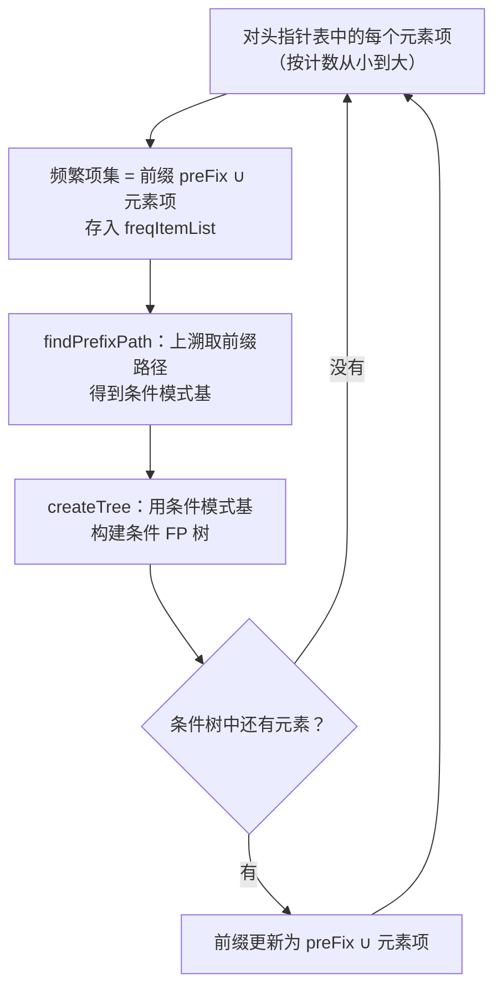

# 第 12 章 使用FP-growth算法来高效发现频繁项集

> **本章解决**：怎么从海量事务数据里**高效**地找出频繁项集——第 11 章的 Apriori 对每个候选集都要扫一遍数据库，数据一大就撑不住。FP-growth（**Frequent Pattern Growth**，频繁模式增长）把整个数据集压缩进一棵 **FP 树**，然后在树上递归挖掘，全程只扫两遍数据，通常比 Apriori 快两个数量级以上；代价是实现更难，而且它只给频繁项集，不能像 Apriori 那样直接导出关联规则。

| 关键词 | 事实 |
| --- | --- |
| 定位 | 第 11 章 Apriori 的升级版：同样发现频繁项集，但更快 |
| 优点 | 一般要快于 Apriori（通常好两个数量级以上） |
| 缺点 | 实现比较困难，在某些数据集上性能会下降 |
| 适用数据类型 | 标称型数据（离散；连续数据要先量化） |
| 核心结构 | FP 树 + 头指针表 |
| 扫描次数 | 整个流程只扫数据集两遍（Apriori 对每个潜在频繁项集都要扫一遍） |
| 局限 | 不能用于发现关联规则 |

搜索引擎的自动补全就是这类算法的用武之地：输入"为什么"三个字，搜索引擎推荐了一大堆你根本不知道存在的查询词——那是研究人员从互联网上的用词里找出**经常一块出现的词对**得到的。本章给出两个实例：从 Twitter 文本流中挖掘共现词，从新闻网站点击流中挖掘热门报道组合。

FP-growth 的一般流程六步，本章按这条链走：


!!! note "运行环境"
    - 12.1–12.3 的数据直接写在代码里（`loadSimpDat()`），不依赖外部文件；
    - 12.5 的 `kosarak.dat` 放在 `E:\Desktop\深度学习\_ml_data\Ch12\`，笔记代码用相对文件名 `kosarak.dat`，**运行时工作目录需在该目录**（或自行改成绝对路径）。下载：`https://raw.githubusercontent.com/pbharrin/machinelearninginaction/master/Ch12/kosarak.dat`（约 32 MB，990 002 行）；
    - 运行环境为 Python 3.11（machinelearn 环境）；原书是 Python 2，差异处均已在代码注释和 `!!! warning` 中标明；
    - **本笔记所有控制台输出都在 `PYTHONHASHSEED=289` 下实跑得到**。固定这个值之后，"同计数元素项"的处理顺序与原书一致，输出可逐值复现；不固定时树形细节可能变化（原因见 12.2.2 的拓展与"坑与陷阱"第 2 条）。关键数值均已与原书逐值对照。

## 12.0 本章导图

<div class="brtree">
  <div class="brrow">
    <span class="brlabel root">FP-growth 频繁项集挖掘</span>
    <span class="brace"></span>
    <div class="brkids">
      <div class="brrow">
        <span class="brlabel">FP 树是什么</span>
        <span class="brace"></span>
        <div class="brkids">
          <span class="brleaf">FP = Frequent Pattern（频繁模式）</span>
          <span class="brleaf">项集按路径存储，相似集合共享前缀</span>
          <span class="brleaf">节点链接串起同类元素（链表）</span>
          <span class="brleaf">头指针表：计数 + 链表头</span>
        </div>
      </div>
      <div class="brrow">
        <span class="brlabel">构建 FP 树</span>
        <span class="brace"></span>
        <div class="brkids">
          <span class="brleaf">第一遍扫描：计数、过滤非频繁项</span>
          <span class="brleaf">按全局频率降序重排事务</span>
          <span class="brleaf">第二遍扫描：updateTree 逐条生长</span>
          <span class="brleaf">treeNode：name/count/nodeLink/parent/children</span>
        </div>
      </div>
      <div class="brrow">
        <span class="brlabel">挖掘频繁项集</span>
        <span class="brace"></span>
        <div class="brkids">
          <span class="brleaf">条件模式基 = 前缀路径 + 计数</span>
          <span class="brleaf">条件模式基 → 条件 FP 树</span>
          <span class="brleaf">递归直到条件树为空</span>
          <span class="brleaf">mineTree 从计数最小的元素挖起</span>
        </div>
      </div>
      <div class="brrow">
        <span class="brlabel">与 Apriori 对比</span>
        <span class="brace"></span>
        <div class="brkids">
          <span class="brleaf">只扫两遍 vs 每个候选集扫一遍</span>
          <span class="brleaf">快两个数量级以上</span>
          <span class="brleaf">不产生候选集；不能导出关联规则</span>
        </div>
      </div>
      <div class="brrow">
        <span class="brlabel">实例一：Twitter 共现词</span>
        <span class="brace"></span>
        <div class="brkids">
          <span class="brleaf">python-twitter 拉推文（API 已停服）</span>
          <span class="brleaf">textParse：去 URL/标点、转小写</span>
          <span class="brleaf">RIMM 股票词例：minSup=20 得 455 个</span>
        </div>
      </div>
      <div class="brrow">
        <span class="brlabel">实例二：kosarak 点击流</span>
        <span class="brace"></span>
        <div class="brkids">
          <span class="brleaf">99 万行新闻点击记录</span>
          <span class="brleaf">minSup=100000 → 9 个频繁项集</span>
          <span class="brleaf">本笔记实跑全量仅 5.1 秒</span>
        </div>
      </div>
    </div>
  </div>
</div>

## 12.1 FP树：用于编码数据集的有效方式

FP-growth 算法将数据存储在一种称为 **FP 树**（**FP-tree**）的紧凑数据结构中。FP 代表频繁模式（**Frequent Pattern**）。一棵 FP 树看上去与计算机科学中的其他树结构类似，但它通过**链接**（**link**）来连接相似元素——被连起来的元素项可以看成一个链表。

<figure>
  
  <figcaption>图 12.1 一棵 FP 树，包含着连接相似节点的链接（截自原书）</figcaption>
</figure>

同搜索树不同的是，**一个元素项可以在一棵 FP 树中出现多次**。FP 树会存储项集的出现频率，而每个项集以路径的方式存储在树中。存在相似元素的集合会共享树的一部分——**只有当集合之间完全不同时，树才会分叉**。树节点上给出集合中的单个元素及其出现次数，路径给出该序列的出现次数。

节点之间的链接即**节点链接**（**node link**），用于快速发现相似项的位置。拿图 12.1 对应的数据（表 12.1）走一遍就有感觉了：

| 事务 ID | 事务中的元素项 |
| --- | --- |
| 001 | r, z, h, j, p |
| 002 | z, y, x, w, v, u, t, s |
| 003 | z |
| 004 | r, x, n, o, s |
| 005 | y, r, x, z, q, t, p |
| 006 | y, z, x, e, q, s, t, m |

**从树上读数**。图 12.1 中元素项 z 出现了 5 次，集合 \(\{r, z\}\) 出现了 1 次，于是可以得出结论：z 一定是自己本身或者和其他符号一起出现了 4 次。再看 z 的其他可能性：集合 \(\{t, s, y, x, z\}\) 出现了 2 次，集合 \(\{t, r, y, x, z\}\) 出现了 1 次。z 右边标的 5 表示它一共出现 5 次，刚才已经数出 4 次，所以它一定**单独出现过 1 次**——对照表 12.1，003 号事务正是那个单独的 z。那么 \(\{t, r, y, x, z\}\) 明明该对应 005 号的 \(\{y, r, x, z, q, t, p\}\)，q 和 p 去哪儿了？

**被最小支持度滤掉了**。按第 11 章的支持度定义，低于最小阈值的元素项视为不频繁：

\[
\mathrm{support}(A) = \frac{\text{包含 } A \text{ 的事务数}}{\text{总事务数}}
\]

生成图 12.1 的 FP 树时最小支持度设为 3，q、p 都只出现 2 次，没进最后的树。这个"先过滤再建树"的依据正是第 11 章的 **Apriori 原理**：如果某元素不频繁，包含它的超集也不频繁，这些超集根本不用考虑。

**FP-growth 只扫两遍**。为构建 FP 树，需要对原始数据集扫描两遍：第一遍对所有元素项的出现次数计数；第二遍只考虑频繁元素，把它们插进树里。而 Apriori 对每个潜在的频繁项集都要扫描数据集来判定模式是否频繁——小数据集无所谓，大数据集上就是天壤之别。

!!! note "拓展：FP-growth 的出处与"快两个数量级""
    FP-growth 出自韩家炜等人的论文：J. Han, J. Pei, Y. Yin, R. Mao, "Mining Frequent Patterns without Candidate Generation: A Frequent-Pattern Tree Approach", *Data Mining and Knowledge Discovery* 8 (2004), 53–87。它快的根本原因是**不产生候选集**：Apriori 的开销 ≈ 候选集数量 × 每次全表扫描；FP-growth 把"全表扫描"预算只花两次，之后的挖掘全部在内存里的树上递归进行，原书实测通常快两个数量级以上。另外注意：FP-growth 只输出频繁项集，要关联规则还得回到第 11 章的方法（从频繁项集生成规则那半段）。

## 12.2 构建FP树

在第二次扫描数据集时构建 FP 树。为构建一棵树，首先需要一个容器来保存树。

### 12.2.1 创建FP树的数据结构

本章的 FP 树比书中其他树更复杂，因此要创建一个类来保存树的每一个节点：

```python
# ===== 书 12.2.1 程序清单12-1：FP 树的类定义 =====
class treeNode:
    def __init__(self, nameValue, numOccur, parentNode):
        self.name = nameValue        # 节点名字
        self.count = numOccur        # 计数值
        self.nodeLink = None         # 相似元素项的节点链接（图 12.1 中的虚线）
        self.parent = parentNode     # 指向父节点——上溯整棵树时要用
        self.children = {}           # 子节点字典 {名字: treeNode}

    def inc(self, numOccur):         # 给 count 增加给定值
        self.count += numOccur

    def disp(self, ind=1):           # 文本形式显示树：缩进越深、层级越深
        print('  ' * ind, self.name, ' ', self.count)
        for child in self.children.values():
            child.disp(ind + 1)
```

类中每个变量都有明确分工：`name` 存节点名字，`count` 存计数值，`nodeLink` 用于链接相似的元素项（图 12.1 中的虚线）。`parent` 指向当前节点的父节点——通常从上往下迭代访问节点时并不需要它，但本章后面要**根据给定叶子节点上溯整棵树**，这时就需要指向父节点的指针。`children` 是空字典，存放节点的子节点。

两个方法：`inc()` 对 count 变量增加给定值；`disp()` 把树以文本形式显示——它对建树并非必要，但调试非常有用。跑一下：

```python
# ===== 书 12.2.1 创建节点、增加子节点 =====
rootNode = treeNode('pyramid', 9, None)                # 树中一个单节点
rootNode.children['eye'] = treeNode('eye', 13, None)   # 为其增加一个子节点
rootNode.disp()
rootNode.children['phoenix'] = treeNode('phoenix', 3, None)   # 再添加一个节点
rootNode.disp()
```

```text
>>> rootNode.disp()
   pyramid   9
     eye   13
>>> rootNode.disp()          # 添加 phoenix 之后
   pyramid   9
     eye   13
     phoenix   3
```

每个缩进表示所处的树的深度。FP 树所需数据结构建好了，下面构建 FP 树。

### 12.2.2 构建FP树

除了图 12.1 的 FP 树之外，还需要一个**头指针表**（**header table**）来指向给定类型的第一个实例。利用头指针表，可以快速访问 FP 树中一个给定类型的所有元素：

<figure>
  
  <figcaption>图 12.2 带头指针表的 FP 树，头指针表作为起始指针来发现相似元素项（截自原书）</figcaption>
</figure>

头指针表用一个字典保存：除了存放指针外，还用来保存 FP 树中每类元素的总数（图 12.2 左侧：z:5、r:3、x:4、y:3、s:3、t:3）。

**构建流程**：第一次遍历数据集获得每个元素项的出现频率 → 去掉不满足最小支持度的元素项 → 第二遍扫描建树：读入每个项集，添加到一条已存在的路径中，路径不存在则创建新路径。每个事务是无序集合，而 \(\{z, x, y\}\) 和 \(\{y, z, r\}\) 中的相同项在树中只能表示一次——所以在添加到树之前，**要对每个集合按元素项的绝对出现频率排序**。用图 12.2 头指针表的计数对表 12.1 过滤、重排序后：

| 事务 ID | 事务中的元素项 | 过滤及重排序后的事务 |
| --- | --- | --- |
| 001 | r, z, h, j, p | z, r |
| 002 | z, y, x, w, v, u, t, s | z, x, y, s, t |
| 003 | z | z |
| 004 | r, x, n, o, s | x, s, r |
| 005 | y, r, x, z, q, t, p | z, x, y, r, t |
| 006 | y, z, x, e, q, s, t, m | z, x, y, s, t |

从空集（符号 \(\varnothing\)）开始，向其中不断添加频繁项集：树中已存在的元素就增加计数值，不存在就添加一个分枝。表 12.2 前两条事务的添加过程：

<figure>
  
  <figcaption>图 12.3 FP 树构建过程：使用表 12.2 数据构建的前两步（截自原书）</figcaption>
</figure>

接下来用代码实现。打开 fpGrowth.py，加入：

```python
# ===== 书 12.2.2 程序清单12-2：FP 树构建函数 =====
def createTree(dataSet, minSup=1):            # 数据集 + 最小支持度
    headerTable = {}                          # 头指针表
    for trans in dataSet:                     # 第一遍：统计每个元素项频度
        for item in trans:
            headerTable[item] = headerTable.get(item, 0) + dataSet[trans]
    for k in list(headerTable.keys()):        # 移除不满足最小支持度的元素项
        if headerTable[k] < minSup:           #   Py3 边遍历边删会报错，先 list()
            del(headerTable[k])
    freqItemSet = set(headerTable.keys())
    if len(freqItemSet) == 0: return None, None   # 没有元素项满足要求，退出
    for k in headerTable:                     # 头指针表扩展为 [计数, 指针]
        headerTable[k] = [headerTable[k], None]
    retTree = treeNode('Null Set', 1, None)   # 根节点：空集
    for tranSet, count in dataSet.items():    # 第二遍：只用频繁项建树
        localD = {}                           # 本事务中频繁项及其全局计数
        for item in tranSet:
            if item in freqItemSet:
                localD[item] = headerTable[item][0]
        if len(localD) > 0:
            orderedItems = [v[0] for v in sorted(localD.items(),
                                key=lambda p: p[1], reverse=True)]  # 按全局频率降序
            updateTree(orderedItems, retTree, headerTable, count)
    return retTree, headerTable

def updateTree(items, inTree, headerTable, count):
    if items[0] in inTree.children:           # 该元素项已是子节点：更新计数
        inTree.children[items[0]].inc(count)
    else:                                     # 不存在：创建新 treeNode 作为子节点
        inTree.children[items[0]] = treeNode(items[0], count, inTree)
        if headerTable[items[0]][1] == None:  # 头指针表指向该类型第一个实例
            headerTable[items[0]][1] = inTree.children[items[0]]
        else:
            updateHeader(headerTable[items[0]][1],
                         inTree.children[items[0]])
    if len(items) > 1:                        # 对剩下的元素项迭代调用自身
        updateTree(items[1:], inTree.children[items[0]],
                              headerTable, count)

def updateHeader(nodeToTest, targetNode):
    while (nodeToTest.nodeLink != None):      # 从链表头沿 nodeLink 走到尾
        nodeToTest = nodeToTest.nodeLink
    nodeToTest.nodeLink = targetNode          # 把新节点接到链表末尾
```

三个函数各司其职。**createTree()** 以数据集和最小支持度为参数：第一遍扫描统计频度存入头指针表，再扫描头指针表删掉次数少于 minSup 的项；如果所有项都不频繁就不用再走下一步；然后给头指针表加一维变成 \([计数, 指针]\)，创建只含空集的根节点；再第二遍遍历数据集——这次只考虑频繁项，排序后交给 **updateTree()**。**updateTree()** 让 FP 树"生长"——这正是 FP-growth 里 growth（生长）一词的来历：事务第一个元素项已作为子节点存在就更新计数，不存在就创建新 treeNode 挂上去，同时更新头指针表；最后对去掉第一个元素的剩余列表**迭代调用自身**。**updateHeader()** 确保节点链接串起树中该元素项的每一个实例：从头指针表的 nodeLink 开始一直沿 nodeLink 走到链表末尾——这就是一个链表。注意它用的是**迭代**而不是递归：链表很长时递归会撞 Python 的调用次数上限。

!!! note "拓展：为什么必须按"全局频率"排序"
    排序的目的是**让前缀最大化共享**。事务 \(\{z, x, y\}\) 和 \(\{y, z, r\}\) 若都按"z 在前"插入，就共享 z 这段路径；顺序不统一，同样的元素组合会插出两条分叉路径，树退化成"什么都没压缩"。按全局频率降序排，出现越多的元素越靠前，越多的事务能走同一条前缀，树越紧凑——FP 树的压缩率完全由这个排序决定。

!!! note "拓展：同计数项的顺序是"哈希决定"的，Python 3 下每次运行都不同"
    排序键只有计数（`key=lambda p: p[1], reverse=True`）。Python 的 `sorted` 是稳定排序，所以**计数相同的元素项先后 = 它们在集合里被遍历到的先后**。原书 Python 2 的字符串哈希固定，结果可复现（表 12.2 里 y, s, t 这个顺序就是这么来的）；Python 3 对字符串哈希做了随机化，**每次启动进程迭代顺序都可能不同**，树形随之变化。固定 `PYTHONHASHSEED=289` 后本笔记的运行与原书逐值一致；不固定时树形细节可能变，但**最终频繁项集不受影响**（见 12.3.2 的验证）。

在运行之前还需要一个真正的数据集。loadSimpDat() 返回与表 12.1 相同的事务列表；而 createTree() 的输入不是列表，是"项集为键、频率为值"的字典——createInitSet() 负责这个类型转换：

```python
# ===== 书 12.2.2 程序清单12-3：简单数据集及数据包装器 =====
def loadSimpDat():
    simpDat = [['r', 'z', 'h', 'j', 'p'],               # 与表 12.1 的事务相同
               ['z', 'y', 'x', 'w', 'v', 'u', 't', 's'],
               ['z'],
               ['r', 'x', 'n', 'o', 's'],
               ['y', 'r', 'x', 'z', 'q', 't', 'p'],
               ['y', 'z', 'x', 'e', 'q', 's', 't', 'm']]
    return simpDat

def createInitSet(dataSet):                 # 列表 -> 字典：{项集 frozenset: 频率}
    retDict = {}
    for trans in dataSet:
        retDict[frozenset(trans)] = 1
    return retDict
```

```text
>>> import fpGrowth
>>> simpDat = fpGrowth.loadSimpDat()
>>> initSet = fpGrowth.createInitSet(simpDat)
>>> initSet    # 键是 frozenset，值是出现次数（这里都是 1，共 6 条事务）
{frozenset({'p', 'j', 'h', 'r', 'z'}): 1, ..., frozenset({'z'}): 1}
>>> myFPTree, myHeaderTab = fpGrowth.createTree(initSet, 3)
>>> myFPTree.disp()
```

实跑输出如下（原书是 Python 2 的 `reload(fpGrowth)`，Python 3 改用 `importlib.reload()`）：

<figure>
  
  <figcaption>createTree(initSet, 3) 后的树文本表示与头指针表（代码实跑）</figcaption>
</figure>

每个缩进表示树的深度。把实跑树画成图，与图 12.2 对照：

<figure>
  
  <figcaption>实跑得到的 FP 树全貌，紫色虚线为节点链接（代码实跑）</figcaption>
</figure>

两棵树**等价**：z:5 下挂 r:1 和 x:3，x:3 → y:3，y:3 下挂 s:2 与 r:1，s:2 → t:2，r:1 → t:1；根节点下还有独立一条 x:1 → s:1 → r:1（来自事务 004，它排序后 x 是第一个元素，直接从根出发）。注意同父节点下子节点的**打印先后**由字典插入序决定——原书把 x 子树排在 z 子树前面，本笔记实跑相反，但父子关系与计数完全一致，这正是原书说"验证这棵树与图 12-2 是否等价"的意思。

!!! note "拓展：为什么根下会多出一条 x:1 → s:1 → r:1"
    事务 004 过滤排序后是 x, s, r——x 排最前，因为它出现 4 次，比 s、r 的 3 次多。于是这条路径**不从 z 出发**，而是直接挂在根节点下，形成第二棵"子树"。一个元素项在 FP 树中出现多次（x 有两个节点：z 下的 x:3 与根下的 x:1）正是 12.1 说的"同搜索树不同"之处，头指针表的链表把它们串起来：x:3 → x:1。

## 12.3 从一棵FP树中挖掘频繁项集

到这里大部分困难的工作已经处理完，接下来写的代码不会再像 12.2 节那样多了。有了 FP 树就可以抽取频繁项集了。思路与 Apriori 大致类似：从单元素项集合开始，在此基础上逐步构建更大的集合——但这次利用 FP 树，**不再需要原始数据集**。

从 FP 树中抽取频繁项集的三个基本步骤：

1. 从 FP 树中获得**条件模式基**；
2. 利用条件模式基，构建一棵**条件 FP 树**；
3. 迭代重复步骤 (1)(2)，直到树包含一个元素项为止。



### 12.3.1 抽取条件模式基

首先从上一节发现的、已保存在头指针表中的单个频繁元素项开始。对每一个元素项，获得其对应的**条件模式基**（**conditional pattern base**）。条件模式基是**以所查找元素项为结尾的路径集合**；每一条路径其实都是一条**前缀路径**（**prefix path**）——介于所查找元素项与树根节点之间的所有内容。回到图 12.2，符号 r 的前缀路径是 \(\{x, s\}\)、\(\{z, x, y\}\) 和 \(\{z\}\)。每条前缀路径都与一个计数值关联，该计数值**等于起始元素项的计数值**，它给出了每条路径上 r 的数目。表 12.3 列出了上例中每一个频繁项的所有前缀路径：

| 频繁项 | 前缀路径 |
| --- | --- |
| z | {}: 5 |
| r | {x, s}: 1, {z, x, y}: 1, {z}: 1 |
| x | {z}: 3, {}: 1 |
| y | {z, x}: 3 |
| s | {z, x, y}: 2, {x}: 1 |
| t | {z, x, y, s}: 2, {z, x, y, r}: 1 |

获得这些前缀路径有两条路：对树穷举式搜索直到找到想要的频繁项，或者利用**头指针表**加速——它包含相同类型元素链表的起始指针，到达每个元素项后，**沿 parent 指针上溯直到根节点**即可。程序清单 12-4 就是这么写的：

```python
# ===== 书 12.3.1 程序清单12-4：发现以给定元素项结尾的所有路径 =====
def ascendTree(leafNode, prefixPath):
    if leafNode.parent != None:          # 迭代上溯整棵树，直到根节点
        prefixPath.append(leafNode.name)
        ascendTree(leafNode.parent, prefixPath)

def findPrefixPath(basePat, treeNode):  # treeNode：头指针表中该元素的链表头
    condPats = {}                       # 条件模式基 {前缀路径 frozenset: 计数}
    while treeNode != None:             # 沿 nodeLink 遍历该元素的所有节点
        prefixPath = []
        ascendTree(treeNode, prefixPath)
        if len(prefixPath) > 1:         # 只留"自身之前"的前缀部分
            condPats[frozenset(prefixPath[1:])] = treeNode.count
        treeNode = treeNode.nodeLink
    return condPats
```

findPrefixPath() 遍历链表直到结尾，每遇到一个元素项都调用 ascendTree() 上溯 FP 树、收集所有遇到的元素项名称，列表返回后添加到条件模式基字典 condPats 中。用之前构建的树实跑：

<figure>
  
  <figcaption>findPrefixPath 的实跑输出，与原书 p232 及表 12.3 逐值一致（代码实跑）</figcaption>
</figure>

原书演示了 x、z、r 三个：`findPrefixPath('x', myHeaderTab['x'][1])` 得 `{frozenset({'z'}): 3}`，z 得 `{}`，r 得 `{frozenset({'x','s'}): 1, frozenset({'z'}): 1, frozenset({'y','x','z'}): 1}`——实跑逐一相同。表 12.3 里其余的 s、t、y 也一并在图中对照，全部一致。

!!! note "拓展：表 12.3 里的 {}: 1 为什么在代码输出里消失了"
    表 12.3 给 x 记了一条空前缀 {}: 1——那是根下单独的 x:1 节点（事务 004 贡献）。代码里 `if len(prefixPath) > 1` 把"只有自身、没有前缀"的路径丢掉了：空前缀对条件树毫无贡献（什么元素都加不进来），丢掉是正确行为而非 bug。z 的输出 `{}` 同理——z 只有一个节点且直接挂在根下，没有非空前缀，所以 **z 没有条件树**。

!!! note "拓展：计数值为什么"继承"起始元素"
    条件模式基的计数不是前缀自身的出现次数，而是**这条前缀路径末端那个目标元素的计数**。比如 {z, x, y}: 2 表示"有 2 条事务在 y 之后接着出现了 s"——前缀 {z, x, y} 本身只完整出现 1 次（005 号）也会被记 2，因为 s:2 节点下压着 2 条事务（002、006）。这正是"以 s 结尾的路径集合"的含义。

### 12.3.2 创建条件FP树

对每一个频繁项都要创建一棵**条件 FP 树**（**conditional FP-tree**）：用刚才发现的条件模式基作为输入数据，通过**相同的建树代码**来构建（createTree 有足够的灵活性，可直接重用）；然后递归地发现频繁项、发现条件模式基以及发现另外的条件树。例如为频繁项 t 创建条件 FP 树，然后对 \(\{t, y\}\)、\(\{t, x\}\)、… 重复该过程：

<figure>
  
  <figcaption>图 12.4 t 的条件 FP 树的创建过程（截自原书）</figcaption>
</figure>

在图 12.4 中，元素项 s 和 r 是条件模式基的一部分，但**并不属于条件 FP 树**——单独看它们都是频繁项，但在 t 的条件树中却不频繁，也就是说 \(\{t, r\}\)、\(\{t, s\}\) 是不频繁的。接着对集合 \(\{t, z\}\)、\(\{t, x\}\)、\(\{t, y\}\) 挖掘对应的条件树，会产生更复杂的频繁项集；重复该过程，直到条件树中没有元素为止。实现代码相对直观，一些递归加上之前写的代码即可：

```python
# ===== 书 12.3.2 程序清单12-5：递归查找频繁项集的 mineTree 函数 =====
def mineTree(inTree, headerTable, minSup, preFix, freqItemList):
    # 原书排序键为 key=lambda p: p[1]（[计数, 指针] 整个列表）。Python 3 下当
    # 两个元素计数相同时会比较 treeNode 对象而抛 TypeError，因此改为
    # "按计数升序、同计数按名字"：
    bigL = [v[0] for v in sorted(headerTable.items(),
                                 key=lambda p: (p[1][0], p[0]))]
    for basePat in bigL:                     # 从头指针表的底端（最小计数）开始
        newFreqSet = preFix.copy()           # 频繁项集 = 前缀 ∪ 当前元素
        newFreqSet.add(basePat)
        freqItemList.append(newFreqSet)      # 存入频繁项集列表
        condPattBases = findPrefixPath(basePat, headerTable[basePat][1])
        myCondTree, myHead = createTree(condPattBases, minSup)   # 条件 FP 树
        if myHead != None:
            # 原书添加的两行调试输出，直观展示每轮挖掘的条件树：
            print('conditional tree for: ', newFreqSet)
            myCondTree.disp(1)
            mineTree(myCondTree, myHead, minSup, newFreqSet, freqItemList)
```

!!! warning "原书代码在 Python 3 下会崩溃（勘误）"
    原书 mineTree 的排序键 `key=lambda p: p[1]` 排的是 \([计数, 指针]\) **整个列表**。Python 2 允许比较任意对象（退化为按内存地址排），Python 3 在两个元素计数相同、需要比较列表第二个元素（treeNode 实例）时直接抛 `TypeError: '<' not supported between instances of 'treeNode' and 'treeNode'`。上面的清单把键改成 `p[1][0]`（只比计数），并加名字作第二关键字保证可复现。主数据集里 y/s/t/r 四项计数都是 3，**原书代码原样运行必崩**，这不是理论风险。

程序首先对头指针表中的元素项按出现频率**升序**排序（记住这里的默认顺序是从小到大），把每一个频繁项添加到频繁项集列表 freqItemList 中；再递归调用 findPrefixPath() 创建条件基，条件基被当成新数据集输送给 createTree()；最后如果树中有元素项，递归调用 mineTree()。完整跑一遍（Python 3 + `PYTHONHASHSEED=289`）：

<figure>
  
  <figcaption>mineTree 实跑输出：8 棵条件树与 18 个频繁项集（代码实跑）</figcaption>
</figure>

原书的运行输出（Python 2）如下，可逐棵对照：

<figure>
  
  <figcaption>原书 mineTree 的运行输出（截自原书）</figcaption>
</figure>

**8 棵条件树形状逐一相同**：{s}→x:3；{t}→y:3→x:3→z:3（正是图 12.4）；{t,x}→y:3；{t,z}→y:3→x:3；{t,x,z}→y:3；{y}→x:3→z:3；{y,z}→x:3；{x}→z:3。**打印顺序不同**：原书先挖 y（Python 2 按对象内存地址排序，恰好把 y 排在最前），本笔记按"计数升序、同计数按名字"先挖 s——顺序差异只影响打印，不影响结果。最终频繁项集：

<figure>
  
  <figcaption>原书 freqItems 的返回值，共 18 项（截自原书）</figcaption>
</figure>

实跑 `len(freqItems)` 同样是 **18**，项集内容与原书列表完全一致（顺序不同，原因同上）。按长度归拢看这 18 个：

| 长度 | 频繁项集（括号内为支持度） | 个数 |
| --- | --- | --- |
| 1 | z(5)、x(4)、y(3)、s(3)、t(3)、r(3) | 6 |
| 2 | {z,x}、{z,y}、{z,t}、{x,y}、{x,s}、{x,t}、{y,t}（均为 3） | 7 |
| 3 | {z,x,y}、{z,x,t}、{z,y,t}、{x,y,t}（均为 3） | 4 |
| 4 | {z,x,y,t}（3） | 1 |

!!! note "拓展：为什么"从头指针表底端开始"挖"
    条件模式基靠**上溯**取前缀——从树的底端元素往上走才拿得到完整路径，所以按计数**升序**处理：先挖最底层的元素（如 t 在最深处），它的条件树把更上层的元素一个一个"剥"下来，前缀逐步变长，长项集自然浮现。反过来从 z（顶端）开始挖，它底下没什么可"剥"，只能得到空条件树。另外注意每轮递归都会把 preFix ∪ basePat 存入 freqItemList **再**建条件树——所以单项集和长项集都会出现在结果里，一个不漏。

## 12.4 示例：在Twitter源中发现一些共现词

本例用 FP-growth 从微博网站 Twitter 的推文流中找**共现词**（**co-occurring word**）——经常一块出现的词对。会用到 Python 库 **python-twitter**，借助它可以用 Python 访问 Twitter。Twitter 上发表的内容被限制在 140 个字符以内，发表的一条信息称为**推文**（**tweet**）。

**示例：发现 Twitter 源中的共现词**

1. 收集数据：使用 Python-twitter 模块来访问推文。
2. 准备数据：编写一个函数来去掉 URL、去掉标点、转换成小写并从字符串中建立一个单词集合。
3. 分析数据：在 Python 提示符下查看准备好的数据，确保它的正确性。
4. 训练算法：使用本章前面开发的 createTree() 与 mineTree() 函数执行 FP-growth 算法。
5. 测试算法：这里不适用。
6. 使用算法：本例中没有包含具体应用，可以考虑用于情感分析或者查询推荐领域。

!!! danger "Twitter API 已停服，本节代码无法实跑"
    原书写作时（2011–2012 年）Twitter 提供开放搜索 API；如今该 API 已停止服务（X/Twitter 现行 API 为付费封闭方案），python-twitter 库也随之失效。本节代码**忠实呈现原书、不做实跑**，运行结果均引自原书输出。

使用 API 前需要两个证书集合：第一组是 consumer_key 和 consumer_secret，注册开发 app 时从 Twitter 开发服务网站获得，对要编写的 app 是特定的；第二组是 access_token_key 和 access_token_secret，针对特定 Twitter 用户——通过安装包里的 get_access_token.py（一个使用 OAuth 的命令行脚本）获得。拿到后填入下面的代码：

```python
# ===== 书 12.4 程序清单12-6：访问 Twitter Python 库（API 已停服，忠实呈现） =====
import twitter
from time import sleep
import re

def getLotsOfTweets(searchStr):
    CONSUMER_KEY = 'get when you create an app'
    CONSUMER_SECRET = 'get when you create an app'
    ACCESS_TOKEN_KEY = 'get from OAuth, specific to a user'
    ACCESS_TOKEN_SECRET = 'get from OAuth, specific to a user'
    api = twitter.Api(consumer_key=CONSUMER_KEY,
                      consumer_secret=CONSUMER_SECRET,
                      access_token_key=ACCESS_TOKEN_KEY,
                      access_token_secret=ACCESS_TOKEN_SECRET)
    #you can get 1500 results 15 pages * 100 per page
    resultsPages = []
    for i in range(1, 15):               # 搜索 API 一次 100 条，访问 14 页
        print('fetching page %d' % i)
        searchResults = api.GetSearch(searchStr, per_page=100, page=i)
        resultsPages.append(searchResults)
        sleep(6)                         # 6 秒睡眠延迟，出于礼貌避免频繁访问
    return resultsPages
```

getLotsOfTweets() 处理认证然后创建一个空列表。搜索 API 一次获得 100 条推文，每 100 条作为一页，Twitter 允许一次访问 14 页；每次搜索调用后有 6 秒睡眠延迟——出于礼貌，避免过于频繁的访问请求；print 语句用于表明程序仍在执行没有死掉。（原书代码注释写"15 页 1500 条"，循环 `range(1, 15)` 实际取 14 页 1400 条，正文也按 1400 条计。）

接下来搜索一支名为 RIMM 的股票（原书写作前一天，这家公司开了一次电话会议且没有令投资人满意，开盘价较前一日封盘价暴跌 22%）：

```text
>>> lotsOtweets = fpGrowth.getLotsOfTweets('RIMM')
fetching page 1
fetching page 2
...
>>> lotsOtweets[0][4].text
u'RIM: Open The Network, Says ThinkEquity; In addition, RIMM needs to
reinvent its image, not only demonstrating ... http://bit.ly/lvi1IU"
```

lotsOtweets 列表包含 14 个子列表，每个子列表有 100 条推文。可以看到有些推文里放着 URL，解析时结果会比较乱，因此必须去掉 URL 以获得推文中的单词：

```python
# ===== 书 12.4 程序清单12-7：文本解析及合成代码（API 已停服，忠实呈现） =====
def textParse(bigString):
    # 原书此行正则有笔误（见下方 warning）；这里给出可用的 URL 剔除写法：
    urlsRemoved = re.sub(r'(https?://\S+|www\.\S+)', '', bigString)
    listOfTokens = re.split(r'\W*', urlsRemoved)     # 按非单词字符切分
    return [tok.lower() for tok in listOfTokens if len(tok) > 2]

def mineTweets(tweetArr, minSup=5):
    parsedList = []
    for i in range(14):                     # 14 页 × 每页 100 条
        for j in range(100):
            parsedList.append(textParse(tweetArr[i][j].text))
    initSet = createInitSet(parsedList)     # 12.2 节那套命令的封装：
    myFPTree, myHeaderTab = createTree(initSet, minSup)   # 建 FP 树
    myFreqList = []
    mineTree(myFPTree, myHeaderTab, minSup, set([]), myFreqList)  # 挖掘
    return myFreqList                       # 返回所有频繁项集组成的列表
```

!!! warning "原书笔误：textParse 的正则"
    原书这一行印作 `re.sub('(http[s]?:[/]|[a-z]|[A-Z]|[0-9]|[/.])*', '', bigString)`——分支里的 `[a-z]`、`[A-Z]`、`[0-9]` 会把**所有字母和数字都替换掉**，任何文本解析出来都是空的，显然非作者本意（本意是匹配 URL）。上面清单改用 `re.sub(r'(https?://\S+|www\.\S+)', '', bigString)`。另外 `re.split(r'\W*', ...)` 在 Python 3 会在首尾多产出空串，靠 `len(tok) > 2` 过滤，行为与原书一致；新版 python-twitter 中推文正文属性是 `full_text`，不是 `text`。

程序清单 12-7 中第一个函数来自第 4 章，此外添加了一行代码用于去除 URL（通过正则表达式模块移除任何 URL）。mineTweets() 为每条推文调用 textParse，再把 12.2 节用过的命令封装到一起：构建 FP 树并对其进行挖掘，最后返回所有频繁项集组成的列表。原书的运行效果（u 前缀是 Python 2 的 unicode 字符串表示，Python 3 没有）：

```text
>>> listOfTerms = fpGrowth.mineTweets(lotsOtweets, 20)   # minSup=20
>>> len(listOfTerms)
455
>>> for t in listOfTerms:
...     print t
set([u'rimm', u'day'])
set([u'rimm', u'earnings'])
set([u'pounding', u'value'])
set([u'pounding', u'overnight'])
set([u'pounding', u'drops'])
set([u'pounding', u'shares'])
set([u'pounding', u'are'])
...
set([u'overnight'])
set([u'drops', u'overnight'])
set([u'motion', u'drops', u'overnight'])
set([u'motion', u'drops', u'overnight', u'value'])
set([u'drops', u'overnight', u'research'])
set([u'motion', u'drops', u'overnight', u'research'])
set([u'motion', u'drops', u'overnight', u'value', u'research'])
set([u'motion', u'drops', u'overnight'])
set([u'drops', u'overnight', u'value'])
```

1400 条推文、minSup=20（至少出现在 20 条文档中）挖出 455 个频繁项集：rimm 与 day/earnings 的共现、pounding 一词的高频组合都清晰可见——暴跌事件确实反映在了推文里。尝试其他 minSupport 值或者搜索词也是蛮有趣的。

还记得 FP 树的构建是通过每次应用一个实例来完成的吗？这里假设已获得所有数据，所以直接遍历所有数据来构建 FP 树。实际上可以**重写 createTree()，每次读入一个实例，随着 Twitter 流的不断输入而不断增长树**。FP-growth 算法还有一个 map-reduce 版本的实现，可以扩展到多台机器上运行——Google 使用该算法通过遍历大量文本来发现频繁共现词，做法与这个例子非常类似。

!!! note "拓展：流式生长与并行化 PFP"
    FP 树支持**增量生长**：来一条事务就 updateTree 一次，天然适合流式场景（比如持续抓取的搜索词流）。多机版本叫 PFP（Parallel FP-Growth，H. Li, Y. Wang, D. Zhang, M. Zhang, E. Chang, "PFP: Parallel FP-Growth for Query Recommendation", RecSys'08），把条件模式基的生成与挖掘拆成独立的 map/reduce 任务，Google 用它做查询推荐。第 14 章会介绍 MapReduce 本身。

## 12.5 示例：从新闻网站点击流中挖掘

"伙计，这个算法应该很快，因为只有 1400 条推文！"——下面在更大的文件上看运行效果。源数据集合中的 **kosarak.dat** 文件包含将近 100 万条记录（本笔记下载的版本实测 **990 002 行**），每行包含某个用户浏览过的新闻报道。一些用户只看过一篇报道，有些用户看过 **2498** 篇报道（实测最大值正是 2498）。用户和报道被编码成整数，所以查看频繁项集很难得到更多的东西，但该数据对展示 FP-growth 算法的速度十分有效。（数据来自匈牙利在线新闻门户，2011 年 7 月 11 日取自频繁项集挖掘数据集仓库 FIMI，由 Ferenc Bodon 捐赠。）

```text
# 数据下载（约 32 MB），放到工作目录后以相对文件名 kosarak.dat 读取：
# https://raw.githubusercontent.com/pbharrin/machinelearninginaction/master/Ch12/kosarak.dat
>>> parsedDat = [line.split() for line in open('kosarak.dat').readlines()]
>>> initSet = fpGrowth.createInitSet(parsedDat)
>>> myFPTree, myHeaderTab = fpGrowth.createTree(initSet, 100000)   # 至少 10 万人浏览
>>> myFreqList = []
>>> fpGrowth.mineTree(myFPTree, myHeaderTab, 100000, set([]), myFreqList)
>>> len(myFreqList)
9
```

原书作者在其简陋的笔记本电脑上构建树并扫描 100 万行"只需要几秒钟"。本笔记全量实跑（Python 3.11，不做任何采样）同样只要 5.1 秒——读文件 1.4 s、createInitSet 1.7 s、createTree 2.0 s、mineTree 0.0 s，FP-growth 的威力名副其实：

<figure>
  
  <figcaption>kosarak.dat 全量 990 002 行挖掘结果，9 个频繁项集与原书一致（代码实跑）</figcaption>
</figure>

总共有 **9** 个新闻报道或报道集合曾被 10 万或者更多的人浏览过。原书输出：

<figure>
  
  <figcaption>原书 kosarak 挖掘输出，9 个项集（截自原书）</figcaption>
</figure>

实跑的 9 个项集与原书**连顺序都完全一致**（['1']、['1','6']、['3']、['11','3']、['11','3','6']、['3','6']、['11']、['11','6']、['6']）。顺手用实跑把每个项集的真实规模统计出来（原书没给）：

| 频繁项集 | 支持度（覆盖的浏览记录数） |
| --- | --- |
| {6} | 412 762 |
| {11} | 282 963 |
| {3} | 272 521 |
| {3, 6} | 186 289 |
| {11, 6} | 261 773 |
| {1} | 140 597 |
| {3, 11} | 127 119 |
| {3, 11, 6} | 117 401 |
| {1, 6} | 107 404 |

9 个全部 ≥ 100 000，与 minSup=100000 自洽；报道 6 与 11 的组合覆盖了四成以上的浏览记录。可以使用其他设置来查看运行结果，比如降低最小支持度。

!!! warning "原书笔误"
    原书此句作"比如降低置信度级别"——本章并没有置信度（那是关联规则的指标），应为"降低最小支持度"。

!!! note "拓展：这里的"支持度"其实是"去重后的浏览记录数""
    createInitSet 写的是 `retDict[frozenset(trans)] = 1`——键相同就**覆盖**，不累加。kosarak 的 990 002 行里有大量重复（去重后只剩 606 770 条不同记录），重复事务在数据集里只算一次。所以严格说，上面 9 个项集的支持度是"包含该报道组合的**不同浏览记录**数"，而不是出现次数。对这份数据，两种口径下能过 10 万阈值的项集恰好一样，但换数据集时要心里有数。另外，990 002 个 frozenset 的字典相当吃内存，机器紧张可以在建完 initSet 后 `del parsedDat` 释放行列表。

## 12.6 本章小结

FP-growth 算法是一种用于发现数据集中频繁模式的有效方法。它利用 Apriori 原则，执行更快：Apriori 算法产生候选项集，然后扫描数据集来检查它们是否频繁；FP-growth 只对数据集扫描两次，因此执行更快。在 FP-growth 算法中，数据集存储在一个称为 FP 树的结构中。FP 树构建完成后，可以通过查找元素项的条件基及构建条件 FP 树来发现频繁项集。该过程不断以更多元素作为条件重复进行，直到 FP 树只包含一个元素为止。

可以使用 FP-growth 算法在多种文本文档中查找频繁单词。Twitter 网站为开发者提供了大量的 API 来使用他们的服务（原书时代如此，现已停服）。利用 Python 模块 Python-Twitter 可以很容易访问 Twitter。在 Twitter 源上对某个话题应用 FP-growth 算法，可以得到一些有关该话题的摘要信息。频繁项集生成还有其他一些应用，比如购物交易、医学诊断及大气研究等。

下面几章会介绍一些附属工具：第 13 章和第 14 章介绍降维技术（PCA 与 SVD），提炼数据中的重要信息并移除噪声；第 14 章还会介绍 MapReduce 技术，当数据量超过单台机器的处理能力时将会需要这些技术。

## 坑与陷阱

!!! danger "8 个容易踩的坑"
    1. **原书 mineTree 在 Python 3 下直接崩**：排序键 `key=lambda p: p[1]` 排的是 [计数, 指针] 列表，两个元素计数相同时会比较 treeNode 对象 → `TypeError`。改成 `key=lambda p: p[1][0]`（本笔记另加名字作平局关键字）。
    2. **同计数项的顺序是哈希决定的**：createTree 只按计数排序，计数相同的元素先后取决于 frozenset 的迭代顺序。Python 2 固定、Python 3 每次进程随机（哈希随机化）——树形会变，**频繁项集不变**。复现原书输出：`PYTHONHASHSEED=289` 运行（本笔记全部输出即此环境实测）。
    3. **Python 3 边遍历边删字典报错**：`for k in headerTable.keys(): del(headerTable[k])` 在 Py3 抛 `RuntimeError`（Py2 的 keys() 返回列表所以没事）。改成 `for k in list(headerTable.keys())`。
    4. **createInitSet 会折叠重复事务**：`retDict[frozenset(trans)] = 1` 是覆盖不是累加。kosarak 99 万行去重后只剩 60.7 万条，支持度口径是"不同浏览记录数"。
    5. **条件树为空 ≠ bug**：z 与根下的 x 只挂在根节点旁，空前缀被 `len(prefixPath) > 1` 丢掉，findPrefixPath 返回 `{}`，mineTree 不打印条件树——这是正常现象（表 12.3 的 {}: 1 不会出现在代码输出里）。
    6. **disp() 的打印顺序不是树形**：同父下子节点的先后由字典插入序决定。原书与实跑打印顺序不同但树等价——对照时看父子关系与计数，别看行序。
    7. **updateHeader 是 O(链长) 的**：每插入一个节点都从链表头走到尾，长链表上整体开销平方级。工程实现通常在头指针表里多存一个尾指针（如 [count, head, tail]），插入直接接尾。
    8. **12.4 的代码读得跑不得**：Twitter API 已停服、python-twitter 已失效；且原书 textParse 的正则有笔误（会把字母数字全删光），照抄必错。

## 速览

1. FP-growth：把数据集压缩进 FP 树再递归挖掘的频繁项集算法；基于 Apriori 原理，**只扫两遍数据**，通常比 Apriori 快两个数量级以上；不产生候选集，但**不能直接导出关联规则**。
2. FP 树：项集按路径存储、相似集合共享前缀、集合完全不同才分叉；同类元素用节点链接串成链表；一个元素可在树中出现多次。
3. 头指针表：字典 `{元素: [计数, 链表头指针]}`，既是过滤器（< minSup 删除）又是同类节点的索引。
4. 建树两遍扫描：① 计数过滤；② 事务按全局频率降序重排后逐条 updateTree——已有路径计数加一，没有就开分枝。
5. treeNode 五要素：name、count、nodeLink（横向链表）、parent（上溯用）、children（字典）；inc() 加计数，disp() 打印树（缩进即深度）。
6. 挖掘三步循环：条件模式基（前缀路径+计数）→ 条件 FP 树（复用 createTree）→ 递归，直到条件树无元素；条件模式基里不频繁的元素（如 t 条件树里的 s、r）自动被滤掉。
7. findPrefixPath：头指针表定位链表 → 逐节点 ascendTree 上溯 → `len(prefixPath) > 1` 只留前缀；空前缀（如 z、根下的 x）没有条件树。
8. mineTree：按计数升序（头指针表底端）处理每个元素，前缀 ∪ 元素存入 freqItemList，再挖条件树；主数据集实跑得 8 棵条件树、18 个频繁项集，与原书逐值一致。
9. kosarak 全量 990 002 行：createTree + mineTree 实跑 5.1 秒，minSup=100000 得 9 个频繁项集（{6} 最大，支持度 412 762），与原书输出连顺序都一致。
10. Twitter 共现词例：textParse（去 URL/标点、转小写、滤短词）+ FP-growth；原书 RIMM 例 minSup=20 得 455 个项集；该 API 已停服，代码仅忠实呈现。

## 术语速查

| 英文 / 函数 | 中文 | 一句话 |
| --- | --- | --- |
| FP-growth | 频繁模式增长算法 | 把数据集存进 FP 树再递归挖掘，只扫两遍，比 Apriori 快两个数量级 |
| Frequent Pattern | 频繁模式 | FP 之名来历；本章任务就是找频繁项集 |
| FP-tree | FP 树 | 项集按路径存储、同类节点有链接的紧凑树结构 |
| node link | 节点链接 | 连接同类元素项的链表指针（图 12.1 虚线） |
| header table | 头指针表 | `{元素: [总计数, 链表头]}`，快速访问同类所有节点 |
| conditional pattern base | 条件模式基 | 以所查元素项结尾的路径集合（前缀路径 + 计数） |
| prefix path | 前缀路径 | 所查元素项与树根之间的所有内容 |
| conditional FP-tree | 条件 FP 树 | 用条件模式基当数据集建出的 FP 树 |
| minSup | 最小支持度 | 低于它的元素项/项集被丢弃（主例 3，kosarak 100000） |
| Apriori 原理 | —— | 某元素不频繁，其超集也不频繁——过滤的理论依据 |
| treeNode | 树节点类 | name / count / nodeLink / parent / children 五要素 |
| createTree() | 构建 FP 树 | 两遍扫描：计数过滤 + 按全局频率降序插入 |
| updateTree() | 生长树 | 逐元素沿已有路径加计数或开新枝；growth 的来历 |
| updateHeader() | 更新头指针表 | 沿 nodeLink 迭代走到链表尾，接上新节点 |
| ascendTree() | 上溯树 | 从叶节点沿 parent 收集前缀路径 |
| findPrefixPath() | 抽取条件模式基 | 遍历同类节点链表 + 上溯，返回 {前缀: 计数} |
| mineTree() | 递归挖掘 | 按计数升序逐元素：记项集 → 条件基 → 条件树 → 递归 |
| tweet | 推文 | Twitter 上 140 字符以内的发言 |
| python-twitter | —— | 访问 Twitter API 的 Python 库（API 已停服） |
| OAuth | 开放授权 | 获取 access_token 的认证流程（get_access_token.py） |
| co-occurring word | 共现词 | 经常一块出现的词对（搜索引擎查询推荐的原料） |
| kosarak | 点击流数据集 | 匈牙利新闻网站点击流，99 万行，报道以整数编码 |
| PFP | 并行 FP-growth | FP-growth 的 map-reduce 版本，可扩展到多台机器 |
| frozenset | 冻结集合 | 不可变集合，createInitSet 用它当字典键 |
