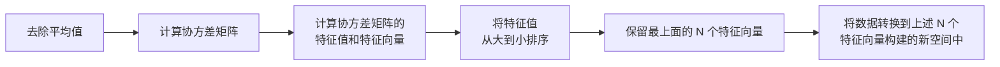

# 第 13 章 利用PCA来简化数据

> **本章解决**：特征太多、数据太"肥"怎么办——就像看球赛时把显示器上的百万像素自动提炼成"球在哪"这一个三维位置。降维（**dimensionality reduction**）让数据更易用、计算更省、还能去噪，是喂给其他机器学习算法之前的预处理步骤。本章主讲其中应用最广的**主成分分析**（**PCA**，Principal Component Analysis），并把一个 590 特征的半导体制造数据集压到 6 个特征，实现约 100∶1 的压缩。

| 关键词 | 事实 |
| --- | --- |
| 定位 | 降维主题两章中的第一章（下一章：利用 SVD 简化数据） |
| 优点 | 降低数据的复杂性，识别最重要的多个特征 |
| 缺点 | 不一定需要，且可能损失有用信息 |
| 适用数据类型 | 数值型数据 |
| 核心工具 | 协方差矩阵 + 特征值分析（NumPy 的 `linalg.eig()`） |
| 本章实例 | 半导体制造数据 SECOM：590 特征 → 6 特征，约 100∶1 压缩 |

先看书里那个开场例子。我们通过电视看体育比赛，纯平显示器上有一个球。显示器大概包含 100 万个像素，球可能只占其中一千个。比赛里我们真正关心的是**球在运动场中的位置**——大脑不知不觉就把显示器上的百万像素实时转换成了一幅三维图像，也就是球的位置。这个过程里，数据已经从一百万维降到了三维：人们面对的原本是百万像素的数据，但只有球的三维位置才最重要。这就是**降维**。

降维的收益有两层：低维下数据更容易处理；相关特征会在低维空间里明确显示出来。通常而言，在应用其他机器学习算法之前，必须先识别出相关特征——降维正是干这个的。

!!! note "运行环境"
    - 13.2 节的演示数据 `testSet.txt`（1000 个点）与 13.3 节的半导体数据 `secom.data`（1567 行 × 590 特征）均放在 `E:\Desktop\深度学习\_ml_data\Ch13\`，来源为原书官方仓库 `pbharrin/machinelearninginaction` 的 Ch13 目录。笔记代码按原书习惯使用相对文件名，**运行时工作目录需在该目录**（或自行改成绝对路径）；
    - 运行环境为 Python 3.10 + NumPy 2.2（machinelearn 环境）。原书是 Python 2 + 老版 NumPy，差异处（`list(map(...))`、`mat()` → `asmatrix()`）已在代码注释和 `!!! warning` 中标明；
    - 本节所有"代码实跑"插图与关键数值均为本笔记实际运行所得，并与原书逐值对照（对照结果见 13.2.2 与 13.3）。

## 13.0 本章导图

<div class="brtree">
  <div class="brrow">
    <span class="brlabel root">利用 PCA 简化数据</span>
    <span class="brace"></span>
    <div class="brkids">
      <div class="brrow">
        <span class="brlabel">为什么要降维</span>
        <span class="brace"></span>
        <div class="brkids">
          <span class="brleaf">电视球赛例：百万像素 → 球的三维位置</span>
          <span class="brleaf">四大好处：易使用 / 省计算 / 去噪声 / 易理解</span>
          <span class="brleaf">定位：喂给其他算法前的预处理</span>
        </div>
      </div>
      <div class="brrow">
        <span class="brlabel">三种降维技术</span>
        <span class="brace"></span>
        <div class="brkids">
          <span class="brleaf">PCA：旋转坐标系，保留最大方差方向</span>
          <span class="brleaf">因子分析：找观察不到的隐变量</span>
          <span class="brleaf">ICA：假设数据来自统计独立的源</span>
          <span class="brleaf">PCA 应用最广，本章主角</span>
        </div>
      </div>
      <div class="brrow">
        <span class="brlabel">PCA 的几何直觉</span>
        <span class="brace"></span>
        <div class="brkids">
          <span class="brleaf">第一条轴：方差最大方向（图 13.1 的直线 B）</span>
          <span class="brleaf">第二条轴：与第一条正交、方差次大（直线 C）</span>
          <span class="brleaf">旋转不降维，丢弃后面的轴才降维</span>
          <span class="brleaf">降维后分类器：决策树式的简单 + SVM 式的间隔</span>
        </div>
      </div>
      <div class="brrow">
        <span class="brlabel">数学工具</span>
        <span class="brace"></span>
        <div class="brkids">
          <span class="brleaf">协方差矩阵 cov(meanRemoved, rowvar=0)</span>
          <span class="brleaf">特征值分析：矩阵乘特征向量等于标量乘向量</span>
          <span class="brleaf">NumPy linalg.eig() 一步求解</span>
          <span class="brleaf">保留最大的 N 个特征值对应的特征向量</span>
        </div>
      </div>
      <div class="brrow">
        <span class="brlabel">算法五步（程序清单 13-1）</span>
        <span class="brace"></span>
        <div class="brkids">
          <span class="brleaf">去平均值</span>
          <span class="brleaf">算协方差矩阵</span>
          <span class="brleaf">特征分解</span>
          <span class="brleaf">特征值从大到小排序、取前 N 个</span>
          <span class="brleaf">数据乘 N 个特征向量转换到新空间</span>
        </div>
      </div>
      <div class="brrow">
        <span class="brlabel">半导体实例（13.3）</span>
        <span class="brace"></span>
        <div class="brkids">
          <span class="brleaf">590 个特征、NaN 密集 → 按列均值填充</span>
          <span class="brleaf">超过 20% 的特征值为 0（特征是副本）</span>
          <span class="brleaf">前 6 个主成分覆盖 96.8% 方差</span>
          <span class="brleaf">590 → 6，约 100∶1 压缩</span>
        </div>
      </div>
    </div>
  </div>
</div>

## 13.1 降维技术

始终贯穿本书的一个难题是**对数据和结果的展示**：这本书是二维的，而数据往往拥有超出显示能力的更多特征——有时可以显示三维图像，或者只显示相关特征，但大都不够。数据显示还不是大规模特征下的唯一难题，对数据进行简化还有下面一系列原因：

1. **使得数据集更易使用**；
2. **降低很多算法的计算开销**；
3. **去除噪声**；
4. **使得结果易懂**。

在已标注与未标注的数据上都有降维技术。本章主要关注**未标注数据**上的降维技术——该技术同时也可以应用于已标注的数据。

原书给出了三种有代表性的降维技术：

| 技术 | 核心假设 | 降维从哪来 | 应用 |
| --- | --- | --- | --- |
| 主成分分析（PCA） | 新坐标系由数据本身决定，最大方差的方向最重要 | 保留前方差最大的正交坐标轴，忽略其余 | 应用目前最为广泛（本章主角） |
| 因子分析（Factor Analysis） | 观察数据是观察不到的隐变量和某些噪声的线性组合 | 隐变量的数目可能比观察数据的数目少 | 社会科学、金融等领域 |
| 独立成分分析（ICA） | 数据由 N 个**统计独立**的数据源混合生成 | 数据源数目少于观察数据数目时即可降维 | 多源信号分离 |

**PCA**。数据从原来的坐标系转换到新的坐标系，**新坐标系的选择由数据本身决定**：第一个新坐标轴选择的是原始数据中方差最大的方向；第二个新坐标轴与第一个正交、且具有最大方差。该过程一直重复，重复次数为原始数据中特征的数目。结果你会发现，**大部分方差都包含在最前面的几个新坐标轴中**——忽略余下的坐标轴，就完成了降维（细节见 13.2 节）。

**因子分析**。假设在观察数据的生成中有一些观察不到的**隐变量**（**latent variable**），观察数据是这些隐变量和某些噪声的线性组合。隐变量的数目可能比观察数据的数目少，找到隐变量就实现了降维。它已经应用于社会科学、金融等领域。

**ICA**。假设数据是从 N 个数据源生成的，数据是多个数据源混合的观察结果，这些数据源之间在统计上**相互独立**——注意 PCA 只假设数据是**不相关**的，ICA 的假设更强。与因子分析一样，数据源数目少于观察数据数目时即可实现降维。

!!! note "拓展：三种降维技术怎么选"
    三种方法的差别在"假设强度"：PCA 只要求找方差大的方向，假设最弱、用起来最省心，所以应用最广；因子分析带着社会科学血统（比如把几十道心理量表题归因于几个看不见的能力维度）；ICA 假设最强（统计独立），分离能力也最强，经典应用是"鸡尾酒会问题"——麦克风录到两个人同时说话，ICA 能把两个声源分开。还有一个容易忽略的点：**PCA 是方差导向，ICA 是独立性导向**，两者可能给出完全不同的"主方向"。方差大不等于独立，独立也不等于方差大，选哪种取决于你关心的"信息"是什么。

## 13.2 PCA

| 优点 | 降低数据的复杂性，识别最重要的多个特征 |
| --- | --- |
| 缺点 | 不一定需要，且可能损失有用信息 |
| 适用数据类型 | 数值型数据 |

本节先讲 PCA 背后的理论知识，再用 NumPy 实现。

### 13.2.1 移动坐标轴

看图 13.1 中的大量数据点：如果要求画出一条直线，这条线要尽可能覆盖这些点，最长的线是哪条？图里 3 条直线中 **B 最长**。PCA 对数据的坐标进行旋转，旋转过程**取决于数据本身**：第一条坐标轴旋转到覆盖数据的**最大方差**位置，即直线 B。数据的最大方差给出了数据的最重要的信息。

<figure>
  
  <figcaption>图 13.1 覆盖整个数据集的三条直线，其中直线 B 最长，并给出了数据集中差异化最大的方向（截自原书）</figcaption>
</figure>

选完第一条坐标轴，再选第二条：它与第一条垂直，是覆盖数据**次大差异性**的坐标轴。更严谨的说法是**正交**（**orthogonal**）——在二维平面下，垂直和正交是一回事。图 13.1 中直线 C 就是第二条坐标轴。利用 PCA，我们把数据坐标轴旋转至数据角度上那些最重要的方向。

<figure>
  
  <figcaption>图 13.2 用 13.2.2 节的代码对演示数据 testSet.txt 实跑：两个特征向量方向（过均值中心，红=第一主成分 λ=2.90，绿=第二主成分 λ=0.37），长度按 √λ 缩放——与图 13.1 的直线 B、C 一一对应（代码实跑）</figcaption>
</figure>

坐标轴旋转完，接下来讨论降维。注意：**坐标轴的旋转并没有减少数据的维度**。看图 13.3，其中包含 3 个不同的类别。要区分它们，决策树的思路是每次基于一个特征做决策——在 x 轴上可以找到一些值很好地分开这 3 类，得到"当 X<4 时属于类别 0"这样的规则。换成 SVM 这种稍复杂的分类器，会得到更好的分类面和分类规则，比如"当 (w0\*x + w1\*y + b) > 0 时属于类别 0"——SVM 的分类间隔更好，但分类超平面**很难解释**。

<figure>
  
  <figcaption>图 13.3 二维空间的 3 个类别：上图为原始数据，下图为经 PCA 转换后的数据——去掉一维后分类问题更容易处理（截自原书）</figcaption>
</figure>

通过 PCA 降维，可以**同时获得 SVM 和决策树的优点**：一方面得到和决策树一样简单的分类器，另一方面分类间隔和 SVM 一样好。看图 13.3 下图（数据来自上图、经 PCA 转换后绘制）：间隔比仅用原始数据时更大；而且只需要考虑**一维**信息，用比 SVM 简单得多的规则就能区分。另一维只是对分类缺乏贡献的**噪声数据**。二维下这点微不足道，但在高维空间下意义重大。

!!! note "拓展：图 13.3 下图的点为什么排成一条横带"
    PCA 把数据投影到第一主成分后，第二维的坐标都近似为 0，所以点带宽度≈第二主成分的残余方差。它不是"数据变少了"，而是"数据换了坐标系再被裁掉一截"。这一点在 13.2.2 的实跑图（图 13.4）里能看得更清楚。

小结 PCA 的语言：**第一个主成分**（**principal component**）就是从数据差异性最大（方差最大）的方向提取出来的；**第二个主成分**来自差异性次大的方向，且与第一个主成分方向正交。这些主成分的值可以通过**数据集的协方差矩阵及其特征值分析**求得。一旦得到了协方差矩阵的特征向量，就保留最大的 N 个值——这些特征向量给出了 N 个最重要特征的真实结构，把数据乘上这 N 个特征向量，就转换到了新空间。

!!! note "侧栏：特征值分析（Eigenvalue Analysis）"
    特征值分析是线性代数中的一个领域，它能通过数据的一般格式揭示数据的"真实"结构，也就是特征向量和特征值。核心等式是 \(A v = \lambda v\)：\(v\) 是特征向量，\(\lambda\) 是特征值（标量）。等式的含义是：如果特征向量 \(v\) 被某个矩阵 \(A\) 左乘，结果等于某个标量 \(\lambda\) 乘以 \(v\)——**矩阵对它的作用只是缩放，不改变方向**。幸运的是，NumPy 中有寻找特征向量和特征值的模块 `linalg`，其 `eig()` 方法一次返回特征值和特征向量。

!!! note "拓展：为什么"方差最大方向"恰好是协方差矩阵的特征向量"
    去均值后的数据沿单位向量 \(v\) 投影，其方差为 \(v^{\top} \Sigma v\)（\(\Sigma\) 是协方差矩阵）。在约束 \(\lVert v \rVert = 1\) 下用拉格朗日乘数法求这个式子的最大值，一阶条件正是：

    \[
    \Sigma v = \lambda v
    \]

    也就是说，最大方差方向必须是 \(\Sigma\) 的特征向量，且对应的特征值 \(\lambda\) **就是该方向上的方差**。所以"特征值从大到小排序"等于"主成分按重要性排序"，这是整套 PCA 流程的数学地基。

### 13.2.2 在 NumPy 中实现 PCA

将数据转换成前 N 个主成分的伪码大致如下：



建立一个名为 `pca.py` 的文件，加入下列代码。原书清单 13-1 是 Python 2 写法，笔记改写成 Python 3 可直接运行：

```python
# ===== 书 13.2.2 节 程序清单13-1 PCA算法（Python 3 改写）=====
import numpy as np

def loadDataSet(fileName, delim='\t'):
    fr = open(fileName)
    stringArr = [line.strip().split(delim) for line in fr.readlines()]
    # 原书写作 datArr = [map(float, line) for line in stringArr]
    # Py3 的 map() 返回迭代器，必须套 list() 才能构建矩阵：
    datArr = [list(map(float, line)) for line in stringArr]
    return np.asmatrix(datArr)   # 原书用 mat()；NumPy 2.0 已删除，asmatrix 等价

def pca(dataMat, topNfeat=9999999):
    # topNfeat：应用的 N 个特征（主成分数）。不指定则返回前 9999999 个，
    # 即保留原始数据中的全部特征
    meanVals = np.mean(dataMat, axis=0)              # ① 按列求均值（每个特征一个均值）
    meanRemoved = dataMat - meanVals                 # ① 每列减去自己的均值
    covMat = np.cov(meanRemoved, rowvar=0)           # ② 协方差矩阵；rowvar=0 → 每列是一个特征
    eigVals, eigVects = np.linalg.eig(np.asmatrix(covMat))  # ③ 特征值 + 特征向量
    eigValInd = np.argsort(eigVals)                  # ④ argsort 从小到大排序（返回索引）
    eigValInd = eigValInd[:-(topNfeat + 1):-1]       # ④ 负步长切片：从末尾倒取 N 个 → 最大 N 个的索引
    redEigVects = eigVects[:, eigValInd]             # ⑤ 按索引重排（截取）特征向量的列
    lowDDataMat = meanRemoved * redEigVects          # ⑥ 数据乘特征向量 → 转换到新空间（降维结果）
    reconMat = (lowDDataMat * redEigVects.T) + meanVals  # 重构回原维度（调试用）
    return lowDDataMat, reconMat
```

!!! warning "原书代码为 Python 2，两处必改"
    1. `datArr = [map(float, line) for line in stringArr]`：Python 3 的 `map()` 返回迭代器而不是列表，`asmatrix` 拿到一堆 map 对象会直接报错。必须写成 `list(map(float, line))`。
    2. 原书 `from numpy import *` 后使用的 `mat()` 在 NumPy 2.0 中已被移除（报 `AttributeError`），用等价的 `np.asmatrix()` 代替。矩阵乘法 `*` 在 `asmatrix` 上行为不变。

逐块过一遍：

- **loadDataSet()** 与前面章节的版本不同：这里用了两个列表推导来构建矩阵——第一层按行切开，第二层把每行转成浮点数。
- **pca()** 有两个参数：第一个是用于 PCA 操作的数据集；第二个 `topNfeat` 是可选参数，即应用的 N 个特征。**不指定时返回前 9 999 999 个特征**，或者说原始数据中的全部特征——所以不带参数调用等于"只旋转坐标轴、不降维"。
- ①②③ 先计算并减去原始数据集的平均值，再计算协方差矩阵及其特征值。
- ④ `argsort()` 对特征值**从小到大**排序，然后按排序结果的逆序取索引——`eigValInd[:-(topNfeat+1):-1]` 从末尾倒着取 topNfeat 个，正好是最大 topNfeat 个特征值的索引（降序）。举例：两个特征值排序后索引是 `[0, 1]`（0 号最小），`[:-(1+1):-1]` 取出 `[1]`，即只剩最大特征值那一列。
- ⑤⑥ 这些特征向量构成转换矩阵，利用 N 个特征把原始数据转换到新空间，得到降维结果 `lowDDataMat`；原始数据被**重构**后返回用于调试（`reconMat`）。

!!! note "拓展：这一步矩阵乘法实际做了什么"
    `meanRemoved * redEigVects` 的每一行 = 去均值后的样本点**点乘**每个主成分方向的单位向量 = 该点在新坐标系下的坐标。所以这一步同时完成了"旋转"（换基）和"裁剪"（只留前 N 列）。协方差矩阵在这里的分工：`np.cov` 的公式为

    \[
    \sigma_{ij} \;=\; \frac{1}{n-1}\sum_{k=1}^{n}\left(x_{ki}-\bar{x}_i\right)\left(x_{kj}-\bar{x}_j\right)
    \]

    对角线是各特征的方差，非对角线是特征两两之间的协方差；去均值后算出的协方差才反映"波动之间的关系"，不被均值干扰。`rowvar=0` 表示"矩阵的每一行是一个观测、每一列是一个变量"，不写这个参数，`np.cov` 会把 1000 个样本当成 1000 个变量，得到 1000×1000 的矩阵——完全不是你要的东西（见"坑与陷阱"第 3 条）。

!!! note "拓展：eig() 与 eigh()"
    `np.linalg.eig()` 是通用特征分解。本章的协方差矩阵是**实对称矩阵**（\(\sigma_{ij} = \sigma_{ji}\)），实对称矩阵的特征值必为实数，此时用 `np.linalg.eigh()` 更合适：它专为对称矩阵设计，更快、数值更稳，且特征值**升序**返回（注意与 `eig()` 的无序返回不同）。原书用 `eig()`，笔记为忠实原书沿用；自己写工程代码时建议 `eigh()`。

书 13.2.2 的演示数据是 `testSet.txt`（1000 个点）。原书在 Python 交互环境里逐条执行，笔记的等价调用如下：

```python
# ===== 书 13.2.2 节 运行示例（原书命令的等价写法）=====
# 原书：import pca → dataMat = pca.loadDataSet('testSet.txt') → lowDMat, reconMat = pca.pca(dataMat, 1)
dataMat = loadDataSet('testSet.txt')       # 把上面清单 13-1 的代码存为 pca.py 再 import 也可以
lowDMat, reconMat = pca(dataMat, 1)        # 只保留第 1 个主成分
lowDMat.shape                              # (1000, 1)：降维后是"一维矩阵"，与原书输出一致
```

实跑输出（本笔记实际运行结果）：

```text
lowDMat.shape   →  (1000, 1)
eigVals         →  [0.36651371  2.89713496]
```

两个特征值 \(\lambda_1 = 2.90\)、\(\lambda_2 = 0.37\)，第一主成分占 \(2.90 / (2.90 + 0.37) \approx 88.8\%\) 的方差——大部分信息确实集中在一个方向上。把旋转前后画在一起更直观：

<figure>
  
  <figcaption>图 13.4 坐标轴旋转后：同一批数据在主成分坐标系（新 x=第一主成分、新 y=第二主成分）中的分布——长轴对准了新 x 方向（代码实跑）</figcaption>
</figure>

再用如下命令把降维后的数据和原始数据一起绘制出来（原书命令的 Python 3 写法）：

```python
# ===== 书 13.2.2 节 绘图：原始数据 + 第一主成分重构 =====
import matplotlib.pyplot as plt

fig = plt.figure()
ax = fig.add_subplot(111)
ax.scatter(dataMat[:, 0].flatten().A[0],          # matrix 切片 → 展平 → 取出 ndarray
           dataMat[:, 1].flatten().A[0],
           marker='^', s=90)                       # 原始数据：三角形点
ax.scatter(reconMat[:, 0].flatten().A[0],
           reconMat[:, 1].flatten().A[0],
           marker='o', s=50, c='red')              # 第一主成分重构：圆形点（红色）
plt.show()
```

!!! note "flatten().A[0] 是什么操作"
    `dataMat[:, 0]` 是 1000×1 的 `matrix`；`scatter` 需要 1 维数组。`flatten()` 展平成 1×1000 的 `matrix`，`.A` 转成 ndarray，`[0]` 取出第一行——一串固定写法，配合 `matrix` 类型使用（用 `np.asarray` 的话一步 `ravel()` 就够）。

<figure>
  
  <figcaption>图 13.5 原始数据集（三角形点表示）及第一主成分（圆形点表示）：圆点全部落在一条直线上（截自原书）</figcaption>
</figure>

<figure>
  
  <figcaption>图 13.6 同一实验的本笔记实跑版：三角形为原始数据，红色圆点为 topNfeat=1 的重构——全部落在第一主成分所在直线上（代码实跑）</figcaption>
</figure>

最后做一致性检查：用如下命令替换原来的 PCA 调用（`topNfeat` 传 2），重复上述过程。既然没有剔除任何特征，重构之后的数据会和原始的数据**重合**——也会看到和图 13.5 类似的结果（不包含其中的直线）。实跑验证：`pca(dataMat, 2)` 的重构与原始数据之差的绝对值总和约 4.0e-14，就是浮点尾差，可视作完全重合。

## 13.3 示例：利用PCA对半导体制造数据降维

半导体在一些极为先进的工厂中制造。工厂或制造设备不仅需要花费上亿美元，还需要大量工人；制造设备仅能在几年内保持先进性，随后就必须更换；单个集成电路的加工时间会超过一个月。设备生命期有限、花费极其巨大，制造过程中**每一秒钟都价值巨大**——如果存在瑕疵，必须尽早发现，确保宝贵的时间不花在缺陷产品的生产上。

工程上的通用方案是早期测试 + 频繁测试，但仍然有一些瑕疵品通过测试。如果机器学习能进一步减少错误，就能为制造商节省大量资金。

现在考察这个任务的数据集。它比前面的大得多，拥有 **590 个特征**（数据来自 UCI 机器学习数据库的 SECOM 数据集，原书检索于 2011 年 6 月 1 日）。该数据包含很多缺失值，以 NaN（**Not a Number** 的缩写）标识。缺失值有一些处理办法（参考第 5 章）：

- **去除不完整的样本**？不可行——590 个特征下，几乎所有样本都有 NaN，删完数据也删没了；
- **把 NaN 替换成 0**？下策——并不知道这些值的意义。如果它们是开氏温度，置成 0 这种处理策略就太差劲了；
- **用平均值代替缺失值**（书的选择）：平均值根据那些非 NaN 的值得到。

将下列代码添加到 `pca.py`（程序清单 13-2）：

```python
# ===== 书 13.3 节 程序清单13-2 将 NaN 替换成平均值的函数 =====
def replaceNanWithMean():
    datMat = loadDataSet('secom.data', ' ')      # 注意：该文件分隔符是空格
    numFeat = np.shape(datMat)[1]                # 特征数目 = 列数
    for i in range(numFeat):
        meanVal = np.mean(
            datMat[np.nonzero(~np.isnan(datMat[:, i].A))[0], i])  # 该列所有非 NaN 值的平均值
        datMat[np.nonzero(np.isnan(datMat[:, i].A))[0], i] = meanVal  # 把该列所有 NaN 置为平均值
    return datMat
```

逐行拆解：`shape(datMat)[1]` 取列数（特征数）；`datMat[:, i]` 是第 i 列，`.A` 把它变成一维 ndarray；`isnan()` 逐元素判断是否 NaN，`~` 取反得到"非 NaN"的布尔数组；`np.nonzero(...)` 返回 True 元素的下标。于是第一行取"非 NaN 值的平均值"，第二行把"NaN 位置"填成这个平均值——**均值是按列算的**，每列用自己的均值。

已经去除了所有 NaN，接下来考虑应用 PCA。首先确认所需特征和可以去除特征的数目。**PCA 会给出数据中所包含的信息量**。需要特别强调：数据（data）和信息（information）之间具有巨大的差别——数据指的是接受的原始材料，其中可能包含噪声和不相关信息；信息是指数据中的相关部分。这些并非抽象概念：我们可以**定量地计算**数据中所包含的信息并决定保留的比例。

!!! note "运行流程"
    ```mermaid
    flowchart LR
        A["replaceNanWithMean()<br/>NaN → 列均值"] --> B["去均值"]
        B --> C["协方差矩阵<br/>590 × 590"]
        C --> D["特征分解<br/>590 个特征值"]
        D --> E["看方差占比<br/>决定保留几个"]
        E --> F["pca(dataMat, N)<br/>590 → N"]
    ```
    之所以"借用" pca() 里的代码而不直接调用，是因为我们想了解**中间结果**而非最后输出。

```python
# ===== 书 13.3 节 借用 pca() 的中间步骤 =====
dataMat = replaceNanWithMean()                 # (1567, 590)，NaN 已全部填均值
meanVals = np.mean(dataMat, axis=0)
meanRemoved = dataMat - meanVals               # 去均值
covMat = np.cov(meanRemoved, rowvar=0)         # 590 × 590 协方差矩阵
eigVals, eigVects = np.linalg.eig(np.asmatrix(covMat))   # 特征值分析
```

观察特征值。原书印出了前 12 个值，本笔记实跑结果与原书**逐值一致**：

| 序号 | 特征值（原书输出） | 特征值（本笔记实跑） |
| --- | --- | --- |
| 1 | 5.34151979e+07 | 5.34151979e+07 |
| 2 | 2.17466719e+07 | 2.17466719e+07 |
| 3 | 8.24837662e+06 | 8.24837662e+06 |
| 4 | 2.07388088e+06 | 2.07388086e+06 |
| 5 | 1.31540439e+06 | 1.31540439e+06 |
| 6 | 4.67693557e+05 | 4.67693557e+05 |
| 7 | 2.90863555e+05 | 2.90863555e+05 |
| 8 | 2.83668601e+05 | 2.83668601e+05 |
| 9 | 2.37155830e+05 | 2.37155830e+05 |
| 10 | 2.08513836e+05 | 2.08513836e+05 |
| 11 | 1.96098849e+05 | 1.96098849e+05 |
| 12 | 1.86856549e+05 | 1.86856549e+05 |
| 13–15 | （原书未印出） | 1.5242e+05 / 1.1322e+05 / 1.0849e+05 |

（第 4 个特征值尾数 88 与 86 的差异属于不同 LAPACK 版本的浮点精度级误差。）

从这串数字里能读出三件事：

1. **很多特征值是 0**。原书说"超过 20% 的特征值都是 0"。实跑精确计数：**恰好为 0** 的有 116 个（19.7%），把绝对值在 1e-8 以下的"数值尘埃"也算上是 143 个（**24.2%**）——原书的"超过 20%"取的是后一种口径。特征值为 0 意味着这些特征是**其他特征的副本**：它们可以通过其他特征来表示，本身没有提供额外的信息。
2. **数量级断崖**。原书说最前面 15 个值的数量级大于 \(10^5\)，之后的值都非常小——重要特征数目很快下降。实跑更精确：前 **17** 个特征值大于 \(10^5\)（第 16、17 个为 1.03e5、1.00e5，紧贴门槛），第 18 个起降到 8.3e4 以下。与原书"前 15 个"说法差异很小，不影响结论：只有部分重要特征。
3. **小的负值**。原书提醒有一些小的负值，源自数值误差、应该四舍五入成 0。实跑正好 4 个，量级在 \(-10^{-15}\) 到 \(-10^{-19}\)——彻底的数值尘埃。

<figure>
  
  <figcaption>图 13.7 前 20 个主成分占总方差的百分比：大部分方差集中在前几个主成分，舍弃后面的主成分不会损失太多信息；保留前 6 个即可将数据集从 590 个特征约简成 6 个特征，约 100∶1 压缩（截自原书）</figcaption>
</figure>

<figure>
  
  <figcaption>图 13.8 本笔记实跑：半导体数据前 20 个特征值（对数刻度）——前 17 个大于 10^5（虚线），之后断崖式下降（代码实跑）</figcaption>
</figure>

<figure>
  
  <figcaption>图 13.9 本笔记实跑：前 20 个主成分的方差百分比（柱）与累积百分比（折线）——形态与图 13.7 一致（代码实跑）</figcaption>
</figure>

原书表 13-1 给出各主成分对应的方差百分比和累积方差百分比（附本笔记实跑对照）：

| 主成分 | 方差百分比（%）原书 | 方差百分比（%）实跑 | 累积方差百分比（%）原书 | 累积方差百分比（%）实跑 |
| --- | --- | --- | --- | --- |
| 1 | 59.2 | 59.3 | 59.2 | 59.3 |
| 2 | 24.1 | 24.1 | 83.4 | 83.4 |
| 3 | 9.2 | 9.2 | 92.5 | 92.5 |
| 4 | 2.3 | 2.3 | 94.8 | 94.8 |
| 5 | 1.5 | 1.5 | 96.3 | 96.3 |
| 6 | 0.5 | 0.5 | 96.8 | 96.8 |
| 7 | 0.3 | 0.3 | 97.1 | 97.1 |
| 20 | 0.08 | 0.09 | 99.3 | 99.3 |

!!! note "拓展：59.2 与 59.3 之争"
    第 1 个主成分的实跑精确值是 **59.254%**——四舍五入到一位小数是 59.3，原书印 59.2（截断或不同舍入口径）。同理第 20 个实跑为 0.086%，书印 0.08、实跑一位小数 0.09。**算法与数据完全相同，差异只在呈现时的舍入**；关键结论两边一致：前六个主成分覆盖 96.8% 的方差（实跑精确值 96.807%），前 20 个覆盖 99.3%（实跑 99.272%）。

浏览"累积方差百分比"列可以注意到：**前六个主成分覆盖了数据 96.8% 的方差，前 20 个覆盖 99.3%**。保留前 6 个、去除后 584 个主成分，就能实现大概 **100∶1 的压缩比**（实跑：`pca(dataMat, 6)` 返回 1567×6 的矩阵，590/6 ≈ 98.3，约 100∶1）。另外，由于舍弃了噪声主成分，去掉后面的主成分还使数据更加干净。

于是我们知道了数据前面多个主成分中的信息量。可以尝试不同的截断值来检验性能：有些人使用能包含 90% 信息量的主成分数量，有些人直接用前 20 个。**无法精确知道需要多少个主成分，必须通过实验取不同的值来确定**——有效的主成分数目取决于数据集和具体应用。分析得到主成分数目后，把该数目输入 PCA 算法，得到的约简数据就可以在分类器中使用了。

!!! note "拓展：均值填充的局限与"信息量"口径"
    - **均值填充对偏态分布很敏感**：某列若被少数极端值拉偏，均值会落在不太合理的位置（可用中位数替代）；若某列**全是 NaN**，`mean()` 返回的还是 NaN，填充后整列仍是 NaN，后续协方差矩阵会整体变 NaN——本例每列都有非 NaN 值才幸免。第 5 章还讲了按类别填充等更精细的做法。
    - **另一个工程习惯**：PCA 对特征的量纲敏感，方差天然大的特征会霸占前几个主成分。SECOM 各传感器量纲差异不小，原书直接用原始值也跑出了好结果；实践中更稳妥的组合是先标准化（如 sklearn 的 `StandardScaler`）再 PCA。
    - sklearn 里 `PCA.fit()` 之后查看 `explained_variance_ratio_`，内容正是本节的"方差百分比"列——手工流程与库函数一一对应。

## 13.4 本章小结

降维技术使数据更易使用，往往还能去除噪声，使其他机器学习任务更精确——它通常作为**预处理步骤**，在数据应用到其他算法之前清洗数据。可用于降维的技术很多，独立成分分析、因子分析和主成分分析比较流行，其中**主成分分析应用最广泛**。

PCA 从数据中识别主要特征的方式是**沿着数据最大方差方向旋转坐标轴**：第一条坐标轴取方差最大的方向，后续坐标轴与前面的正交。协方差矩阵上的特征值分析可以系统地求出这一系列正交坐标轴。

!!! note "拓展：数据装不进内存怎么办"
    本章的 PCA 把**整个数据集调入内存**——协方差矩阵与特征分解都建立在全量数据上。数据大到无法装入内存时，就要换方法求特征值：原书推荐论文 *Incremental Eigenanalysis for Classification*（P. Hall, D. Marshall, R. Martin, 1998 年英国机器视觉会议）做在线 PCA 分析；scikit-learn 也提供了增量式的 `IncrementalPCA`（分批喂入小批量数据）。下一章的**奇异值分解**（SVD，Singular Value Decomposition）同样可以用于特征值分析，且不必显式构造协方差矩阵。

## 坑与陷阱

!!! danger "8 个容易踩的坑"
    1. **Python 3 直接跑原书代码会报错**：`map(float, line)` 在 Py3 返回迭代器，`asmatrix` 无法把它转成矩阵。必须 `list(map(float, line))`。这是本章代码第一处、也是最拦人的一处 Py2/Py3 差异。
    2. **NumPy 2.0 移除了 `mat()`**：原书 `from numpy import *` + `mat(datArr)` 的写法在 NumPy ≥ 2.0 直接 `AttributeError`。用等价的 `np.asmatrix()`；只要还在用 `matrix` 类型的 `*` 矩阵乘法，其余代码不变。
    3. **`cov()` 忘写 `rowvar=0`**：`np.cov` 默认把每一**行**当成一个变量。数据矩阵是 1567×590 时，忘写它会得到 1567×1567 的"样本协方差矩阵"——含义全错，而且特征分解慢几个数量级。
    4. **特征值排序方向搞反**：`argsort()` 是**从小到大**。直接拿前 N 个索引，保留的是方差最**小**的方向——降维降掉的恰恰是最重要的信息。必须用 `eigValInd[:-(topNfeat+1):-1]` 从尾部倒取（或 `[::-1]` 反转）。
    5. **`topNfeat=0` 的边界**：`eigValInd[:-(0+1):-1]` 即 `[:-1:-1]`，得到**空**索引，返回 0 列矩阵——不报错但结果没用。想"全保留"就用默认值 9999999 或传入特征总数。
    6. **特征值里的数值尘埃**：实跑发现 4 个 \(-10^{-15}\) 级的"负特征值"和大量 1e-8 以下的正尘埃（理论为 0）。求方差百分比前先 `np.real()` 去虚部、把尘埃归 0，否则占比分母被污染、还可能因为复数报错。
    7. **均值填充不是无脑安全**：某列全 NaN 时均值还是 NaN，整列填完整条数据链跟着 NaN；偏态列更适合中位数；更关键的是——**测试集的 NaN 要用训练集的均值填**，否则属于数据泄漏（参考第 5 章的处理策略）。
    8. **返回值顺序**：`pca()` 返回 `(lowDDataMat, reconMat)`，第一个才是降维结果，第二个是给调试用的重构。接反了，拿"重构回原维度"的数据去训练，等于白降维。

## 速览

1. 降维（dimensionality reduction）：把高维数据映射到低维，使数据更易使用、降低计算开销、去除噪声、使结果易懂；是喂给其他算法前的预处理。开场例：百万像素的显示器 → 球的三维位置。
2. 三种流行技术：主成分分析（PCA，本章）、因子分析（隐变量的线性组合）、独立成分分析（ICA，数据源统计独立——假设比 PCA 的"不相关"更强）；PCA 应用最广。
3. PCA 几何：新坐标系由数据决定——第一轴=方差最大方向，第二轴=与其正交且方差次大，依此类推；大部分方差集中在前几个轴，丢弃其余即降维；旋转本身不降维，裁轴才降。
4. 数学工具：协方差矩阵 `np.cov(meanRemoved, rowvar=0)` + 特征值分析 \(Av=\lambda v\)，NumPy 的 `np.linalg.eig()` 一次求解；最大方差方向就是协方差矩阵的特征向量，特征值=该方向方差。
5. 算法五步：去均值 → 协方差矩阵 → 特征分解 → 特征值降序排序 → 数据乘前 N 个特征向量；`pca()` 另返回重构矩阵 `reconMat` 供调试。
6. `topNfeat` 默认 9999999（等于全保留、只旋转不降维）；`eigValInd[:-(topNfeat+1):-1]` 从小到大排序的索引里倒取最大 N 个。
7. testSet.txt（1000 点）实跑：`pca(dataMat, 1)` 得 `(1000, 1)`，eigVals `[0.367, 2.897]`（第一主成分占 88.8% 方差）；`topNfeat=2` 重构与原始数据重合（误差 ~4e-14）。
8. 半导体数据 SECOM：590 特征、1567 样本、NaN 密集 → `replaceNanWithMean()` 按列均值填充；数据 ≠ 信息，PCA 能定量给出信息量。
9. 实跑结论：24.2% 特征值为 0（特征是其他特征的副本）、前 17 个特征值 >10^5、4 个 ~1e-15 的负值是数值尘埃；前 6 个主成分覆盖 96.8% 方差、前 20 个覆盖 99.3% → 590→6，约 100∶1 压缩。
10. 主成分数目没有精确答案，靠实验取不同截断值（90% 信息量 / 前 20 个都是常见口径）。全量数据装不进内存时用在线/增量 PCA；下一章的 SVD 也可用于特征值分析。

## 术语速查

| 英文 / 函数 | 中文 | 一句话 |
| --- | --- | --- |
| dimensionality reduction | 降维 | 把高维数据压缩到低维的预处理技术 |
| Principal Component Analysis (PCA) | 主成分分析 | 旋转坐标轴到最大方差方向、保留前几个主成分 |
| principal component | 主成分 | 方差最大（次大、再次……）方向上提取出的新特征 |
| Factor Analysis | 因子分析 | 假设观察数据是隐变量与噪声的线性组合 |
| latent variable | 隐变量 | 观察不到的潜在变量，数目少于观察数据即可降维 |
| Independent Component Analysis (ICA) | 独立成分分析 | 假设数据来自 N 个统计独立的数据源 |
| orthogonal | 正交 | 垂直的严谨说法；主成分两两正交 |
| variance | 方差 | 数据的差异性/波动程度，PCA 的重要性度量 |
| covariance matrix | 协方差矩阵 | 对角=各特征方差，非对角=特征两两协方差；`np.cov(x, rowvar=0)` |
| eigenvalue analysis | 特征值分析 | 求解 \(Av=\lambda v\)，揭示数据的"真实"结构 |
| eigenvalue / eigenvector | 特征值 / 特征向量 | \(\lambda\) 是缩放系数，\(v\) 是方向；特征值=该方向的方差 |
| `np.linalg.eig()` | 特征分解函数 | 一次返回特征值和特征向量（对称矩阵可用 `eigh()`） |
| `np.argsort()` | 排序索引 | 返回从小到大排序的索引，配合负步长切片取最大 N 个 |
| topNfeat | 保留主成分数 | `pca()` 的第二个参数，默认 9999999=全保留 |
| lowDDataMat | 降维后数据矩阵 | 去均值数据 × 前 N 个特征向量，如 590→6 |
| reconMat | 重构数据矩阵 | 低维数据 × 特征向量转置 + 均值，调试用 |
| NaN | 非数（Not a Number） | 缺失值标记，本例按列用非 NaN 均值填充 |
| SECOM | 半导体制造数据集 | UCI 数据库来源，1567 行 × 590 特征 |
| rowvar | 变量方向开关 | `rowvar=0`：每行是观测、每列是变量 |
| asmatrix / mat | numpy 矩阵类型 | `mat()` 在 NumPy 2.0 被移除，改用 `asmatrix()` |
| flatten().A[0] | 矩阵取一维数组 | matrix 切片 → 展平 → ndarray，喂给 scatter 的固定写法 |
| incremental eigenanalysis | 增量特征值分析 | 数据装不进内存时的在线 PCA 思路（Hall 等 1998） |
| SVD | 奇异值分解 | 下一章主角，同样可用于特征值分析 |
