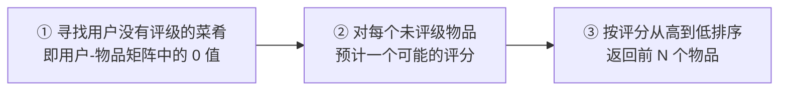

# 第 14 章 利用SVD简化数据

> **本章解决**：数据里往往只有一小段携带了大部分信息，其余是噪声和冗余——奇异值分解（**SVD**，Singular Value Decomposition）把任意 \(m \times n\) 矩阵拆成 \(U\)、\(\Sigma\)、\(V^T\) 三个矩阵，只保留前面少数几个奇异值就能同时完成降噪、压缩和特征提取。它的三大应用场景本章各演一遍：搜索领域的隐性语义索引、推荐系统（在低维"主题空间"下给用户推荐未尝过的菜肴）、以及把 32×32 手写数字图像压到 130 个数字的图像压缩。

| 关键词 | 事实 |
| --- | --- |
| 定位 | 降维主题两章中的第二章（上一章：PCA） |
| 优点 | 简化数据，去除噪声，提高算法的结果 |
| 缺点 | 数据的转换可能难以理解 |
| 适用数据类型 | 数值型数据 |
| 三大应用 | 隐性语义索引（搜索）／推荐系统／图像压缩 |
| 本章实例 | 餐馆菜肴推荐引擎；32×32=1024 像素手写数字压缩到 130 个数字 |

章首的例子：餐馆可划分为美式、中式、日式、牛排馆、素食店等很多类别——这些类别够用吗？或许人们喜欢的是"中式素食店"这样的混合类别。到底该有多少类？问专家可能得不到答案（一个按调料分类、一个按配料分类），**忘了专家，从数据着手**：对用户关于餐馆观点的数据进行处理，提取出背后的因素。这些因素可能与餐馆的类别、烹饪所用的某个特定配料一致；然后就能用这些因素估计人们对没去过的餐馆的看法。提取方法就是 SVD——从生物信息学到金融学，SVD 都是提取信息的强大工具。

!!! note "运行环境"
    - 本章演示数据在 `E:\Desktop\深度学习\_ml_data\Ch14\`：`0_5.txt`（32×32 的 0/1 手写数字"0"，来自原书官方仓库 `pbharrin/machinelearninginaction` 的 Ch14 目录，与 Ch02 的 `trainingDigits/0_5.txt` 是同一张图）。推荐与压缩部分的代码按原书习惯使用相对文件名 `'0_5.txt'`，**运行时工作目录需在该目录**（或自行改成绝对路径）；
    - 运行环境 Python 3.10 + NumPy 2.x。原书是 Python 2 + 老版 NumPy，差异三件套：`from numpy import *` 的裸函数名（`shape`/`nonzero`/`logical_and`/`zeros`/`eye`）笔记显式写成 `np.` 前缀；`mat()` 已弃用，一律改 `np.asmatrix()`（见"坑与陷阱"第 1 条）；`print x,` 改 `print(x, end=' ')`；
    - 本笔记所有"代码实跑"插图与关键数值均为实际运行所得，并与原书逐值对照。原书有三处命令行输出与其自身代码对不上（14.5.1 一处、14.5.2 两处），已在对应小节勘误。

## 14.0 本章导图

<div class="brtree">
  <div class="brrow">
    <span class="brlabel root">利用 SVD 简化数据</span>
    <span class="brace"></span>
    <div class="brkids">
      <div class="brrow">
        <span class="brlabel">SVD 的应用</span>
        <span class="brace"></span>
        <div class="brkids">
          <span class="brleaf">隐性语义索引 LSI／LSA：文档×词语矩阵</span>
          <span class="brleaf">奇异值=文档概念/主题，治拼写错误与同义词</span>
          <span class="brleaf">推荐系统：先建主题空间，再在空间里算相似度</span>
          <span class="brleaf">Netflix 百万美元大赛，获奖方案用到 SVD</span>
        </div>
      </div>
      <div class="brrow">
        <span class="brlabel">矩阵分解</span>
        <span class="brace"></span>
        <div class="brkids">
          <span class="brleaf">类比代数因式分解：12 = (2,6) 等答案不唯一</span>
          <span class="brleaf">Data 拆成 U、Σ、V 转置三个矩阵的乘积</span>
          <span class="brleaf">Σ 只在对角线上，且从大到小排列</span>
          <span class="brleaf">奇异值 = Data×Data 转置特征值的平方根</span>
          <span class="brleaf">r 个重要特征之后≈0，其余是噪声/冗余</span>
        </div>
      </div>
      <div class="brrow">
        <span class="brlabel">Python 实现</span>
        <span class="brace"></span>
        <div class="brkids">
          <span class="brleaf">numpy.linalg.svd 一行搞定</span>
          <span class="brleaf">Sigma 以行向量返回（只存对角元素，省空间）</span>
          <span class="brleaf">7×5 实例：前 3 个奇异值 9.72/5.29/0.68</span>
          <span class="brleaf">Sig3 重构：U 前 3 列 × 3×3 对角阵 × VT 前 3 行</span>
          <span class="brleaf">保留几个：90% 能量启发式 or 前 2000~3000 个</span>
        </div>
      </div>
      <div class="brrow">
        <span class="brlabel">协同过滤</span>
        <span class="brace"></span>
        <div class="brkids">
          <span class="brleaf">不看物品属性，只按用户意见算相似度</span>
          <span class="brleaf">三种方法：欧氏距离／皮尔逊相关／余弦相似度</span>
          <span class="brleaf">基于物品 vs 基于用户：看用户和物品谁多</span>
          <span class="brleaf">评价：去掉已知评分做交叉测试，算 RMSE</span>
        </div>
      </div>
      <div class="brrow">
        <span class="brlabel">餐馆菜肴推荐引擎</span>
        <span class="brace"></span>
        <div class="brkids">
          <span class="brleaf">三步：找 0 值 → 预测评分 → 排序取前 N</span>
          <span class="brleaf">standEst：基于共同评分用户的原始空间估计</span>
          <span class="brleaf">svdEst：先映射到低维空间再算相似度</span>
          <span class="brleaf">挑战：效率／稀疏存储／冷启动→基于内容</span>
        </div>
      </div>
      <div class="brrow">
        <span class="brlabel">图像压缩</span>
        <span class="brace"></span>
        <div class="brkids">
          <span class="brleaf">32×32 手写数字 = 1024 个数字</span>
          <span class="brleaf">printMat：阈值 0.8 界定显示 0 还是 1</span>
          <span class="brleaf">2 个奇异值重构：64+64+2 = 130 个数字</span>
          <span class="brleaf">压缩比约 8 倍（书称几乎 10 倍）</span>
        </div>
      </div>
    </div>
  </div>
</div>

## 14.1 SVD 的应用

利用 SVD，我们能够**用小得多的数据集来表示原始数据集**——这样做实际上是去除了噪声和冗余信息。节省空间时这是很崇高的目标，但在这里我们是从数据中**抽取信息**：可以把 SVD 看成从有噪声数据中抽取相关特征。下面先看 SVD 在搜索与信息检索领域的应用（隐性语义索引），再看它在推荐系统中的应用。

### 14.1.1 隐性语义索引

SVD 的历史已经超过百年，但最近几十年随着计算机的使用，我们才发现它更多的使用价值。最早的 SVD 应用之一就是**信息检索**，利用 SVD 的这类方法称为**隐性语义索引**（**LSI**，Latent Semantic Indexing）或**隐性语义分析**（**LSA**，Latent Semantic Analysis）。

LSI 的做法：一个矩阵由**文档和词语**组成，在该矩阵上做 SVD 会构建出多个奇异值——这些奇异值代表了**文档中的概念或主题**，可用于更高效的文档搜索。它治好简单搜索的两大痛点：

1. **拼写错误**：只基于词语存在与否的简单搜索，遇到拼写错误就搜不到了；
2. **同义词**：查找一个词时，其同义词所在的文档可能匹配不上。若从上千篇相似的文档中抽取出概念，同义词就会**映射为同一概念**。

!!! note "拓展：LSI 与今天的语义检索"
    LSI 是"语义检索"的祖师爷：它不比较词面，而是比较词面背后的**概念坐标**，所以"汽车"能搜到含"轿车"的文档。现代做法换了工具但思路一脉相承——先无监督地学出低维语义空间，再在空间里算相似度：LSI 用 SVD，词嵌入（word2vec、GloVe）与现在的语义检索模型用神经网络。向量数据库里的"embedding 相似度检索"，本质上就是 LSI "文档×词语矩阵 → 低维概念空间"的当代版。

### 14.1.2 推荐系统

SVD 的另一个应用就是推荐系统。**简单版本**的推荐系统能够计算项或者人之间的相似度；**更先进的方法**则先利用 SVD 从数据中构建一个**主题空间**，然后再在该空间下计算相似度。考虑图 14-1 给出的矩阵：它由餐馆的菜和品菜师对这些菜的意见构成，品菜师用 1 到 5 的整数评级，没尝过某道菜则评级为 0。

<figure>
  
  <figcaption>图 14.1 原书图 14-1：餐馆的菜及其评级的数据——SVD 处理可将数据压缩到若干概念，右图标出了一个概念（截自原书）</figcaption>
</figure>

对上述矩阵做 SVD，会得到**两个奇异值**（下一节会实跑验证）——仿佛有两个概念或主题与此数据集相关联。观察图中的 0 就能找到这两个概念：Ed、Peter 和 Tracy 对"烤牛肉"和"手撕猪肉"进行了评级，且未对其他菜评级；烤牛肉和手撕猪肉都是**美式烧烤**餐馆才有的菜，其余菜（鳗鱼饭、日式炸鸡排、寿司饭）则在**日式餐馆**才有。于是新空间只有二维，可以命名为"美式 BBQ"和"日式食品"——与原始矩阵的五维（5 道菜）或七维（7 位品菜师）相比，二维就够刻画这份数据。

如何将原始数据变换到新空间？下一节详细介绍 SVD 后会看到：\(V^T\) 矩阵将**用户**映射到 BBQ/日式食品空间，\(U\) 矩阵将**菜肴**映射到该空间。真实数据通常不会像图 14-1 那样稠密整齐，这里只是便于说明问题。推荐引擎中的评级数据往往带噪声，把数据抽取为这些基本主题之后，推荐系统能取得**比原始数据更好的推荐效果**。2006 年末，Netflix 举办过奖金 100 万美元的推荐系统大赛，奖金颁给比当时最好系统还好 10% 的参赛者——最后的获奖者就使用了 SVD（获奖方案见 Yehuda Koren 的 *The BellKor Solution to the Netflix Grand Prize*）。

!!! note "拓展：Netflix 大赛与矩阵补全"
    Netflix 给出约 48 万用户对约 1.8 万部电影的 1 亿条评分，要求把均方根误差（RMSE）改进 10%。大赛把"推荐"抽象成了一道数学题——**矩阵补全**（matrix completion）：评级矩阵里大片空白，SVD 把它分解成"用户主题 × 物品主题"两个低秩矩阵的乘积，空白格子的评分就用两个低维向量的内积来预测。三支队伍（BellKor、Pragmatic Theory、BigChaos）最终合并成 BelKor's Pragmatic Chaos 摘得百万美元（2009 年）。此后"带正则的矩阵分解（LFM）"成了工业界推荐系统的标配基线，Spark 的 `als`、Surprise 库里的 SVD 都源于此。

## 14.2 矩阵分解

在很多情况下，数据中的一小段携带了数据集中的大部分信息，其他信息要么是噪声，要么毫不相关。线性代数中有很多**矩阵分解**（matrix factorization）技术：将原始矩阵表示成新的易于处理的形式——**两个或多个矩阵的乘积**。可以把分解过程想象成代数中的因式分解：如何把 12 分解成两个数的乘积？(1,12)、(2,6) 和 (3,4) 都是合理答案——矩阵分解同样不唯一，不同技术有不同性质，有的适合这个应用、有的适合那个应用。

最常见的一种矩阵分解技术就是 SVD。SVD 将原始数据集矩阵 Data 分解成三个矩阵 \(U\)、\(\Sigma\)、\(V^T\)。如果 Data 是 \(m\) 行 \(n\) 列，则 \(U\)、\(\Sigma\)、\(V^T\) 分别是 \(m \times m\)、\(m \times n\)、\(n \times n\)：

\[
Data_{m \times n} = U_{m \times m} \, \Sigma_{m \times n} \, V^{T}_{n \times n}
\]

上述分解构建出的矩阵 \(\Sigma\) **只有对角元素**，其他元素均为 0；另一个惯例是 \(\Sigma\) 的对角元素**从大到小排列**。这些对角元素称为**奇异值**（**Singular Value**），它们对应原始数据集矩阵 Data 的奇异值。回想上一章 PCA 得到的特征值——它们告诉我们数据集中的重要特征，\(\Sigma\) 中的奇异值也是如此。奇异值和特征值是有关系的：**这里的奇异值就是矩阵 Data·Dataᵀ 特征值的平方根**。

前面提到 \(\Sigma\) 只有从大到小排列的对角元素。在科学和工程中一直存在这样一个普遍事实：**在某个奇异值数目（\(r\) 个）之后，其他奇异值都置为 0**——这意味着数据集中仅有 \(r\) 个重要特征，而其余特征都是噪声或冗余特征。14.3 节会看到一个可靠的案例。

我们不必担心该如何进行矩阵分解——NumPy 的线性代数工具箱里有现成的 SVD 实现（下一节）。若对 SVD 的编程实现感兴趣，可阅读 *Numerical Linear Algebra*（L. Trefethen and D. Bau III, SIAM, 1997）。

!!! note "拓展：SVD 与 PCA 是什么关系"
    上一章 PCA 的流程是"去均值 → 协方差矩阵 → 特征分解"，而 SVD **直接分解数据矩阵本身**，不用显式构造协方差矩阵。两者关系可以算出来：对去均值后的数据做 SVD，奇异值的平方除以 (n-1) 正是协方差矩阵的特征值，右奇异向量 \(V\) 的列就是 PCA 的主成分方向（14.3 节的"能量占比"也就等于 PCA 里的"方差占比"）。数值计算上 SVD 往往更稳：先算 \(X^TX\) 再特征分解会放大舍入误差，直接 SVD 绕开了这一步。sklearn 的 `PCA` 底层就是靠 SVD 实现的。

## 14.3 利用Python实现SVD

如果 SVD 确实那么好，该如何实现它？SVD 背后的线性代数不在本书讨论范围内——很多软件包都有现成实现，NumPy 有一个称为 `linalg` 的线性代数工具箱。先拿一个最小矩阵练手：

\[
\begin{bmatrix} 1 & 1 \\ 7 & 7 \end{bmatrix}
\]

```python
# ===== 书 14.3 节：2×2 矩阵的 SVD =====
import numpy as np
from numpy import linalg as la

U, Sigma, VT = la.svd([[1, 1], [7, 7]])
print(U); print(Sigma); print(VT)
```

实跑输出（与书 p255 逐值一致）：

```text
[[-0.14142136 -0.98994949]
 [-0.98994949  0.14142136]]
[10.  0.]
[[-0.70710678 -0.70710678]
 [-0.70710678  0.70710678]]
```

注意：矩阵 Sigma 以**行向量** `array([10., 0.])` 返回，而非完整矩阵 `array([[10., 0.], [0., 0.]])`。由于矩阵除对角元素外均为 0，这种只返回对角元素的方式能**节省空间**——这是 NumPy 内部机制产生的。要记住的是：**一旦看到 Sigma 就要知道它是一个矩阵**。

接下来在一个更大的数据集上分解。建立文件 svdRec.py，加入书 p256 印刷的这份数据：

```python
# ===== 书 14.3 节：p256 印刷版示例矩阵（7×5） =====
Data = [[1, 1, 1, 0, 0],
        [2, 2, 2, 0, 0],
        [1, 1, 1, 0, 0],
        [5, 5, 5, 0, 0],
        [1, 1, 0, 2, 2],
        [0, 0, 0, 3, 3],
        [0, 0, 0, 1, 1]]

U, Sigma, VT = la.svd(Data)
print(Sigma)
```

实跑输出（与书 p256 逐值对照）：

```text
[9.72140007e+00 5.29397912e+00 6.84226362e-01 1.50962387e-15 1.15387192e-31]
```

前 3 个数值比其他的值大了很多（书原话：最后两个值的结果在不同机器上可能稍有不同——它们太小了，数量级差不多即可）。于是可以**将最后两个值去掉**，原始数据集就可以用如下结果近似：

\[
Data_{m \times n} \approx U_{m \times 3} \, \Sigma_{3 \times 3} \, V^{T}_{3 \times n}
\]

<figure>
  
  <figcaption>图 14.2 原书图 14-2：SVD 示意图——Data 被分解，浅灰色区域是原始数据，深灰色区域是矩阵近似计算仅需要的数据（截自原书）</figcaption>
</figure>

!!! warning "原书笔误：loadExData 有两个版本"
    上面按书 p256 抄的这份矩阵，与**随书官方源码**里的 `loadExData()` **不是同一个矩阵**：官方版返回的是图 14-1 那份评级矩阵（`[[0,0,0,2,2], [0,0,0,3,3], [0,0,0,1,1], [1,1,1,0,0], [2,2,2,0,0], [5,5,5,0,0], [1,1,1,0,0]]`），对它做 SVD 只有**两个**非零奇异值（9.644 与 5.292）——这恰好呼应 14.1.2 "两个奇异值、两个概念"的说法。书中 14.3 的 Sigma 输出（9.72/5.29/0.68）对应**印刷版**矩阵，而 14.4 节起的全部命令行结果（相似度、推荐）都基于**随书源码版**。本笔记 14.3 用印刷版复现书的 Sigma 输出，14.4 起改用随书源码版 `loadExData()`。

<figure>
  
  <figcaption>图 14.3 两个版本的 loadExData 奇异值对比——印刷版前 3 个为 9.721/5.294/0.684，随书源码版只有 2 个非零（代码实跑）</figcaption>
</figure>

我们试图重构原始矩阵。首先构建一个 3×3 的矩阵 Sig3（把 Sigma 向量铺回对角线上），然后只需用 \(U\) 的**前 3 列**和 \(V^T\) 的**前 3 行**：

```python
# ===== 书 14.3 节：Sig3 与近似重构 =====
Sig3 = np.asmatrix([[Sigma[0], 0, 0],
                    [0, Sigma[1], 0],
                    [0, 0, Sigma[2]]])
recon = np.asmatrix(U[:, :3]) * Sig3 * VT[:3, :]   # U 前 3 列 × Sig3 × VT 前 3 行
print(recon)
```

实跑结果：重构矩阵与原矩阵的**最大绝对误差约 \(1.8 \times 10^{-15}\)**——3 个奇异值就把 7×5 原矩阵几乎零误差复原了；只取前 1、前 2 个时误差分别为 3.0、0.47，信息是逐个奇异值补回来的：

<figure>
  
  <figcaption>图 14.4 取前 k 个奇异值重构印刷版矩阵：k=3 时最大误差 1.8e-15，几乎零误差复原（代码实跑）</figcaption>
</figure>

我们是如何知道仅需保留前 3 个奇异值的呢？确定保留数目有很多**启发式策略**：

1. **保留矩阵中 90% 的能量信息**：把所有奇异值**求平方和**得到总能量，将奇异值的平方**从大到小累加到总值的 90%** 为止，用了几个算几个；
2. **直接保留前 2000 或 3000 个**：当矩阵有上万个奇异值时更好实施，但不够优雅——它不能保证在任何数据集上前 3000 个就包含 90% 的能量。不过使用者往往对数据有足够的了解，能做出类似假设。

!!! note "拓展：为什么『能量』是奇异值的平方"
    矩阵的 **Frobenius 范数**（把所有元素平方求和再开根号）在 SVD 下有一个漂亮等式：\(\|Data\|_F^2 = \sum_i \sigma_i^2\)——全部"能量"恰好分布在奇异值的平方上，且各奇异值贡献互相独立。所以"保留前 r 个奇异值"丢掉的能量就是 \(\sum_{i>r}\sigma_i^2\)，"90% 能量阈值"即保留 90% 的平方和。这也解释了 PCA 与 SVD 的互通：去均值数据的 \(\sigma_i^2/(n-1)\) 就是第 \(i\) 个主成分的方差。

## 14.4 基于协同过滤的推荐引擎

近十年来，推荐引擎对因特网用户而言已不是新鲜事物：Amazon 根据购买历史推荐物品，Netflix 向用户推荐电影，新闻网站推荐新闻报道。实现推荐的方法很多，本章只用一种——**协同过滤**（**collaborative filtering**）：通过将用户和其他用户的数据进行**对比**来实现推荐。

数据在概念上组织成"用户×物品"的矩阵形式（类似图 14-1/14-2）。这样组织之后，就可以比较**用户**或**物品**之间的相似度。知道了两个用户或两个物品之间的相似度，就能利用已有数据预测未知的用户喜好：比如预测某用户喜欢的电影——推荐引擎发现一部该用户没看过的电影，计算它与用户看过的电影之间的相似度，相似度很高就认为用户会喜欢。唯一需要的数学方法就是**相似度的计算**。

### 14.4.1 相似度计算

如何定量地给出物品之间的相似度？以食品销售网站为例：可以根据食品的配料、热量、烹调类型来算——但如果网站想把业务拓展到餐具行业呢？会用热量来描述一个叉子吗？**用于描述不同物品的属性并不通用**。换一种思路：不用专家给出的属性，而是**利用用户对它们的意见来计算相似度**——这就是协同过滤的方法，它不关心物品的描述属性，严格按许多用户的观点来计算。图 14-5 给出了一个简单矩阵（3 位用户 × 5 道菜）。

<figure>
  
  <figcaption>图 14.5 原书图 14-3：用于展示相似度计算的简单矩阵（截自原书）</figcaption>
</figure>

**欧氏距离**。以图 14-5 为例计算手撕猪肉和烤牛肉之间的欧氏距离（两列在 Jim、John、Sally 三人上的评分为 (4,3,2) 与 (4,3,1)）：

\[
\sqrt{(4-4)^2 + (3-3)^2 + (2-1)^2} = 1
\]

而手撕猪肉和鳗鱼饭的欧氏距离为（鳗鱼饭一列评分为 (2,5,2)）：

\[
\sqrt{(4-2)^2 + (3-5)^2 + (2-2)^2} = 2.83
\]

手撕猪肉与烤牛肉的距离更小，因此更相似。我们希望相似度值在 **0 到 1** 之间变化，且物品对越相似值越大——用"**相似度 = 1/(1+距离)**"即可：距离为 0 时相似度 1.0，距离非常大时趋近 0。

**皮尔逊相关系数（Pearson correlation）**。第 8 章度量回归方程精度时用过，度量的是两个向量的相似度。它相对欧氏距离的优势在于**对用户评级的量级不敏感**：比如某个狂躁者对所有物品都评 5 分，另一个忧郁者对所有物品都评 1 分，皮尔逊相关系数会认为这两个向量相等。NumPy 中由 `corrcoef()` 计算。皮尔逊相关系数取值从 −1 到 +1，用 0.5 + 0.5×corrcoef() 归一化到 0 到 1。

**余弦相似度（cosine similarity）**。计算两个向量**夹角的余弦值**：夹角 90° 时相似度为 0，方向相同时为 1.0。取值同样在 −1 到 +1 之间，也要归一化到 0 到 1。两个向量 \(A\)、\(B\) 夹角余弦的定义：

\[
\cos\theta = \frac{A \cdot B}{\|A\| \, \|B\|}
\]

其中 \(\|A\|\)、\(\|B\|\) 表示向量 \(A\)、\(B\) 的 **2 范数**——不指定范数阶数时默认都是 2 范数。向量 [4,2,2] 的 2 范数为 \(\sqrt{4^2+2^2+2^2}=\sqrt{24}\approx 4.90\)，NumPy 线性代数工具箱提供了 `linalg.norm()` 来算范数。

!!! warning "原书笔误：2 范数示例的公式"
    书 p259 正文写"向量 [4,2,2] 的 2 范数"，但公式印成了 \(\sqrt{4^2+3^2+2^2}\)（第二个分量写成了 3）。按 [4,2,2] 计算应为 \(\sqrt{4^2+2^2+2^2}=\sqrt{24}\approx 4.90\)，两者必有一处排印错误，本笔记以正文向量 [4,2,2] 为准。

接下来把三种相似度写成 Python 函数（原书程序清单 14-1；NumPy 线性代数工具箱 `linalg` 以 `la` 导入，函数假定 inA 和 inB 都是**列向量**）：

```python
# ===== 书 14.4.1 节 程序清单 14-1：相似度计算 =====
import numpy as np
from numpy import linalg as la

def euclidSim(inA, inB):
    """欧氏距离相似度：1/(1+距离)，距离 0 → 1.0，越大越趋近 0。"""
    return 1.0 / (1.0 + la.norm(inA - inB))

def pearsonSim(inA, inB):
    """皮尔逊相关系数相似度：少于 3 个点时返回 1.0（两点必完全相关）。"""
    if len(inA) < 3:
        return 1.0
    return 0.5 + 0.5 * np.corrcoef(inA, inB, rowvar=0)[0][1]

def cosSim(inA, inB):
    """余弦相似度：夹角余弦归一化到 0~1。inA、inB 需为列向量。"""
    num = float(inA.T * inB)                 # A·B（inA、inB 为 asmatrix 列向量）
    denom = la.norm(inA) * la.norm(inB)      # ||A|| × ||B||，2 范数
    return 0.5 + 0.5 * (num / denom)
```

!!! warning "原书笔误：函数名拼写"
    原书正文与随书源码把欧氏距离相似度函数拼作 `ecludSim`（euclid 的错拼）、皮尔逊相似度拼作 `pearsSim`（正文甚至还有第三种拼法 `perasSim`）。本笔记统一改成正确的 `euclidSim`、`pearsonSim`，其余逻辑与书完全一致。

对上述函数做尝试（myMat 取随书源码的 `loadExData()`，即图 14-1 的评级矩阵）：

```python
# ===== 书 14.4.1 节：三种相似度实跑 =====
def loadExData():
    """随书源码版 = 图 14-1 的用户-菜肴评级矩阵（7 位用户 × 5 道菜）"""
    return [[0, 0, 0, 2, 2],
            [0, 0, 0, 3, 3],
            [0, 0, 0, 1, 1],
            [1, 1, 1, 0, 0],
            [2, 2, 2, 0, 0],
            [5, 5, 5, 0, 0],
            [1, 1, 1, 0, 0]]

myMat = np.asmatrix(loadExData(), dtype=float)
print(euclidSim(myMat[:, 0], myMat[:, 4]))     # 第 0 列 vs 第 4 列
print(euclidSim(myMat[:, 0], myMat[:, 0]))     # 自身 vs 自身
print(cosSim(myMat[:, 0], myMat[:, 4]))
print(cosSim(myMat[:, 0], myMat[:, 0]))
print(pearsonSim(myMat[:, 0], myMat[:, 4]))
print(pearsonSim(myMat[:, 0], myMat[:, 0]))
```

实跑输出（与书 p259-260 逐值对照）：

```text
0.12973190755680383      # 书 0.12973190755680383 ✓
1.0                      # 书 1.0 ✓
0.5                      # 书 0.5 ✓
1.0                      # 书 1.0000000000000002（同一计算的浮点尾数差异）
0.20596538173840329      # 书 0.20596538173840329 ✓
1.0                      # 书 1.0 ✓
```

六个值全部复现（仅自相似度差一个 1e-16 的浮点尾数，无实质差别）。直观解读：第 0 列（Fan/Ming/Pachi/Jocelyn 的日式菜评分）与第 4 列（Ed/Peter/Tracy 的手撕猪肉评分）**共同评分用户为 0**——欧氏距离只看数值差给出 0.13，皮尔逊靠相反的评分趋势勉强给出 0.21，余弦则因两列正交恰好给 0.5：

<figure>
  
  <figcaption>图 14.6 三种相似度计算对比：第 0 列 vs 第 4 列（不同组菜肴）与自身 vs 自身（代码实跑）</figcaption>
</figure>

!!! note "拓展：为什么 cosSim 要做 0.5+0.5 归一化"
    余弦本身取值 [−1, +1]：夹角超过 90° 的两个"反向"向量余弦为负。评分场景里"反向"其实是**负相关**（一个喜欢另一个讨厌），直接拿负数当相似度会破坏 0~1 的语义，所以平移压缩到 [0, 1]。皮尔逊同理。另外两处细节：`pearsonSim` 里 `len(inA) < 3` 的防御是因为**两点必完全相关**（相关系数恒为 ±1，没有信息量）；而"少于 3 个点"挡不住**常数列**（比如 [2,2,2,2]）——实跑验证 `pearsonSim(常数列, 任意列)` 返回 **nan**（NumPy 会发 RuntimeWarning），0/0 型，方差为 0 算不了相关系数。这是 Pearson 相似度的经典坑，见"坑与陷阱"。

上面的相似度计算都假设数据采用**列向量**表示。若用来计算两个**行向量**的相似度会遇到问题（很容易修改函数来支持行向量）。采用列向量，暗示我们将使用**基于物品**的相似度计算方法——原因见下一小节。

### 14.4.2 基于物品的相似度还是基于用户的相似度？

我们计算了两个餐馆菜肴之间的距离，这称为**基于物品**（**item-based**）的相似度；计算用户之间距离的方法则称为**基于用户**（**user-based**）的相似度。回到图 14-5：**行与行**之间比较的是基于用户的相似度，**列与列**之间比较的是基于物品的相似度。用哪一种？**取决于用户或物品的数目**——基于物品相似度的计算时间随物品数量增加而增加，基于用户的计算时间随用户数量增加而增加。一个商店最多几千件商品（写书之际最大的商店约 100 000 件商品）；而 Netflix 大赛有 480 000 个用户和 17 700 部电影。**用户的数目很多时，倾向基于物品的相似度**。

对于大部分**产品导向**的推荐引擎而言，用户的数量往往大于物品的数量（购买商品的用户数多于出售的商品种类），所以本书选基于物品的相似度。

### 14.4.3 推荐引擎的评价

如何评价推荐引擎？此时既没有预测的目标值，也没有用户来调查满意程度。可以采用前面多次使用的**交叉测试**：将某些**已知的评分值去掉**，对它们进行预测，最后计算预测值和真实值之间的差异。

通常用于推荐引擎评价的指标是**最小均方根误差**（**RMSE**，Root Mean Squared Error），它先计算**均方误差的平均值**然后**取平方根**。如果评级在 1 星到 5 星范围内，而 RMSE 为 1.0，就意味着预测值和用户给出的真实评价**相差了一个星级**。

!!! note "拓展：RMSE 之外还有哪些指标"
    RMSE 对大误差敏感（平方放大），想弱化个别离谱预测的影响可用**平均绝对误差**（MAE）；只关心"推荐列表里的东西用户接不接受"的场合（Top-N 推荐）则更多用**精确率/召回率**、**NDCG**（考虑排序位置）等排序指标。工业界最终还会用**在线 A/B 测试**看点击率、转化率——离线指标好只是入场券。

## 14.5 示例：餐馆菜肴推荐引擎

现在构建一个关注餐馆食物推荐的引擎：假设一个人在家决定外出吃饭，但不知道该到哪儿吃、该点什么菜——推荐系统帮他做到这两点。路线：先构建一个**基本的推荐引擎**（寻找用户没有尝过的菜肴）→ 通过 SVD 减少特征空间并提高推荐效果 → 打包成用户可读的人机界面 → 最后介绍构建推荐系统面临的问题。

### 14.5.1 推荐未尝过的菜肴

推荐系统的工作过程：给定一个用户，为此用户返回 **N 个最好的推荐菜**。需要做到：



打开 svdRec.py，加入原书程序清单 14-2：

```python
# ===== 书 14.5.1 节 程序清单 14-2：基于物品相似度的推荐引擎 =====
def standEst(dataMat, user, simMeas, item):
    """在给定相似度计算方法下，估计用户 user 对物品 item 的评分。"""
    n = np.shape(dataMat)[1]                 # 数据集中物品数目
    simTotal = 0.0; ratSimTotal = 0.0
    for j in range(n):                       # 遍历所有物品 j
        userRating = dataMat[user, j]        # 用户对物品 j 的评分
        if userRating == 0:
            continue                         # 评分为 0：未评级，跳过
        # overLap：把 item 和 j 都评过分的用户（两列同时 >0 的行号）
        overLap = np.nonzero(np.logical_and(dataMat[:, item].A > 0,
                                            dataMat[:, j].A > 0))[0]
        if len(overLap) == 0:
            similarity = 0                   # 没有任何重合元素：相似度 0
        else:
            # 基于这些重合用户的评分计算两个物品的相似度
            similarity = simMeas(dataMat[overLap, item], dataMat[overLap, j])
        # print('the %d and %d similarity is: %f' % (item, j, similarity))
        simTotal += similarity               # 相似度累加
        ratSimTotal += similarity * userRating   # 相似度 × 用户对 j 的评分
    if simTotal == 0:
        return 0                             # 一个重合的物品都没有
    else:
        return ratSimTotal / simTotal        # 归一化，使预测值落在 0~5 之间

def recommend(dataMat, user, N=3, simMeas=cosSim, estMethod=standEst):
    """推荐引擎：返回前 N 个（默认 3）未评级物品的预测得分列表。"""
    unratedItems = np.nonzero(dataMat[user, :].A == 0)[1]   # ① 未评分物品列表
    if len(unratedItems) == 0:
        return 'you rated everything'        # 全都评过：退出
    itemScores = []
    for item in unratedItems:
        estimatedScore = estMethod(dataMat, user, simMeas, item)   # ② 预测得分
        itemScores.append((item, estimatedScore))
    return sorted(itemScores, key=lambda jj: jj[1],
                  reverse=True)[:N]          # ③ 按得分从大到小排序，取前 N
```

`standEst()` 的参数包括数据矩阵、用户编号、物品编号和相似度计算方法；数据矩阵为图 14-1/14-2 的形式（行对应用户、列对应物品）。流程：先取物品数目并初始化两个累加变量，然后遍历行中的每个物品——评分 0 意味着用户没评过，跳过；循环本质上是对**用户评过分的每个物品**与目标物品做比较。变量 `overLap` 给出两个物品中**都已被评分**的元素（重合用户）；没有重合则相似度 0 并中止本次循环，有重合则基于重合物品计算相似度。相似度不断累加，每次还累加"相似度 × 当前用户评分"；最后**除以所有评分总和做归一化**，使评分值落在 0 到 5 之间，用于排序。

`recommend()` 产生最高的 N 个推荐结果（默认 N=3），参数还包括相似度计算方法和估计方法（估计方法目前只有 standEst，下一小节增加 svdEst）。它先建立未评分物品列表，不存在则退出；否则对每个未评分物品调用 `standEst()` 得到预测得分，放入 `itemScores`，最后**按得分从大到小逆序排列**返回前 N 个——第一个值就是最大值。

下面实际运行。调入原始矩阵并对其中一些值进行修改（把 4 个位置改成 4、1 个位置改成 2）：

```python
# ===== 书 14.5.1 节：构造 myMat 并做推荐 =====
myMat = np.asmatrix(loadExData(), dtype=float)
myMat[0, 1] = myMat[0, 0] = myMat[1, 0] = myMat[2, 0] = 4
myMat[3, 3] = 2
print(myMat)
```

实跑得到的矩阵（与书 p262 展示一致）：

```text
matrix([[4, 4, 0, 2, 2],
        [4, 0, 0, 3, 3],
        [4, 0, 0, 1, 1],
        [1, 1, 1, 2, 0],
        [2, 2, 2, 0, 0],
        [1, 1, 1, 0, 0],
        [5, 5, 5, 0, 0]])
```

先尝试默认推荐，再用其他相似度计算方法：

```python
print(recommend(myMat, 2))                        # 默认 cosSim
print(recommend(myMat, 2, simMeas=euclidSim))
print(recommend(myMat, 2, simMeas=pearsonSim))
```

实跑输出与书 p262-263 对照：

```text
[(2, 2.5), (1, 2.0243290220056256)]           # 书 [(2, 2.500000000000004), (1, 2.0498713655614456)]
[(2, 3.0), (1, 2.8266504712098603)]           # 书 [(2, 3.0), (1, 2.8266504712098603)] ✓ 逐位一致
[(2, 2.5), (1, 2.0)]                          # 书 [(2, 2.5), (1, 2.0)] ✓ 逐位一致
```

结果表明：用户 2（从 0 开始计数，对应矩阵第 3 行）对**物品 2** 的预测评分约为 2.5，对**物品 1** 的预测评分约为 2.02～2.05（书中正文取 2.05 的口径，原因见下方勘误）。

!!! warning "原书笔误：默认余弦那一行的输出与清单代码对不上"
    按程序清单 14-1 的 `cosSim`（做了 0.5+0.5 归一化）实跑 `recommend(myMat, 2)`，物品 1 的预测分是 **2.0243…**；书中印的 2.0498713655614456 **恰好等于"不做 0.5+0.5 归一化的纯余弦"算出的值**——本笔记用纯余弦实跑，结果与书**逐位一致**（连 2.500000000000004 的浮点尾数都对上）。推断书排印这行命令行时用的是未归一化的旧版 cosSim。读数以清单代码的口径（本笔记实跑值）为准，排序结论不变：物品 2 排在物品 1 前面。

可以对多个用户进行尝试，或者对数据集做些修改来了解其对预测结果带来的变化。这个例子给出了如何利用基于物品相似度和多种相似度计算方法来进行推荐的过程，下面介绍如何将 SVD 应用于推荐。

### 14.5.2 利用SVD提高推荐的效果

实际的数据集会比展示用的 myMat **稀疏得多**。图 14-7 给出了一个更真实的矩阵——11 位用户（Brett、Rob、Drew、Scott、Mary、Brent、Kyle、Sara、Shaney、Brendan、Leanna）对 11 道菜（鳗鱼饭、日式炸鸡排、寿司饭、烤牛肉、三文鱼汉堡、鲁宾三明治、印度烤鸡、麻婆豆腐、宫保鸡丁、印度奶酪咖喱、俄式汉堡）的评级，其中很多物品都没有评分。

<figure>
  
  <figcaption>图 14.7 原书图 14-4：更大的用户-菜肴矩阵，很多物品没有评分，比全填充矩阵更接近真实情况（截自原书）</figcaption>
</figure>

可以将该矩阵输入到程序中，或者从下载代码中复制函数 `loadExData2()`（本笔记采用随书源码版，11×11）。先计算该矩阵的 SVD，了解到底需要多少维特征：

```python
# ===== 书 14.5.2 节：loadExData2 与能量计算 =====
def loadExData2():
    """随书源码版：11 位用户 × 11 道菜的稀疏评级矩阵"""
    return [[0, 0, 0, 0, 0, 4, 0, 0, 0, 0, 5],
            [0, 0, 0, 3, 0, 4, 0, 0, 0, 0, 3],
            [0, 0, 0, 0, 4, 0, 0, 1, 0, 4, 0],
            [3, 3, 4, 0, 0, 0, 0, 2, 2, 0, 0],
            [5, 4, 5, 0, 0, 0, 0, 5, 5, 0, 0],
            [0, 0, 0, 0, 5, 0, 1, 0, 0, 5, 0],
            [4, 3, 4, 0, 0, 0, 0, 5, 5, 0, 1],
            [0, 0, 0, 4, 0, 4, 0, 0, 0, 0, 4],
            [0, 0, 0, 2, 0, 2, 5, 0, 0, 1, 2],
            [0, 0, 0, 0, 5, 0, 0, 0, 0, 4, 0],
            [1, 0, 0, 0, 0, 0, 0, 1, 2, 0, 0]]

myMat2 = np.asmatrix(loadExData2(), dtype=float)
U, Sigma, VT = la.svd(myMat2)
print(Sigma)
Sig2 = Sigma ** 2            # 对 Sigma 中的值求平方（能量）
```

实跑 Sigma（11 个，从大到小）：

```text
[15.77075346 11.40670395 11.03044558  4.84639758  3.09292055  2.58097379
  1.00413543  0.72817072  0.43800353  0.22082113  0.07367823]
```

看看多少个奇异值能达到**总能量 90%**（平方、求和、对比——与书 p264 逐值对照）：

| 计算步骤 | 本笔记实跑 | 书中印刷值 |
| --- | --- | --- |
| `sum(Sig2)`（总能量） | 541.9999999999997 | 541.9999999999932 ✓ |
| `sum(Sig2)*0.9`（90% 阈值） | 487.7999999999997 | 487.7999999999939 ✓ |
| `sum(Sig2[:2])`（前 2 个能量） | 378.82955951135796 | 378.829595113579（排印丢位） |
| `sum(Sig2[:3])`（前 3 个能量） | 500.5002891275793 | 500.50028912757909 ✓ |

前两个元素的能量（69.9%）**低于** 90%，前三个元素的能量（92.3%）**高于** 90%——于是可以把一个 **11 维的矩阵转换成一个 3 维的矩阵**。

!!! warning "原书两处旧截图与其自身数据对不上"
    1. 书中 Sigma 数组印的是 [13.8487021, 11.5944583, 11.0219767, 5.31377372, …]，它的平方和约 507——既不等于书自己的 `sum(Sig2)=542`，也不等于图 14-4 矩阵的平方和 497，应为旧版数据的截图。按随书源码 `loadExData2()` 实跑的 Sigma（上表）平方和恰为 542，与书正文**所有**能量计算吻合；
    2. 上表 `sum(Sig2[:2])` 一行，书中印的 378.8295**9**5113579 实为 378.8295**5**951135796 排印时丢了一位"5"，不影响结论（两种读法都低于 487.8）。

<figure>
  
  <figcaption>图 14.8 loadExData2 的 11 个奇异值（左）与能量累计百分比（右）：前 2 个 69.9% 不足 90%，前 3 个 92.3% 达标（代码实跑）</figcaption>
</figure>

下面对转换后的三维空间构造出一个相似度计算函数：利用 SVD 将**所有菜肴映射到一个低维空间**，在低维空间下用前面相同的相似度计算方法来推荐。构造一个类似 `standEst()` 的函数——原书程序清单 14-3：

```python
# ===== 书 14.5.2 节 程序清单 14-3：基于 SVD 的评分估计 =====
def svdEst(dataMat, user, simMeas, item):
    """在 SVD 降维后的低维空间里估计用户 user 对物品 item 的评分。"""
    n = np.shape(dataMat)[1]
    simTotal = 0.0; ratSimTotal = 0.0
    U, Sigma, VT = la.svd(dataMat)                  # 对数据集做 SVD 分解
    Sig4 = np.asmatrix(np.eye(4) * Sigma[:4])       # ① 前 4 个奇异值重建对角矩阵
    # ② 构建转换后的物品：dataMat.T×U[:, :4]×Sig4 的逆，把物品映射到 4 维空间
    xformedItems = dataMat.T * np.asmatrix(U[:, :4]) * Sig4.I
    for j in range(n):
        userRating = dataMat[user, j]               # 用户对物品 j 的评分
        if userRating == 0 or j == item:
            continue
        # ③ 相似度在低维空间下计算：第 item 行与第 j 行各自转置成列向量
        similarity = simMeas(xformedItems[item, :].T, xformedItems[j, :].T)
        print('the %d and %d similarity is: %f' % (item, j, similarity))
        simTotal += similarity
        ratSimTotal += similarity * userRating
    if simTotal == 0:
        return 0
    else:
        return ratSimTotal / simTotal
```

把 `svdEst()` 与 `standEst()` 对比，很多行代码都很相似；不同之处在于它先对数据集做了 SVD 分解。分解之后只利用包含 90% 能量值的奇异值（**代码里取前 4 个**，即 `Sig4`——按上表 3 个就够 90%，代码多留一个更保守），这些奇异值以 NumPy 数组形式保存，要做矩阵运算就必须用它们**构建出对角矩阵**（`Sig4`）；然后利用 \(U\) 矩阵将**物品转换到低维空间**（`xformedItems`）。对给定用户，for 循环在其对应行的所有元素上遍历，目的与 `standEst()` 相同，只不过**相似度计算在低维空间下进行**；相似度求和、相似度与对应评分乘积求和，最后相除得到估计评分。for 循环里那条 print 语句只是为了观察相似度计算的进展，嫌累赘可以注释掉。

!!! note "拓展：xformedItems 为什么恰好等于 V 的前 4 列"
    把 \(Data = U\Sigma V^T\) 代进去算一笔账：\(Data^T U = V\Sigma U^T U = V\Sigma\)，所以 `dataMat.T * U[:, :4]` 等于 \(V\) 的前 4 列再乘对角阵 \(\mathrm{diag}(\sigma_{1..4})\)；再乘 `Sig4.I`（对角元 \(1/\sigma_i\)）就把奇异值**恰好消掉**——`xformedItems` 就是**右奇异向量矩阵 \(V\) 的前 4 列**，第 \(i\) 行即物品 \(i\) 在 4 维"主题空间"里的坐标。物品相似度于是变成"两个物品的主题坐标向量夹角多小"。这也解释了稀疏 0 评分为什么无妨：SVD 从全局模式里"猜"出了每个物品的主题位置。

接下来看执行效果。对用户 1（评过物品 3、5、10，分数 3、4、3）分别用余弦相似度和皮尔逊相似度跑 `svdEst`：

```python
print(recommend(myMat2, 1, estMethod=svdEst))
print(recommend(myMat2, 1, estMethod=svdEst, simMeas=pearsonSim))
```

实跑输出（余弦相似度，完整的相似度打印）：

```text
the 0 and 3 similarity is: 0.490950
the 0 and 5 similarity is: 0.484274
the 0 and 10 similarity is: 0.512755
the 1 and 3 similarity is: 0.491294
the 1 and 5 similarity is: 0.481516
the 1 and 10 similarity is: 0.509709
the 2 and 3 similarity is: 0.491573
the 2 and 5 similarity is: 0.482346
the 2 and 10 similarity is: 0.510584
the 4 and 3 similarity is: 0.450495
the 4 and 5 similarity is: 0.506795
the 4 and 10 similarity is: 0.512896
the 6 and 3 similarity is: 0.743699
the 6 and 5 similarity is: 0.468366
the 6 and 10 similarity is: 0.439465
the 7 and 3 similarity is: 0.482175
the 7 and 5 similarity is: 0.494716
the 7 and 10 similarity is: 0.524970
the 8 and 3 similarity is: 0.491307
the 8 and 5 similarity is: 0.491228
the 8 and 10 similarity is: 0.520290
the 9 and 3 similarity is: 0.522379
the 9 and 5 similarity is: 0.496130
the 9 and 10 similarity is: 0.493617
[(4, 3.3447149384692287), (7, 3.329402072452697), (9, 3.328100876390069)]
```

换皮尔逊相似度（只列结果）：

```text
[(4, 3.3469521867021728), (9, 3.33537965732747), (6, 3.3071930278130375)]
```

推荐结论与书同型：给用户 1 返回 3 道预测评分约 3.3 的未尝菜肴（书中 top-3 为物品 6/8/7，见下方勘误）。把 `standEst`（不做 SVD）与 `svdEst` 对同一用户逐物品对照，能看出两者性格差异：

| 物品 | standEst（原始空间） | svdEst（cosSim） | svdEst（pearsonSim） |
| --- | --- | --- | --- |
| 菜肴0 | 3.000000 | 3.325457 | 3.213003 |
| 菜肴1 | 3.000000 | 3.324796 | 3.214004 |
| 菜肴2 | 3.000000 | 3.324921 | 3.213889 |
| 菜肴4 | **0.000000** | **3.344715** | **3.346952** |
| 菜肴6 | 3.333333 | 3.283595 | 3.307193 |
| 菜肴7 | 3.000000 | 3.329402 | 3.214676 |
| 菜肴8 | 3.000000 | 3.326870 | 3.211033 |
| 菜肴9 | 3.333333 | 3.328101 | 3.335380 |

最典型的是**菜肴 4**：没有任何用户同时评过它和用户 1 评过的菜（重合用户为空），`standEst` 只能返回 0（"无法预测"），而 `svdEst` 在低维空间里照样给出 3.34 的合理预测——**这正是 SVD 提高推荐效果最直观的证据**：它从全局评分模式里补齐了局部信息缺失。`standEst` 给一堆物品打出相同的 3.00 也暴露了它的短板：重合用户只有 1 个时，单点向量夹角恒为 0，相似度一律 1.0，预测退化成用户自己评分的平均。

<figure>
  
  <figcaption>图 14.9 用户 1 未尝菜肴的预测评分对照：standEst 对菜肴 4 无能为力（0 分），svdEst 仍给出 3.34（代码实跑）</figcaption>
</figure>

!!! warning "原书笔误：svdEst 的命令行输出同样无法复现"
    书中 svdEst 会话印的是 "The 0 and 3 similarity is 0.362287…"、top-3 为 [(6, 3.3879), (8, 3.3611), (7, 3.3587)]。按清单 14-3 代码 + loadExData2 实跑得不到这些数——把保留奇异值个数（2～6）、对角矩阵取法（Sig4、Sig4 的平方、不乘、乘其逆）与四种相似度函数做全组合也没有一组命中，与上面 Sigma 截图应属同源（旧版数据）。以本笔记实跑值为准。

!!! note "拓展：svdEst 的两个实现细节"
    1. **索引方向**：`xformedItems` 是"物品 × 新特征"的 \(n \times 4\) 矩阵，**物品作行**，所以取第 item 个物品要写 `xformedItems[item, :]` 再转置成列向量喂给相似度函数；加权用的评分是 `dataMat[user, j]`——用户对**相似物品 j** 的评分，不是 `dataMat[user, item]`（目标物品对用户来说必是 0，否则也不会进推荐流程）；
    2. **不做重合过滤**：`standEst` 只在"两个物品都被评分"的用户子集上算相似度，`svdEst` 则用**全部用户**的转换坐标算相似度（未评分的 0 也参与了物品坐标的构成）——这正是它能预测"零重合"物品的原因；同时也意味着它把 0 当作"低信号"而不是"缺数据"用，工程上属于一个有意识的近似。

### 14.5.3 构建推荐引擎面临的挑战

本节的代码很好地展示了推荐引擎的工作流程以及 SVD 将数据映射为重要特征的过程。写这些代码时尽量保证了可读性，但**不保证执行效率**：

- **别每次都做 SVD**：不必在每次估计评分时都做 SVD 分解。对上述数据集，是否包含 SVD 分解在效率上没有太大区别，但**更大规模的数据集上 SVD 分解会降低程序速度**。SVD 可以在程序调入时运行一次；在大型系统中，SVD **每天运行一次或者频率更低，并且要离线运行**；
- **矩阵的表示方法**：例子里已经有很多 0，实际系统中 0 的数目更多。也许可以通过**只存储非零元素**来节省内存和计算开销（稀疏矩阵）；
- **相似度得分的复用**：程序中每次需要推荐得分时都要计算多个物品的相似度，这些得分记录的是物品之间的相似度，**可以被另一个用户重复使用**。实际中普遍的做法就是**离线计算并保存相似度得分**；
- **冷启动（cold-start）问题**：如何在缺乏数据时给出好的推荐？这处理起来十分困难。另一种说法是：**用户不会喜欢一个无效的物品，而用户不喜欢的物品又无效**（译者注：新物品缺乏所有用户对其的喜好信息，无法判断每个用户对它的喜好；无法判断喜好，也就无法利用该商品）。如果推荐只是可有可无的功能，问题不大；但如果应用的成功与否和推荐的成功密切相关，问题就相当严重了。

冷启动的解决方案是**将推荐看成搜索问题**——对用户而言是透明的（内部表现不同，用户无感）。为此要使用需要推荐的**物品的属性**：餐馆菜肴的例子中可以用各种标签标记菜肴，比如素食、美式BBQ、价格很贵等，同时把这些属性作为相似度计算的数据——这称为**基于内容（content-based）的推荐**。基于内容的推荐可能不如基于协同过滤的推荐效果好，但**拥有它就是个良好的开始**。

!!! note "拓展：冷启动的常见解法"
    实践中通常分两头处理：**新用户**靠注册信息、热门榜单或兴趣问卷先兜底，收集到几次交互后再切换到协同过滤；**新物品**靠内容特征（标签、文本描述、图像 Embedding）走基于内容的路线，等有了评分数据再并入协同过滤。两类方法也常按"能否解释"互补：协同过滤准但难解释，基于内容可解释（"因为你看过素食"）但召回面窄。本章的 svdEst 其实已经站在两者中间——低维"主题"本身就可以当作物品的内容向量用。

## 14.6 示例：基于SVD的图像压缩

最后看一个能**可视化** SVD 数据近似效果的例子。代码库中包含一张手写的数字图像（第 2 章用过）：原始图像 32×32 = 1024 像素。能否用更少的数字表示它？能压缩，就能节省空间或带宽开销。做法还是 SVD 分解后截断重构——下面的程序清单包含数字的**读入**和**压缩重构**代码（原书程序清单 14-4）：

```python
# ===== 书 14.6 节 程序清单 14-4：图像压缩函数 =====
def printMat(inMat, thresh=0.8):
    """打印矩阵：浮点元素按阈值 thresh 界定深浅，大于阈值打 1，否则打 0。"""
    for i in range(32):
        for k in range(32):
            if float(inMat[i, k]) > thresh:
                print(1, end=' ')
            else:
                print(0, end=' ')
        print('')                            # 每行 32 个数字后换行

def imgCompress(numSV=3, thresh=0.8):
    """基于任意给定的奇异值数目 numSV 重构并打印压缩后的图像。"""
    myl = []                                 # 打开文本文件，以数值方式逐字符读入
    for line in open('0_5.txt').readlines(): # 工作目录需含 0_5.txt（见"运行环境"）
        newRow = []
        for i in range(32):
            newRow.append(int(line[i]))      # 每行 32 个字符转成整数
        myl.append(newRow)
    myMat = np.asmatrix(myl, dtype=float)
    print('****original matrix******')
    printMat(myMat, thresh)                  # 先在屏幕上输出原始矩阵
    U, Sigma, VT = la.svd(myMat)             # 对原始图像做 SVD 分解
    SigRecon = np.asmatrix(np.zeros((numSV, numSV)))   # 建立全 0 矩阵
    for k in range(numSV):                   # 把前 numSV 个奇异值填到对角线上
        SigRecon[k, k] = Sigma[k]
    reconMat = np.asmatrix(U[:, :numSV]) * SigRecon * VT[:numSV, :]  # 截断重构
    print('****reconstructed matrix using %d singular values******' % numSV)
    printMat(reconMat, thresh)               # 输出重构后的矩阵
```

第一个函数 `printMat()` 负责打印矩阵：矩阵包含浮点数，必须定义浅色和深色，这里通过一个**阈值**界定（后面可调节）；遍历所有元素，大于阈值打印 1，否则打印 0。第二个函数实现压缩：允许基于**任意给定的奇异值数目**重构图像。它先打开文本文件、以数值方式读入字符并输出原始矩阵；然后对原始图像做 SVD 分解并重构——通过将 Sigma 重新构成 `SigRecon` 实现：Sigma 是对角矩阵，因此先建立**全 0 矩阵**，再把前面的奇异值**填充到对角线上**；最后通过截断的 \(U\) 和 \(V^T\) 矩阵与 SigRecon 相乘得到重构矩阵，交给 `printMat()` 输出。

```python
# ===== 书 14.6 节：只用 2 个奇异值压缩 =====
imgCompress(2)
```

实跑输出（与书 p267-268 逐位对照）：

<figure>
  
  <figcaption>图 14.10 imgCompress(2) 的 printMat 输出——左：原始 32×32 矩阵；右：仅用 2 个奇异值的重构矩阵（代码实跑）</figcaption>
</figure>

可以看到，只需要**两个奇异值**就能相当精确地对图像实现重构。到底需要多少个 0-1 数字来重构图像？\(U\) 和 \(V^T\) 都是 32×2 的矩阵，加上两个奇异值，总数字数目是 **64 + 64 + 2 = 130**。和原数目 1024 相比，获得了**几乎 10 倍的压缩比**（实算 1024/130 ≈ 7.9 倍）。

从能量的角度看这张图：32 个奇异值里只有前 20 个非零（该矩阵秩为 20），前 2 个奇异值就携带 84.8% 的能量，前 4 个越过 90% 线（92.2%）——这就是"两个奇异值足够"背后的定量依据：

<figure>
  
  <figcaption>图 14.11 0_5.txt 原图（左）与奇异值能量累计曲线（右）：k=2 即 84.8%，k=4 达 92.2%（代码实跑）</figcaption>
</figure>

<figure>
  
  <figcaption>图 14.12 不同奇异值个数（1/3/10/20/32）下的重构图像对比：k=3 已可辨认为"0"，k=20 之后无变化（代码实跑）</figcaption>
</figure>

!!! note "拓展：截断 SVD 是『最优』的低秩近似"
    **Eckart–Young 定理**：在所有秩不超过 k 的矩阵中，截断 SVD 重构 \(U_{[:, :k]}\Sigma_{[:k]}V^T_{[:k,:]}\) 与原矩阵的 Frobenius 范数距离**最小**——这就是"扔掉小奇异值损失最少信息"的严格版本，也解释了图像压缩、去噪、PCA 为什么都爱用截断 SVD。不过它是"最优的数学近似"而非"最优的图像编码"：JPEG 用 DCT 分块加量化的压缩率更高。SVD 压缩的价值在于把"降维 = 保留主要信息"这件事变得**看得见摸得着**。

## 14.7 本章小结

SVD 是一种强大的**降维**工具：利用 SVD 来逼近矩阵并从中提取重要特征，通过保留矩阵 80%～90% 的能量，就可以得到重要的特征并去掉噪声。SVD 已运用到多个应用中，其中一个成功的应用案例就是**推荐引擎**。

推荐引擎将物品推荐给用户，**协同过滤**则是一种基于用户喜好或行为数据的推荐的实现方法。协同过滤的核心是**相似度计算方法**——欧氏距离、皮尔逊相关系数、余弦相似度等多种方法都可计算物品或用户之间的相似度。通过**在低维空间下计算相似度**，SVD 提高了推荐引擎的效果。

在大规模数据集上，SVD 的计算和推荐可能是一个困难的工程问题：通过**离线**方式进行 SVD 分解和相似度计算，是一种减少冗余计算和推荐所需时间的办法。下一章将介绍在大数据集上进行机器学习的一些工具。

## 坑与陷阱

!!! danger "8 个容易踩的坑"
    1. **NumPy 2.x 里 `mat()` 已弃用**：原书 `mat(loadExData())` 在新环境会报错或告警。用 `np.asmatrix()`（行为完全等价）；若想彻底摆脱 matrix 类，把 `inA.T*inB` 这类写法换成 ndarray 的 `inA.T @ inB`、`Sig4.I` 换成 `np.linalg.inv(Sig4)`。
    2. **`la.svd` 返回的 Sigma 是行向量不是矩阵**：直接拿它做矩阵乘法会广播出错。重构或矩阵运算前必须重建对角阵（`Sig3`/`Sig4`/`SigRecon`），而且**对角线上放的是奇异值本身**——平方只在算"能量占比"时才做，两处混用是新手高发错误。
    3. **`pearsonSim` 对常数列返回 nan**：`len(inA) < 3` 的防御只挡"点太少"，挡不住"点全相同"（零方差）。`np.corrcoef` 返回 nan 且发 RuntimeWarning，nan 会顺着 `simTotal`/`ratSimTotal` 污染整条推荐结果。要么在函数里加方差判零，要么用 try/except 兜底。
    4. **`svdEst` 的索引方向**：`xformedItems` 是"物品×新特征"矩阵，**物品作行**——比较第 item、j 个物品要写 `xformedItems[item, :].T`；写成 `[:, item]` 在 item ≥ 4 时直接越界。加权评分取 `dataMat[user, j]`（用户对相似物品 j 的评分），不是 `dataMat[user, item]`。
    5. **`standEst` 返回 0 不是"预测 0 分"**：`simTotal == 0` 意味着目标物品与用户评过的所有物品都没有共同评分用户——是"无法预测"。排序后 0 分沉底，看起来像"最不推荐"，实际是"没有依据"；这也是要用 svdEst 的动机之一（菜肴 4 的例子）。
    6. **相似度函数假定列向量**：三个函数都按 `inA.T*inB` 写。传行向量（1×n）时 `cosSim` 的 `float(inA.T*inB)` 会拿到 4×4 矩阵直接报错。要么 `dataMat[:, j]` 取列，要么先 `.T` 转置。
    7. **别在循环里反复做 SVD**：`svdEst` 每估计一个物品就 `la.svd(dataMat)` 一次——11×11 无所谓，大矩阵上就是灾难。真实系统里 SVD 在程序加载时做一次、或每天离线跑一次，相似度得分也离线算好存起来（14.5.3）。
    8. **重构矩阵是浮点数，不过阈值没法看**：`reconMat` 的元素是连续值（含负数和微量噪声），必须过 `printMat` 的阈值（默认 0.8）才变成 0/1 图像。阈值调高线条变细、调低线条变粗，`imgCompress` 的两个参数都值得动手试。

## 速览

1. SVD 把 \(m \times n\) 的 Data 分解为 \(U_{m \times m}\Sigma_{m \times n}V^T_{n \times n}\)；\(\Sigma\) 只在对角线上、从大到小排列；奇异值 = Data·Dataᵀ 特征值的平方根；r 个重要特征之后奇异值 ≈ 0。
2. 应用三件套：隐性语义索引 LSI/LSA（文档×词语 → 概念，治拼写错误与同义词）、推荐系统（先建主题空间再算相似度，Netflix 百万美元大赛夺冠方案用到 SVD）、图像压缩。
3. NumPy 一行搞定：`U, Sigma, VT = la.svd(Data)`；**Sigma 以行向量返回**（只存对角元素省空间），用前记得重建对角矩阵。
4. 7×5 实例实跑：Sigma = [9.7214, 5.2940, 0.6842, ~0, ~0]；\(U\) 前 3 列 × Sig3 × \(V^T\) 前 3 行重构，最大误差 1.8e-15（几乎零误差复原）。
5. 保留几个奇异值：把奇异值**平方**累加到总能量 90%（或图省事保留前 2000～3000 个）；loadExData2（11×11）实跑总能量 542，前 2 个 69.9% 不足、前 3 个 92.3% 达标 → 11 维压到 3 维。
6. 三种相似度（对 myMat 第 0、4 列实跑）：欧氏 0.1297、余弦 0.5、皮尔逊 0.2060；自身相似度均为 1.0；`0.5+0.5*` 把后两者归一化到 0~1。用户数多选基于物品（item-based）的相似度；评价用 RMSE（1~5 星制下 1.0 = 差一个星级）。
7. 推荐三步：找 0 值 → 逐物品预测评分（standEst/svdEst 加权并归一化到 0~5）→ 排序取前 N。实跑 recommend(myMat, 2)：物品 2 得 2.5、物品 1 得 2.02（书中 2.05 为旧版余弦口径，见勘误）。
8. svdEst：`xformedItems = dataMat.T * U[:, :4] * Sig4.I` 恰好等于 \(V\) 的前 4 列（每行 = 物品的低维主题坐标），相似度在低维空间计算；standEst 因"零重合用户"打 0 分的菜肴 4，svdEst 给出 3.34。
9. 工程挑战：SVD 与相似度得分**离线**算（大系统每天一次或更低频率）、稀疏矩阵只存非零元素、冷启动问题 → 把推荐当搜索、用物品标签做基于内容（content-based）的推荐。
10. 图像压缩：32×32 手写数字（1024 个数字，秩 20），imgCompress(2) 只需 64+64+2 = 130 个数字，压缩比约 7.9 倍（书称几乎 10 倍）；实跑能量：前 2 个奇异值 84.8%、前 4 个 92.2% 过 90% 线。

## 术语速查

| 英文 / 函数 | 中文 | 一句话 |
| --- | --- | --- |
| Singular Value Decomposition (SVD) | 奇异值分解 | 把 Data 拆成 \(U\Sigma V^T\)，用少数奇异值逼近原矩阵 |
| singular value | 奇异值 | \(\Sigma\) 的对角元素，从大到小排列，等于 Data·Dataᵀ 特征值的平方根 |
| matrix factorization | 矩阵分解 | 把原始矩阵表示为两个或多个矩阵的乘积（类比 12=(2,6)） |
| Latent Semantic Indexing / Analysis (LSI/LSA) | 隐性语义索引/分析 | 文档×词语矩阵做 SVD，奇异值代表概念或主题 |
| concept / topic | 概念/主题 | 奇异值刻画出的潜在语义维度，如"美式 BBQ vs 日式食品" |
| collaborative filtering | 协同过滤 | 不看物品属性，把用户和其他用户的数据对比来实现推荐 |
| item-based / user-based | 基于物品/基于用户 | 列间比较 vs 行间比较；用户多时选基于物品 |
| Euclidean distance | 欧氏距离 | 相似度 = 1/(1+距离)，距离 0 → 1.0 |
| Pearson correlation | 皮尔逊相关系数 | 对评级量级不敏感；`0.5+0.5*corrcoef()` 归一化到 0~1 |
| cosine similarity | 余弦相似度 | 两向量夹角余弦；`0.5+0.5*cos` 归一化到 0~1 |
| 2-norm | 2 范数 | 向量长度 \(\|A\|\)，`linalg.norm()` 不指定阶数即 2 范数 |
| `np.linalg.svd()` | SVD 分解函数 | 返回 U、Sigma（**行向量**）、VT；Sigma 是对角元素 |
| `np.corrcoef(x, y, rowvar=0)` | 相关系数矩阵 | rowvar=0 时按列算相关，[0][1] 即两个列向量的 r |
| energy | 能量 | 奇异值的平方和；保留 90% 能量即保留 90% 信息量 |
| Sig3 / Sig4 / SigRecon | 对角矩阵重建 | 把 Sigma 向量铺回对角线上才能参与矩阵乘法 |
| xformedItems | 转换后的物品 | `dataMat.T*U[:,:4]*Sig4.I`，即 \(V\) 的前 4 列（物品的低维坐标） |
| standEst | 标准评分估计 | 基于共同评分用户的相似度加权预测，零重合返回 0 |
| svdEst | SVD 评分估计 | 先把物品映射到低维空间再算相似度，可处理零重合 |
| recommend | 推荐引擎 | 找 0 值 → 预测 → 降序取前 N（默认 3） |
| RMSE | 最小均方根误差 | 均方误差平均后开方；1~5 星制下 1.0 = 差一个星级 |
| cold-start | 冷启动 | 新用户/新物品缺数据无法推荐；解法是把推荐当搜索 |
| content-based | 基于内容的推荐 | 用物品属性/标签（素食、美式BBQ、贵）算相似度 |
| printMat / imgCompress | 打印矩阵/图像压缩 | 阈值 0.8 界定 0/1；按 numSV 个奇异值截断重构 |
