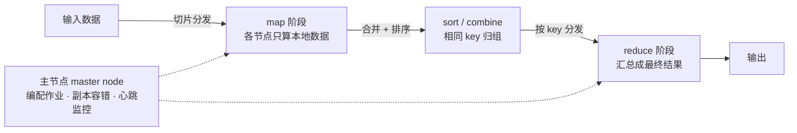
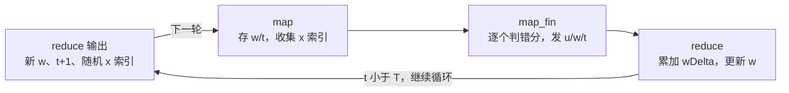

# 第 15 章 大数据与MapReduce

> **本章解决**：数据大到单机跑不动怎么办——MapReduce 把一个计算作业拆成许多小份分发到集群各节点并行计算，再把结果汇总，单机跑几天的活压缩到个把小时。
> 配套解决"上哪找机器"（AWS 按小时租用，EMR 一键起 Hadoop 集群）和"多步作业怎么自动化"（mrjob），最后用 Pegasos 算法把 SVM 训练改写成 MapReduce 作业，在大规模文档分类上落地。

常听人说："兄弟，你举的例子是不错，但我的数据太大了！"工作中使用的数据集往往比书里的例子大很多：大量设备连上互联网、用户又偏爱基于数据的决策，收集到的数据早已超出单机的处理能力。幸运的是，开源软件提供了海量数据处理的解决方案，其中一个就是 **Hadoop**——Java 编写的 MapReduce 框架免费开源实现，支持在大量机器上分布式处理数据。

假想你在一家网络购物商店工作：很多用户访问网站，有人下单、有人逛完就走。你想识别有购物意愿的用户，办法是翻 Web 服务器日志，找出每个人访问过的网页；日志里可能还记录了其他行为，可以拿这些行为训练分类器。问题在于数据集可能非常大，单机训练要好几天。本章的工具就是冲着这类问题来的。

本章四块内容：MapReduce 与 Hadoop 项目 → 用 Python 编写 MapReduce 作业（先单机测试，再上 AWS 并行执行）→ MapReduce 上做机器学习的一般方案 + 自动化框架 mrjob → 用 mrjob 构建分布式 SVM，在大量机器上并行训练分类器。

!!! note "本章内容"
    - MapReduce
    - Python 中 Hadoop 流的使用
    - 使用 mrjob 库将 MapReduce 自动化
    - 利用 Pegasos 算法并行训练支持向量机

## 15.0 本章导图

<div class="brtree">
  <div class="brrow">
    <span class="brlabel root">大数据与 MapReduce</span>
    <span class="brace"></span>
    <div class="brkids">
      <div class="brrow">
        <span class="brlabel">MapReduce 框架</span>
        <span class="brace"></span>
        <div class="brkids">
          <span class="brleaf">Google 2004 年提出，专利在 Google</span>
          <span class="brleaf">作业切片 → map → 合并排序 → reduce</span>
          <span class="brleaf">数据以 key/value 对传递</span>
          <span class="brleaf">主节点编配作业、副本容错、心跳监控</span>
        </div>
      </div>
      <div class="brrow">
        <span class="brlabel">Hadoop 流</span>
        <span class="brace"></span>
        <div class="brkids">
          <span class="brleaf">Hadoop：Java 开源的 MapReduce 实现</span>
          <span class="brleaf">自带分布式文件系统 HDFS</span>
          <span class="brleaf">像 Unix 管道一样串起 mapper 与 reducer</span>
          <span class="brleaf">先单机管道测试，再上集群</span>
        </div>
      </div>
      <div class="brrow">
        <span class="brlabel">AWS 与 EMR</span>
        <span class="brace"></span>
        <div class="brkids">
          <span class="brleaf">S3 存数据，EC2 租服务器</span>
          <span class="brleaf">EMR：简化 Hadoop 作业的启动</span>
          <span class="brleaf">按量计费，租 1000 台也只付几天</span>
        </div>
      </div>
      <div class="brrow">
        <span class="brlabel">mrjob 自动化</span>
        <span class="brace"></span>
        <div class="brkids">
          <span class="brleaf">Yelp 内部框架，2010 年底开源</span>
          <span class="brleaf">mapper 与 reducer 写进同一个脚本</span>
          <span class="brleaf">steps() 定制 map-reduce 链</span>
          <span class="brleaf">一行参数切换单机 / EMR</span>
        </div>
      </div>
      <div class="brrow">
        <span class="brlabel">MapReduce 上的机器学习</span>
        <span class="brace"></span>
        <div class="brkids">
          <span class="brleaf">朴素贝叶斯：加法天然可并行</span>
          <span class="brleaf">kNN：树缩小搜索，高维用 LSH</span>
          <span class="brleaf">SVM 用 Pegasos，SVD 用 Lanczos</span>
          <span class="brleaf">K-均值先用 canopy 取初始簇</span>
        </div>
      </div>
      <div class="brrow">
        <span class="brlabel">分布式 Pegasos</span>
        <span class="brace"></span>
        <div class="brkids">
          <span class="brleaf">内积可并行，w 更新不能并行</span>
          <span class="brleaf">mapper 判错分，reducer 累加更新</span>
          <span class="brleaf">steps 列表乘迭代次数，链式作业</span>
        </div>
      </div>
    </div>
  </div>
</div>

## 15.1 MapReduce：分布式计算的框架

| MapReduce | |
| --- | --- |
| 优点 | 可在短时间内完成大量工作 |
| 缺点 | 算法必须经过重写，需要对系统工程有一定的理解 |
| 适用数据类型 | 数值型和标称型数据 |

MapReduce 是一个软件框架，可以将单个计算作业分配给多台计算机执行。它假定这些作业在单机上需要很长的运行时间，因此用多台机器缩短运行时间——常见的例子是日常统计数字的汇总，单机执行要超过一整天。

尽管有人声称独立开发过类似的框架，美国还是把 MapReduce 的专利颁发给了 Google。Google 的 Jeffrey Dean 和 Sanjay Ghemawat 在 2004 年的论文《MapReduce: Simplified Data Processing on Large Clusters》中第一次提出了这个思想。MapReduce 的名字由函数式编程中常用的 map 和 reduce 两个单词组成。

MapReduce 在大量节点组成的集群上运行。工作流程：单个作业被分成很多小份，输入数据也被切片分发到每个节点，各节点只在本地数据上做运算，对应的运算代码称为 mapper，这个过程被称作 map 阶段；每个 mapper 的输出通过某种方式组合（一般还会做排序），排序后的结果再被分成小份分发到各个节点进行下一步处理，第二步的处理阶段被称为 reduce 阶段，对应的运行代码被称为 reducer。reducer 的输出就是程序的最终执行结果。



MapReduce 的优势在于程序以并行方式执行：如果集群由 10 个节点组成，原先的作业需要 10 个小时，那么应用 MapReduce 后，一个多小时就能得到同样的结果。举个例子：给出过去 100 年内中国每个省每天的正确气温数据（格式 `<province><date><temp>`），想知道近 100 年中国国内的最高气温——先把数据按节点数分成很多份，每个节点各自寻找本机数据上的最高温度，每个 mapper 产生一个形如 `<"max"><temp>` 的输出（所有 mapper 都用相同的 key："max"），最后只需一个 reducer 比较所有 mapper 的输出，就得到全局最高温。

!!! note "注意：mapper 之间、reducer 之间不通信"
    任何时候，每个 mapper 或 reducer 之间都不进行通信。每个节点只处理自己的事务，且只在本地分配的数据集上运算。（译者注：这是指 mapper 各自之间不通信、reducer 各自之间不通信，而 reducer 会接收 mapper 生成的数据。）

不同类型的作业可能需要不同数目的 reducer。回到气温例子，这次要找**每年**的最高温度：mapper 应先找到每年的最大温度并输出，中间数据形如 `<year><temp>`；还要保证同一年的数据都传给同一个 reducer——这由 map 和 reduce 中间的 sort 阶段完成。这里体现了 MapReduce 值得注意的一点：数据以 key/value 对的形式传递，年代（year）是 key，温度（temp）是 value。sort 阶段按年代分类、之后合并，最终每个 reducer 收到相同 key 的数据。

从上述例子可以看出，reducer 的数量并不是固定的。MapReduce 框架中还有其他灵活的配置选项：整个编配工作由**主节点（master node）**控制，包括每份数据存放的节点位置、map/sort/reduce 等阶段的时序控制等；主节点还要包含容错机制——一般地，每份 mapper 的输入数据会同时分发到多个节点形成多份副本，用于事务的失效处理。一个 MapReduce 集群的示意图如图 15-1。

<figure>
  
  <figcaption>图 15-1 MapReduce 框架的示意图。该集群中有 3 台双核机器，如果机器 0 失效，作业仍可以正常继续（截自原书）</figcaption>
</figure>

图 15-1 的每台机器都有两个处理器，可以同时处理两个 map 或者 reduce 任务。如果机器 0 在 map 阶段宕机，主节点会发现这一点，将机器 0 移出集群，并在剩余节点上继续执行作业。一些 MapReduce 的实现会在多个机器上保存数据的多个备份（例如机器 0 上的输入数据在机器 1 上还有一份），以防机器 0 出现问题。同时，每个节点都必须与主节点通信，表明自己工作正常；如果某节点失效或工作异常，主节点将重启该节点或者将其移出可用机器池。

总结上面几个例子中关于 MapReduce 的学习要点：

1. 主节点控制 MapReduce 的作业流程；
2. MapReduce 的作业可以分成 map 任务和 reduce 任务；
3. map 任务之间不做数据交流，reduce 任务也一样；
4. 在 map 和 reduce 阶段中间，有一个 sort 或 combine 阶段；
5. 数据被重复存放在不同的机器上，以防某个机器失效；
6. mapper 和 reducer 传输的数据形式为 key/value 对。

Apache 的 Hadoop 项目是 MapReduce 框架的一个实现。下一节讨论 Hadoop，并介绍如何在 Python 中使用它。

!!! note "拓展：函数式编程里的 map 与 reduce"
    map/reduce 这两个词来自函数式编程：map 对集合的每个元素施加同一个函数，reduce 把集合归约为一个值（Python 内置的 `map()` 和 `functools.reduce()` 就是它俩）。MapReduce 框架借用的正是这个抽象——只要你的计算能写成"先逐块映射、再归约"的形式，框架就能替你处理分发、排序、容错这些脏活。另外 Hadoop 这个名字也不是缩写，是创始人 Doug Cutting 儿子玩具大象的名字。

## 15.2 Hadoop流

Hadoop 是一个开源的 Java 项目，为运行 MapReduce 作业提供了大量所需的功能。除了分布式计算之外，Hadoop 自带分布式文件系统（HDFS，Hadoop Distributed File System）。

本书既不是 Java 也不是 Hadoop 的教材，本节只对 Hadoop 做简单介绍，满足"在 Python 中用 Hadoop 执行 MapReduce 作业"的需求即可。想深入理解可以读《Hadoop 实战》（Chuck Lam, *Hadoop in Action*）或浏览 Hadoop 官方文档（http://hadoop.apache.org/ ）；*Mahout in Action* 一书也为在 MapReduce 下实现机器学习算法提供了很好的参考。

Hadoop 可以运行 Java 之外的其他语言编写的分布式程序。Hadoop 流（Hadoop streaming，http://hadoop.apache.org/common/docs/current/streaming.html ）很像 Linux 系统中的**管道（pipe，符号 `|`，把一个命令的输出作为另一个命令的输入）**。如果用 mapper.py 调用 mapper、用 reducer.py 调用 reducer，那么 Hadoop 流就可以像 Linux 命令一样执行，例如：

```text
cat inputFile.txt | python mapper.py | sort | python reducer.py > outputFile.txt
```

这样，类似的 Hadoop 流就可以在多台机器上分布式执行，用户可以通过 Linux 命令来测试 Python 语言编写的 MapReduce 脚本。

!!! note "拓展：为什么「管道测试」等价于「集群调试」"
    Hadoop 流在真实集群上运行的就是这条命令的"放大版"：`hadoop jar ...streaming.jar -mapper "python mapper.py" -reducer "python reducer.py"`，框架负责把数据切片、分发、按 key 排序归组。也就是说，mapper 和 reducer 从 stdin 读、往 stdout 写的约定在单机和集群上完全一致——先用 Unix 管道在单机跑通，等于用零成本排掉了九成的代码错误。

### 15.2.1 分布式计算均值和方差的 mapper

接下来构建一个海量数据上分布式计算均值和方差的 MapReduce 作业。示范起见，只选了一个小数据集。在文本编辑器中创建文件 mrMeanMapper.py，加入程序清单 15-1 的代码。

```python
# ===== 书 15.2.1 节 程序清单15-1：分布式均值和方差计算的 mapper（Py3 版） =====
import sys
from numpy import array, mean, power      # 原书用 mat：numpy 2.x 已移除该别名

def read_input(file):
    for line in file:
        yield line.rstrip()

input = read_input(sys.stdin)          # 从标准输入流读取数据
input = [float(line) for line in input]
numInputs = len(input)                 # 本节点分到的样本数
input = array(input)                   # 原书：input = mat(input)
sqInput = power(input, 2)              # 对所有的值平方

print("%d\t%f\t%f" % (numInputs, mean(input), mean(sqInput)))   # 发送均值和平方均值
print("report: still alive", file=sys.stderr)   # 向标准错误输出发送报告
```

这是一个很简单的例子：mapper 首先按行读取所有的输入并创建一组对应的浮点数，然后得到数组的长度并创建 NumPy 矩阵，再对所有的值进行平方，最后将均值和平方后的均值发送出去。这些值将用于计算全局的均值和方差。

!!! note "注意"
    一个好的习惯是向标准错误输出发送报告。如果某作业 10 分钟内没有报告输出，则将被 Hadoop 中止。

下面看看程序清单 15-1 的运行效果。先确认下载源码中的文件 inputFile.txt（包含 100 个数）。正式使用 Hadoop 之前，先测试 mapper。Linux 终端执行：

```text
cat inputFile.txt | python mrMeanMapper.py
```

Windows 系统下在 DOS 窗口输入：

```text
python mrMeanMapper.py < inputFile.txt
```

原书的运行结果如下：

```text
100	0.509570	0.344439
report: still alive
```

其中第一行是标准输出，也就是 reducer 的输入；第二行是标准错误输出，即对主节点做出的响应报告，表明本节点工作正常。

!!! note "拓展：为什么只传三个数"
    100 个数经过 mapper，只剩"样本数、均值、平方均值"三个数——而且无论分到 mapper 的数据多大，输出永远是 3 个数。这是 MapReduce 上做统计的通用套路：均值、方差、计数这类**可加统计量**可以先在每个分块上算出"充分统计量"，reducer 只汇总这些小结果，原始数据从不需要在机器之间搬运。后面 15.6 的 Pegasos 也是同样的思路——机器间只传权重向量和样本索引，不传整个数据集。

### 15.2.2 分布式计算均值和方差的 reducer

mapper 已经可以工作了，下面介绍 reducer。mapper 接受原始的输入并产生中间值传递给 reducer；很多 mapper 是并行执行的，所以需要将这些 mapper 的输出合并成一个值。reducer 的代码就是将中间的 key/value 对进行组合。创建文件 mrMeanReducer.py，输入程序清单 15-2 的代码。

```python
# ===== 书 15.2.2 节 程序清单15-2：分布式均值和方差计算的 reducer（Py3 版） =====
import sys

def read_input(file):
    for line in file:
        yield line.rstrip()

input = read_input(sys.stdin)
mapperOut = [line.split('\t') for line in input]   # 每行 [样本数, 均值, 平方均值]
cumVal = 0.0      # 累加 Σ nj·均值j，即全局和
cumSumSq = 0.0    # 累加 Σ nj·平方均值j，即全局平方和
cumN = 0.0        # 累加全局样本数
for instance in mapperOut:
    nj = float(instance[0])
    cumN += nj
    cumVal += nj*float(instance[1])     # nj×均值 = 该块的和
    cumSumSq += nj*float(instance[2])   # nj×平方均值 = 该块的平方和

mean = cumVal/cumN
varSum = (cumSumSq - 2*mean*cumVal + cumN*mean*mean)/cumN
print("%d\t%f\t%f" % (cumN, mean, varSum))
print("report: still alive", file=sys.stderr)
```

程序清单 15-2 就是 reducer 的代码：它接收程序清单 15-1 的输出，并把它们合并成为全局的均值和方差。方差的合并基于一个恒等变形：

\[
\mathrm{Var}(X) \;=\; \frac{\sum_j n_j\,\overline{x_j^2} \;-\; 2\bar{x}\sum_j n_j\bar{x}_j \;+\; N\bar{x}^2}{N} \;=\; \overline{x^2} - \bar{x}^2
\]

其中 \(n_j\)、\(\bar{x}_j\)、\(\overline{x_j^2}\) 分别是第 \(j\) 个 mapper 分到的样本数、均值、平方均值，\(N=\sum_j n_j\) 是全局样本数，\(\bar{x}\) 是全局均值。reducer 只用各块的三个数就把全局方差凑了出来，不需要见过任何一个原始数据点。

你可以在自己的单机上用下面的命令测试一下：

```text
%cat inputFile.txt | python mrMeanMapper.py | python mrMeanReducer.py
```

如果是 DOS 环境，键入如下命令：

```text
%python mrMeanMapper.py < inputFile.txt | python mrMeanReducer.py
```

本站用自生成的 100 个数实跑了这条管道（不需要 Hadoop，纯 Python），并与 numpy 直接全量计算对照：

```text
$ python mrMeanMapper.py < inputFile.txt
100	0.479569	0.316144      ← 标准输出（reducer 的输入）
report: still alive              ← 标准错误（发给主节点的心跳）

$ python mrMeanMapper.py < inputFile.txt | sort | python mrMeanReducer.py
100	0.479569	0.086158        ← reducer 输出：样本数、均值、方差
report: still alive

对照 numpy 一次性全量计算：
100	0.479569	0.086157        ← 与管道结果一致（末位差异来自浮点舍入）
```

!!! warning "原书笔误：最终输出里的 0.344439 不是方差"
    原书 281 页说 EMR 上 reducer 的输出文件 part-00000 内容是 `100 0.509570 0.344439`，并称"与单机上用管道得到的测试结果一样"。但 0.344439 恰好是 **mapper 的平方均值**（mapper 输出三个数：样本数、均值、平方均值），而按程序清单 15-2 的逻辑，reducer 输出的第三个数应是**方差** = 平方均值 − 均值² ≈ 0.344439 − 0.50957² ≈ **0.084778**。286 页 mrjob 版的最终输出 `0.50956970000000001 0.34443931307935999` 同样把平方均值当成了第二个输出值。本站按书代码实跑管道，输出的正是方差——两处截图应更正为 ≈0.0848。

后面的章节将介绍如何在多台机器上分布式运行该代码。你手边或许没有 10 台机器，没有问题，下节就会介绍如何租用服务器。

## 15.3 在Amazon网络服务上运行Hadoop程序

如果要在 100 台机器上同时运行 MapReduce 作业，就需要找到 100 台机器——可以购买，或者租用。Amazon 公司通过 **Amazon 网络服务（Amazon Web Services，AWS，http://aws.amazon.com/ ）**，将它的大规模计算基础设施租借给开发者。

AWS 提供网站、流媒体、移动应用等类似的服务，其中存储、带宽和计算能力按价收费，用户仅为使用的部分按时缴费，无需长期合同。这种"仅为所需买单"的形式使得 AWS 很有诱惑力：当你临时需要 1000 台机器时，可以在 AWS 上申请并做几天实验；几天后发现当前方案不可行，就即时关掉，不需要再为这 1000 台机器支出任何费用。本节先介绍 AWS 上可用的服务，然后介绍运行环境的搭建方法，最后给出一个在 AWS 上运行 Hadoop 流作业的例子（后面章节的练习将花费大约 1 美元的费用）。

### 15.3.1 AWS上的可用服务

AWS 上提供了大量可用的服务：行内人士看来名字很好理解，新手看来则比较神秘。AWS 还在不停地演变，不断添加新服务。下面是几个基本的、稳定的服务：

| 服务 | 全称 | 一句话说明 |
| --- | --- | --- |
| S3 | 简单存储服务（Simple Storage Service） | 在网络上存储数据，需要与其他 AWS 产品配合使用；按数据量大小及存储时间付费 |
| EC2 | 弹性计算云（Elastic Compute Cloud） | 使用服务器镜像的服务，很多 AWS 系统的核心；服务器镜像几分钟内即可启动，可创建、存储、共享镜像；"弹性"指能根据需求迅速增加服务数量 |
| EMR | 弹性 MapReduce（Elastic MapReduce） | AWS 的 MapReduce 实现，搭建在稍旧版本的 Hadoop 之上（Amazon 希望保持版本稳定，未用最新 Hadoop）；提供很好的 GUI，简化 Hadoop 任务的启动，免去集群琐碎配置（如 Hadoop 系统的文件导入或 Hadoop 机器的参数修改）；可运行 Java 作业或 Hadoop 流作业 |

本书将着重介绍 EMR，另外还需用到 S3 服务，因为 EMR 需要从 S3 上读取文件并启动安装 Hadoop 的 EC2 服务器镜像。

!!! note "拓展：2020 年代的 AWS / EMR 长什么样"
    本章截图全部来自 2011 年的 AWS 控制台，如今界面已彻底改版，但服务骨架没变。变化主要有：(1) 控制台从"选项卡"变成统一 AWS 管理界面，EMR 的"作业流（job flow）"改叫"集群（cluster）"，新建集群时可以直接选 Spark、Hive、Trino 等应用，Hadoop 只是其中一种引擎；(2) 计费粒度更细（按实例秒计费，还有竞价实例等玩法），跑完记得释放集群，否则一直计费；(3) Hadoop 流的 URI 从 `s3n://` 换成了 `s3://`（老协议早已停用），EMR 现在更多用 `aws emr add-steps` 命令行或 SDK 提交步骤，而不是网页表单。读本章时把"表单字段"理解成"提交作业时要填的参数"即可，思路完全通用。

### 15.3.2 开启Amazon网络服务之旅

使用 AWS 之前，首先需要创建 AWS 账号，开通账号还需要一张信用卡。打开 http://aws.amazon.com/ 可以看到图 15-2 所示的界面，右上角有"现在注册（Sign Up Now）"按钮。点击后按照指令进行，经过三个页面就可以完成 AWS 的注册。**注意，你需要注册 S3、EC2 和 EMR 三项服务。**

<figure>
  
  <figcaption>图 15-2 http://aws.amazon.com/ 页面右上部给出了注册 AWS 账号的按钮（截自原书）</figcaption>
</figure>

建立了 AWS 账号后，登录进 AWS 控制台并点击 EC2、Elastic MapReduce 和 S3 选项卡，确认你是否已经注册了这些服务。如果没有注册某项服务，会看到如图 15-3 所示的提示。

<figure>
  
  <figcaption>图 15-3 服务未注册时的 AWS 控制台提示信息。如果浏览器在 S3、EC2 和 Elastic MapReduce 服务页面也有相应提示，请注册这些服务（截自原书）</figcaption>
</figure>

这样就做好了在 Amazon 集群上运行 Hadoop 作业的准备，下一节介绍在 EMR 上运行 Hadoop 的具体流程。

### 15.3.3 在EMR上运行Hadoop作业

注册了所需的 Amazon 服务之后，登录 AWS 控制台并点击 S3 选项卡，把文件上传上去，以便 AWS 能找到我们提供的文件：

1. 首先需要创建一个新的 **bucket**（可以把它看做一个驱动器），例如创建一个叫做 rustbucket 的 bucket。注意，bucket 的名字是唯一的，所有用户均可使用，你应当为自己的 bucket 创建独特的名字。
2. 然后创建两个文件夹：mrMeanCode 和 mrMeanInput。将之前用 Python 编写的 MapReduce 代码上传到 mrMeanCode，另一个目录 mrMeanInput 用于存放 Hadoop 作业的输入。
3. 在已创建的 bucket（如 rustbucket）中上传文件 inputFile.txt 到 mrMeanInput 目录。
4. 将文件 mrMeanMapper.py 和 mrMeanReducer.py 上传到 mrMeanCode 目录。这样就完成了全部所需文件的上传，做好了在多台机器上启动第一个 Hadoop 作业的准备。
5. 点击 Elastic MapReduce 选项卡，点击"创建新作业流（Create New Job Flow）"按钮，并将作业流命名为 mrMean007。在屏幕下方还有两个复选框和一个下拉框，选择"运行自己的应用程序（Run Your Own Application）"并点击"继续（Continue）"进入下一步。

<figure>
  
  <figcaption>图 15-4 EMR 的新作业流创建页面（截自原书）</figcaption>
</figure>

6. 这一步需要设定 Hadoop 的输入参数，如果设置错误，作业将会执行失败。在"指定参数（Specify Parameters）"页面的对应字段上输入下面的内容（"其他参数（Extra Args）"字段可以留空，它的作用是指定一些其他参数，如 reducer 的数量）：

| 字段 | 填入内容 |
| --- | --- |
| Input Location* | `<your bucket name>/mrMeanInput/inputFile.txt` |
| Output Location* | `<your bucket name>/mrMean007Log` |
| Mapper* | `"python s3n://<your bucket name>/mrMeanCode/mrMeanMapper.py"` |
| Reducer* | `"python s3n://<your bucket name>/mrMeanCode/mrMeanReducer.py"` |
| Extra Args | 留空（可选：reducer 数量等参数） |

<figure>
  
  <figcaption>图 15-5 EMR 的指定参数页面（截自原书）</figcaption>
</figure>

7. 下一个页面设定 EC2 的服务器镜像：这里设定用于存储数据的服务器数量，默认值是 2，可以改成 1；也可以按需要改变 EC2 服务器镜像的类型，申请大内存高运算能力的机器（当然也花费更多）。实际上，大的作业经常在大的服务器镜像上运行（详见 http://aws.amazon.com/ec2/#instance ），本节的简单例子选用很小的机器即可。

8. 下一个是"高级选项（Advanced Options）"页面，可以设定有关调试的一些选项。**务必打开日志选项**，在"亚马逊 S3 日志路径（Amazon S3 Log Path）"里添加 `s3n://<your bucket name>/mrMean007DebugLog`。只有注册 SimpleDB 才能开启 Hadoop 调试服务，它是 Amazon 的访问非关系数据库的简单工具——虽然开启了该服务，但本书不准备用它来调试 Hadoop 流作业。当一个 Hadoop 作业失败，会有一些失败信息写入上述目录，回头读一下这些信息就可以分析在哪里出了问题。

<figure>
  
  <figcaption>图 15-6 设定 EMR 的 EC2 服务器镜像的页面，在该页面上可以设定 MapReduce 作业所需的服务器类型和服务器数量（截自原书）</figcaption>
</figure>

<figure>
  
  <figcaption>图 15-7 EMR 的高级选项页面，可以设定调试文件的存放位置，也可以设定继续自动运行机制。作业失败还可以设定登录服务器所需的登录密钥。如果想检查代码的运行环境，登录服务器再查看是个很好的办法（截自原书）</figcaption>
</figure>

9. 关键的设置已经完成，接下来的引导页面使用默认设定，一直点"下一步（Next）"到查看（Review）页面，检查所有配置是否正确，然后点击底部的"创建作业流（Create Job Flow）"按钮。新任务就创建好了，在下一个页面点击"关闭（Close）"按钮将返回 EMR 控制台。当作业运行的时候，可以在控制台看到其运行状态。不必担心运行这样一个小作业花费了这么多时间，因为这里包含了新的服务器镜像的配置。最终页面如图 15-8 所示（可能你那里不会有这么多的失败作业）。

<figure>
  
  <figcaption>图 15-8 EMR 控制台显示出了一些 MapReduce 作业，本章的 MapReduce 作业已经在这张图中启动（截自原书）</figcaption>
</figure>

新建的任务将在开始运行几分钟之后完成。点击控制台顶端的 S3 选项卡观察 S3 的输出：选中 S3 控制台后，点击之前创建的 bucket（本例中是 rustbucket），里面应该可以看到一个 mrMean007Log 目录；双击打开该目录，可以看到一个文件 part-00000，该文件就是 reducer 的输出。双击下载到本地，用文本编辑器打开——这个结果应与单机管道的结果一致（提示：按书代码正确运行时，输出的第三个数应是方差 ≈0.0848，见 15.2.2 的勘误说明）。

如果结果不正确，应当怎样找到问题所在呢？退回到 EMR 选项卡，点击"已经完成的任务（Completed Job）"，可以看到"调试（Debug）"按钮，上面还有一个绿色小昆虫的动画。点击该按钮将打开调试窗口，可以访问不同的日志文件；另外，点击"控制器（Controller）"超链接，可以看到 Hadoop 命令和 Hadoop 版本号。

现在我们已经运行了一个 Hadoop 流作业，下面将介绍如何在 Hadoop 上执行机器学习算法。MapReduce 可以在多台机器上运行很多程序，但这些程序需要做一些修改。

!!! note "拓展：不使用AWS——本地 Hadoop 四步走"
    如果不希望使用信用卡，或者怕泄露信用卡信息，也能在本地机器上运行同样的作业（前提是已安装 Hadoop，参见 http://hadoop.apache.org/common/docs/stable/#Getting+Started ）：

    ```text
    # (1) 将文件复制到 HDFS（Hadoop 的分布式文件系统）
    >hadoop fs -copyFromLocal inputFile.txt mrmean-i

    # (2) 启动任务：streaming.jar 指定输入、输出、mapper 与 reducer
    >hadoop jar $HADOOP_HOME/contrib/streaming/hadoop-0.20.2-streaming.jar \
        -input mrmean-i -output mrmean-o \
        -mapper "python mrMeanMapper.py" -reducer "python mrMeanReducer.py"

    # (3) 观察结果
    >hadoop fs -cat mrmean-o/part-00000

    # (4) 下载结果到本地，完成
    >hadoop fs -copyToLocal mrmean-o/part-00000 .
    ```

## 15.4 MapReduce上的机器学习

在 10 台机器上使用 MapReduce 并不能等价于当前机器 10 倍的处理能力。在 MapReduce 代码编写合理的情况下，可能会近似达到这样的性能，但不是每个程序都可以直接提速的，map 和 reduce 函数需要正确编写才行。

很多机器学习算法不能直接用在 MapReduce 框架上。这也没关系，正如老话所说："需求是发明之母。"科学家和工程师中的一些先驱已完成了大多数常用机器学习算法的 MapReduce 实现。本书常用算法对应的 MapReduce 实现思路如下：

| 算法 | MapReduce 上的实现思路 |
| --- | --- |
| 朴素贝叶斯 | 为数不多的可以很自然地使用 MapReduce 的算法：在 MapReduce 中计算加法非常容易，而朴素贝叶斯正需要统计某个类别下某特征的概率。将每个指定类别下的计算作业交由单个 mapper 处理，再用 reducer 将结果加和 |
| k-近邻算法 | 首先试图在数据集上找到相似向量，即便数据集很小，这个步骤也将花费大量的时间；海量数据下，它将极大地影响日常商业周期的运转。提速办法是构建树来存储数据，利用树形结构缩小搜索范围（特征数小于 10 时效果很好）；高维数据（文本、图像、视频）下流行的近邻查找方法是**局部敏感哈希（locality sensitive hashing，LSH）** |
| 支持向量机（SVM） | 第 6 章的 Platt SMO 算法在 MapReduce 框架下难以实现；但有一些其他 SVM 实现使用随机梯度下降算法求解，如 Pegasos 算法。另外还有一个近似的 SVM 算法叫**最邻近支持向量机（proximal SVM，PSVM）**，求解更快并且易于在 MapReduce 框架下实现 |
| 奇异值分解 | **Lanczos 算法**是有效的求解近似特征值的算法，可以应用在一系列 MapReduce 作业上，从而有效地找到大矩阵的奇异值；另外该算法还可以应用于主成分分析 |
| K-均值聚类 | 流行的分布式聚类方法叫做 **canopy 聚类**：先调用 canopy 聚类法取得初始的 k 个簇，然后再运行 K-均值聚类方法 |

!!! note "拓展：PSVM 补充"
    书中脚注给出的 PSVM 出处是 Glenn Fung 与 Olvi L. Mangasarian 的论文《PSVM: Proximal Support Vector Machine》（http://www.cs.wisc.edu/dmi/svm/psvm/ ）。它的核心是把 SVM 改写成一次线性方程组的求解，避开迭代式的二次规划，因此特别适合按行切分数据、分布式求解。

如果想了解更多机器学习方法的 MapReduce 实现，可以访问 Apache 的 Mahout 项目主页（http://mahout.apache.org/ ）并参考 *Mahout in Action* 一书：Mahout 项目以 Java 语言编写，该书对处理大规模数据的实现细节做了很详细的介绍。另一个关于 MapReduce 的很棒的资源是 Jimmy Lin 和 Chris Dyer 写的 *Data Intensive Text Processing with Map/Reduce*。

上面列举的算法大多是**迭代的**——它们不能用一次 MapReduce 作业来完成，而通常需要多步。15.3 节在 Amazon 的 EMR 上运行 MapReduce 作业只是一个简例：如果想在大数据集上运行 AdaBoost 算法该怎么办？如果想运行 10 个 MapReduce 作业呢？（下一节的 mrjob 就是为此而来。）

## 15.5 在Python中使用mrjob来自动化MapReduce

有一些框架可以将 MapReduce 作业流自动化，例如 **Cascading** 和 **Oozie**，但它们不支持在 Amazon 的 EMR 上执行。**Pig** 可以在 EMR 上执行，也可以使用 Python 脚本，但需要额外学习一种脚本语言（Pig 是一个 Apache 项目，为文本处理提供高级编程语言，可以将文本处理命令转换成 Hadoop 的 MapReduce 作业）。还有一些工具可以在 Python 中运行 MapReduce 作业，如本书将要介绍的 **mrjob**。

mrjob（文档：http://packages.python.org/mrjob/index.html ；源代码：https://github.com/Yelp/mrjob ）之前是 Yelp（一个餐厅点评网站）的内部框架，它在 2010 年底实现了开源。读者可以参考附录 A 学习如何安装和使用（本站笔记不实际安装 mrjob，代码保持 mrjob API 写法并做 Py3 兼容标注）。本书将用 mrjob 重写之前的全局均值和方差计算的代码，相信读者能体会到 mrjob 的方便快捷。需要指出的是，mrjob 是一个很好的学习工具，但仍然使用 Python 语言编写，如果想获得更好的性能，应该使用 Java。

!!! note "拓展：mrjob 的今天"
    mrjob 后来成了 Python 生态里跑 Hadoop/EMR 最省心的库之一，但 Yelp 已于 2020 年前后停止了它的积极维护，项目仓库现处于归档状态，对新版 Python 的支持也不再更新。如今生产环境里同样的需求大多交给 **Spark（PySpark）**等引擎。不过这不影响本章代码的学习价值：MRJob 类、steps()、mapper_final 这些抽象把 MapReduce 的协作模式讲得非常清楚，思想在哪个框架里都通用。

### 15.5.1 mrjob与EMR的无缝集成

与 15.3 节介绍的一样，本节将使用 mrjob 在 EMR 上运行 Hadoop 流，区别在于 **mrjob 不需要上传数据到 S3，也不需要担心命令输入是否正确，所有这些都由 mrjob 后台完成**。有了 mrjob，读者还可以在自己的 Hadoop 集群上运行 MapReduce 作业，当然也可以在单机上进行测试。作业在单机执行和在 EMR 执行之间的切换十分方便，例如，将一个作业在单机执行，可以输入以下命令：

```text
% python mrMean.py < inputFile.txt > myOut.txt
```

如果要在 EMR 上运行同样的任务，可以执行以下命令：

```text
% python mrMean.py -r emr < inputFile.txt > myOut.txt
```

15.3 节中，所有的上传以及表单填写全由 mrjob 自动完成。除了上面两条命令之外，再加一条就可以在本地的 Hadoop 集群上执行作业，也可以添加一些命令行参数来指定本作业在 EMR 上的服务器类型和数目。另外，15.3 节中的 mapper 和 reducer 分别存于两个不同的文件中，而 mrjob 中的 mapper 和 reducer 可以写在**同一个脚本**中。下节展示该脚本的内容，并分析其工作原理。

### 15.5.2 mrjob的一个MapReduce脚本剖析

用 mrjob 可以做很多事情，本书仍从最典型的 MapReduce 作业开始介绍。为方便阐述，继续沿用前面的例子——计算数据集的均值和方差，这样读者可以更专注于框架的实现细节。程序清单 15-3 的代码与程序清单 15-1 和程序清单 15-2 的功能一致。打开文本编辑器，创建一个新文件 mrMean.py，加入下面的代码。

```python
# ===== 书 15.5.2 节 程序清单15-3：分布式均值方差计算的 mrjob 实现 =====
from mrjob.job import MRJob

class MRmean(MRJob):
    def __init__(self, *args, **kwargs):
        super(MRmean, self).__init__(*args, **kwargs)
        self.inCount = 0       # 本 mapper 收到的数据条数
        self.inSum = 0         # 数据和
        self.inSqSum = 0       # 数据平方和

    def map(self, key, val):                 # 接收输入数据流
        if False: yield                      # 技巧：使本方法成为生成器（见下方拓展）
        inVal = float(val)
        self.inCount += 1                    # 在 mapper 内积累统计量
        self.inSum += inVal
        self.inSqSum += inVal*inVal

    def map_final(self):                     # 所有输入到达后开始处理
        mn = self.inSum/self.inCount         # 本块均值
        mnSq = self.inSqSum/self.inCount     # 本块平方均值
        yield (1, [self.inCount, mn, mnSq])  # 统一 key=1，全部汇给同一个 reducer

    def reduce(self, key, packedValues):
        cumVal=0.0; cumSumSq=0.0; cumN=0.0
        for valArr in packedValues:          # 迭代器：逐个读取各 mapper 的输出
            nj = float(valArr[0])
            cumN += nj
            cumVal += nj*float(valArr[1])    # nj×均值 = 该块的和
            cumSumSq += nj*float(valArr[2])
        mean = cumVal/cumN
        var = (cumSumSq - 2*mean*cumVal + cumN*mean*mean)/cumN
        yield (mean, var)

    def steps(self):
        return ([self.mr(mapper=self.map, reducer=self.reduce, \
            mapper_final=self.map_final)])

if __name__ == '__main__':
    MRmean.run()
```

该代码分布式地计算了均值和方差：输入文本分发给很多 mappers 来计算中间值，这些中间值再通过 reducer 进行累加，从而计算出全局的均值和方差。

为了使用 mrjob 库，需要创建一个 MRJob 的继承类，本例中类名为 MRmean。代码中的 mapper 和 reducer 都是该类的方法，此外还有一个叫做 steps() 的方法定义了执行的步骤。执行顺序不必完全遵从于 map-reduce 的模式，也可以是 map-reduce-reduce-reduce，或者 map-reduce-map-reduce-map-reduce（下节会给出相关例子）。在 steps() 方法里，需要为 mrjob 指定 mapper 和 reducer 的名称；如果未给出，它将默认调用 mapper 和 reducer 方法。

首先看 mapper 的行为：它类似于 for 循环，在每行输入上执行同样的步骤。如果想在收到所有的输入之后进行某些处理，可以考虑放在 mapper_final 中实现——这乍看起来有些古怪，但非常实用。另外在 mapper() 和 mapper_final() 中还可以共享状态。所以在上述例子中，首先在 mapper() 中对输入值进行积累，所有值收集完毕后计算出均值和平方均值，最后把这些值作为中间值通过 yield 语句传出去。

中间值以 key/value 对的形式传递。如果想传出去多个中间值，一个好的办法是将它们打包成一个列表。这些值在 map 阶段之后会按照 key 来排序。Hadoop 提供了更改排序方法的选项，但默认的排序方法足以应付大多数的常见应用。拥有相同 key 的中间值将发送给同一个 reducer，因此你需要考虑 key 的设计，使得在 sort 阶段后相似的值能够收集在一起。这里所有的 mapper 都使用"1"作为 key，因为本书希望所有的中间值都在同一个 reducer 里加和起来。（译者注：只要所有 mapper 都使用相同的 key 就可以，不必是"1"，也可以是其他值。）

mrjob 里的 reducer 与 mapper 有一些不同之处：**reducer 的输入存放在迭代器对象里**。为了能读取所有的输入，需要使用类似 for 循环的迭代器。mapper 或 mapper_final 和 reducer 之间**不能共享状态**，因为 Python 脚本在 map 和 reduce 阶段中间没有保持活动。如果需要在 mapper 和 reducer 之间进行任何通信，那么只能通过 key/value 对。在 reducer 的最后有一条输出语句，该语句没有 key，因为输出的 key 值已经固定；如果该 reducer 之后不是输出而是执行另一个 mapper，那么 key 仍需要赋值。

!!! note "拓展：`if False: yield` 是什么魔法"
    Python 里只要函数体中出现了一次 `yield`，整个函数就变成了生成器函数——哪怕这行 `yield` 永远不会执行。mrjob 靠"是不是生成器"来区分普通方法与 mapper/reducer，所以书里用 `if False: yield` 给 map 方法"打上生成器标记"。它看起来像废代码，实际是框架的注册开关。

无须多言，下面看一下实际效果。先运行一下 mapper，在 Linux/DOS 的命令行输入下面的命令（注意不是在 Python 提示符下），其中的文件 inputFile.txt 在第 15 章的代码里：

```text
%python mrMean.py --mapper < inputFile.txt
```

原书运行该命令后，得到如下输出：

```text
1	[100, 0.50956970000000001, 0.34443931307935999]
```

含义：key 为 1，值是列表 [样本数 100, 本块均值 0.5095697…, 本块平方均值 0.3444393…]——正是 map_final yield 出去的中间值。

要运行整个程序，移除 --mapper 选项：

```text
%python mrMean.py < inputFile.txt
```

你将在屏幕上看到很多中间步骤的描述文字，最终的输出如下。按程序清单 15-3 的 reduce() 逻辑，输出的应是（均值，方差），即第二个数应为 ≈0.084778；原书截图显示的 `0.50956970000000001 0.34443931307935999` 把平方均值当成了第二个值，见 15.2.2 的勘误：

```text
0.50956970000000001	0.084778...
```

若想把有效输出流写进文件，输入如下命令：

```text
%python mrMean.py < inputFile.txt > outFile.txt
```

最后，要在 Amazon 的 EMR 上运行本程序，输入如下命令（确保你已经设定了环境变量 AWS_ACCESS_KEY_ID 和 AWS_SECRET_ACCESS_KEY，这些变量的设定见附录 A）：

```text
%python mrMean.py -r emr < inputFile.txt > outFile.txt
```

完成了 mrjob 的使用练习，下面将用它来解决一些机器学习问题。上文提到，一些迭代算法仅使用 EMR 难以完成，因此下一节将介绍如何用 mrjob 完成这项任务。

## 15.6 示例：分布式SVM的Pegasos算法

第 4 章介绍过一个文本分类算法：朴素贝叶斯，它将文本文档看做是词汇空间里的向量；第 6 章又介绍了效果很好的 SVM 分类算法，它将每个文档看做是成千上万个特征组成的向量。

在机器学习领域，海量文档上做文本分类面临很大的挑战：怎样在如此大的数据上训练分类器呢？如果能将算法分成并行的子任务，那么 MapReduce 框架有望帮我们实现这一点。回忆第 6 章，SMO 算法一次优化两个支持向量，并在整个数据集上迭代，在需要注意的值上停止——该算法看上去并不容易并行化。

!!! note "在MapReduce框架上使用SVM的一般方法"
    1. **收集数据**：数据按文本格式存放。
    2. **准备数据**：输入数据已经是可用的格式，所以不需任何准备工作。如果你需要解析一个大规模的数据集，建议使用 map 作业来完成，从而达到并行处理的目的。
    3. **分析数据**：无。
    4. **训练算法**：与普通的 SVM 一样，在分类器训练上仍需花费大量的时间。
    5. **测试算法**：在二维空间上可视化之后，观察超平面，判断算法是否有效。
    6. **使用算法**：本例不会展示一个完整的应用，但会展示如何在大数据集上训练 SVM。该算法其中一个应用场景就是文本分类，通常在文本分类里可能有大量的文档和成千上万的特征。

SMO 算法的一个替代品是 Pegasos 算法，后者可以很容易地写成 MapReduce 的形式。本节将分析 Pegasos 算法，介绍如何写出分布式版本的 Pegasos 算法，最后在 mrjob 中运行该算法。

### 15.6.1 Pegasos算法

Pegasos 是指**原始估计梯度求解器（Primal Estimated sub-GrAdient Solver）**。该算法使用某种形式的随机梯度下降方法来解决 SVM 所定义的优化问题。研究表明该算法所需的迭代次数取决于用户所期望的精确度而不是数据集的大小，有关细节可以参考原文（S. Shalev-Shwartz, Y. Singer, N. Srebro, "Pegasos: Primal Estimated sub-GrAdient SOlver for SVM," Proceedings of the 24th International Conference on Machine Learning 2007）。原文有长文和短文两个版本，推荐阅读长文。

第 6 章提到，SVM 算法的目的是找到一个分类超平面，在二维情况下也就是要找到一条直线，将两类数据分隔开来。Pegasos 算法的工作流程是：从训练集中随机挑选一些样本点添加到待处理列表中，之后按序判断每个样本点是否被正确分类；如果是则忽略，如果不是则将其加入到待更新集合。批处理完毕后，权重向量按照这些错分的样本进行更新。整个算法循环执行。

上述算法的伪代码如下：

```text
将 w 初始化为 0
对每次批处理：
    随机选择 k 个样本点（向量）
    对每个向量：
        如果该向量被错分：
            更新权重向量 w
            累加对 w 的更新
```

为了解实际效果，Python 版本的实现见程序清单 15-4（原书为 Python 2，下面是本站的 Py3 改写，差异处见注释）：

```python
# ===== 书 15.6.1 节 程序清单15-4：SVM 的 Pegasos 算法（串行版，Py3 改写） =====
import random
from numpy import shape, zeros, asmatrix as mat, array

def predict(w, x):
    return w*x.T                       # 内积：样本 x 的（带符号）预测值

def batchPegasos(dataSet, labels, lam, T, k):
    m, n = shape(dataSet); w = zeros(n)
    dataIndex = list(range(m))         # 原书写 range(m)：Py3 的 range 不支持 shuffle，
                                       # 必须先转 list（Py2/Py3 差异）
    for t in range(1, T+1):
        wDelta = mat(zeros(n))         # 待更新值累加器
        eta = 1.0/(lam*t)              # 学习率：随迭代衰减
        random.shuffle(dataIndex)      # 打乱后取前 k 个作为本批样本
        for j in range(k):
            i = dataIndex[j]
            p = predict(w, dataSet[i,:])
            if labels[i]*p < 1:        # 被错分（或落在间隔内）
                wDelta += labels[i]*dataSet[i,:].A   # 将待更新值累加
        w = (1.0 - 1/t)*w + (eta/k)*wDelta   # 批处理完毕，一次更新权重向量
    return w
```

程序清单 15-4 的代码是 Pegasos 算法的**串行版本**。输入值 T 和 k 分别设定了迭代次数和待处理列表的大小。在 T 次迭代过程中，每次需要重新计算 eta——它是学习率，代表了权重调整幅度的大小。在外循环中，需要选择另一批样本进行下一次批处理；在内循环中执行批处理，将分类错误的值全部累加之后更新权重向量。

用公式写出来，每次批处理后的更新是：

\[
\eta = \frac{1}{\lambda t}, \qquad
\mathbf{w} \;\leftarrow\; \left(1-\frac{1}{t}\right)\mathbf{w} \;+\; \frac{\eta}{k}\sum_{i \,\in\, \text{错分样本}} y_i\,\mathbf{x}_i
\]

注意 \(\eta\lambda = 1/t\)，所以系数 \((1-1/t)\) 其实就是 \((1-\eta\lambda)\)——这是"衰减旧权重、叠加错分样本梯度"的正则化更新：\(\lambda\) 越大，旧 w 衰减越快，模型越保守。

如果想试试它的效果，可以用第 6 章的数据来运行本例程序。本书不会对该代码做过多分析，它只为 Pegasos 算法的 MapReduce 版本做一个铺垫。下节将在 mrjob 中建立并运行一个 MapReduce 版本的 Pegasos 算法。

本站用内联合成的两团二维点（每类 100 个，lam=0.2、T=50、k=20）实跑了这段代码：训练错误率从 t=2 时的 7.5% 降到 t=50 时的 6.5%；2 次迭代的权重向量为 [3.46, -1.78]，50 次迭代后为 [0.85, -0.30]——方向不变、长度收敛（正则化把 w 往回拉），分类面从虚线位置旋转到了实线位置（图左），与原书图 15-9 的现象一致：

<figure>
  
  <figcaption>图 15-10 batchPegasos 实跑：左为 2 次/50 次迭代的分类面对比，右为训练错误率曲线（代码实跑）</figcaption>
</figure>

!!! note "拓展：Pegasos 为什么收敛快"
    上面更新式是标准的随机次梯度（sub-gradient）法：目标函数是"合页损失 + \(\frac{\lambda}{2}\|\mathbf{w}\|^2\)"，错分样本给出损失梯度，步长取 \(1/(\lambda t)\)。原论文证明了达到精度 \(\epsilon\) 所需的迭代次数是 \(O(1/\lambda\epsilon)\) 量级——只与目标精度和正则化强度有关，与样本量无关，这正是它适合大数据场景的原因（本章开头说"迭代次数取决于期望精确度而不是数据集的大小"就是这个意思）。

### 15.6.2 训练算法：用mrjob实现MapReduce版本的SVM

本节将用 MapReduce 来实现程序清单 15-4 的 Pegasos 算法，之后再用 15.5 节讨论的 mrjob 框架运行该算法。首先要明白如何将该算法划分成 map 阶段和 reduce 阶段，确认哪些可以并行，哪些不能并行。

对程序清单 15-4 的代码运行情况稍作观察将会发现：大量的时间花费在**内积计算**上；内积运算可以并行，但**创建新的权重变量 w 是不能并行的**。这就是将算法改写为 MapReduce 作业的一个切入点。在编写 mapper 和 reducer 的代码之前，先完成一部分外围代码。打开文本编辑器，创建一个新文件 mrSVM.py，在该文件中添加程序清单 15-5 的代码。

```python
# ===== 书 15.6.2 节 程序清单15-5：mrjob 中分布式 Pegasos 算法的外围代码 =====
import random                                   # 原书清单未写本行，但 reduce() 用到
                                                # random.randint，实际运行必须导入
from mrjob.job import MRJob
from mrjob.protocol import JSONValueProtocol    # 原书写法是 DEFAULT_INPUT_PROTOCOL
import pickle                                   # = 'json_value'（字符串），新版 mrjob
from numpy import *                             # 推荐直接引用协议类，功能等价

class MRsvm(MRJob):
    DEFAULT_INPUT_PROTOCOL = 'json_value'       # 输入按 JSON 解析，每行 [key, value]

    def __init__(self, *args, **kwargs):
        super(MRsvm, self).__init__(*args, **kwargs)
        # Pickle 在加载不同版本的 Python 文件时会出现问题，作者把 Python2.6 和
        # 2.7 两个版本对应的数据文件各自存为 svmDat26 和 svmDat27。
        # Py3 必须以二进制读：open(..., 'rb')
        self.data = pickle.load(open(\
            '<path to your Ch15 code directory>\\svmDat27', 'rb'))
        self.w = 0                              # 当前权重向量（第一轮为 0）
        self.eta = 0.69
        self.dataList = []                      # 本批样本索引的收集处
        self.k = self.options.batchsize         # 待处理列表大小
        self.numMappers = 1
        self.t = 1                              # 当前迭代轮数

    def configure_options(self):
        super(MRsvm, self).configure_options()
        self.add_passthrough_option(
            '--iterations', dest='iterations', default=2, type='int',
            help='T: number of iterations to run')
        self.add_passthrough_option(
            '--batchsize', dest='batchsize', default=100, type='int',
            help='k: number of data points in a batch')

    def steps(self):
        # [map, map_fin, reduce] 整个列表乘以迭代次数 → 链式执行 T 轮
        return ([self.mr(mapper=self.map, mapper_final=self.map_fin, \
                    reducer=self.reduce)]*self.options.iterations)

if __name__ == '__main__':
    MRsvm.run()
```

程序清单 15-5 的代码进行了一些设定，从而保证了 map 和 reduce 阶段的正确执行。在程序开头，Mrjob、NumPy 和 Pickle 模块分别通过一条 import 语句导入。之后创建了一个 mrjob 类 MRsvm，其中 \_\_init\_\_() 方法初始化了一些在 map 和 reduce 阶段用到的变量。Python 的模块 Pickle 在加载不同版本的 Python 文件时会出现问题，为此，作者将 Python2.6 和 2.7 两个版本对应的数据文件各自存为 svmDat26 和 svmDat27。

对应于命令行输入的参数，configure_options() 方法建立了一些变量，包括迭代次数（T）、待处理列表的大小（k）。这些参数都是可选的，如果未指定，它们将采用默认值。

最后，steps() 方法告诉 mrjob 应该做什么、以什么顺序来做。它创建了一个 Python 的列表，包含 map、map_fin 和 reduce 这几个步骤，然后将该列表乘以迭代次数，即在每次迭代中重复调用这个列表。为了保证作业里的任务链能正确执行，mapper 需要能够正确读取 reducer 输出的数据。单个 MapReduce 作业中无须考虑这个因素，这里需要特别注意输入和输出格式的对应。

对输入和输出格式规定如下：

| 阶段 | 输入 | 输出 |
| --- | --- | --- |
| Mapper | `<mapperNum, valueList>` | 无 |
| Mapper_final | 无 | `<1, valueList>` |
| Reducer | `<mapperNum, valueList>` | `<mapperNum, valueList>` |

传入的值是列表数组，valueList 的第一个元素是一个字符串，用于表示列表的后面存放的是什么类型的数据，例如 `['x', 23]` 和 `['w', [1, 5, 6]]`（原书正文把前一个写成了 `{'x', 23}`，是笔误）。每个 mapper_final 都将输出同样的 key，这是为了保证所有的 key/value 对都输出给同一个 reducer。

定义好了输入和输出之后，下面开始写 mapper 和 reducer 方法。打开 mrSVM.py 文件并在 MRsvm 类中添加程序清单 15-6 的代码。

```python
# ===== 书 15.6.2 节 程序清单15-6：分布式 Pegasos 算法的 mapper 和 reducer =====
    def map(self, mapperId, inVals):
        if False: yield                        # 生成器标记（见 15.5.2 拓展）
        if inVals[0]=='w':                     # 类型 'w'：权重向量
            self.w = inVals[1]
        elif inVals[0]=='x':                   # 类型 'x'：训练样本的索引
            self.dataList.append(inVals[1])
        elif inVals[0]=='t':                   # 类型 't'：迭代次数（不参与运算）
            self.t = inVals[1]

    def map_fin(self):
        labels = self.data[:,-1]; X=self.data[:,0:-1]   # 最后一列是标签，其余是特征
        if self.w == 0: self.w = [0.001]*shape(X)[1]    # 第一轮：w 初始化为很小的数
        for index in self.dataList:
            p = mat(self.w)*X[index,:].T              # 内积：可并行计算的部分
            if labels[index]*p < 1.0:                 # 被错分/落在间隔内
                yield (1, ['u', index])               # 'u'：报告该索引需要更新
        yield (1, ['w', self.w])                      # 状态不能保存：w、t 都要
        yield (1, ['t', self.t])                      # 通过 key/value 传给 reducer

    def reduce(self, _, packedVals):
        for valArr in packedVals:
            if valArr[0]=='u':  self.dataList.append(valArr[1])   # 收集错分索引
            elif valArr[0]=='w': self.w = valArr[1]
            elif valArr[0]=='t':   self.t = valArr[1]
        labels = self.data[:,-1]; X=self.data[:,0:-1]
        wMat = mat(self.w);      wDelta = mat(zeros(len(self.w)))
        for index in self.dataList:
            wDelta += float(labels[index])*X[index,:]         # 将更新值累加
        eta = 1.0/(2.0*self.t)                                # 学习率（λ 取 0.5）
        wMat = (1.0 - 1.0/self.t)*wMat + (eta/self.k)*wDelta  # 与清单15-4 同一更新式
        for mapperNum in range(1,self.numMappers+1):
            yield (mapperNum, ['w', wMat.tolist()[0] ])       # 新 w 发回每个 mapper
            if self.t < self.options.iterations:
                yield (mapperNum, ['t', self.t+1])            # 轮数 +1
                for j in range(self.k//self.numMappers):      # Py3：/ 得浮点会报错，
                    yield (mapperNum, ['x',\                  # 须整除 //（原书写 /）
                        random.randint(shape(self.data)[0]) ]) # 随机抽下一批样本索引
```

程序清单 15-6 里的第一个方法是 map()，这也是分布式的部分：它得到输入值并存储，以便在 map_fin() 中处理。该方法支持三种类型的输入：w 向量、t 或者 x。t 是迭代次数，在本方法中不参与运算。状态不能保存，因此如果需要在每次迭代时保存任何变量并留给下一次迭代，可以使用 key/value 对传递该值，抑或是将其保存在磁盘上——显然前者更容易实现，速度也更快。

map_fin() 方法在所有输入到达后开始执行。这时已经获得了权重向量 w 和本次批处理中的一组 x 值。每个 x 值是一个整数，它并不是数据本身，而是**索引**：数据存储在磁盘上，当脚本执行的时候读入到内存中。当 map_fin() 启动时，它首先将数据分成标签和数据，然后在本次批处理的数据（存储在 self.dataList 里）上进行迭代，如果有任何值被错分就将其输出给 reducer。为了在 mapper 和 reducer 之间保存状态，w 向量和 t 值都应被发送给 reducer。

最后是 reduce() 函数，本例只有一个 reducer 执行。该函数首先迭代所有的 key/value 对并将值解包到一个局部变量 datalist 里，之后 dataList 里的值都将用于更新权重向量 w，更新量在 wDelta 中完成累加。然后，wMat 按照 wDelta 和学习率 eta 进行更新。在 wMat 更新完毕后，又可以重新开始整个过程：一个新的批处理过程开始，随机选择一组向量并输出。注意，这些向量的 key 是 mapper 编号。

整个迭代作业的数据流如下（reducer 的输出绕回 mapper，形成链条）：



为了看一下该算法的执行效果，还需要用一些类似于 reducer 输出的数据作为输入数据启动该任务，作者为此附上了一个文件 kickStart.txt。在本机上执行前面的代码可以用下面的命令：

```text
%python mrSVM.py < kickStart.txt
```

原书运行后的输出（省略中间日志）：

```text
streaming final output from c:\users\peter\appdata\local\temp
\mrSVM.Peter.20110301.011916.373000\output\part-00000
1	["w", [0.51349820499999987, -0.084934502500000009]]
removing tmp directory c:\users\peter\appdata\local\temp
\mrSVM.Peter.20110301.011916.373000
```

这样就输出了结果。经过 2 次和 50 次迭代后的分类面如图 15-9 所示。

<figure>
  
  <figcaption>图 15-9 经过多次迭代的分布式 Pegasos 算法执行结果。该算法收敛迅速，多次迭代后可以得到更好的结果（截自原书）</figcaption>
</figure>

如果想在 EMR 上运行该任务，可以添加运行参数：-r emr。该作业默认使用的服务器个数是 1，如果要调整的话，添加运行参数：--num-ec2-instances=2（这里的 2 也可以是其他正整数），整个命令如下：

```text
%python mrSVM.py -r emr --num-ec2-instances=3 < kickStart.txt > myLog.txt
```

要查看所有可用的运行参数，输入 `python mrSVM.py -h`。

!!! note "拓展：为什么 mapper 之间只传索引不传数据"
    程序清单 15-6 里跨机器传输的只有三样小东西：w 向量（维度等于特征数）、迭代轮数 t、样本索引 x。真正的数据集被 pickle 成文件，每个 mapper/reducer 进程启动时各自读入自己本地的一份。这正是 MapReduce 的经济学：**网络上传送的是"指针"，计算在数据旁边发生**——把计算搬到数据所在的地方，永远比把数据搬到计算所在的地方便宜。

!!! note "拓展：调试mrjob（原书侧栏）"
    调试一个 mrjob 脚本将比调试一个简单的 Python 脚本棘手得多，原书给出五条建议：
    1. 确保已经安装了所有所需的部件：boto、simplejson 和可选的 PyYAML。
    2. 可以在 \~/.mrjob.conf 文件中设定一些参数，确定它们是正确的。
    3. 在将作业放在 EMR 上运行之前，尽可能在本地多做调试。能在花费 10 秒就发现一个错误的情况下，就不要花费 10 分钟才发现一个错误。
    4. 检查 base_temp_dir 目录，它在 \~/.mrjob.conf 中设定。例如作者机器上该目录是 /scratch/\$USER，其中可以看到作业的输入和输出，对程序的调试非常有帮助。
    5. 一次只运行一个步骤。

## 15.7 你真的需要MapReduce吗？

不需要知道你是谁，作者也可以说：你很可能并不需要使用 MapReduce 和 Hadoop，因为单机的处理能力已经足够强大。这些大数据的工具是 Google、Yelp 和 Facebook 等公司开发的，世界上能有几个这样的公司？

充分利用已有资源可以节省时间和精力。如果你的作业花费了太多的时间，先问问自己：代码是否能用更有效率的语言编写（如 C 或者 Java）？如果语言已经足够有效率，那么代码是否经过了充分的优化？影响处理速度的系统瓶颈在哪里，是内存还是处理器？或许你不知道这些问题的答案，找一些人做些咨询或讨论将非常有益。

大多数人意识不到单台机器上可以做多少数字运算。如果没有大数据的问题，一般不需要用到 MapReduce 和 Hadoop。但对 MapReduce 和 Hadoop 稍作了解，在面临大数据的问题时知道它们能做些什么，还是很棒的一件事情。

## 15.8 本章小结

1. 当运算需求超出了当前资源的运算能力，可以考虑购买更好的机器；另一个情况是，运算需求超出了合理价位下所能购买到的机器的运算能力——解决办法之一是将计算转成并行的作业，MapReduce 就提供了这种方案的一个具体实施框架。在 MapReduce 中，作业被分成 map 阶段和 reduce 阶段。
2. 一个典型的作业流程是先使用 map 阶段并行处理数据，之后将这些数据在 reduce 阶段合并。这种多对一的模式很典型，但不是唯一的流程方式。mapper 和 reducer 之间传输数据的形式是 key/value 对，一般地，map 阶段后数据还会按照 key 值进行排序。
3. Hadoop 是一个流行的可运行 MapReduce 作业的 Java 项目，它同时提供非 Java 作业的运行支持，叫做 Hadoop 流。
4. Amazon 网络服务（AWS）允许用户按时长租借计算资源。弹性 MapReduce（EMR）是 AWS 上的一个常用工具，可以帮助用户在 AWS 上运行 Hadoop 流作业；简单的单步 MapReduce 任务可以在 EMR 管理控制台上实现并运行，更复杂的任务则需要额外的工具。
5. 相对新的开源工具 mrjob 可以顺序地执行大量的 MapReduce 作业；经过很少的配置，mrjob 就可以自动完成 AWS 上的各种繁杂步骤。
6. 很多机器学习算法都可以很容易地写成 MapReduce 作业，而另一些需要经过创新性的修改才能在 MapReduce 上运行。SVM 是一个强大的文本分类工具，在大量文档上训练一个分类器需要耗费巨大的计算资源，而 Pegasos 算法可以分布式地训练 SVM 分类器。像 Pegasos 算法一样，需要多次 MapReduce 作业的机器学习算法可以很方便地使用 mrjob 来实现。
7. 到这里为止，本书的正文部分就结束了。正如作者所说：希望这本书能为你开启新的大门——在机器学习的数学和具体实现方面还有很多东西值得探索，期待你使用本书里学到的工具和技术开发出一些有趣的应用。

## 坑与陷阱

!!! danger "8 个容易踩的坑"
    1. **10 分钟无报告就出局**：Hadoop 默认假定"不吭声的节点是死节点"，作业若 10 分钟内没有任何报告输出会被中止。mapper/reducer 里像书上那样往 stderr 打一行 "report: still alive"，既是心跳也是调试线索。
    2. **Hadoop 流输出的第一列就是 key**：程序清单 15-1 的 mapper 输出首列是"样本数"，若各 mapper 分到的样本数不同，这些输出会被路由到**不同的 reducer**，各自算出各自的"全局均值"。mrjob 版（清单 15-3）显式用固定 key 1 解决了这个问题——设计 key 时永远先想清楚"哪些值要归到一起算"。
    3. **map 与 reduce 之间没有共享内存**：mrjob 里 mapper 和 reducer 之间不能共享状态——Python 脚本在两个阶段之间没有保持活动。跨阶段传值只有两条路：key/value 对，或落盘。清单 15-6 里 w、t 每轮都要重新"递"一遍就是这个原因。
    4. **Python 2 → 3 迁移四连坑**：(a) `range(m)` 直接 `shuffle` 会报错，要 `list(range(m))`；(b) `self.k/self.numMappers` 在 Py3 得浮点数，`range()` 直接炸，要用 `//`；(c) `pickle.load(open(path))` 少了 `'rb'` 会读出乱码；(d) `print >> sys.stderr` 改为 `print(..., file=sys.stderr)`。numpy 2.x 还移除了 `np.mat` 别名（`asmatrix`/`array` 等价替代）。
    5. **EMR 用完必须关**：集群按运行时长计费，哪怕作业只跑几秒，服务器镜像的配置那几分钟也在计费；2011 年的界面如今已大改，作业流（job flow）改叫集群（cluster），但"配参数 → 起集群 → 收日志"的流程没变。
    6. **日志要在建作业流时就想好**：EMR 的高级选项页里务必填 S3 日志路径（书中 `mrMean007DebugLog`），作业失败后才有日志可查；调要看 Debug 按钮（绿色小昆虫）和 Controller 链接（能看到 Hadoop 命令与版本号）。
    7. **Pegasos 的学习率不是拍脑袋**：\(\eta = 1/(\lambda t)\) 随迭代衰减，\(\lambda\) 是正则化强度。本站实跑发现 \(\lambda=0.2\) 时 50 轮后 w 范数明显收缩、分类面还在微调——先跑几十轮看错误率曲线再下结论，别拿第一轮的 w 直接用。
    8. **MapReduce 不是免费加速器**：10 台机器不等于 10 倍速度，算法必须真的能拆（内积能并行、w 更新不能）。拆不动就先换算法（SMO → Pegasos）或换语言，再考虑上集群——见 15.7 的灵魂拷问。

## 速览

1. MapReduce：把单个计算作业分配给多台计算机的软件框架；作业分小份、数据切片分发，map 之后经过 sort/combine 再 reduce，数据一律以 key/value 对传递；2004 年由 Google 的 Jeffrey Dean 和 Sanjay Ghemawat 提出。
2. mapper 之间、reducer 之间不通信；整个编配由主节点（master node）负责：数据分布、阶段时序、副本容错、心跳监控。
3. Hadoop 是 MapReduce 的开源 Java 实现，自带 HDFS；Hadoop 流让它能跑 Python 等非 Java 程序，用法像 Unix 管道：`cat input | python mapper.py | sort | python reducer.py`。
4. 分布式均值方差作业：mapper 发出（样本数、均值、平方均值）三个数，reducer 用 \(\mathrm{Var}=\overline{x^2}-\bar{x}^2\) 恒等式合并出全局均值方差；先在单机用管道测试再上集群。
5. AWS 三件套：S3（存储）、EC2（服务器镜像）、EMR（简化 Hadoop 作业启动，GUI 提交）；EMR 作业要填 Input/Output Location 和 Mapper/Reducer 的 `s3n://` 路径，务必开日志（需注册 SimpleDB），用完关集群。
6. 迭代算法（如 AdaBoost、Pegasos）需要多步 MapReduce：Cascading/Oozie 不支持 EMR，Pig 要学新语言，mrjob（Yelp 出品，2010 开源）单脚本写完 map+reduce，`-r emr` 一行切到云端。
7. mrjob：mapper 类似 for 循环逐行处理，mapper_final 在所有输入后收尾（可与 mapper 共享状态）；reducer 输入是迭代器，与 mapper 之间只能靠 key/value 通信；steps() 定义步骤链，可以 map-reduce-map-reduce 随意拼。
8. Pegasos（原始估计梯度求解器）：随机挑 k 个样本，错分（\(y_i\mathbf{w}^\top\mathbf{x}_i<1\)）者累加 \(y_i\mathbf{x}_i\)，按 \(\mathbf{w}\leftarrow(1-1/t)\mathbf{w}+(\eta/k)\sum y_i\mathbf{x}_i\)、\(\eta=1/(\lambda t)\) 更新；迭代次数取决于期望精度而非数据规模。
9. 分布式 Pegasos 的拆分：内积计算并行（mapper），w 更新串行（单一 reducer）；跨轮状态（w、t、样本索引）全靠 key/value 传递，steps 列表乘 T 形成链式作业；kickStart.txt 提供第一轮的启动输入。
10. 你大概率不需要 MapReduce：先换高效语言、优化代码、找瓶颈（内存还是处理器），确认真有大数据问题再上这套工具——但了解它能做什么很值得。

## 术语速查

| 英文 | 中文 | 一句话 |
| --- | --- | --- |
| MapReduce | —— | 把单个计算作业拆到多台机器并行执行的软件框架 |
| mapper / reducer | —— | map / reduce 阶段的运算代码（程序或节点） |
| key/value | 键/值对 | mapper 与 reducer 之间传输的数据形式；相同 key 归同一 reducer |
| sort / combine | 排序 / 合并 | map 与 reduce 之间的中间阶段，把相同 key 的数据归组 |
| master node | 主节点 | 控制作业编配、数据存放位置、阶段时序与容错 |
| job | 作业 | 把一个 MapReduce 程序应用到一个数据集上 |
| Hadoop（含 HDFS） | —— | Apache 开源的 MapReduce 实现（Java），自带分布式文件系统 HDFS |
| Hadoop 流（streaming） | —— | Hadoop 运行非 Java 程序的接口，用法像 Unix 管道 |
| pipe (`\|`) | 管道 | 把一个命令的输出作为另一个命令的输入 |
| stdin / stdout / stderr | 标准输入/输出/错误 | mapper/reducer 的数据通道；stderr 用来发"我还活着"的报告 |
| S3 | 简单存储服务 | AWS 网络存储，按数据量与存储时间付费 |
| EC2 | 弹性计算云 | AWS 的服务器镜像服务，几分钟启动，"弹性"指可迅速扩容 |
| EMR | 弹性 MapReduce | AWS 的 MapReduce 实现（基于稍旧版 Hadoop），GUI 简化作业启动 |
| bucket | 存储桶 | S3 里的"驱动器"，名字全网唯一 |
| job flow | 作业流 | EMR 里的一个 MapReduce 任务单元（今称 cluster） |
| SimpleDB | —— | AWS 非关系数据库；开启 Hadoop 调试服务需注册它 |
| mrjob | —— | Yelp 开源的 Python MapReduce 框架（2010 年底），自动完成 S3 上传与 EMR 表单 |
| MRJob / steps() | —— | mrjob 的作业基类 / 定义执行步骤及顺序的方法 |
| mapper_final | —— | 所有输入到达后执行一次的收尾方法，可与 mapper 共享状态 |
| yield | 产出 | 生成器关键字；mrjob 用它发出 key/value 中间值 |
| Pegasos | 原始估计梯度求解器 | 用随机梯度下降解 SVM，迭代次数取决于精度而非数据规模 |
| eta（η） | 学习率 | 权重调整幅度，本例取 1/(λt) 随迭代衰减 |
| kickStart.txt | —— | 仿 reducer 输出格式的启动文件，给 mrSVM 的第一轮喂初始 w/t/x |
| LSH | 局部敏感哈希 | 高维数据（文本、图像、视频）近邻查找的流行方法 |
| canopy | 树冠聚类 | 先粗聚类取初始 k 个簇、再跑 K-均值的分布式方案 |
| Lanczos | —— | 求近似特征值的有效算法，可用于分布式求大矩阵奇异值 |
| PSVM | 最邻近支持向量机 | 求解更快的近似 SVM，易于在 MapReduce 下实现 |
| Mahout | —— | Apache 的机器学习 MapReduce 库（Java），配套书 Mahout in Action |
