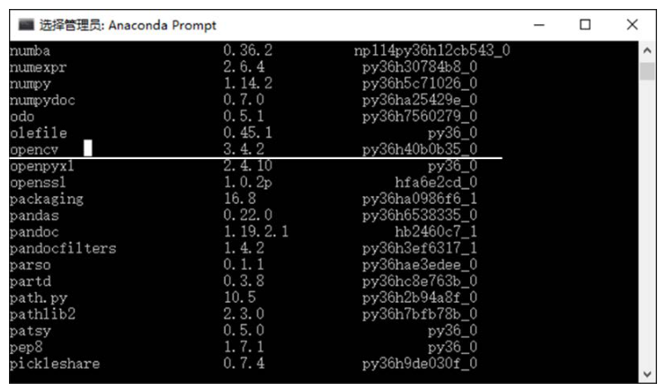
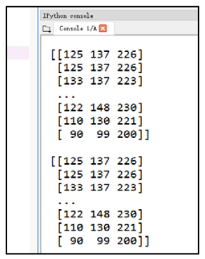
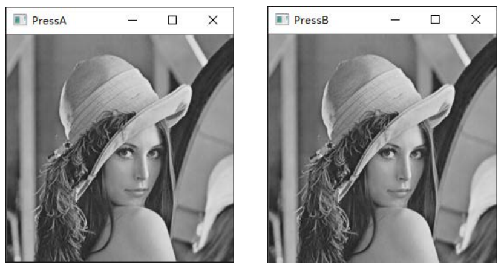

# 第 1 章 OpenCV 入门

> **本章解决**：OpenCV 是什么、凭什么用它——开源计算机视觉库的定位与历史（章首）；环境怎么配（1.1）；以及图像处理最基本的三件事：读取、显示、保存（1.2）。
> **承上启下**：本章打通"读 → 显 → 存"的最小闭环，从此图像在 Python 里就是一个 numpy 数组——第 2 章起的像素处理、通道、ROI……全部围绕这个数组展开；1.3 节的贡献库则埋了个伏笔，第 23 章人脸识别用到的 face 模块就来自那里。

OpenCV 是一个开源的计算机视觉库，1999 年由英特尔的 Gary Bradski 启动。Bradski 访学时注意到，很多优秀大学的实验室里都有一套完备的内部视觉接口，从一届学生传给另一届学生——新人直接用接口，比重复造轮子方便得多。OpenCV 正是基于"**为计算机视觉提供通用接口**"这个目标策划的。

为什么是英特尔（硬件厂商）而非软件厂商来开发它？因为要用视觉库，用户就得买更快的 CPU——这无疑会提升英特尔的销量。如今 OpenCV 已开源并由基金会支持，研究主力早已不限于英特尔，全球用户都在为它做贡献。

| 关键词 | 事实 |
| --- | --- |
| 出生 | 1999 年，英特尔，Gary Bradski 发起 |
| 底层 | C / C++ 编写，可在多种操作系统上运行 |
| 规模 | 覆盖计算机视觉各领域的 500 多个函数 |
| 心法 | **当黑盒用**：像用 PhotoShop——专注图像处理本身，不抠算法实现细节 |
| Python 接口 | `import cv2`（改善版 API，面向对象；区别于旧版面向过程的 cv 模块，见 §1.2.1 侧栏） |

图像处理的最小流程只有四步，本章就把这条链完整走通：


!!! note "运行环境约定"
    本章所有代码引用本目录根下的素材（`picture1.jpg` 等），路径写作相对路径 `picture1.jpg`。**运行时工作目录需为 数字图像处理-python 根目录**，否则 `imread` 读不到图（详见 §1.2.2 的 (-215) 错误与"坑与陷阱"第 2 条）。拿不准时先 `print(os.getcwd())` 确认。

## 1.0 本章导图

<div class="brtree">
  <div class="brrow">
    <span class="brlabel root">OpenCV 入门</span>
    <span class="brace"></span>
    <div class="brkids">
      <div class="brrow">
        <span class="brlabel">OpenCV 是什么</span>
        <span class="brace"></span>
        <div class="brkids">
          <span class="brleaf">1999 年 Intel 发起，Gary Bradski</span>
          <span class="brleaf">C/C++ 编写 · 500 多个函数 · 跨平台</span>
          <span class="brleaf">黑盒思维：像 PhotoShop，拿来就用</span>
        </div>
      </div>
      <div class="brrow">
        <span class="brlabel">环境配置</span>
        <span class="brace"></span>
        <div class="brkids">
          <span class="brleaf">Python 3 + Anaconda</span>
          <span class="brleaf">pip install opencv-python</span>
          <span class="brleaf">conda list / cv2.__version__ 验证</span>
        </div>
      </div>
      <div class="brrow">
        <span class="brlabel">基本流程四步</span>
        <span class="brace"></span>
        <div class="brkids">
          <span class="brleaf">读取 imread 返回 ndarray</span>
          <span class="brleaf">处理（第 2 章起各章的主体）</span>
          <span class="brleaf">显示 imshow + waitKey</span>
          <span class="brleaf">保存 imwrite</span>
        </div>
      </div>
      <div class="brrow">
        <span class="brlabel">读取 imread</span>
        <span class="brace"></span>
        <div class="brkids">
          <span class="brleaf">flags：-1 原格式 / 0 灰度 / 1 默认 BGR</span>
          <span class="brleaf">读不到只返回 None，不报错</span>
          <span class="brleaf">相对路径按当前工作目录解析</span>
        </div>
      </div>
      <div class="brrow">
        <span class="brlabel">显示 imshow + waitKey</span>
        <span class="brace"></span>
        <div class="brkids">
          <span class="brleaf">窗口不存在时 imshow 自动创建</span>
          <span class="brleaf">waitKey：暂停程序 + 驱动窗口事件</span>
          <span class="brleaf">ord 比较按键，做键盘交互</span>
          <span class="brleaf">destroyAllWindows 收尾销毁</span>
        </div>
      </div>
      <div class="brrow">
        <span class="brlabel">保存 imwrite</span>
        <span class="brace"></span>
        <div class="brkids">
          <span class="brleaf">扩展名决定编码格式</span>
          <span class="brleaf">成功 True / 失败 False</span>
        </div>
      </div>
      <div class="brrow">
        <span class="brlabel">主库与贡献库</span>
        <span class="brace"></span>
        <div class="brkids">
          <span class="brleaf">主库：成熟稳定，核心团队维护</span>
          <span class="brleaf">contrib：dnn / face / tracking / ximgpro</span>
          <span class="brleaf">含专利算法，注意许可</span>
        </div>
      </div>
    </div>
  </div>
</div>

## 1.1 如何使用：Python、Anaconda 与 OpenCV 的安装

书里选 **Anaconda** 作为开发环境，配置分三步：装 Python 3 → 装 Anaconda → 装 OpenCV。前两步去官网（python.org、anaconda.com）按"操作系统 + 处理器位数"选对应安装包即可；OpenCV 有两种装法：

- **官方途径**：从 OpenCV 官网下载安装包，编译后使用——折腾；
- **PyPI 预编译包（书的选择，也是如今的标准做法）**：直接 `pip install`，一行搞定。

```text
pip install opencv-python           # 只装主库（本书大部分章节够用）
pip install opencv-contrib-python   # 主库 + 贡献库（1.3 节），二选一即可
```

装完验证：Anaconda Prompt 里 `conda list` 能看到 opencv 及版本号，就说明安装成功；更直接的办法是让 Python 亲口报版本：


*图 1-1 包列表（截自原书）*

```python
# ===== 1.1 验证安装：能 import、能报版本，就说明装好了 =====
import cv2
print(cv2.__version__)   # 例如 4.10.0；报 ModuleNotFoundError 才是没装上
```

!!! note "两个小提醒"
    1. **模块名是 `cv2`，不是 `opencv`**：`import opencv` 会直接报错。cv2 这个名字不代表"OpenCV 2 专用"，它指引入了改善 API 的模块（面向对象）；旧版 cv 模块面向过程，早已不用。
    2. `opencv-python` 与 `opencv-contrib-python` **不要同时装进同一个环境**——两个包会互相覆盖文件，官方 FAQ 明确建议二选一。

## 1.2 图像处理基本操作

在图像处理过程中，**读取图像、显示图像、保存图像**是最基本的操作。本节把这三件事逐一讲清，中间的"处理"环节本章先用"读取时转灰度"客串一下——第 2 章开始，处理才是每章的主体。

### 1.2.1 读取图像：cv2.imread()

函数 `cv2.imread()` 用来读取图像，支持各种常见静态图像格式，语法格式为：

```text
retval = cv2.imread( filename[, flags] )
```

- **retval**：返回值，即读取到的图像。**如果未读取到图像，返回 None——不报错**；
- **filename**：要读取的图像的完整文件名（路径名 + 文件名）；
- **flags**：读取标记，控制读取文件的类型。第一列参数与第三列数值等价，写哪个都行。

| flags 参数 | 含义 | 数值 |
| --- | --- | --- |
| `cv2.IMREAD_UNCHANGED` | 保持原格式不变 | −1 |
| `cv2.IMREAD_GRAYSCALE` | 转换为单通道灰度图像 | 0 |
| `cv2.IMREAD_COLOR`（默认值） | 转换为 3 通道 BGR 图像 | 1 |
| `cv2.IMREAD_ANYDEPTH` | 16/32 位深度图返回对应深度，否则转 8 位 | 2 |
| `cv2.IMREAD_ANYCOLOR` | 以任何可能的颜色格式读取 | 4 |
| `cv2.IMREAD_LOAD_GDAL` | 使用 gdal 驱动程序加载图像 | 8 |
| `cv2.IMREAD_REDUCED_GRAYSCALE_2 / 4 / 8` | 单通道灰度，尺寸缩至 1/2、1/4、1/8 | — |
| `cv2.IMREAD_REDUCED_COLOR_2 / 4 / 8` | 3 通道 BGR 彩色，尺寸缩至 1/2、1/4、1/8 | — |
| `cv2.IMREAD_IGNORE_ORIENTATION` | 不以 EXIF 方向标记旋转图像 | — |

支持的格式很全：Windows 位图（\*.bmp、\*.dib）、JPEG（\*.jpeg、\*.jpg、\*.jpe）、JPEG 2000（\*.jp2）、PNG（\*.png）、WebP（\*.webp）、便携式图像格式（\*.pbm、\*.pgm、\*.ppm 等）、TIFF（\*.tiff、\*.tif）、OpenEXR（\*.exr）、HDR（\*.hdr、\*.pic），还能通过 GDAL 读地理空间栅格/矢量数据。

【例 1.1】读取图像并打印。读取结果就是一个 numpy 数组，`print(img)` 会刷出满屏像素值——更实用的习惯是先看 `shape`（高、宽、通道）：

```python
# ===== 1.2.1 例 1.1：读取图像 =====
import cv2

img = cv2.imread("picture1.jpg")    # 默认 flags=1：3 通道 BGR 彩色图
print(type(img))                    # <class 'numpy.ndarray'>：图像就是数组
print(img.shape)                    # (1080, 1920, 3)：高 1080、宽 1920、3 通道 BGR
# print(img)                        # 能打印，但满屏数字没法看——先看 shape

# 读不到不报错、只返回 None，务必养成检查习惯：
if img is None:
    print("读取失败：检查文件名与当前工作目录")
```


*图 1-2 图像部分像素值（截自原书）*

flags 换着用，同一张图能读出不同形态（彩色 3 通道、灰度 2 维无通道维）：

```python
# ===== 1.2.1 flags：同一张图，三种读法 =====
import cv2

img_u = cv2.imread("picture1.jpg", -1)                     # −1：保持原格式
img_g = cv2.imread("picture1.jpg", cv2.IMREAD_GRAYSCALE)   # 0：单通道灰度
img_c = cv2.imread("picture1.jpg", cv2.IMREAD_COLOR)       # 1：3 通道 BGR（默认）

print(img_u.shape)   # (1080, 1920, 3)
print(img_g.shape)   # (1080, 1920)      ← 灰度图没有第 3 维
print(img_c.shape)   # (1080, 1920, 3)
```

!!! note "侧栏：cv2 与 cv"
    大多数常用 OpenCV 函数都在 `cv2` 模块内；与之对应的 `cv` 模块代表传统版本。**cv2 并不是"专门针对 OpenCV 2"**，而是指该模块引入了一套改善的 API：cv2 内部采用面向对象的编程方式，cv 模块则更多面向过程。本书全部使用 cv2 模块函数，为了醒目，函数名前面都带 `cv2.` 前缀（但标题中的函数名不带）。

### 1.2.2 显示图像：imshow、waitKey 与窗口管理

显示相关的函数有五个：`namedWindow`（建窗）、`imshow`（显示）、`waitKey`（等待按键）、`destroyWindow`（销毁指定窗口）、`destroyAllWindows`（销毁所有窗口）。

**namedWindow 与 imshow**。`namedWindow` 用来创建指定名称的窗口；`imshow` 在指定窗口内显示图像：

```text
None = cv2.namedWindow( winname )        # winname：要创建的窗口名称
None = cv2.imshow( winname, mat )        # winname：窗口名称；mat：要显示的图像
```

【例 1.2】可以先 `namedWindow` 建窗、再 `imshow` 引用它：

```python
# ===== 1.2.2 例 1.2：先建窗再显示 =====
import cv2

img = cv2.imread("picture1.jpg")
cv2.namedWindow("lesson")       # 创建名为 lesson 的窗口
cv2.imshow("lesson", img)       # 在 lesson 窗口内显示图像
cv2.waitKey(0)                  # 等待按键（见下文，没有它窗口画不出来）
cv2.destroyAllWindows()         # 按键后销毁窗口，程序干净收尾
```


*图 1-3 【例 1.2】程序的运行结果（截自原书）*

实际使用中**通常省略 namedWindow**：直接让 `imshow` 引用一个不存在的窗口，它会自动完成两步——创建指定名称的新窗口，再把图像显示进去：

```python
# ===== 1.2.2 省事写法：imshow 自动建窗 =====
import cv2

img = cv2.imread("picture1.jpg")
cv2.imshow("demo", img)    # demo 窗口不存在：imshow 先创建它，再显示图像
cv2.waitKey(0)
cv2.destroyAllWindows()
```

!!! warning "高频报错：(-215:Assertion failed)"
    显示图像时初学者最常遇到：

    ```text
    error: (-215:Assertion failed) size.width>0 && size.height>0 in function 'cv::imshow'
    ```

    它说明**当前要显示的图像是空的（None）**——根源几乎总在读取环节：要么文件名写错，要么**工作路径配置错误**。注意相对路径是按"当前工作目录"解析的：程序放在 `E:\lesson`、想读 `image\lena.bmp`，若当前工作目录是 `E:\lesson`，实际读取 `E:\lesson\image\lena.bmp`（正确）；若工作目录是 `E:\python`，实际读取的却是 `E:\python\image\lena.bmp`（不存在）。防御方法就是例 1.1 里的 `if img is None` 检查。

**waitKey：显示图像离不开的搭档**。函数 `cv2.waitKey()` 用来等待按键，语法格式为：

```text
retval = cv2.waitKey( [delay] )
```

- **retval**：返回值。没有按键被按下时返回 −1；有按键被按下时返回该按键的 ASCII 码；
- **delay**：等待键盘触发的时间，**单位是 ms**。负数或 0 表示无限等待，默认为 0。

!!! note "为什么需要 waitKey：两个角度理解"
    **书上角度——暂停程序**：程序运行到 `waitKey` 会按 delay 设定等待。delay=0 时一直等，直到有按键事件才执行后续语句；delay 为正数时等指定毫秒数，期间有按键就提前继续，到点没等到也继续往下走。没有这一暂停，`imshow` 之后程序立刻往下跑、跑完就退出——窗口连存在的时间都没有。

    **底层角度——GUI 事件泵**：`imshow` 只是向窗口提交"绘制图像"的请求，OpenCV 自带的简易图形界面组件（HighGUI）里的绘制与键盘/鼠标事件，要靠 `waitKey` 这类函数去处理才真正生效。缺了它，窗口表现为**一闪而过、一片灰白，甚至标题栏写着"未响应"**。所以"imshow + waitKey + destroyAllWindows"是固定三件套。

    **附赠用途**：返回的 ASCII 码可用于键盘交互（例 1.3）；视频循环里 `waitKey(30)` 既控制每帧间隔 30 ms、又监听退出键——第 18 章视频处理会再见到它。

【例 1.3】用按键做交互。判断是否按下了某个特定键时，用 Python 的 `ord()` 取字符的 ASCII 码值再与返回值比较，程序里就不用直接出现 ASCII 数字了：

```python
# ===== 1.2.2 例 1.3：waitKey 返回 ASCII 码，做键盘交互 =====
import cv2

img = cv2.imread("picture1.jpg")
cv2.imshow("demo", img)
key = cv2.waitKey()              # 默认 0：无限等待，按下的键返回其 ASCII 码
if key == ord('A'):              # ord('A') = 65：不查 ASCII 表也能写分支
    cv2.imshow("PressA", img)    # 按 A：新开窗口 PressA
elif key == ord('B'):
    cv2.imshow("PressB", img)    # 按 B：新开窗口 PressB
# 原书示例到此为止；不加下面两行，新窗口会随脚本结束一闪而过：
cv2.waitKey()
cv2.destroyAllWindows()
```


*图 1-4 【例 1.3】程序的运行结果（截自原书）*

【例 1.4】从"暂停"的角度用 waitKey——按任意键后程序才继续：

```python
# ===== 1.2.2 例 1.4：waitKey 充当暂停键 =====
import cv2

img = cv2.imread("picture1.jpg")
cv2.imshow("demo", img)
key = cv2.waitKey()       # 未按键：程序停在这一行；按键：往下执行
if key != -1:             # 有按键时返回值不是 -1
    print("触发了按键")
```

**destroyWindow 与 destroyAllWindows**。前者释放指定名称的窗口，后者释放所有窗口；通常与 `waitKey` 组合，在按键后统一收尾：

```text
None = cv2.destroyWindow( winname )     # 销毁指定名称的窗口
None = cv2.destroyAllWindows( )         # 销毁所有窗口
```

【例 1.5 / 1.6】两个窗口显示同一幅图，按键后统一销毁：

```python
# ===== 1.2.2 例 1.5 / 1.6：销毁窗口 =====
import cv2

img = cv2.imread("picture1.jpg")
cv2.imshow("demo1", img)
cv2.imshow("demo2", img)          # 两个窗口显示同一幅图
cv2.waitKey()                     # 等待按键
cv2.destroyWindow("demo1")        # 只销毁 demo1
# cv2.destroyAllWindows()         # 或一键销毁全部（更常用，见例 1.2/1.3）
```

本章起反复用到"显示一幅图、按键后销毁"，封装成一个小函数，后面各章直接复用：

```python
# ===== 1.2.2 封装：cv_show（跟随代码同款）=====
import cv2

def cv_show(name, img):
    """显示一幅图：按任意键后销毁窗口再返回。"""
    cv2.imshow(name, img)
    cv2.waitKey(0)
    cv2.destroyAllWindows()
```

### 1.2.3 保存图像：cv2.imwrite()

函数 `cv2.imwrite()` 用来保存图像，语法格式为：

```text
retval = cv2.imwrite( filename, img[, params] )
```

- **retval**：返回值。保存成功返回 True，失败返回 False；
- **filename**：目标文件的完整路径名，**包含文件扩展名**（扩展名决定按什么格式编码保存）；
- **img**：被保存图像的名称；
- **params**：保存类型参数，可选。

【例 1.7】把"读 → 显 → 存"串成一个完整闭环，再用 flags=0 演示灰度链：读取时转灰度、显示、另存为新文件：

```python
# ===== 1.2.3 例 1.7 + 灰度链：读 → 显 → 存 完整闭环 =====
import cv2

# ① 读取（工作目录：数字图像处理-python 根目录）
img = cv2.imread("picture1.jpg")

# ② 显示：imshow + waitKey + destroyAllWindows 三件套
cv2.imshow("Image", img)
cv2.waitKey(0)
cv2.destroyAllWindows()

# ③ 保存：扩展名 .jpg 决定按 JPEG 编码，成功返回 True
r = cv2.imwrite("result.jpg", img)
print(r)                                             # True

# 灰度版：读取时直接转灰度（flags=0）→ 显示 → 另存
img_gray = cv2.imread("picture1.jpg", cv2.IMREAD_GRAYSCALE)
cv2.imshow("Gray Image", img_gray)
cv2.waitKey(0)
cv2.destroyAllWindows()
cv2.imwrite("picture1_gray.jpg", img_gray)           # 生成 picture1_gray.jpg
```

## 1.3 OpenCV 贡献库

目前 OpenCV 库包含两部分：

- **OpenCV 主库**：即通常安装的 OpenCV，成熟稳定，由核心的 OpenCV 团队维护；
- **OpenCV 贡献库（opencv_contrib）**：主要由社区开发和维护，包含的视觉应用比主库更全面。注意其中包含**非 OpenCV 许可的部分与受专利保护的算法**，使用前要特别留意许可问题。

贡献库模块很多，常见的有：

| 模块 | 功能 |
| --- | --- |
| bioinspired | 生物视觉模块 |
| datasets | 数据集读取模块 |
| dnn | 深度神经网络模块 |
| face | 人脸识别模块（第 23 章的 LBPH / EigenFaces / Fisherfaces 就来自它） |
| matlab | MATLAB 接口模块 |
| stereo | 双目立体匹配模块 |
| text | 视觉文本匹配模块 |
| tracking | 基于视觉的目标跟踪模块 |
| ximgpro | 图像处理扩展模块 |
| xobjdetect | 增强 2D 目标检测模块 |
| xphoto | 计算摄影扩展模块 |

使用贡献库有两种方式：

- 下载 OpenCV 贡献库源码，用 cmake 手动编译；
- `pip install opencv-contrib-python` 直接安装编译好的贡献库（其 PyPI 页面提供持续更新的 FAQ）。

!!! note "怎么选"
    只用主库装 `opencv-python`；想一步到位（或后续要用 face/tracking/dnn 等扩展）就直接装 `opencv-contrib-python`——它包含主库的全部内容，**不要两个都装**（同一环境会互相覆盖，见 §1.1 的提醒）。

## 坑与陷阱

!!! danger "8 个容易踩的坑"
    1. **imread 失败不报错**：只默默返回 None，等 `imshow` 时才炸出 `error: (-215:Assertion failed) size.width>0 && size.height>0`。读完立刻 `if img is None` 检查，错误当场现形而不是拖到显示环节。
    2. **相对路径 ≠ 相对脚本文件**：`imread("picture1.jpg")` 按**当前工作目录**解析——VSCode 默认工作区根、PyCharm 默认项目根、Jupyter 默认启动目录，都可能不是素材所在处。运行前确认工作目录为 数字图像处理-python 根目录，或用 `os.getcwd()` 现场验证。
    3. **忘写 waitKey**：imshow 只提交绘制请求，waitKey 才真正驱动窗口事件——漏掉它，窗口一闪而过、灰白一片甚至"未响应"。
    4. **waitKey 的单位是毫秒**：`waitKey(1)` 只等 1 毫秒，不是"无限等待"；0 或负数才是无限等（默认值就是 0，所以平时 `cv2.waitKey()` 什么都不传即可）。
    5. **中文路径静默失败**：Windows 下 imread/imwrite 遇到中文路径可能直接返回 None/False（OpenCV 不走 Python 的文件接口）。素材与保存路径尽量全英文；第 2 章学了 numpy 后，也可用 `np.fromfile` + `cv2.imdecode`、`cv2.imencode` + `tofile` 中转绕过。
    6. **通道顺序是 BGR 不是 RGB**：把 imread 的结果直接喂给 matplotlib 的 `imshow` 会红蓝颠倒（第 13 章会大量混用两个库）。转换用 `cv2.cvtColor(img, cv2.COLOR_BGR2RGB)`（第 4 章详讲）。
    7. **PNG 的透明通道默认被丢掉**：flags 默认 1（IMREAD_COLOR）会强转 3 通道 BGR，带 alpha 的图要 `flags=-1`（IMREAD_UNCHANGED）才能保住第 4 通道。
    8. **窗口残留**：脚本结束前不 `destroyAllWindows`，Jupyter 里反复运行会堆出成排"未响应"窗口；`imshow → waitKey → destroyAllWindows` 三件套要练成肌肉记忆（或直接用 cv_show）。

## 速览

1. OpenCV：开源计算机视觉库，1999 年英特尔 Gary Bradski 发起；C/C++ 编写、500 多个函数、跨平台；当"黑盒/PhotoShop"用，专注应用不抠算法细节。
2. 环境三步：Python 3 → Anaconda → `pip install opencv-python`（或 `opencv-contrib-python`，二选一）；`conda list` 或 `cv2.__version__` 验证。
3. 图像处理基本流程四步：**读取 imread → 处理 → 显示 imshow+waitKey → 保存 imwrite**；本章走通全链，处理环节从第 2 章开始展开。
4. `cv2.imread(filename[, flags])`：成功返回 ndarray（BGR 顺序），失败返回 None 不报错；flags：−1 原格式（含 alpha）、0 灰度、1 默认 3 通道 BGR；还有 ANYDEPTH/ANYCOLOR/REDUCED_* 等一族。
5. 图像即 numpy 数组：`shape` = (高, 宽, 通道)；灰度图没有第 3 维。`print(img)` 满屏像素值，先看 shape 更实用。
6. `cv2.imshow(winname, mat)`：窗口不存在时自动"建窗 + 显示"两步完成；`namedWindow` 可显式提前建窗。
7. `cv2.waitKey([delay])`：delay 单位 ms，默认 0 = 无限等待；返回按键 ASCII 码、无按键 −1。它既是暂停键，又是 GUI 事件泵——没有它窗口画不出来；视频循环里兼作帧间隔控制（第 18 章）。
8. 交互判断按键：`key == ord('A')`，`ord()` 把字符转 ASCII 码，免查表。
9. 窗口管理：`cv2.destroyWindow("名")` 销毁指定窗口，`cv2.destroyAllWindows()` 销毁全部；显示三件套 `imshow → waitKey → destroyAllWindows` 是固定收尾。
10. `cv2.imwrite(filename, img[, params])`：按扩展名编码保存，成功 True、失败 False；OpenCV 分主库与 opencv_contrib 贡献库（dnn、face、tracking、ximgpro……），贡献库含专利算法需注意许可。

## 术语速查

| 英文 / 函数 | 中文 | 一句话 |
| --- | --- | --- |
| cv2 | —— | OpenCV 的 Python 模块名：改善版 API、面向对象（旧 cv 模块面向过程） |
| retval | 返回值 | 书中函数语法格式里指返回值（图像 / True/False / ASCII 码） |
| imread / imshow / imwrite | 读取 / 显示 / 保存 | 图像处理基本操作三件套 |
| flags | 读取标记 | imread 的读取方式：−1 原格式 / 0 灰度 / 1 默认 BGR |
| IMREAD_UNCHANGED / GRAYSCALE / COLOR | 保持原格式 / 灰度 / 彩色 | 最常用的三个 flags（−1 / 0 / 1） |
| ndarray | 多维数组 | imread 的返回值类型，图像在 Python 里的形态 |
| shape | 形状 | (高, 宽, 通道)；灰度图只有 (高, 宽) |
| BGR | 蓝-绿-红通道顺序 | OpenCV 默认色彩顺序，与 matplotlib 的 RGB 相反 |
| namedWindow | 创建窗口 | 显式建指定名称的窗口；imshow 引用不存在的窗口会自动创建 |
| waitKey | 等待按键 | delay 单位 ms、默认 0 无限等待；返回 ASCII 码，无按键返回 −1 |
| HighGUI | 图形界面组件 | OpenCV 自带的简易窗口组件，imshow/waitKey 所属（拓展名） |
| ord() | 字符转 ASCII 码 | `key == ord('A')` 判断按键，避免直接写 ASCII 数字 |
| destroyWindow / destroyAllWindows | 销毁指定 / 所有窗口 | 释放窗口资源，程序收尾标配 |
| params | 保存类型参数 | imwrite 的可选参数 |
| opencv_contrib | 贡献库 | 社区维护的扩展模块集合，含非 OpenCV 许可与专利算法 |
| dnn | 深度神经网络模块 | 贡献库中做深度学习推理的模块 |
| face / tracking / ximgpro / xphoto | 人脸识别 / 目标跟踪 / 图像处理扩展 / 计算摄影 | 常用贡献库模块（face 在第 23 章登场） |

<p class="pdf-note"><a href="第01章_OpenCV入门_跟随代码.ipynb">配套跟随代码 · 第01章（ipynb）</a></p>
